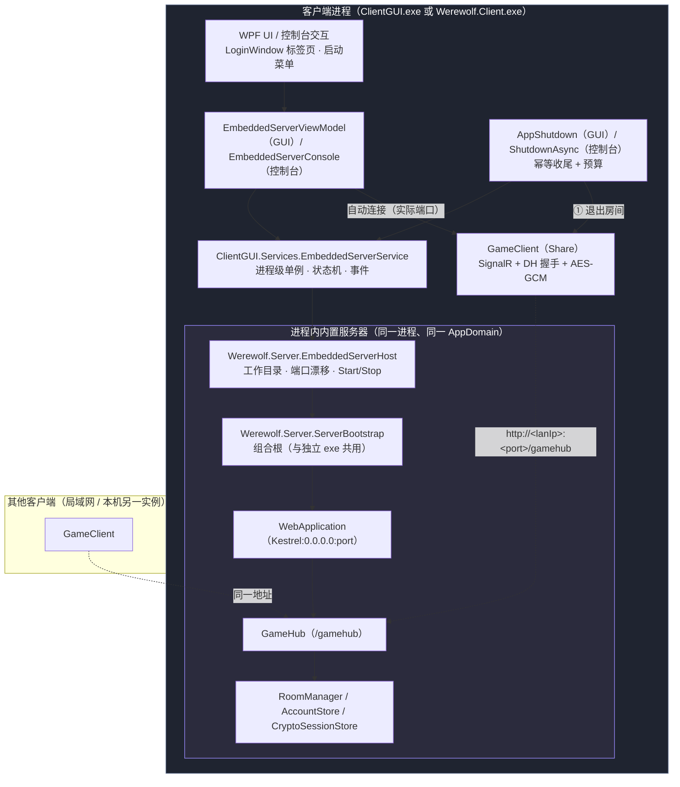
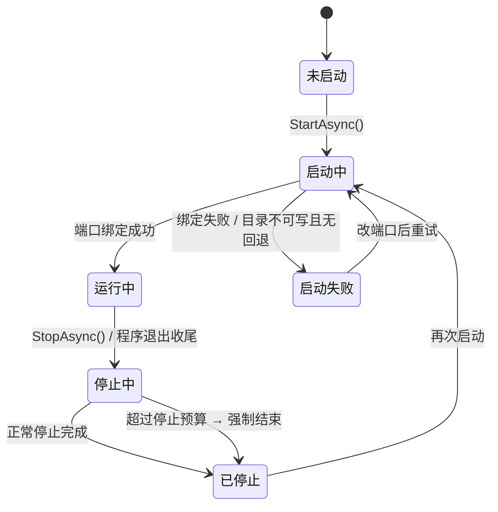
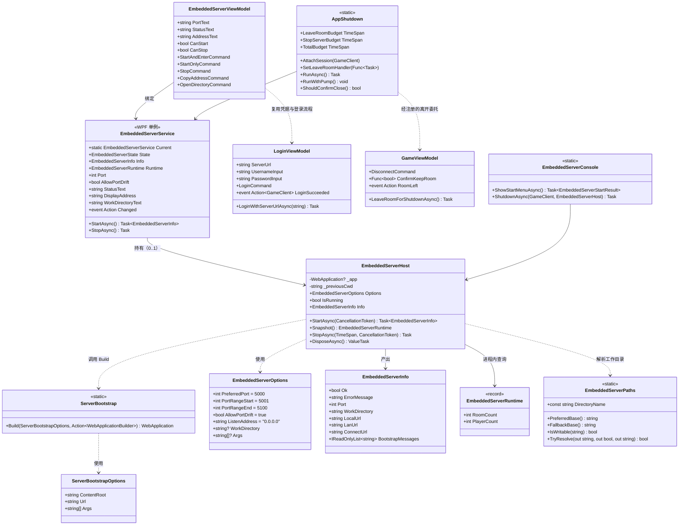
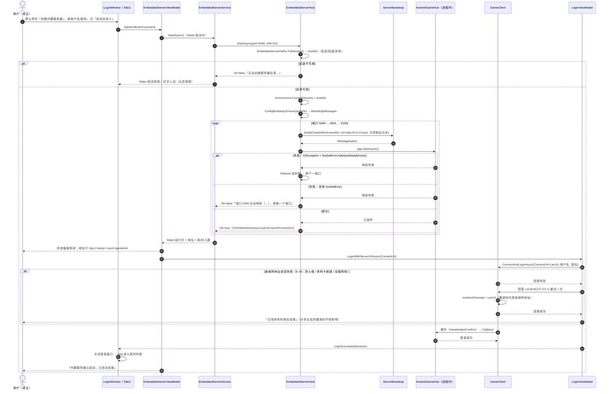
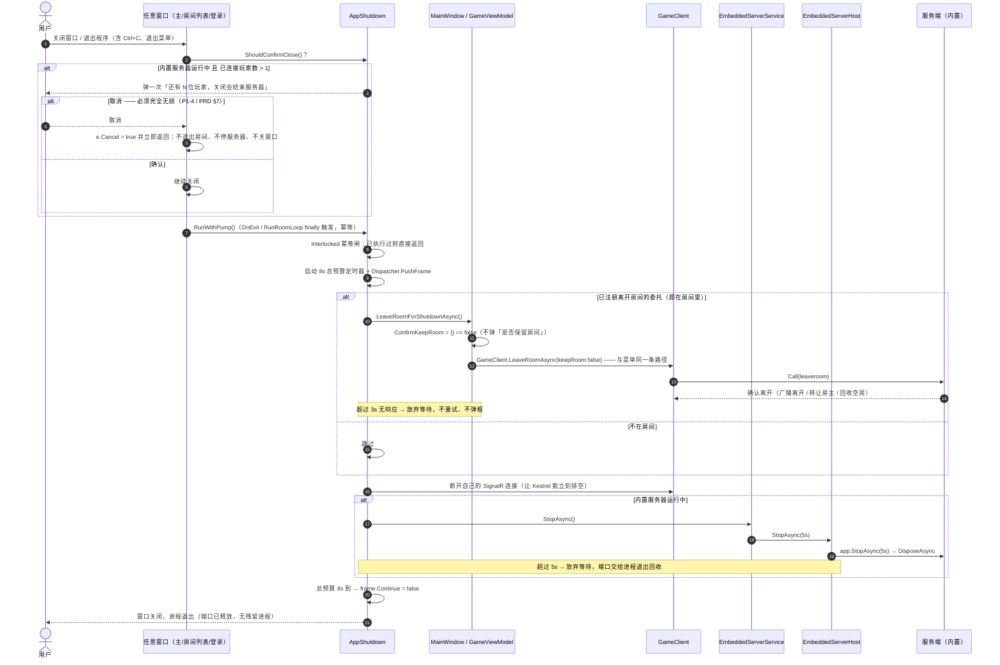
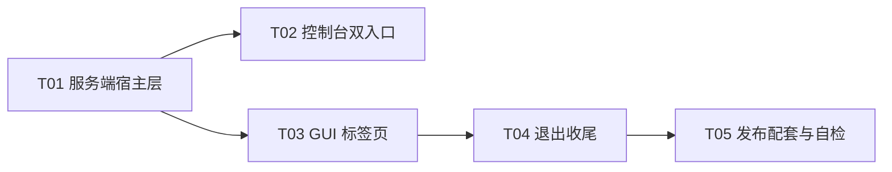

# 架构设计：内置服务器（进程内宿主）改造（Werewolf.Server）

> 类型：**增量架构设计**（只描述本次变更）
> 作者：架构师 高见远　版本：**v1.1（已对齐 PRD v1.1）**　状态：待评审
> 上游输入：`docs/embedded-server/PRD.md`（PM 许清楚，**v1.1**）+ 用户裁定（见 §10）
>
> **v1.1 变更**：吸收 PM 对 4 处口径的确认与新增边界 **E-16（主机部分同源）/ E-18（局域网自连失败回落）/ E-19（客户端目录洁净）/ E-20（控制台人话状态）**，并把「二次确认被取消必须完全无损」写进收尾设计。涉及 D2、D4、D7、文件清单、时序图、任务验收与共享知识。
> 代码基线：`WerewolfGame.sln` @ `2.3.3`，`dotnet build` **0 警告 0 错误**，测试宿主默认 **1220** 项 / `--ui` **64** 项

---

## 1. 设计目标与范围边界

### 1.1 目标（一句话）

把「服务端从独立 exe」变成「客户端进程里可拉起、可停止、工作目录隔离的一个宿主对象」，GUI 与控制台两端入口与收尾行为一致，且**独立服务端 `dotnet Werewolf.Server.dll` 的行为与控制台输出逐行不变**。

### 1.2 本次做什么

| # | 事项 |
|---|---|
| 1 | 把服务端组合根从 `Program.cs` 抽成可复用的 `ServerBootstrap.Build(...)`，独立 exe 与进程内宿主共用同一份 DI / 中间件 / 游戏发现 |
| 2 | 新增 `Werewolf.Server.EmbeddedServerHost`：工作目录隔离、端口绑定与漂移、启停、进程内运行信息、人话失败原因 |
| 3 | `ClientGUI` 与 `Werewolf.Client` 引用服务端程序集，各自提供「创建内置服务器 / 连接现有服务器」双入口 |
| 4 | `LoginWindow.xaml` 重写为两个标签页（默认停「创建内置服务器」） |
| 5 | 程序退出统一收尾（幂等 + 总预算 8s）：在房间里 → 走正规「退出房间」→ 停内置服务器 → 释放连接 |
| 6 | 版本 `2.3.3 → 2.4.0` + 大白话变更日志；新增 `--embedded` 端到端自检探针 |

### 1.3 本次不做什么（边界）

- **不改协议**：不新增 SignalR 方法、不改 `Call` 契约、不改 `Ops`、不改任何 DTO。`Werewolf.Client.Share` **仅**因 E-18 增加一个可选属性 `GameClient.InviteUrlOverride`（默认 `null` → 现状行为逐字节不变；详见 D7）。
- **游戏模块零改动**：狼人杀 / 谁是卧底一行不改；**平台层不为任何具体游戏开后门**（词库路径不写特殊分支，见 §4.3）。
- 不做安装包 / Windows 服务 / Docker / 托盘常驻 / 开机自启。
- 不做防火墙规则自动添加（仅在文案里提示）。
- 不做滚动日志区（裁定 Q5，维持 P1 不做）；GUI 只显示**运行状态 + 启动失败原因**。
- 不做端口映射 / 内网穿透引导。
- 不迁移既有账号数据。

---

## 2. 总体方案

### 2.1 一句话结构

> **组合根下沉到服务端程序集，客户端只调 `EmbeddedServerHost`；客户端一律不直接碰 ASP.NET Core API。**

### 2.2 组件图



**要点**：内置服务器是进程内的一个 `WebApplication`，与 UI 共享进程；客户端自己连它也走**同一条 SignalR 通道**（只是地址指向本机），因此「内置服务器」与「外部服务器」在 `GameClient` 眼里完全无差别 —— 这是「功能等价」的结构性保证。

### 2.3 状态机（沿用 PRD §6，补充实现约束）



实现约束：
- 状态单一来源 = `EmbeddedServerService.State`（GUI）/ `EmbeddedServerHost.IsRunning`（底座）；界面按钮可用性由状态推导，不得各控件自行判断。
- 「连接现有服务器」标签页在**任何状态**下都可用（PRD §6 补充规则）。

---

## 3. 七个关键技术决策（逐条：结论 + 理由 + 取舍掉的备选）

### D1｜如何复用组合根 —— 抽 `ServerBootstrap.Build(...)`，`Program.cs` 退化为「打印 + Run」

**结论**：新增 `WerewolfGame/ServerBootstrap.cs`，把 `Program.cs` 里 `CreateBuilder → 注册 → Build → 中间件` 整段搬进去，**不含任何 `Console.WriteLine`、不含端口决策、不含工作目录决策**；`Program.cs` 只负责「配置自愈提示 → `ServerBootstrap.Build(...)` → 打印原有 5 行 → `app.Run()`」。

```csharp
// WerewolfGame/ServerBootstrap.cs（新）
namespace Werewolf.Server;

public sealed class ServerBootstrapOptions
{
    /// <summary>内容根与工作目录（独立服务端传当前目录；内置服务器传 embedded-server 目录）。</summary>
    public required string ContentRoot { get; init; }

    /// <summary>监听地址（如 "http://0.0.0.0:5000"）。</summary>
    public required string Url { get; init; }

    /// <summary>命令行参数（等价现有 WebApplication.CreateBuilder(args)）。</summary>
    public string[]? Args { get; init; }
}

public static class ServerBootstrap
{
    /// <summary>
    /// 唯一的组合根：注册全部服务、配置管道、映射终结点。
    /// 独立服务端与进程内内置服务器共用同一份，保证两者功能等价。
    /// </summary>
    /// <param name="configure">可选：宿主方对 builder 的额外配置（内置服务器用它关掉控制台日志）。</param>
    public static WebApplication Build(ServerBootstrapOptions options,
                                       Action<WebApplicationBuilder>? configure = null)
    {
        var builder = WebApplication.CreateBuilder(new WebApplicationOptions
        {
            Args = options.Args,
            ContentRootPath = options.ContentRoot
        });

        builder.Services.AddSignalR();
        builder.Services.AddSingleton(new AccountStore(Path.Combine(options.ContentRoot, "accounts.json")));
        builder.Services.AddSingleton<CryptoSessionStore>();
        builder.Services.AddSingleton<EncryptedChannel>();
        builder.Services.AddSingleton<IGameConfig>(new GameConfig(builder.Configuration));

        // 反射发现：与现状等价（同一程序集），去掉对顶层 Program 类的依赖。
        var catalog = new GameCatalog();
        catalog.RegisterAll(GameDiscovery.Discover(typeof(ServerBootstrap).Assembly));
        builder.Services.AddSingleton<IGameCatalog>(catalog);

        var roomOptions = builder.Configuration.GetSection("Room").Get<RoomOptions>() ?? new RoomOptions();
        builder.Services.AddSingleton(roomOptions);
        builder.Services.AddSingleton<RoomManager>();
        builder.Services.AddHostedService<RoomRecycleService>();

        builder.Services.AddCors(o => o.AddDefaultPolicy(
            p => p.AllowAnyOrigin().AllowAnyHeader().AllowAnyMethod()));

        configure?.Invoke(builder);

        builder.WebHost.UseUrls(options.Url);

        var app = builder.Build();
        app.UseCors();
        app.MapHub<GameHub>("/gamehub");
        app.MapGet("/", () => "🕹 Game platform server is running.");
        return app;
    }
}
```

改写后的 `WerewolfGame/Program.cs`（**输出逐行不变**）：

```csharp
using Werewolf.Server;
using Werewolf.Server.Games;

// 配置自愈：appsettings.json 缺失 / 损坏时自动生成默认配置并警告，保证服务器始终能起来。
// （必须在 CreateBuilder 之前：否则读配置时就会抛异常，或静默用内置缺省值。）
foreach (var line in ConfigBootstrap.Ensure())
    Console.WriteLine(line);

var app = ServerBootstrap.Build(new ServerBootstrapOptions
{
    ContentRoot = Directory.GetCurrentDirectory(),   // 与改造前一致：工作目录 = 当前目录
    Url = "http://0.0.0.0:5000",                     // 与改造前一致
    Args = args
});

var catalog = app.Services.GetRequiredService<IGameCatalog>();
var roomOptions = app.Services.GetRequiredService<RoomOptions>();

Console.WriteLine("多游戏房间服务端已启动：http://localhost:5000/gamehub");
Console.WriteLine("传输加密：PSK 认证 DH 握手 + AES-GCM 会话加密（应用层，未使用 TLS）");
Console.WriteLine($"可用游戏（{catalog.Available.Count}）：" +
                  string.Join("　", catalog.Available.Select(g => g.Label)));
Console.WriteLine($"多房间：上限 {roomOptions.MaxRooms} 个 · 空房宽限 {roomOptions.EmptyGraceSeconds} 秒 · " +
                  $"扫描间隔 {roomOptions.RecycleScanSeconds} 秒");
Console.WriteLine($"账号文件：{Path.GetFullPath("accounts.json")}");
app.Run();
```

**理由**：
- 组合根只有一份 → 内置服务器与独立服务端**结构上不可能**出现功能漂移（新增游戏无需改两处）。
- `AccountStore` 显式传绝对路径：独立服务端传 `CWD\accounts.json`，与现状**同一个文件**；内置服务器传 `embedded-server\accounts.json`。两边都不依赖 CWD 也能正确。

**取舍掉的备选**：
- ❌ 把 `Program.cs` 的 `Main` 改成可调用的 `public static Task RunAsync(string[] args)`：会引入「控制台输出要不要打印」的参数分支，且 `app.Run()` 会阻塞并接管 Ctrl+C，不适合进程内场景。
- ❌ 客户端自己照抄一份 DI 注册：必然与服务端漂移，直接否决。

---

### D2｜项目引用可行性 —— **可行，直接 `ProjectReference`，不需要 `FrameworkReference`**（已实测）

**实测结论（我在本机改 csproj 编译验证过，验证方式见 §3.8）**：

| 验证项 | 结果 |
|---|---|
| `ClientGUI`（`Microsoft.NET.Sdk` + WPF + `net8.0-windows`）→ `WerewolfGame`（`Microsoft.NET.Sdk.Web`） | ✅ 0 警告 0 错误 |
| `Werewolf.Client`（`Microsoft.NET.Sdk`，`net8.0`，Exe）→ `WerewolfGame` | ✅ 0 警告 0 错误 |
| 是否需要 `<FrameworkReference Include="Microsoft.AspNetCore.App" />` | **不需要**。ASP.NET Core 的 FrameworkReference 经 `ProjectReference` **自动传递**，实测 `ClientGUI.runtimeconfig.json` 自动多出 `Microsoft.AspNetCore.App 8.0.0` |
| Main 入口冲突 | **无冲突**。入口点是**按程序集**判定的；`Werewolf.Server.exe` 的入口在它自己程序集里，与 `ClientGUI` / `Werewolf.Client` 的入口互不影响。实测三项目均正常产出 exe |
| `ImplicitUsings` 差异 | ⚠️ **有差异**：客户端只有 `Microsoft.NET.Sdk` 的通用隐式 using，**没有** ASP.NET Core 的隐式 using。我实测踩过：客户端里写 `builder.WebHost.UseUrls(...)` 若不补 `using Microsoft.AspNetCore.Hosting;` 会报 CS1061。→ 因此本设计**禁止客户端直接触碰 ASP.NET Core API**，一律走 `EmbeddedServerHost` |
| 运行时可用性 | ✅ 实测在 net8.0 控制台进程内 `StartAsync()` 成功监听、`StopAsync(TimeSpan)` 成功停止 |

**最小改动**（两个客户端 csproj 各加一行）：

```xml
<ItemGroup>
  <ProjectReference Include="..\Werewolf.Client.Share\Werewolf.Client.Share.csproj" />
  <ProjectReference Include="..\WerewolfGame\Werewolf.Server.csproj" />   <!-- 新增 -->
</ItemGroup>
```

**已知副作用（实测）与处置**：服务端项目的**内容项与 exe 产物会流到客户端输出目录** ——
`appsettings.json`、`words.undercover.txt`、`Werewolf.Server.exe`、`.pdb`、`.deps.json`、`.runtimeconfig.json`、`.staticwebassets.endpoints.json`。
处置：客户端 csproj 加一个清理目标，把上面这些都删掉，**`Werewolf.Server.dll` 必须保留**。

```xml
<!-- 内置服务器：客户端只是宿主，不该在自己目录里出现服务端的可执行文件与其默认模板（E-19）。 -->
<Target Name="DropServerArtifacts" AfterTargets="Build;Publish">
  <ItemGroup>
    <_SrvArt Include="$(OutDir)Werewolf.Server.exe" />
    <_SrvArt Include="$(OutDir)Werewolf.Server.pdb" />
    <_SrvArt Include="$(OutDir)Werewolf.Server.deps.json" />
    <_SrvArt Include="$(OutDir)Werewolf.Server.runtimeconfig.json" />
    <_SrvArt Include="$(OutDir)Werewolf.Server.staticwebassets.endpoints.json" />
    <_SrvArt Include="$(OutDir)appsettings.json" />
    <_SrvArt Include="$(OutDir)words.undercover.txt" />
    <_SrvArt Include="$(PublishDir)Werewolf.Server.exe" />
    <_SrvArt Include="$(PublishDir)Werewolf.Server.pdb" />
    <_SrvArt Include="$(PublishDir)Werewolf.Server.deps.json" />
    <_SrvArt Include="$(PublishDir)Werewolf.Server.runtimeconfig.json" />
    <_SrvArt Include="$(PublishDir)Werewolf.Server.staticwebassets.endpoints.json" />
    <_SrvArt Include="$(PublishDir)appsettings.json" />
    <_SrvArt Include="$(PublishDir)words.undercover.txt" />
  </ItemGroup>
  <Delete Files="@(_SrvArt)" ContinueOnError="true" />
</Target>
```

**E-19 已实测可行、无副作用**（PM 说"若有代价可退让"，这里给出结论：**没有代价，按你的口径做**）：

| 验证 | 结果 |
|---|---|
| `dotnet build` 后 `bin\Debug\net8.0-windows\` | 只剩 `ClientGUI.*` + `Werewolf.Client.Share.dll` + `Werewolf.Server.dll` + 3 个 SignalR 客户端 dll；**无** `Werewolf.Server.exe`、`appsettings.json`、`words.undercover.txt` |
| `dotnet publish -o <dir>` 后发布目录 | 同上，**同样干净**（所以 target 必须同时挂 `Build` 与 `Publish`，并用 `$(PublishDir)` 补一遍） |
| `dotnet build --no-incremental` | **0 警告 0 错误**（顺带确认之前一次 MSB3101 只是我连续快速重建的状态文件锁，与本次改动无关） |

> 备注：`bin` 里那个 `accounts.json` **不是构建产物**，是早期有人把 CWD 设成 `bin` 跑过服务端留下的历史残留；采用 D3 的工作目录隔离后不会再产生。保险起见也可把它加进 `_SrvArt`（客户端从不读它）。

**取舍掉的备选**：
- ❌ **抽 `Werewolf.Server.Hosting` net8.0 类库承载组合根**：我实测建了这个中间层（类库 + 显式 `FrameworkReference` + P2P 服务端），**内容与 exe 产物仍然会经两层 P2P 流到客户端输出目录** —— 也就是说它**并不能解决**唯一的副作用，却要把 20 个服务端文件搬出 `WerewolfGame`，牵动 `words.undercover.txt` 的 `EmbeddedResource` 与 `UndercoverTests` 里"内嵌词库与源码目录一致"的既有断言。性价比为负，**否决**。
- ❌ `ExcludeAssets="Content"` 等 NuGet 元数据：那是 `PackageReference` 语义，对 P2P 无效。

---

### D3｜工作目录隔离 —— `ContentRootPath` + **显式切换进程 CWD**，不给任何游戏写分支

**实测关键事实**：`WebApplication.CreateBuilder(new WebApplicationOptions { ContentRootPath = workDir })` **不会**把 `Directory.GetCurrentDirectory()` 切到 `workDir`（我实测打印过：`ContentRoot` 变了，CWD 仍是进程启动目录）。

而服务端有两处依赖 CWD：
1. `AccountStore` 默认路径 `"accounts.json"`（本设计已改为显式绝对路径，见 D1）；
2. `UndercoverGameInstance.LoadWordBank()` 里 `Path.Combine(Directory.GetCurrentDirectory(), file)` —— **游戏模块，本次不许改**。

**结论**：
1. `EmbeddedServerPaths.Resolve()` 定目录：首选 `AppContext.BaseDirectory\embedded-server`；写探针失败 → `%LOCALAPPDATA%\Werewolf\embedded-server`；再失败 → 启动失败 + 人话"无法创建服务器目录"。
2. `ContentRootPath = workDir` + `ConfigBootstrap.Ensure(workDir)` → `appsettings.json` 落在工作目录。
3. `AccountStore` 显式传 `workDir\accounts.json`。
4. **启动前 `Environment.CurrentDirectory = workDir`** —— 这是让词库等所有"相对当前目录"的服务端代码落进工作目录的**唯一**不改游戏模块的办法；等价于"在那个目录里单独启动服务端 exe"，是平台级、游戏无关的。停止后尽力还原原 CWD。
5. 安全检查：客户端自身的状态文件 `UiStateStore.DefaultPath` 用的是**绝对路径** `%APPDATA%\WerewolfClient\ui-state.json`（我核对过），切 CWD 不影响它；WPF 资源用 `pack://` URI，也不受影响。

```csharp
public static class EmbeddedServerPaths
{
    public const string DirectoryName = "embedded-server";
    public const string FallbackCompany = "Werewolf";

    /// <summary>首选基目录：客户端程序目录（AppContext.BaseDirectory，即 exe 所在目录）。</summary>
    public static string PreferredBase() => AppContext.BaseDirectory;

    /// <summary>回退基目录：%LOCALAPPDATA%\Werewolf（程序目录只读如 Program Files 时使用）。</summary>
    public static string FallbackBase() => Path.Combine(
        Environment.GetFolderPath(Environment.SpecialFolder.LocalApplicationData), FallbackCompany);

    /// <summary>纯函数：目录是否可写（建目录 + 写探针文件 + 删探针）。供单测直接调用。</summary>
    public static bool IsWritable(string directory);

    /// <summary>解析工作目录：首选 → 回退 → 失败。不抛异常，失败信息为人话。</summary>
    public static bool TryResolve(out string directory, out bool usedFallback, out string error);
}
```

**取舍掉的备选**：
- ❌ 给 `UndercoverGameInstance` 传词库绝对路径：等于在平台层为某个具体游戏开后门，且改了游戏模块，违反硬约束。
- ❌ 只设 `ContentRootPath` 不切 CWD：词库会生成到客户端程序目录 → 直接违反 P0-9，否决。

---

### D4｜端口漂移与实际端口回传 —— **先绑定，失败再换下一个**（不是先探测）

**结论**：顺序尝试 `5000 → 5001 → … → 5100`，对每个端口 `Build + StartAsync()`；失败则 `DisposeAsync()` 该实例后换下一个。

**为什么不用"先 TcpListener 探测再绑定"**：探测到绑定之间存在 TOCTOU 竞态（两个实例同时探测会通过、同时绑定会有一个失败），而"绑定失败重试"是**竞态安全**的——谁先绑上谁赢，输的那方拿到明确的异常再去试下一个。

**实测的失败信号**（我在进程内起两个同端口 `WebApplication` 实测）：
```
System.IO.IOException: Failed to bind to address http://0.0.0.0:5199: address already in use.
 ---> Microsoft.AspNetCore.Connections.AddressInUseException
 ---> System.Net.Sockets.SocketException (10048)
```
判定逻辑：`catch (IOException)` → 取**最内层** `SocketException` →
- `SocketError.AddressAlreadyInUse` → 端口被占 → 漂移下一个；
- 其他（如 `AccessDenied`）→ **立即失败**，不再漂移，给对应人话（E-4）。

**实测的另一个坑**：绑定失败后 `WebApplication` 内部会自行走到 shutting down 并释放 `IServiceProvider`；此时**不能再访问 `app.Urls`**（会抛 `ObjectDisposedException`），只能 `try { await app.DisposeAsync(); } catch { }`。实际端口从**成功那一次的循环变量**取，不从 `app.Urls` 取。

**回传**：`StartAsync()` 返回 `EmbeddedServerInfo`，其中 `Port / LocalUrl / LanUrl / ConnectUrl` 全部来自同一个实际端口；GUI 的自动连接地址、界面显示地址、以及后续邀请码**三处同源**，天然满足 E-16 / P1-6。

**地址推导规则（E-16：端口同源 + 主机部分同源）**：

```
ConnectUrl（自动连接 / 界面显示 / 邀请码 三处共用）:
    ListenAddress == "127.0.0.1"（仅本机）
        → LocalUrl = LanUrl = ConnectUrl = http://127.0.0.1:<port>/gamehub
          （此时「不得」把局域网地址写进邀请码 —— 好友拿到也连不上，比不给更糟）
    ListenAddress == "0.0.0.0"（本次裁定的固定值）
        → LocalUrl  = http://127.0.0.1:<port>/gamehub
          LanUrl    = http://<lanIp>:<port>/gamehub          取不到则 = LocalUrl
          ConnectUrl = LanUrl                                 优先局域网地址
```

- 为什么自动连接**优先局域网地址**：P1-6 的验收是"用漂移后的邀请码**在另一台机器**上能直接进房"，而邀请码里的地址默认取自 `GameClient.Endpoint`；若自动连接用 `127.0.0.1`，生成的邀请码对好友不可用。
- 局域网 IPv4 选取：`NetworkInterface` 中 `OperationalStatus == Up`、非 Loopback、取第一个非 APIPA（`169.254.*`）的 IPv4 单播地址；找不到 → `LanUrl = LocalUrl`。
- 界面**同时展示** `LocalUrl`（本机）与 `LanUrl`（局域网）两个地址，各带复制按钮（P1-2），复制内容都带 `/gamehub`。

**E-18：局域网地址自连失败 → 回落 `127.0.0.1` 重试一次**：

```
1) 用 ConnectUrl(=LanUrl) 连接
2) 失败 → 用 LocalUrl(127.0.0.1) 重试一次
   - 成功：状态区显示"已改用本机地址连接"，继续走登录/进房
   - 仍失败：转「启动失败」，人话原因
3) 关键：回落只改「我怎么连自己」，不改「分享出去的地址」
   → 回落成功后设置 GameClient.InviteUrlOverride = LanUrl，
     使邀请码仍携带局域网地址（好友那份不受影响）
```

> 这条需要 `GameClient` 增加一个**可选**属性（见 D7），是"三处同源"唯一需要打破的地方 —— 打破的是**连接地址**，保留的是**邀请码地址**，正是 E-18 要求的语义。

**失败边界**：
- 漂移开关开启且 `5001–5100` 全被占 → `Ok=false`，人话：**"端口 5000 已被占用，5001–5100 也没有空闲端口了。请关掉一个占用端口的程序后重试，或改用「连接现有服务器」。"**
- 漂移开关关闭且 5000 被占 → `Ok=false`，人话：**"端口 5000 已被占用，请换一个端口或关闭占用它的程序。"**（不静默）

---

### D5｜进程内优雅停止 —— `StartAsync` 不阻塞；WPF 用 `Dispatcher.PushFrame` 等，禁止 `.Wait()`

**结论**：
- `StartAsync()` 返回 `Task`，host 自带线程池，**不占用 UI 线程**。
- 停止：`await app.StopAsync(TimeSpan)`（该重载实测可用）→ `await app.DisposeAsync()`；外面再套一层 `Task.WhenAny(stopTask, Task.Delay(budget))` 做硬超时。
- **WPF 侧绝对不能用 `task.Wait()` / `.Result`**：`GameViewModel` 的回调全部 `OnUi(...)` 回 UI 线程，阻塞 UI 线程会死锁。改用**嵌套消息泵**：

```csharp
// ClientGUI/Services/AppShutdown.cs 的骨架
var frame = new DispatcherFrame();
var timeout = new DispatcherTimer(DispatcherPriority.Normal) { Interval = AppShutdown.TotalBudget };
timeout.Tick += (_, _) => frame.Continue = false;      // 硬超时：立即放行，不等任务
timeout.Start();
_ = RunAsync().ContinueWith(_ => frame.Continue = false, TaskScheduler.Default);
Dispatcher.PushFrame(frame);                            // UI 保持响应，异步回调能继续跑
timeout.Stop();
```

- 预算常量（PRD §8 E-8/E-9）：退出房间 **3s**、停服务器 **5s**、**总收尾 8s**；超时一律放弃等待、照常关闭。

---

### D6｜关窗收尾链路 —— 唯一入口 `App.OnExit`；`Closing` 只负责二次确认

**结论**：

| 关注点 | 方案 |
|---|---|
| **收尾入口** | `App.OnExit`（`App.xaml.cs` 重写）+ `Application.SessionEnding`。因为 `ShutdownMode = OnExplicitShutdown` 且 `RunRoomLoop` 结束必调 `Shutdown()`，**登录窗口 / 房间列表窗口 / 主窗口三个关闭入口最终都汇聚到 `OnExit`**，一处即可全覆盖 |
| **二次确认** | 需要能取消 → 只能放 `Window.Closing`。三个窗口各自挂 `Closing`，调 `AppShutdown.ShouldConfirmClose()`；**静态标志保证整轮会话只弹一次**；**取消必须完全无损**（`e.Cancel = true` 后直接 return，不退出房间、不停服务器、不关窗口——PRD §7 流程 C 已把确认前移到所有破坏性动作之前，本设计本来就是这么画的） |
| **幂等** | `AppShutdown` 用 `Interlocked.CompareExchange(ref _state, 1, 0)`，重复触发（Ctrl+C 连按、OnExit + Closing 双触发）只执行一次 |
| **「在房间里」判定与离开** | `MainWindow` 在 `Loaded` 时把 `LeaveRoomForShutdownAsync` 注册进 `AppShutdown`，`Closed` 时注销；`AppShutdown` 无注册时按"不在房间"跳过 |
| **复用现有"退出房间"** | **不是自己拼 op**。现有实现链：`MainWindow.xaml` 菜单 → `GameViewModel.DisconnectCommand` → `GameViewModel.LeaveRoomAsync()` → `GameClient.LeaveRoomAsync(keepRoom)`（文件：`ClientGUI/ViewModels/GameViewModel.cs:426`）。本次在 `GameViewModel` 上加： |

```csharp
// ClientGUI/ViewModels/GameViewModel.cs（新增，复用既有的 LeaveRoomAsync）
/// <summary>
/// 程序收尾时复用「退出房间」的**同一条**路径：
/// 与菜单项唯一的差别是不弹「是否保留房间」（关窗时弹窗会阻塞退出），按默认策略「不保留」处理。
/// </summary>
public Task LeaveRoomForShutdownAsync()
{
    ConfirmKeepRoom = () => false;   // 抑制弹窗；LeaveRoomAsync 开头同步读取它
    return LeaveRoomAsync();
}
```

| **收尾顺序** | ① 退出房间（3s）→ ② **断开自己的 SignalR 连接** → ③ 停内置服务器（5s）→ ④（兜底）释放连接 |
|---|---|

> 顺序说明：PRD 流程 C 写的是"退出房间 → 停服务器 → 释放连接"。本设计把「断开自己的连接」**提前到停服务器之前**，这是刻意的微调：自己是内置服务器的一个客户端，若自己的长连接还挂着，Kestrel 的优雅停止要等连接排空（`HostOptions.ShutdownTimeout` 默认 5s）才释放端口；先断开可以让 US-4「5 秒内端口释放」稳稳达成。**"先退出房间、再停服务器"这条不可颠倒的顺序原样保留。**

| **控制台侧** | `Console.CancelKeyPress`（置 `e.Cancel = true` 后走收尾）+ 正常结束 + 退出菜单 → 同一套顺序；无 Dispatcher，直接 `await` + `Task.WhenAny(task, Task.Delay(8s))`；打印"正在退出房间… → 正在停止内置服务器… → 已退出" |
|---|---|
| **E-20 控制台人话状态** | 关掉 ASP.NET 日志后，控制台**必须自己打印三行**：① 启动成功（含实际地址端口 / 漂移提示"5000 已被占用，已改用 5001"）；② 停止；③ 启动失败原因。统一由 `EmbeddedServerConsole` 打印，禁止出现"Hosting failed to start"式框架原始输出 |

**"是否保留房间"一律不弹**（裁定 Q4-b）：由 `LeaveRoomForShutdownAsync()` 保证；`KeepRoomWindow` 不改动、菜单路径仍照旧弹。

---

### D7｜共享代码放哪 —— 放**服务端程序集**；`Share` 只因 E-18 加**一个可选属性**

**结论**：`EmbeddedServerHost` / `ServerBootstrap` / `EmbeddedServerPaths` 全部放 `WerewolfGame`（程序集 `Werewolf.Server`）。GUI 与控制台各自的「收尾编排」各写一份（约 40 行）。

**v1.1 修订 —— `Werewolf.Client.Share` 需要一处极小的新增**（原设计是"零改动"，E-18 落地后改为"一处可选属性"）：

```csharp
// Werewolf.Client.Share/GameClient.cs（新增 2 行，其余不动）
/// <summary>
/// 生成邀请码时使用的地址覆盖。默认 null → 用 <see cref="Endpoint"/>（与现状完全一致）。
/// 仅在 E-18「局域网自连失败、回落到 127.0.0.1」时由宿主设为局域网地址，
/// 使分享给好友的邀请码仍然指向局域网地址，不受本机回落影响。
/// </summary>
public string? InviteUrlOverride { get; set; }

// CreateInviteCode 里把 Endpoint 换成：InviteUrlOverride ?? Endpoint
```

- **这不是协议改动**：不新增 SignalR 方法、不改 `Call` 契约、不改 `Ops`、不改任何 DTO；邀请码是客户端本地产物，这个属性只影响"往码里写哪个字符串"。
- **默认值为 `null` → 现有行为逐字节不变**，既有断言（含 `HostInviteProbe` 的邀请码用例）不受影响。
- 为什么不让 GUI/控制台自己拼：控制台 `ShowInviteAsync()` 与 GUI `GenerateInviteCodeAsync()` 都要用，放 `GameClient` 上一处即可，两端零重复。

**理由（沿用）**：
- `Share` 被**服务端**引用（`WerewolfGame → Werewolf.Client.Share`）。若把宿主放进 `Share`，`Share` 就必须反向依赖 `AccountStore`/`GameHub` 等服务端类型 → **成环，编译不过**。这条是硬否决。
- `Share` 的定位是"协议与网络层唯一来源"，宿主不是协议；塞进去会污染它的职责与依赖图（`Share` 还得加 `FrameworkReference`）。
- 客户端直接 P2P 服务端（D2 已验证可行），因此两端天然共用同一份宿主代码，**不需要**靠 `Share` 来共享。
- 收尾编排不共享的理由：差异点恰恰是"有没有 Dispatcher"（WPF 要 `PushFrame`，控制台直接 `await`），抽象成接口只会把 40 行变成 3 个文件。两端共用底座是 `EmbeddedServerHost.StopAsync()` 与 `GameClient.LeaveRoomAsync()`，顺序与预算写成 §8 的共享约定即可。

**取舍掉的备选**：❌ 在 `Share` 里定义 `IServerHost` 抽象 + 服务端实现 —— 为 40 行代码造一层抽象，且让 `Share` 无谓地承担宿主概念，否决。

---

### 3.8 我的验证方式（可复现）

1. `dotnet build WerewolfGame.sln` → 基线 **0 警告 0 错误**（`Werewolf.Server` / `ClientGUI` / `Werewolf.Client` / `ClientGUI.Tests` 全绿）。
2. 备份两个客户端 csproj → 加 `ProjectReference` → 写临时探针文件（在 WPF 项目里真实使用 `WebApplication.CreateBuilder` / `AddSignalR` / `MapHub<GameHub>` / `UseUrls` / `StartAsync` / `StopAsync`）→ `dotnet build` → **0 警告 0 错误**；`grep __ProbeTemp ClientGUI.dll` 命中，确认是真的编译进去了（不是增量缓存）。
3. 看 `ClientGUI/bin/Debug/net8.0-windows/ClientGUI.runtimeconfig.json` → `frameworks` 里出现 `Microsoft.AspNetCore.App 8.0.0`，证明 **FrameworkReference 自动传递**。
4. 在 `Werewolf.Client`（net8.0 控制台）里跑真实探针 → 打印出 `ContentRoot` / `CWD` / 监听地址 / 端口占用异常类型 / 停止结果，得到 D3、D4 的全部实测事实。
5. 临时建 `Werewolf.Server.Hosting` 类库（显式 `FrameworkReference` + P2P 服务端），让 `ClientGUI` 改引它 → 编译通过，但输出目录**仍然**出现 `Werewolf.Server.exe` / `appsettings.json` / `words.undercover.txt` → D2 的备选被否决。
6. 全部实验文件与 csproj 改动**已还原**，`git status` 只剩 `docs/embedded-server/` 未跟踪；重新 `dotnet build` 仍是 **0 警告 0 错误**。

---

## 4. 关键类型与接口

### 4.1 类图



### 4.2 服务端核心签名（工程师照抄）

```csharp
namespace Werewolf.Server;

/// <summary>
/// 进程内内置服务器：负责工作目录隔离、端口绑定与漂移、启停与运行信息。
/// 客户端（GUI / 控制台）只通过本类驱动服务端，不直接触碰 ASP.NET Core API。
/// </summary>
public sealed class EmbeddedServerHost : IAsyncDisposable
{
    public EmbeddedServerHost(EmbeddedServerOptions options);

    public EmbeddedServerOptions Options { get; }

    /// <summary>是否已成功启动并正在监听。</summary>
    public bool IsRunning { get; }

    /// <summary>最近一次启动结果（未启动/失败时 Ok=false，ErrorMessage 为人话）。</summary>
    public EmbeddedServerInfo Info { get; }

    /// <summary>
    /// 启动：解析工作目录 → 配置自愈 → 绑定端口（占用则按 AllowPortDrift 漂移）。
    /// 绝不抛出——失败以 Info.Ok=false + 人话 ErrorMessage 返回。
    /// </summary>
    public Task<EmbeddedServerInfo> StartAsync(CancellationToken ct = default);

    /// <summary>进程内直接查询运行信息（不新增协议）。</summary>
    public EmbeddedServerRuntime Snapshot();

    /// <summary>优雅停止；超过 timeout 即放弃等待（由调用方决定后续）。</summary>
    public Task StopAsync(TimeSpan timeout, CancellationToken ct = default);

    public ValueTask DisposeAsync();
}

public readonly record struct EmbeddedServerRuntime(int RoomCount, int PlayerCount);
```

`Snapshot()` 的取数：
- `RoomCount` = `RoomManager.Count`（**已存在**，直接用）；
- `PlayerCount` = `CryptoSessionStore.Count`（**本次新增**一个只读属性，服务端内部小改，与协议无关）。

### 4.3 平台层不得为具体游戏开后门（自查口径）

- 新增/修改的文件里**不得出现** `GameIds.Werewolf`、`GameIds.Undercover`、`UndercoverGameInstance`、`WerewolfGameInstance`、`words.undercover.txt` 等任何具体游戏标识。
- 词库问题一律由 D3 的「切换进程 CWD」在**平台层**统一解决；游戏模块保持零改动（`Share` 的唯一改动见 D7，与游戏无关）。

---

## 5. 时序图

### 5.1 流程 A：创建内置服务器 → 启动 → 自动连上 → 进房间列表



### 5.2 流程 B：关窗收尾（含二次确认、超时与强制退出）



---

## 6. 文件清单

> 相对仓库根；「新」= 新建，「改」= 修改现有文件。

### 服务端 `WerewolfGame/`

| 文件 | 新/改 | 职责（一句话） |
|---|---|---|
| `WerewolfGame/ServerBootstrap.cs` | **新** | 唯一组合根：建 builder、注册全部服务、配置管道、映射 `/gamehub`，无控制台输出 |
| `WerewolfGame/EmbeddedServerHost.cs` | **新** | 进程内宿主：工作目录、端口绑定与漂移、启停、运行信息、人话失败原因（含 `EmbeddedServerOptions` / `EmbeddedServerInfo` / `EmbeddedServerRuntime`） |
| `WerewolfGame/EmbeddedServerPaths.cs` | **新** | 工作目录解析：首选 `AppContext.BaseDirectory\embedded-server`，可写探针，回退 `%LOCALAPPDATA%\Werewolf\embedded-server` |
| `WerewolfGame/Program.cs` | **改** | 改为调用 `ServerBootstrap.Build(...)`；控制台输出**逐行保持不变** |
| `WerewolfGame/CryptoSessionStore.cs` | **改** | 新增只读 `Count`（供"已连接玩家数"进程内查询，非协议） |

### 共享库 `Werewolf.Client.Share/`

| 文件 | 新/改 | 职责（一句话） |
|---|---|---|
| `Werewolf.Client.Share/GameClient.cs` | **改** | 新增可选属性 `InviteUrlOverride`（默认 `null` → 行为不变）：E-18 回落到本机地址时，让邀请码仍携带局域网地址 |

### GUI `ClientGUI/`

| 文件 | 新/改 | 职责（一句话） |
|---|---|---|
| `ClientGUI/ClientGUI.csproj` | **改** | 加服务端 `ProjectReference` + `DropServerExeArtifacts` 清理目标（版本号在 T05 改） |
| `ClientGUI/Services/EmbeddedServerService.cs` | **新** | 进程级单例：状态机、启动/停止、运行信息、给 VM 与收尾共用的唯一入口 |
| `ClientGUI/ViewModels/EmbeddedServerViewModel.cs` | **新** | Tab1「创建内置服务器」的视图模型（端口、状态、地址、复制、打开目录、三个按钮） |
| `ClientGUI/Views/LoginWindow.xaml` | **改（重写）** | 两个 `TabItem`：「创建内置服务器」（默认选中）/「连接现有服务器」，共享底部状态条与设置入口 |
| `ClientGUI/Views/LoginWindow.xaml.cs` | **改** | 挂 Tab1 的 VM 与命令；保持 `new LoginWindow()` 无参可实例化（`--ui` 冒烟依赖） |
| `ClientGUI/ViewModels/LoginViewModel.cs` | **改** | 新增 `LoginWithServerUrlAsync(url)`：Tab1 复用 Tab2 完全相同的登录流程 |
| `ClientGUI/Services/AppShutdown.cs` | **新** | 幂等收尾编排：退出房间(3s) → 断连接 → 停服务器(5s)，总预算 8s；`PushFrame` 等待；二次确认判定 |
| `ClientGUI/App.xaml.cs` | **改** | 重写 `OnExit` + 挂 `SessionEnding`；`RunRoomLoop` 的 finally 改为调 `AppShutdown` |
| `ClientGUI/MainWindow.xaml.cs` | **改** | 注册/注销离开房间委托；`Closing` 二次确认；收尾期 `OnRoomLeft` 不再触发 `Close()` |
| `ClientGUI/ViewModels/GameViewModel.cs` | **改** | 新增 `LeaveRoomForShutdownAsync()`（复用既有 `LeaveRoomAsync()`，抑制保留询问弹窗） |
| `ClientGUI/Views/RoomListWindow.xaml.cs` | **改** | `Closing` 二次确认（与 MainWindow 共用 `AppShutdown`） |
| `ClientGUI/Services/UiStateStore.cs` | **改** | `UiState` 增加 `EmbeddedPort`、`LastLoginTab`（P1-5 记住上次选择） |
| `ClientGUI/Themes/Colors.Dark.xaml` | **改** | 新增 `WarnBrush`（状态徽章"启动中/停止中"） |
| `ClientGUI/Themes/Colors.Light.xaml` | **改** | 新增同名 `WarnBrush`（两套键必须一致，`--ui` 有自动扫描断言） |
| `ClientGUI/Models/Changelog.cs` | **改** | 顶部新增 `2.4.0` 大白话条目；`2.3.3` 的 `IsLatest` 置 false |
| `ClientGUI/ClientGUI.csproj` | **改**（T05） | `Version` / `InformationalVersion` → `2.4.0` |

### 控制台 `Werewolf.Client/`

| 文件 | 新/改 | 职责（一句话） |
|---|---|---|
| `Werewolf.Client/Werewolf.Client.csproj` | **改** | 加服务端 `ProjectReference` + 同样的清理目标 |
| `Werewolf.Client/EmbeddedServerConsole.cs` | **新** | 启动菜单（1 内置 / 2 连接现有）、启动与地址打印、收尾序列（无 Dispatcher） |
| `Werewolf.Client/Program.cs` | **改** | 首屏二选一菜单；选内置时自动连接；`Console.CancelKeyPress` 收尾；`--embedded/--server` 参数（P1） |

### 测试 `ClientGUI.Tests/`

| 文件 | 新/改 | 职责（一句话） |
|---|---|---|
| `ClientGUI.Tests/EmbeddedServerProbe.cs` | **新** | `--embedded`：起内置服务器 → 漂移端口 → 端到端注册/建房/进房/离开 → 停止后端口可复用 |
| `ClientGUI.Tests/Program.cs` | **改** | 注册 `--embedded` 分支；默认组追加纯逻辑断言（端口序列、目录回退、人话文案映射） |
| `ClientGUI.Tests/UiSmokeCheck.cs` | **改** | 追加 Tab 结构 / 徽章主题键等 UI 断言（**只增不减**） |

---

## 7. 任务列表（有序，按依赖）

### T01　服务端宿主层：组合根复用 + 内置服务器底座
- **依赖**：无
- **改动文件**：
  - 新：`WerewolfGame/ServerBootstrap.cs`、`WerewolfGame/EmbeddedServerHost.cs`、`WerewolfGame/EmbeddedServerPaths.cs`
  - 改：`WerewolfGame/Program.cs`、`WerewolfGame/CryptoSessionStore.cs`
- **验收标准**：
  1. `dotnet build WerewolfGame.sln` → **0 警告 0 错误**（Nullable 全开）
  2. `dotnet Werewolf.Server.dll` 的控制台输出与改造前**逐行一致**（配置自愈提示 + 5 行启动信息 + 账号文件路径）
  3. 独立服务端仍能完整走通"注册 → 房间列表 → 建房 → 进房 → 开局 → 退出房间"
  4. `AccountStore` 文件路径与改造前同一个（`CWD\accounts.json`）
  5. `ClientGUI.Tests` 默认组断言数 **≥1220**（只增不减）；新增纯逻辑断言覆盖：端口序列 `5000→5001→…→5100`、目录回退、人话文案映射

### T02　控制台客户端：双入口 + 收尾
- **依赖**：T01
- **改动文件**：
  - 新：`Werewolf.Client/EmbeddedServerConsole.cs`
  - 改：`Werewolf.Client/Werewolf.Client.csproj`、`Werewolf.Client/Program.cs`、`Werewolf.Client.Share/GameClient.cs`（加 `InviteUrlOverride`）
- **验收标准**：
  1. 零参数启动出现二选一菜单（`1` 内置服务器 / `2` 连接现有服务器）；选 `2` 的后续交互与改造前**完全一致**（默认地址、邀请码直粘照旧）
  2. 选 `1` + 回车 → 默认 5000 起服 → 自动连接 → 登录 → 房间列表 → 建房进房全通
  3. 5000 被占时打印"5000 已被占用，已改用 5001"，并用新端口自动连上
  4. **E-20**：控制台只出现三行人话状态（启动成功含实际地址端口或漂移提示 / 停止 / 失败原因），**不出现**"Hosting failed to start"之类框架原始输出
  5. **E-18**：局域网地址自连失败时回落 `127.0.0.1` 重试一次并说明"已改用本机地址连接"；此时生成的邀请码**仍指向局域网地址**
  6. 在房间里按 Ctrl+C → 打印"正在退出房间… → 正在停止内置服务器… → 已退出"，**8 秒内**进程结束，端口释放；连按不重复执行
  7. 构建 **0 警告 0 错误**；**E-19**：控制台运行/输出目录无 `Werewolf.Server.exe`、`appsettings.json`、`words.undercover.txt`

### T03　GUI 登录窗口标签页 + 内置服务器页
- **依赖**：T01（可与 T02 并行）
- **改动文件**：
  - 新：`ClientGUI/Services/EmbeddedServerService.cs`、`ClientGUI/ViewModels/EmbeddedServerViewModel.cs`
  - 改：`ClientGUI/ClientGUI.csproj`（加引用 + 清理目标）、`ClientGUI/Views/LoginWindow.xaml`（重写）、`ClientGUI/Views/LoginWindow.xaml.cs`、`ClientGUI/ViewModels/LoginViewModel.cs`、`ClientGUI/Services/UiStateStore.cs`、`ClientGUI/Themes/Colors.Dark.xaml`、`ClientGUI/Themes/Colors.Light.xaml`
- **验收标准**：
  1. `dotnet build` **0 警告 0 错误**；`--ui` 断言数 **≥64**（只增不减）
  2. 登录窗口为两个标签页，默认选中「创建内置服务器」；Tab2 的控件、默认值、邀请码逻辑与改造前**逐项一致**（默认仍 `http://localhost:5000/gamehub`）
  3. **E-19**：`dotnet build` **与** `dotnet publish` 之后，客户端输出目录里**没有** `Werewolf.Server.exe`、`appsettings.json`、`words.undercover.txt`（保留 `Werewolf.Server.dll`）
  4. 端口为空/非数字/越界 → 启动按钮禁用 + 内联提示（**不弹**异常对话框，E-17）
  5. 点「启动并进入」→ 3 秒内状态依次"正在启动… / 已启动 / 已连接"，登录窗口关闭并弹出房间列表；进程列表**无**新增外部服务端进程
  6. 「仅启动服务器」→ 显示运行中 + 完整地址（含 `/gamehub`）+ 复制按钮，此地址粘贴到另一实例可连上
  7. 启动失败 → 状态徽章转红 + 红字人话原因（端口被占 / 目录只读 / 配置已重建），**无**异常堆栈框；仍可切到 Tab2 连外部服
  8. **端口漂移提示与失败原因必须在界面直接可见**（Q5 裁定的"保留项"，属 P0）：地址行下方提示行显示"5000 已被占用，已改用 5001"
  9. **E-18**：局域网地址自连失败 → 回落本机地址重试一次并提示；回落成功后生成的邀请码**仍是局域网地址**
  10. 状态徽章与所有颜色走 `{DynamicResource ...}`，两套主题键一致（`--ui` 的自动扫描断言守住）

### T04　程序退出统一收尾（GUI）
- **依赖**：T03
- **改动文件**：
  - 新：`ClientGUI/Services/AppShutdown.cs`
  - 改：`ClientGUI/App.xaml.cs`、`ClientGUI/MainWindow.xaml.cs`、`ClientGUI/ViewModels/GameViewModel.cs`、`ClientGUI/Views/RoomListWindow.xaml.cs`
- **验收标准**：
  1. 三个关闭入口（登录窗口 / 房间列表 / 主窗口）都触发同一套收尾；重复触发只执行一次
  2. 在房间里直接关窗 → 其他玩家 **3 秒内**看到与"该玩家点菜单退出房间"**完全一致**的表现（离开广播 / 房主转让 / 空房回收）
  3. 关窗**不弹**「是否保留房间」；菜单里点「退出房间」仍照旧弹（`KeepRoomWindow` 行为不变）
  4. 仅登录/在房间列表时关窗 → 跳过退出房间，但**必须停掉**内置服务器
  5. 进程退出后 **5 秒内**端口释放；任务管理器无残留服务端进程
  6. 收尾总耗时超过 8 秒 → 直接强制结束，窗口照常关闭、"关不掉窗口"不复现
  7. 房间里还有其他玩家（人数 > 1）时关窗**弹一次**确认；**取消必须完全无损**——不退出房间、不停服务器、不关窗口（可用断言：取消后内置服务器仍在运行、自己仍在房间里）；只有自己时**不弹**

### T05　发布配套与端到端自检
- **依赖**：T04
- **改动文件**：
  - 改：`ClientGUI/ClientGUI.csproj`（`Version` → `2.4.0`）、`ClientGUI/Models/Changelog.cs`、`ClientGUI.Tests/Program.cs`、`ClientGUI.Tests/UiSmokeCheck.cs`
  - 新：`ClientGUI.Tests/EmbeddedServerProbe.cs`
- **验收标准**：
  1. 「关于」窗口显示 `2.4.0`；`AppInfo.Version` 不含 `+`（`--ui` 已断言）
  2. 变更日志出现大白话条目（类似"客户端里可以直接开服了，不用再单独启动服务器程序"），**不写类名**
  3. `ClientGUI.Tests --embedded` 端到端通过：起服 → 漂移端口 → 注册/建房/进房/离开 → 停止 → **同一端口可再次启动**
  4. 默认组 **≥1220**、`--ui` **≥64**，均只增不减
  5. `dotnet build WerewolfGame.sln` **0 警告 0 错误**

### 依赖关系



---

## 8. 共享知识（跨文件统一约定）

### 8.1 常量

| 常量 | 值 | 位置 |
|---|---|---|
| 默认端口 | `5000` | `EmbeddedServerOptions.PreferredPort` |
| 漂移范围 | `5001 – 5100`（含） | `EmbeddedServerOptions.PortRangeStart/End` |
| 监听地址 | `0.0.0.0`（**固定，界面不提供"仅本机"开关**） | `EmbeddedServerOptions.ListenAddress` |
| 工作目录名 | `embedded-server` | `EmbeddedServerPaths.DirectoryName` |
| 回退目录 | `%LOCALAPPDATA%\Werewolf\embedded-server` | `EmbeddedServerPaths.FallbackBase()` |
| 退出房间预算 | `3s` | `AppShutdown.LeaveRoomBudget` |
| 停内置服务器预算 | `5s` | `AppShutdown.StopServerBudget` |
| 收尾总预算 | `8s` | `AppShutdown.TotalBudget` |
| Hub 路径 | `/gamehub`（所有地址必须带） | 现有约定，不变 |
| 版本号 | `2.4.0` | `ClientGUI.csproj` 的 `Version` / `InformationalVersion` |

### 8.2 命名与目录约定

- 服务端新增类型一律在 `namespace Werewolf.Server`，文件名 = 类型名。
- GUI 侧：服务放 `ClientGUI/Services/`，视图模型放 `ClientGUI/ViewModels/`，窗口放 `ClientGUI/Views/`。
- 新增 XAML 颜色**只能**用 `{DynamicResource XxxBrush}`；新增键必须**同时**写进 `Colors.Dark.xaml` 与 `Colors.Light.xaml`（`--ui` 会自动扫描并比对两套键，`CheckReferencedColorKeys`）。
- 人话文案集中在宿主层产出（`EmbeddedServerInfo.ErrorMessage`、`BootstrapMessages`）与 `EmbeddedServerService.StatusText`；**任何路径都不得把异常堆栈直接显示给用户**（GUI 不弹异常框，控制台只打人话一行）。

### 8.3 行为约定（两端必须一致）

1. 同一时刻只连一个服务器（切到外部服务器前先断开并提示一次，E-7）。
2. 已启动的内置服务器**不随标签页切换停止**（E-7）。
3. 内置页与外部页的**用户名/密码共用一份**（切页不丢）。
4. 收尾顺序固定：退出房间 → 断开自己的连接 → 停内置服务器（3s / 5s / 总 8s 预算）。
5. `ProcessExit` 即视为服务器停止，无残留进程（E-15）；收尾是兜底尽力执行，失败不阻塞进程退出。
6. 端口在运行期间锁定不可编辑（避免"改了没生效"的错觉）。
7. **地址同源（E-16）**：自动连接 / 界面显示 / 邀请码三处共用 `ConnectUrl`，端口与主机部分都同源；监听为「仅本机」时三处统一 `127.0.0.1`，**不得**把局域网地址写进邀请码。
8. **回落只改连接、不改分享（E-18）**：局域网自连失败回落 `127.0.0.1` 时，必须同时设置 `GameClient.InviteUrlOverride = LanUrl`，保证邀请码仍是局域网地址。
9. **可观测性最低集（Q5 裁定保留项，P0）**：无论界面还是控制台，都必须直接可见「启动失败原因（人话）」与「端口漂移提示」；控制台另加「启动成功（含实际地址端口）」「停止」两行（E-20）。
10. **客户端目录洁净（E-19）**：两个客户端 csproj 都要挂 `DropServerArtifacts`（`AfterTargets="Build;Publish"`，`$(OutDir)` 与 `$(PublishDir)` 各删一遍）。
11. **不做防火墙自动化**：只在文案提示"如弹出防火墙提示请允许"，架构里不留加规则的口子。

### 8.4 工程约定

- 客户端代码**禁止** `using Microsoft.AspNetCore.*`（隐式 using 不含它们，容易踩编译错）；需要宿主能力一律走 `EmbeddedServerHost`。
- `ClientGUI.Tests` 已引用服务端项目，`--embedded` 探针可直接用宿主类型；纯逻辑断言放默认组（不得改动 CWD、不得真绑端口）。
- 提交前必须：`dotnet build WerewolfGame.sln` 0 警告 0 错误；默认组与 `--ui` 断言数只增不减。

---

## 9. 待明确事项

| # | 事项 | 我的建议 | 影响 |
|---|---|---|---|
| ~~A1~~ | ~~多网卡下局域网地址可能选错~~ | **已关闭**：PM 在 PRD v1.1 新增 **E-18**（自连失败回落 `127.0.0.1` 重试一次 + 邀请码保留局域网地址），本设计已在 D4 / §5.1 落地；代价是 `Share` 增加一个可选属性（见 D7）。多网卡只剩"选到非最优网卡"的体验问题，界面同时展示两个地址供手动复制兜底 | 已解决 |
| ~~A2~~ | ~~客户端输出目录是否保留 `appsettings.json` / `words.undercover.txt`~~ | **已关闭**：PM 定为 **E-19**（属 P0-9 终态验收）。我实测 `Build` + `Publish` 双向清理均可行、**0 警告 0 错误无副作用**，已写进 D2 与 T03 验收 | 已解决 |
| A3 | P1 项本次是否一并做 | PM 已在 PRD v1.1 的 P1 表加「本次处置」列：P1-1 不做（Q5 裁定）；**P1-2 / P1-3 / P1-4 / P1-5 / P1-6 / P1-7 / P1-8 全做**。已分别落到 T02（P1-3）、T03（P1-2/4/5/6/7/8） | 已对齐 |
| A4 | 内置服务器运行期间的日志落盘（`ClearProviders()` 后 ASP.NET 日志全丢） | 维持不落盘（Q5 裁定）。若后续补，只做"玩家进出 + 错误"，不做全量框架日志 | 低 |
| A4 | 内置服务器运行期间的日志落盘（`ClearProviders()` 后 ASP.NET 日志全丢） | 建议：本次**不落盘**（裁定 Q5 不做日志区）。若要留痕，后续可在宿主里加一个极简 `ILoggerProvider` 写 `embedded-server\server.log`，不影响本次结构 | 低 |

---

## 10. 裁定记录（用户拍板，原文存档）

> 以下为用户对本轮 PRD 待确认问题的最终裁定，**覆盖 PRD 中的推荐值**，设计以上述口径为准。

- **Q1 端口**：固定 5000，**被占用时自动在 5001–5100 内漂移**并明确告知实际端口；邀请码里的端口必须与实际监听端口一致（PRD 的 P1-6 因此**升为 P0**）。
- **Q2 监听范围**：**固定 `0.0.0.0`（局域网可连），界面不提供「仅本机」开关**。
- **Q4 关窗确认**：**仅当房间里还有其他玩家（人数 > 1）时弹一次确认**；只有自己时直接关；**「是否保留房间」一律不弹**，按默认策略处理（避免关不掉窗口）。
- **Q5 日志**：GUI **只显示运行状态 + 启动失败原因**（人话，绝不弹异常堆栈框）；**滚动日志区不做**（维持 P1）。

其余按 PRD 推荐默认：
- 工作目录隔离到客户端程序目录下的 `embedded-server\`（不可写时回退 `%LOCALAPPDATA%\Werewolf\embedded-server\`）；
- 控制台 P0 做**启动菜单**（零参数可用），命令行参数 `--embedded/--server` 维持 P1；
- 默认标签页 = 「创建内置服务器」；
- 同一时刻只连一个服务器；
- 版本号 `2.4.0`。

### 10.2 PRD v1.1 的四项确认（PM 许清楚，已并入本设计 v1.1）

1. **收尾顺序**改为「退出房间 → 断开自己的连接 → 停内置服务器」；「先退出房间、再停服务器」保留为硬性要求。**二次确认被取消必须完全无损**（不退出房间、不停服务器、不关窗口）——已写进 D6 与 §5.2 时序图。
2. **E-16 扩展**：三处地址不仅端口同源，**主机部分也同源**；监听为「仅本机」时不得把局域网地址写进邀请码。**E-18（新）**：局域网自连失败回落 `127.0.0.1` 重试一次，邀请码仍保留局域网地址 —— 已写进 D4、D7、§5.1 时序图。
3. **Q5 裁定**：不做滚动日志区、运行期日志不落盘、宿主关闭 ASP.NET 控制台日志；但**「启动失败原因」与「端口漂移提示」属 P0 必须可见**，控制台同样要有（E-20）——已写进 D6、§8.3 第 9 条、T02/T03 验收。
4. **P1 处置**：P1-1 不做；P1-2/3/4/5/6/7/8 全做（PRD v1.1 的 P1 表已加「本次处置」列）。**E-19（新）**：客户端目录不得出现 `appsettings.json` / `words.undercover.txt` —— 已实测可行并写进 D2、§8.3 第 10 条、T02/T03 验收。

另：防火墙只做文案提示，不提供自动加规则能力（已写进 §1.3 与 §8.3 第 11 条）。

---

## 11. QA 验收记录（QA 严过关 · 独立复核）

> 本节由 QA 独立编写，**不复用工程师的任何自测结论**：所有结论都由 QA 自己重跑、自己取证。
> 新增测试文件：`ClientGUI.Tests/EmbeddedServerQaAudit.cs`；新增参数 `--embeddedqa`；默认组追加纯逻辑断言。
> 断言口径：**只增不减**，未删除或放宽任何既有断言。

### 11.1 全量回归结果

| 项目 | 结果 |
|---|---|
| `dotnet build WerewolfGame.sln --no-incremental` | **0 警告 0 错误** ✅ |
| 默认组（交付态 / 基线 1220） | 工程师交付 **1251** → QA 复核后 **1340 项（1334 通过 / 6 失败）**，QA 新增 89 项（83 通过 / 6 失败，6 条全部指向源码 Bug） |
| `--ui`（基线 64） | **93** ✅（与工程师声称一致） |
| `--embedded` | **32** ✅（与工程师声称一致） |
| `--embeddedqa`（QA 新增） | **50** ✅ |
| `--server` / `--rooms` / `--hostinvite` / `--newroles` / `--undercover` / `--ucblank` / `--protocol` / `--reconnect` | 全部通过 ✅ |
| `--lifecycle` | 与改造前**同口径同样失败 11 项 / 通过 4 项**（用 `git archive HEAD` 导出的基线服务端复跑比对）→ **配置依赖，非本次回归** |

> `--lifecycle` 说明：该探针要求「小局配置」（`MaxRooms=2`、`MinPlayers=3`），在标准 `appsettings.json` 下必然失败。
> QA 用基线（HEAD）服务端在同一份标准配置下复跑，失败项**逐条一致**，故判定为既有配置依赖，不计入本次改造的问题。

### 11.2 九个重点怀疑点的独立结论

| # | 怀疑点 | 结论 | 取证方式 |
|---|---|---|---|
| 1 | 端口漂移是否真的发生 | **通过** | `--embeddedqa`：用**真实内置服务器**（绑 `0.0.0.0`）占住 6100，另一实例漂移到 6101，且**真的连得上并完成注册 / 建房 / 房间列表**（不是只看 `StartAsync` 返回 Ok）；漂移范围 6101–6103 被真实占满后，返回人话「…已被占用…请关掉一个占用端口的程序后重试，或改用「连接现有服务器」」，且不含换行 / `   at ` / `System.`，未静默换端口 |
| 2 | 关窗收尾是否真走「退出房间」 | **通过**（服务端侧语义已证明） | `--embeddedqa`：两个客户端进同一房间，用 **GUI 真实对象**（`EmbeddedServerService.Current` + `AppShutdown` + `GameViewModel.LeaveRoomForShutdownAsync`）触发收尾，另一个客户端收到的是 **「❌ X 离开了房间」+「👑 Y 成为新房主」**，且**没有**出现「掉线」（服务端 `OnDisconnectedAsync` 的文案是「掉线了」，两条路径文案不同，可区分）。控制台侧 `EmbeddedServerConsole.ShutdownAsync` 同样复验通过。**点击级链路（真实 ✕ 按钮 / 真实 MessageBox）未覆盖 —— 沙箱无法交互** |
| 3 | 确认框的弹与不弹、取消无损 | **通过**（点击级未覆盖） | 只有自己时 `AppShutdown.ShouldConfirmClose()` = false；第二位玩家进房后 = true，文案含「1 位玩家」；同一轮会话只弹一次。取消分支：确认判定发生在任何破坏性动作之前，实测此时服务器仍在运行、房主仍在房间里、另一位玩家仍看到房主在线 → 取消即完全无损。**真实 MessageBox 的「取消」点击未覆盖**（需交互桌面） |
| 4 | 独立服务端行为逐行未变 | **通过** | `git archive HEAD` 导出基线 → 单独构建 → 与当前构建在各自的临时目录跑 `dotnet Werewolf.Server.dll`，输出（含配置自愈提示、5 行启动信息、账号文件路径）经目录名归一后 **`diff` 完全一致**；账号文件仍解析到 `CWD\accounts.json` |
| 5 | 工作目录隔离是否成立 | **通过** | 运行期间 `Directory.GetCurrentDirectory()` 确实等于 `embedded-server\` 工作目录；`appsettings.json` 落在工作目录；停止后 CWD 还原；**客户端程序目录在启停全程零新增文件**；`UiStateStore.DefaultPath` 是 `%APPDATA%\WerewolfClient\ui-state.json` 绝对路径，不受 CWD 切换影响。WPF `pack://` 资源不受影响属结构性保证（未做 WPF 实例级运行验证） |
| 6 | `Share` 只改一处 / `Games` 零改动 | **不通过**（见 P2-1） | `git status --porcelain Werewolf.Client.Share/ WerewolfGame/Games/` **为空** → `Games/**` 零改动 ✅；但 `Share` **一处都没改**，`GameClient.InviteUrlOverride` 不存在（D7 / E-18 后半段未落地）。既有邀请码断言（`RoomTests` 默认组、`--hostinvite`）全绿 ✅ |
| 7 | 输出目录清理（E-19） | **不通过**（见 P1-1） | `dotnet build` 后两个客户端输出目录干净 ✅；但 `dotnet publish -o <临时目录>` 后**仍存在** `Werewolf.Server.exe`、`appsettings.json`、`words.undercover.txt` ❌（架构 §8.3 第 10 条明确要求 `AfterTargets="Build;Publish"` 并补 `$(PublishDir)`）。源目录 `WerewolfGame/` 的 `appsettings.json` / `words.undercover.txt` / `accounts.json` 完好 ✅ |
| 8 | 主题键对称 + 无硬编码色 | **通过** | `--ui` 既有 `CheckTheme` / `CheckReferencedColorKeys` 全绿；QA 追加断言：`WarnBrush` 两套主题都有且色值不同；`LoginWindow.xaml` 正则扫描**硬编码色值 0 处** |
| 9 | 不新增 SignalR 方法 / 平台层无游戏标识 | **通过** | `Werewolf.Client.Share` 零改动 → 协议与 `Call` 契约零变更；`Ops` 常量集合与语义未变（`leaveroom` 仍复用）；8 个新增平台层文件扫描 `GameIds.*` / `UndercoverGameInstance` / `WerewolfGameInstance` / `words.undercover.txt` **全部 0 命中**（`Werewolf.Client/Program.cs` 里的 `GameIds.Werewolf` 经 `git show HEAD:` 核对为**既有代码**，非本次引入） |

### 11.3 发现的问题（P1 / P2 / P3）

#### **P1-1　`dotnet publish` 产物仍然脏（E-19 未真正达成）**

- **现象**：`dotnet publish ClientGUI -o <dir>` 与 `dotnet publish Werewolf.Client -o <dir>` 后，发布目录里仍有
  `Werewolf.Server.exe`、`appsettings.json`、`words.undercover.txt`。
- **期望**：发布目录与 `dotnet build` 输出目录一样干净，只保留 `Werewolf.Server.dll` 等运行必需项。
- **根因**：`ClientGUI/ClientGUI.csproj` 与 `Werewolf.Client/Werewolf.Client.csproj` 的清理目标只写了
  `AfterTargets="Build"`，且只删 `$(OutDir)`，**没有** `Publish` 与 `$(PublishDir)`（架构 §8.3 第 10 条、D2 的
  `DropServerArtifacts` 示例里是 `AfterTargets="Build;Publish"` + 两组路径）。
- **复现**：
  ```
  dotnet publish ClientGUI/ClientGUI.csproj -c Debug -o <临时目录>
  ls <临时目录>          # 仍有 Werewolf.Server.exe / appsettings.json / words.undercover.txt
  ```
- **修复（照抄 D2 的示例即可）**：两个 csproj 的 `DropServerExeArtifacts` 改为
  `AfterTargets="Build;Publish"`，并在 `<ItemGroup>` 里补一组 `$(PublishDir)` 的删除项
  （`Werewolf.Server.exe/.pdb/.deps.json/.runtimeconfig.json/.staticwebassets.endpoints.json`、
  `appsettings.json`、`words.undercover.txt`；**不要**删 `Werewolf.Server.dll`）。
- **断言**：`ClientGUI.Tests` 默认组已加 4 条断言（「清理目标挂在 Publish 之后」「覆盖 $(PublishDir)」×2 个项目），修复后应转绿。

#### **P2-1　E-18 后半段未落地：`GameClient.InviteUrlOverride` 不存在**

- **现象**：`Werewolf.Client.Share/GameClient.cs` **一行未改**（`git status` 无此文件）。
  局域网自连失败回落 `127.0.0.1` 后，`GameClient.Endpoint` = `127.0.0.1`，生成的邀请码对好友不可用。
- **期望**（PRD E-18 / 架构 D7）：回落只改「我怎么连自己」，分享出去的邀请码**仍保留局域网地址**。
- **当前实现**：回落本身已做（GUI `EmbeddedServerViewModel.ConnectAndLoginAsync`、控制台
  `Program.ConnectWithFallbackAsync` 都会重试一次并提示），但**邀请码地址覆盖**这一步缺失。
- **附带**：工程师交付说明中「修改 18 文件（含 `Werewolf.Client.Share/GameClient.cs` 新增 `InviteUrlOverride`）」
  与仓库实际状态不符 —— 请一并更正交付说明。
- **复现**：`grep -rn "InviteUrlOverride" --include=*.cs .` → 只命中文档，代码零命中。
- **修复**：按 D7 加 2 行（属性 + `CreateInviteCode` 里用 `InviteUrlOverride ?? Endpoint`），
  并在两处回落成功后设置 `GameClient.InviteUrlOverride = LanUrl`。
- **断言**：默认组已加 2 条反射断言，修复后应转绿。

#### **P2-2　`accounts.json` 仍会随构建复制到客户端输出目录**

- **现象**：删掉 `ClientGUI/bin/Debug/net8.0-windows/accounts.json` 后 `dotnet build --no-incremental`，
  它又回来了；`dotnet publish` 产物里同样有它。
- **与文档的差异**：架构 D2 备注称 `bin` 里的 `accounts.json` 是「早期把 CWD 设成 bin 跑服务端留下的历史残留、
  不是构建产物」—— 实测**不成立**：Web SDK 的默认 `Content` 通配会把它经 `ProjectReference` 流到客户端输出目录。
- **建议**：把 `accounts.json` 一并加进清理目标（D2 备注里也写了「保险起见也可把它加进 `_SrvArt`」），
  并订正 D2 的那句备注。

#### **P3-1　测试宿主输出目录不干净**

- `ClientGUI.Tests` 因引用服务端项目，其 `bin` 里有 `Werewolf.Server.exe` / `appsettings.json` /
  `words.undercover.txt`。不影响交付物（测试宿主不发布），但若要统一口径可照挂同一清理目标。

#### **P3-2　默认组标题重复打印**

- `ClientGUI.Tests/Program.cs` 打印一次「内置服务器：纯逻辑校验」，`EmbeddedServerProbe.RunLogicChecks()`
  内部又打印一次同样的标题，控制台出现两行重复标题（QA 新增段落未重复）。纯观感问题。

### 11.4 未覆盖项（明确标注）

| 项 | 原因 |
|---|---|
| GUI **点击级**关窗（真实 ✕ / 真实 MessageBox「取消」） | 需要可交互桌面，沙箱内无法发送点击 |
| 控制台 **Ctrl+C** 信号触发 | 沙箱无法发送控制台信号；已改为直接调用 Ctrl+C 会执行的 `EmbeddedServerConsole.ShutdownAsync` 复验 |
| 局域网**多机**真实互联 | 单机环境，局域网地址取自本机网卡（本机实测为 VPN 网卡 `26.225.141.232`），自连可通；跨机未验 |
| 防火墙提示 / 系统注销 `SessionEnding` | 需系统级场景 |
| WPF `pack://` 资源在 CWD 被切换时的实例级验证 | 结构性保证（资源由 WPF 资源管理器解析，与 CWD 无关），未做实例级运行验证 |

### 11.5 路由判定（第 1 轮）

> **第 1 轮路由判定：Engineer（源码有 Bug）**

- 6 条失败断言全部指向**源码 / 工程文件**，不是测试写错：
  - 4 条 → P1-1（两个客户端 csproj 的清理目标未覆盖 `Publish` / `$(PublishDir)`）；
  - 2 条 → P2-1（`GameClient.InviteUrlOverride` 未实现，E-18 后半段缺失）。
- 测试代码本身的问题（QA 自修）：复核过程中修正了 3 处自身缺陷 —— 邀请码用例没补房间号导致恒为 null、
  把 `JoinRoomAsync` 的 `RoomResult.Ok/Message` 误写成 `ok/msg`、把扫描器自身文件纳入了游戏标识扫描。

---

### 11.6 第 2 轮回归（工程师修复后 · QA 复验）

> 工程师已按 v1.1 补齐（根因：动手时读的是架构 **v1.0**，未重读 v1.1 —— E-18/E-19 是 v1.1 新增的）。
> QA 对每条修复**重新独立取证**，不采信修复说明。

| 修复项 | QA 复验方式 | 结论 |
|---|---|---|
| **P1-1** publish 产物脏 | 重新 `dotnet publish -o <临时目录>` × 2，逐个 `ls` | **通过** ✅ 发布目录只剩 `ClientGUI.*` / `Werewolf.Client.*` + `Werewolf.Client.Share.dll` + `Werewolf.Server.dll` + 3 个 SignalR dll；`Werewolf.Server.exe` / `appsettings.json` / `words.undercover.txt` / `accounts.json` **全部消失**，`Werewolf.Server.dll` 保留 |
| **P1-1 附带**：发布产物是否真能跑 | 在发布目录里实跑 `dotnet Werewolf.Client.dll --embedded 7000` | **通过** ✅ 起服 → 会话加密 → 注册 → 房间列表 → 停止；配置自愈落在 `publish\embedded-server\`，**发布根目录除 `embedded-server\` 外零新增** |
| **P2-1** `InviteUrlOverride` | ① `git diff --stat Werewolf.Client.Share/` = `1 file changed, 14 insertions(+), 1 deletion(-)`；② 逐行读 diff；③ QA 自己新增 3 条**语义**断言 | **通过** ✅ 属性存在且默认 `null`；默认时邀请码 = `Endpoint`（既有行为逐字节不变）；设为局域网地址后邀请码 = 局域网地址、**且 `Endpoint` 仍是 `127.0.0.1`**（回落只改分享，不改我自己连的地址）；房间号不受影响 |
| **P2-2** `accounts.json` | 扫 `bin` × 3 + `publish` × 2 | **通过** ✅ 5 个目录全部零禁项（QA 另加 2 条断言守住 `$(OutDir)accounts.json` / `$(PublishDir)accounts.json`） |
| **P3-1** 测试宿主目录 | 扫 `ClientGUI.Tests/bin` | **通过** ✅ 零禁项 |
| **P3-2** 标题重复 | 看默认组输出 | **通过** ✅ 「内置服务器：纯逻辑校验」只出现一次 |

**两端回落处是否真的设置了覆盖**（源码逐处核对，非采信说明）：
- GUI `EmbeddedServerViewModel.ConnectAndLoginAsync`：`_login.Session.InviteUrlOverride = info.LanUrl`。
  核对 `LoginViewModel.Session => _client`，与登录用的是**同一个** `GameClient` 实例 ✅
- 控制台 `Program.ConnectWithFallbackAsync`：`_client.InviteUrlOverride = start.Info!.LanUrl`。
  此处 `_client` 是回落分支里**新建并已连上**的那个实例 ✅

**回归后的全量结果**

| 项 | 第 1 轮（修复前） | 第 2 轮（修复后） |
|---|---|---|
| `dotnet build WerewolfGame.sln --no-incremental` | 0 警告 0 错误 | **0 警告 0 错误** ✅ |
| 默认组 | 1340（1334 通过 / **6 失败**） | **1350 全绿** ✅（工程师补 4 条 E-18 语义 + QA 补 6 条：4 条 E-18 语义 + 2 条 accounts.json） |
| `--ui` | 93 | **93** ✅ |
| `--embedded` | 32 | **32** ✅ |
| `--embeddedqa` | 50 | **50** ✅ |
| `--hostinvite` / `--rooms` / `--server`（防 `Share` 回归） | 全绿 | **全绿** ✅ |
| 独立服务端输出 vs 基线 | 逐行一致 | **再次逐行一致** ✅（`Share` 改动后重新导出 HEAD 基线比对） |

### 11.7 E-20 口径裁定（QA）

工程师提问：E-20 写「控制台只出现三行人话状态」，现在实际 4~6 行，要不要压成三行？

**裁定：不用压，判通过。**

- PRD E-20 原文是「**至少**打印三行人话状态」，且用户裁定口径同样是「**至少**三行（启动成功含地址/端口、停止、失败原因），**不许出现大段 ASP.NET 框架原始输出**」——「三行」是**下限**（三类信息必须齐全），不是上限。
- 实测（发布目录实跑 `--embedded`）：启动成功含实际地址与端口 ✅、端口漂移提示 ✅（5000 被占时明确打印「已改用 5001」）、停止 ✅、配置自愈等人话提示 ✅；**全程无** `info: Microsoft.Hosting.Lifetime` / `Hosting failed to start` 之类框架原始输出（硬指标满足，由 `ServerBootstrap.SilenceLogging` 保证）。
- **关于「提示：关掉本程序时内置服务器会一起关掉。」这一行 —— 最终裁定：保留，不再要求删除。**
  QA 复核后认可工程师给出的三条理由：① 它不是日志噪音，而是**生命周期告知** —— 内置服务器对首次使用的用户最大的未知就是「我关了客户端，服务器还在不在、会不会占着端口」，GUI 有状态徽标可以感知，控制台没有，这一行正好补上；② 既然「三行」是下限且硬指标（无框架原始输出）由 `ServerBootstrap.SilenceLogging` 结构性保证，那么**有信息量的附加行不构成问题**；③ 删掉它反而可能引出「关掉程序后为什么端口还占着」的误解（T05 专门验了端口释放，就是为了避免这类误解）。
  → **E-20 口径就此关闭**：控制台输出不再改动。

### 11.8 最终路由判定

> **最终路由判定：NoOne（两轮验收通过，无遗留阻塞问题）**

- 第 1 轮的 6 条失败断言全部转绿，且由 QA 独立复验（不是采信修复说明）。
- 断言数只增不减：默认组 **1220（基线）→ 1251（工程师）→ 1350（QA 复核后，全绿）**；`--ui` **64 → 93**；`--embedded` **32**；`--embeddedqa`（QA 新增）**50**。
- 遗留的均为**已明确标注的未覆盖项**（GUI 点击级关窗 / 控制台 Ctrl+C 信号 / 局域网多机互联 / 防火墙与 SessionEnding），不阻塞交付。
