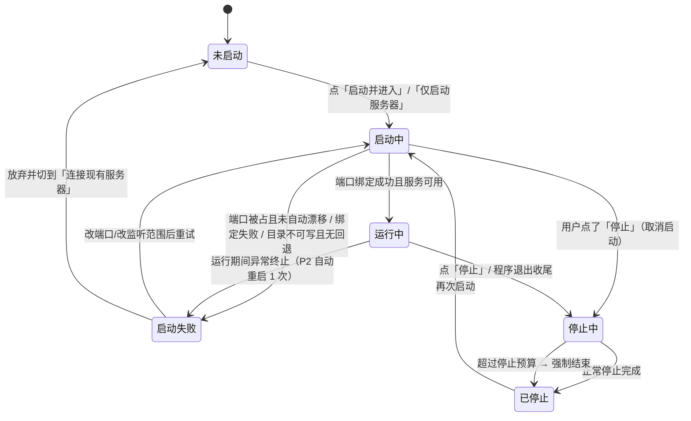
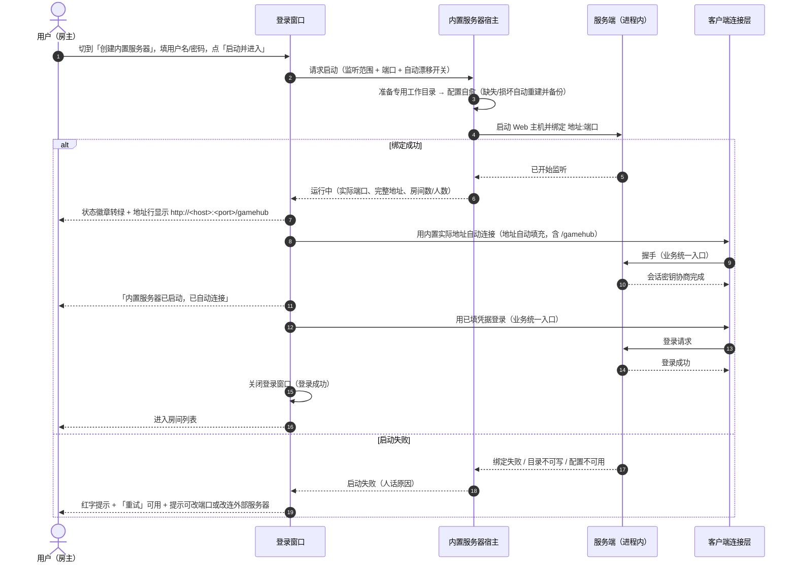
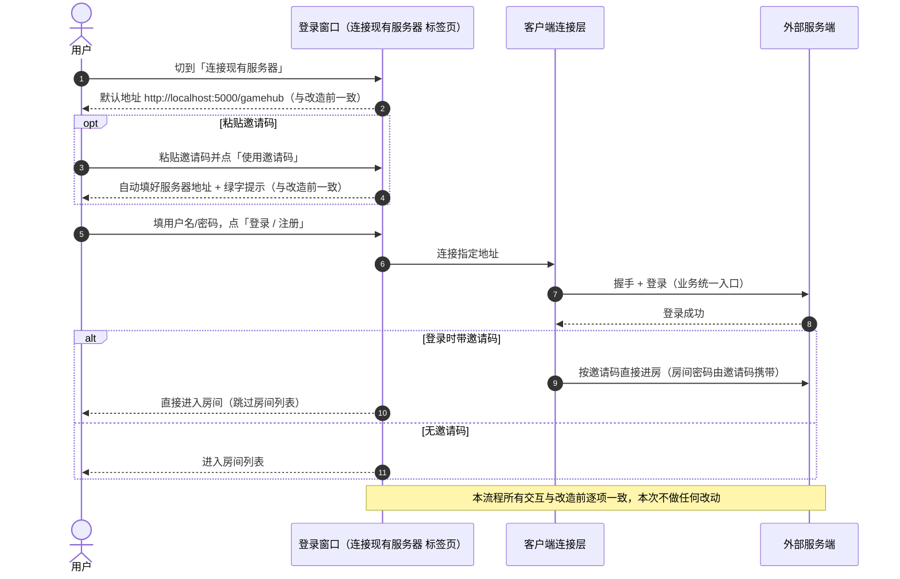
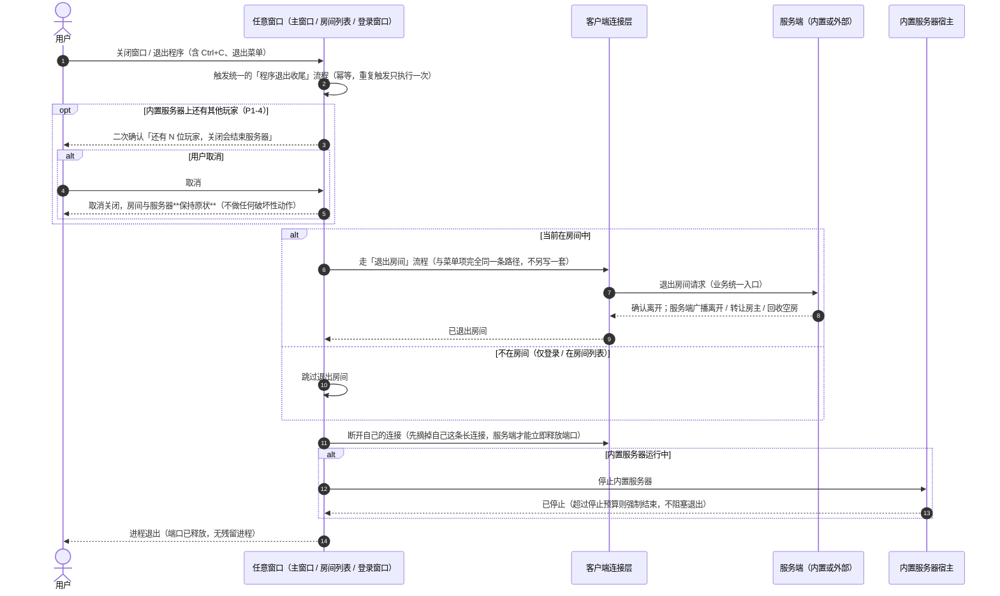

# PRD：内置服务器（进程内宿主）改造（Werewolf.Server）

> 类型：**增量 PRD**（只描述本次变更，不重写整个产品文档）
> 作者：产品经理 许清楚　版本：**v1.1**　状态：已与架构对齐，待评审

**修订记录**
- **v1.0**：初稿。
- **v1.1**：与架构设计对齐后的口径微调 —— ① 收尾顺序改为「退出房间 → 断开自己的连接 → 停内置服务器」（§7 流程 C）；② 二次确认前置且**取消必须无损**；③ 邀请码/自动连接/界面显示三处地址**主机部分也同源**，仅本机模式下统一用 `127.0.0.1`（E-16）；④ 新增 E-18（局域网地址自连失败回落 `127.0.0.1` 重试）、E-19（客户端目录洁净）、E-20（控制台状态行）；⑤ Q5 裁定：不做滚动日志区与日志落盘，P1-1 移出本次范围。

---

## 0. 项目信息

- **Language**：简体中文
- **Programming Language**：沿用现有技术栈 —— C# / .NET 8、ASP.NET Core + SignalR（服务端）、WPF（GUI 客户端）、控制台（CLI 客户端）。**不引入** Docker、Windows 服务安装器、Web 前端等重型部署形态。
- **Project Name**：`werewolf_embedded_server`
- **本次改造的目标文件（已知）**：`ClientGUI/Views/LoginWindow.xaml`（重写为标签页）、控制台客户端入口、服务端宿主方式。
- **原始需求复述（用户原话）**：

  > 由于服务器编译出来是 dll 文件，所以可以制作"内置服务器"，服务器内置于客户端，在客户端（gui 和控制台）可选择创建内置服务器还是连接现有服务器（gui 为标签页设计，重写 loginwindow.xaml），并接收"窗口关闭"消息，使关闭时自动关闭内置服务器（若是在房间中还会起到和"退出房间"一样的效果）

  拆解为 4 条：
  1. **内置服务器**：服务端不再只能以独立进程运行，要能被客户端进程直接拉起（进程内宿主）。
  2. **双入口选择**：GUI 与**控制台客户端**都要能让用户在「创建内置服务器」和「连接现有服务器」之间选择。
  3. **GUI 改标签页**：登录窗口重写为标签页（Tab）形式承载这两种模式。
  4. **生命周期联动**：窗口/程序关闭时自动关闭内置服务器；**若此时用户在房间里，要产生与「退出房间」相同的效果**（走正规离开流程，不是硬断线）。

---

## 1. 产品目标（痛点）

**一句话目标**：把"想开一局，得先在另一台机器/另一个窗口里装 .NET、敲命令启动服务端"这件事，变成"打开客户端点一下就开始"，让服务端从"要单独部署的程序"降级为"客户端里的一个开关"。

**现状痛点**：
- 服务端是独立可执行程序，普通玩家（尤其是非技术用户）要先准备运行环境、在正确的**工作目录**下启动（否则账号文件、配置、词库会散落在别处），才能在客户端里填地址连接。
- 房主开黑的真实场景是"我自己这台机器就是服务器"，为这个场景额外维护一个外部进程，成本高、易出错（端口被占、目录不对、忘记关导致残留进程）。
- 关闭客户端时若服务端是外部进程，不会跟着退出，容易留下孤儿进程占着端口。

**本次要交付的价值**：
1. **零门槛开服**：房主在客户端内一键启动服务端，自动连接、自动进房间列表，全程不用接触命令行。
2. **功能等价**：内置服务器与独立服务端在多房间、多游戏、账号、加密握手等方面**完全一致**，其他客户端（GUI / 控制台 / 局域网好友）可以照常连进来。
3. **不留残留**：客户端退出时内置服务器一定被停掉；若人在房间里，按"退出房间"的正规流程离开，服务端能立刻广播、转让房主、回收空房，而不是等心跳超时。
4. **两端一致**：GUI 与控制台客户端都提供同样的两种入口与同样的收尾行为。

**不做的事（Non-Goals，明确边界）**：
- 不改动网络协议：不新增 SignalR 方法、不改 `Call` 契约，业务仍走单一加密入口 `Call`。
- 不为任何具体游戏（狼人杀 / 谁是卧底等）开后门；本次是**宿主方式**变化，游戏模块零感知、零改动。
- 不做安装包 / 系统服务 / Docker / 开机自启 / 托盘常驻等部署形态。
- 不做账号数据迁移工具、不做公网穿透与端口映射引导。

---

## 2. 术语

| 术语 | 含义 |
|---|---|
| 内置服务器 | 由客户端进程直接拉起、运行在**客户端进程内部**的服务端；对外表现与独立服务端等价 |
| 外部服务器 | 现有的独立服务端进程（保持现有连接方式不变） |
| 宿主 | 客户端里负责"拉起/停止内置服务器 + 隔离工作目录"的那层能力 |
| 工作目录 | 内置服务器读写配置、账号、词库的目录（见 §8 与 Q3） |
| 退出房间 | 客户端现有的正规离开房间流程（含服务端广播离开、房主转让、空房回收）；**不是**直接断开连接 |

---

## 3. 用户故事与验收标准

> 验收标准一律写成"可观测、可断言"的操作 + 结果，QA 可直接照做。

| # | 角色 | 用户故事 | 验收标准（可观测 / 可断言） |
|---|---|---|---|
| **US-1** | 房主（GUI） | 作为**房主**，我希望**在客户端里点一下就启动内置服务器并自动连上、自动进房间列表**，以便不用先开一个服务端程序就能开局。 | ① 打开 GUI → 默认停在「创建内置服务器」标签页，端口默认 5000；② 填用户名/密码，点「启动并进入」；③ **3 秒内**状态区依次出现"正在启动…"→"已启动"→"已连接"；④ 登录窗口自动关闭并弹出房间列表；⑤ 房间列表能正常刷新、能创建房间；⑥ 进程列表里**没有**新增外部服务端进程。 |
| **US-2** | 房主（GUI，只开服不进） | 作为**房主**，我希望**只启动服务器、拿到可分享的地址，自己先不进房间**，以便把地址发给朋友后自己再决定何时加入。 | ① 点「仅启动服务器」；② 状态变为"运行中"，并且显示完整地址（含 `/gamehub`）与**复制**按钮；③ 复制出来的地址粘贴到**另一个**客户端实例（或控制台客户端）的"服务器地址"里能连上并完成注册/进房；④ 此时自己仍处于登录页，可以随后再点登录。 |
| **US-3** | 玩家（GUI） | 作为**玩家**，我希望**切到「连接现有服务器」标签页，像以前一样填地址/邀请码登录**，以便连别人的服务器。 | ① 第二个标签页的控件与现有登录窗口完全一致（服务器地址、邀请码、用户名、密码、登录按钮、状态、底部提示）；② 行为与改造前**逐项一致**：默认地址仍为 `http://localhost:5000/gamehub`、邀请码仍能自动填地址并在登录后直接进房；③ 当本机内置服务器正在运行时，用 `http://localhost:5000/gamehub` 连进来也能成功（连的是内置那个）。 |
| **US-4** | 房主（GUI） | 作为**房主**，我希望**关掉窗口时内置服务器跟着一起关掉**，以便不留下占端口的残留进程。 | ① 启动内置服务器 → 进房间 → 直接点右上角的 ✕ 关闭；② 进程退出后 **5 秒内**端口被释放（用另一个实例以同一端口启动内置服务器可成功，或系统命令行查端口无人监听）；③ 任务管理器中客户端进程消失，且**无**任何服务端子进程残留。 |
| **US-5** | 房间内玩家（GUI） | 作为**房间里的玩家**，我希望**直接关窗口时，服务端知道我是"正常退出房间"**，以便房主身份能被正常转让、空房间能被正常回收，而不是等我超时掉线。 | ① A（内置服务器房主）与 B 同房间；② A 直接关窗口；③ **B 端在 3 秒内**看到系统消息/玩家列表变化（A 离开、房主转让给 B），与 A 点菜单「退出房间」时 B 端看到的**完全一致**；④ 若 A 是最后一人，服务端立刻回收该房间（房间列表里消失），不需要等回收扫描周期。 |
| **US-6** | 控制台用户 | 作为**控制台用户**，我希望**启动时能选择"启动内置服务器"还是"连接现有服务器"**，以便没有 GUI 也能一键开服。 | ① 运行控制台客户端，首屏出现二选一菜单（`1` 内置服务器 / `2` 连接现有服务器）；② 选 `1` 后可直接回车用默认端口，随后流程与现有控制台流程一致（连接 → 登录 → 房间列表 → 建房/开局）；③ 选 `2` 后的交互与改造前**完全一致**（默认地址、邀请码直粘都照旧）。 |
| **US-7** | 控制台用户 | 作为**控制台用户**，我希望**按 Ctrl+C 或走退出菜单时，服务器被正常关闭**，以便不留残留。 | ① 控制台启动了内置服务器并已进入房间；② 按 Ctrl+C；③ 控制台打印"正在退出房间…→ 正在停止内置服务器…→ 已退出"，**8 秒内**进程结束；④ 端口被释放；⑤ 另一个已连接的客户端在 3 秒内看到该玩家正常离开。 |
| **US-8** | 房主（端口冲突） | 作为**房主**，我希望**5000 端口被别的程序占了时，客户端能自动换一个端口并告诉我**，以便不用自己去查端口。 | ① 先用外部服务端占用 5000；② 在 GUI 里点「启动并进入」；③ 状态显示"5000 已被占用，已改用 5001"，地址区显示 `…:5001/gamehub`；④ 仍能一键连上并进房间列表；⑤ 全程**不弹**吓人的异常对话框。 |

---

## 4. 需求池

> 涉及端：**G**=GUI 客户端、**C**=控制台客户端、**S**=服务端、**L**=共享库（协议/网络层）

### P0（必须做 —— 本次变更的底线）

| ID | 需求描述 | 验收标准 | 涉及端 |
|---|---|---|---|
| **P0-1** | **进程内宿主能力**：服务端可被客户端进程直接拉起并运行在同一进程内，功能与独立服务端等价（多房间、多游戏可插拔、账号、加密握手、房间回收）。**不得**改动协议、不得为具体游戏开后门、游戏模块零改动 | 内置服务器启动后，另一个独立客户端（GUI 或控制台）用 `http://<host>:<port>/gamehub` 连入，可完整走通"注册 → 房间列表 → 建房 → 进房 → 开局 → 退出房间"；各游戏行为与连独立服务端时逐项一致 | S / L |
| **P0-2** | **内置服务器启停与运行信息**：提供启动/停止能力与运行状态展示（监听地址、实际端口、状态、房间数、已连接玩家数）。运行信息由**进程内直接查询**获得，不新增协议 | 见 §6 状态机与 §5 运行信息区；停止后端口在 5 秒内释放；人数显示为进程内真实值（自身 + 其他连入者） | G / C / S |
| **P0-3** | **GUI 登录窗口标签页化**：登录窗口重写为两个标签页 —— 「创建内置服务器」与「连接现有服务器」，共享底部状态条与设置入口 | 见 §5 设计稿；两个标签页切换时输入内容不丢失；「连接现有服务器」页的控件与交互与改造前保持一致 | G |
| **P0-4** | **一键启动并进入**：在内置服务器页点主按钮后，自动完成"启动 → 自动连接（地址自动填充为内置实际地址，且带 `/gamehub`）→ 用当前凭据登录 → 进入房间列表" | 见 US-1；自动填充的地址与实际监听端口一致（端口漂移时也必须一致） | G |
| **P0-5** | **程序退出统一收尾（GUI）**：任一窗口关闭导致程序退出时，走同一套收尾流程 —— ① 若当前在房间中：执行与菜单「退出房间」**完全相同**的离开流程；② 停止内置服务器；③ 释放连接；④ 进程退出 | 见 US-4 / US-5；覆盖登录窗口、房间列表窗口、主窗口三种关闭入口；收尾总耗时超预算（见 §8）时不阻塞关闭 | G |
| **P0-6** | **控制台双入口**：控制台客户端启动时提供"启动内置服务器 / 连接现有服务器"二选一；选内置时用默认端口或用户输入的端口启动并自动连接 | 见 US-6；选择连接外部服务器时的交互与改造前完全一致 | C / S |
| **P0-7** | **控制台退出收尾**：Ctrl+C、退出菜单、`Main` 正常结束、未处理异常退出，都走与 P0-5 相同的收尾（退出房间 → 停内置服务器 → 释放连接） | 见 US-7 | C |
| **P0-8** | **端口与监听地址可配置 + 冲突处理**：端口可改（默认 5000）；端口被占用时按"自动漂移"策略处理并明确告知；监听范围可选"仅本机 / 局域网" | 见 §8「端口被占用」与 Q1 / Q2 | G / C / S |
| **P0-9** | **工作目录与文件隔离**：内置服务器的配置、账号、词库落在**专用子目录**，首次启动自动创建并生成默认文件；不污染客户端程序根目录；界面/控制台显示实际目录 | 见 §8「文件放哪里」与 Q3 | G / C / S |
| **P0-10** | **启动失败可读化**：启动失败时给出**人话原因**（端口被占用 / 目录只读 / 配置损坏已重建），而不是抛异常对话框；失败后仍可重试或改用"连接现有服务器" | 见 §8「启动失败」 | G / C |
| **P0-11** | **发布配套**：按项目约定递增 GUI 版本号（建议 `2.3.3 → 2.4.0`，新增功能）并新增变更日志条目（**大白话**，不写类名） | 变更日志里出现类似"客户端里可以直接开服了，不用再单独启动服务器程序"的条目；关于"关于"窗口能看到新版本 | G |

### P1（应该做 —— 体验与可诊断性）

| ID | 需求描述 | 验收标准 | 涉及端 | 本次处置 |
|---|---|---|---|---|
| **~~P1-1~~** | ~~内置服务器日志区~~ | — | G | **本次不做**（Q5 已裁定，见 §5.3 注）；若后续再做，只做"玩家进出 + 错误"落盘 |
| **P1-2** | **可分享地址与一键复制**：运行中显示"本机地址 + 局域网地址"，提供复制按钮；复制内容包含 `/gamehub` | 复制后粘贴到另一台机器的客户端能直接连上 | G / C | 做（界面同时展示两个地址） |
| **P1-3** | **控制台命令行参数入口**：支持 `--embedded [--port N]` / `--server <url>` 跳过交互菜单 | 带参数启动时不再显示选择菜单；参数与菜单行为一致 | C | 做（随控制台任务顺带，成本极低） |
| **P1-4** | **关闭二次确认**：内置服务器运行中且**已连接人数 > 1**（除了自己还有别人）时，关闭窗口弹一次确认；只有自己时不弹 | 弹窗文案说明"还有 N 位玩家在房间里，关闭会结束服务器"；**取消则完全无损**（不退出房间、不停服务器、不关窗口） | G / C | 做（取消语义已写进 §7 流程 C） |
| **P1-5** | **记住上次选择**：记住上一次使用的标签页、端口、监听范围，下次启动自动带入 | 重启客户端后默认停留在上次用过的标签页且端口保留 | G | 做（顺带） |
| **P1-6** | **邀请码与漂移端口一致性**：内置服务器端口发生漂移后，生成的邀请码里携带的是**实际端口** | 用漂移后的邀请码在另一台机器上能直接进房；邀请码主机部分与当前连接同源（见 E-16） | G / L | 做（由"三处同源"天然满足） |
| **P1-7** | **打开工作目录入口**：内置服务器页提供"打开服务器目录"，便于用户手工编辑配置/词库 | 点击后打开到 P0-9 定义的实际目录 | G | 做（顺带） |
| **P1-8** | **重复实例提示**：同一台机器第二个客户端再启动内置服务器时，端口自动漂移并提示"本机已有内置服务器占用 5000" | 两个实例互不抢占，各自可用 | G / C | 做（由端口漂移提示天然满足） |

### P2（可选 —— 有余力再做）

| ID | 需求描述 | 验收标准 | 涉及端 |
|---|---|---|---|
| **P2-1** | 内置服务器高级设置入口（房间上限 / 宽限期等配置的可视化编辑，改动后需重启内置服务器生效） | 编辑保存后重启内置服务器，新值生效 | G |
| **P2-2** | 最小化到托盘时保持内置服务器运行（默认关闭） | 勾选后关窗不退出、托盘图标可恢复/退出 | G |
| **P2-3** | 连接人数定时自动刷新（当前为进入页面/连接变化时刷新） | 3～5 秒轮询一次，数值准确 | G / S |
| **P2-4** | 内置服务器"仅开服模式"下显示简易欢迎页（可访问 `http://host:port/` 看到服务在跑） | 浏览器打开根路径能看到可读文本 | S |
| **P2-5** | 内置服务器异常崩溃后的自动重启（最多 1 次）与提示 | 崩溃后自动重启一次并在日志区说明 | G / S |

---

## 5. UI 设计稿（登录窗口重写为标签页）

### 5.1 整体结构（ASCII 草图）

```
┌────────────────────────────────────────────────────────────────────┐
│  🐺 狼人杀                                             [ ⚙ 设置 ] │
│                                                                    │
│  ┌──────────────────────────┬──────────────────────────────────┐  │
│  │  🖥 创建内置服务器  ●     │     🌐 连接现有服务器             │  │   ← Tab 头（默认选第 1 个）
│  └──────────────────────────┴──────────────────────────────────┘  │
│                                                                    │
│  ╔══════════════ Tab 1：创建内置服务器 ═══════════════════════════╗ │
│  ║ 监听范围   ( ) 仅本机 127.0.0.1      (•) 局域网 0.0.0.0       ║ │
│  ║ 端口       [ 5000 ]   ☑ 被占用时自动换一个空闲端口            ║ │
│  ║                                                                ║ │
│  ║      [ 启动并进入 ]        [ 仅启动服务器 ]      [ 停止 ]      ║ │
│  ║       一键开服+自动连      只开服，拿地址分享                  ║ │
│  ║ ──────────────────────────────────────────────────────────── ║ │
│  ║ 状态   ● 运行中                                               ║ │
│  ║ 地址   http://192.168.1.5:5000/gamehub        [ 复制地址 ]    ║ │
│  ║        （仅本机时显示 http://127.0.0.1:5000/gamehub）         ║ │
│  ║ 运行   房间 1 · 已连接玩家 3        [ 打开服务器目录 ]        ║ │
│  ║ 提示   ⚠ 5000 已被占用，已改用 5001（仅异常时出现，红字）    ║ │
│  ║ ──────────────────────────────────────────────────────────── ║ │
│  ║ 用户名  [ ___________________________ ]                       ║ │
│  ║ 密码    [ ___________________________ ]                       ║ │
│  ╚════════════════════════════════════════════════════════════════╝ │
│                                                                    │
│  ┌──────────────────────────────────────────────────────────────┐  │
│  │ 状态条：内置服务器已启动，已自动连接并登录                     │  │  ← 失败时红字
│  └──────────────────────────────────────────────────────────────┘  │
│  提示：内置服务器只在这台电脑上跑，关掉客户端会一起关掉。          │
│       想让同网络的朋友加入，把上面的地址发给他即可。               │
└────────────────────────────────────────────────────────────────────┘
```

```
╔══════════════ Tab 2：连接现有服务器（与改造前保持一致） ═════════╗
║ 服务器地址  [ http://localhost:5000/gamehub ]                    ║
║ 邀请码（可选）[ ______________________ ]  [ 使用邀请码 ]         ║
║              🎟 已识别邀请码：将连接 …（绿字提示，同现状）       ║
║ 用户名       [ ______________________ ]  （最长 20）             ║
║ 密码         [ ______________________ ]                          ║
║                                                                  ║
║            [            登录 / 注册           ]                  ║
║ 状态条：……                                                       ║
║ 底部提示：首次登录的用户名会自动注册；掉线后用相同用户名+密码      ║
║           重新登录即可恢复原房间身份；收到邀请码可直接粘贴……      ║
║           默认地址 http://localhost:5000/gamehub                 ║
╚══════════════════════════════════════════════════════════════════╝
```

### 5.2 控件清单与默认值

**Tab 1「创建内置服务器」**

| 控件 | 默认值 | 说明 |
|---|---|---|
| 监听范围（单选） | **局域网 `0.0.0.0`**（待确认 Q2） | 另一项：仅本机 `127.0.0.1`；切换只影响下次启动 |
| 端口（数字输入） | `5000` | 范围 1024–65535，非法输入时按钮禁用并提示 |
| "被占用时自动换一个空闲端口"（复选框） | **勾选** | 漂移范围 `5001–5100` |
| 「启动并进入」（主按钮） | 可用 | 启动 → 自动连接 → 用当前凭据登录 → 进房间列表 |
| 「仅启动服务器」（次按钮） | 可用 | 只开服并显示可分享地址 |
| 「停止」 | 未运行时**禁用** | 停止内置服务器 |
| 状态徽章 | `● 未启动` | 颜色取自主题资源（成功/警告/错误），**禁止硬编码颜色** |
| 地址行 + 复制 | 启动后才有值 | 必须带 `/gamehub` |
| 运行信息（房间数 / 已连接玩家数） | `房间 0 · 已连接玩家 0` | 进程内查询，不新增协议 |
| ~~日志区~~ | **本次不做**（见 Q5 裁定） | 启动/异常信息统一走下方提示行与状态条 |
| 用户名 / 密码 | 沿用现有输入框 | 与 Tab 2 **共用同一份凭据**（切页不丢） |

**Tab 2「连接现有服务器」**：控件、默认值、文案、邀请码逻辑与改造前**完全一致**（默认地址 `http://localhost:5000/gamehub`）。

### 5.3 内置服务器页必须展示的运行信息（P0 最小集）

| 信息 | 为什么必须展示 | 未启动/失败时 |
|---|---|---|
| **状态**（未启动 / 启动中 / 运行中 / 停止中 / 启动失败） | 用户要知道"到底开了没有" | 显示对应状态 |
| **实际监听地址 + 端口**（含 `/gamehub`） | 分享给朋友、以及自动连接都依赖它 | 显示"—" |
| **已连接玩家数 / 房间数** | 房主要知道有没有人进来了 | `0 / 0` |
| **启动 / 停止按钮** | 手动控制权 | 按状态机禁用（§6） |
| **失败原因（人话）** | 否则用户只能干瞪眼 | 红字显示 |
| **工作目录路径（P1 起可点击打开）** | 用户要能找到配置文件和词库 | 显示将使用的目录 |

> **Q5 已裁定**：本次**不做**滚动日志区，也不落盘 ASP.NET 运行日志（避免"每个失败端口都刷一段 Hosting failed to start"的吓人输出）。
> 代价是排障信息变少，因此**「启动失败原因（人话）」与「端口漂移提示」必须在状态条/提示行直接可见**（属 P0，不是可选）。
> 后续若要补 P1-1，重点放在"玩家进出 + 错误"两类的落盘，而不是全量框架日志。

### 5.4 主题约束（沿用项目约定）

- 所有颜色只能定义在深色/浅色两套主题资源里，两套**键名必须一致**。
- XAML 中一律用动态资源引用（如 `{DynamicResource XxxBrush}`），**禁止**硬编码颜色值。
- 状态徽章的成功/警告/错误三态复用现有语义色，不新增硬编码色。

---

## 6. 内置服务器状态机

### 6.1 状态流转



### 6.2 各状态下的控件可用性

| 状态 | 监听范围 / 端口 | 自动漂移复选框 | 启动并进入 | 仅启动服务器 | 停止 | 登录/凭据输入 | 状态徽章 |
|---|---|---|---|---|---|---|---|
| 未启动 | 可编辑 | 可编辑 | 可用 | 可用 | **禁用** | 可输入（登录按钮禁用） | 灰 ● 未启动 |
| 启动中 | **禁用** | **禁用** | **禁用**（文案"启动中…"） | **禁用** | 可用（取消） | 禁用 | 黄 ● 启动中 |
| 运行中 | **禁用** | **禁用** | **禁用** | **禁用** | 可用 | 可用（登录按钮可用） | 绿 ● 运行中 |
| 停止中 | 禁用 | 禁用 | 禁用 | 禁用 | **禁用** | 禁用 | 黄 ● 停止中 |
| 已停止 | 可编辑 | 可编辑 | 可用 | 可用 | **禁用** | 可用（登录按钮可用，连外部服） | 灰 ● 已停止 |
| 启动失败 | 可编辑 | 可编辑 | 可用（重试） | 可用（重试） | **禁用** | 可用（连外部服） | 红 ● 启动失败 |

补充规则：
- **任何状态下**，「连接现有服务器」标签页都可用 —— 内置服务器出问题绝不能把"连别人的服"这条路堵死。
- 登录按钮在"未启动"状态下禁用（否则会出现"还没开服就要连"的困惑）；已启动但未自动登录时可用。
- 端口输入框在服务器运行期间锁定，避免"改了端口但没生效"的错觉。

---

## 7. 关键交互流程

### 流程 A：创建内置服务器 → 启动 → 自动连上 → 进房间列表



### 流程 B：连接现有服务器（保持现有行为）



### 流程 C：关闭窗口 → 若在房间中走「退出房间」→ 停内置服务器 → 进程退出



**收尾流程的硬性要求**：
- 收尾**幂等**：Ctrl+C 连按、窗口关闭事件重复触发，都只执行一次。
- 收尾**有总预算**：走到超时就直接强制结束并退出，绝不允许"关不掉窗口"。
- 二次确认若被**取消**，必须是彻底无损的 —— 不退出房间、不停服务器、不关窗口。
- 收尾**顺序不可颠倒**（与架构实现对齐）：**退出房间 → 断开自己的连接 → 停止内置服务器**。
  - 先退出房间：让服务端正确广播离开 / 转让房主 / 回收空房，这是 E-10 的核心；
  - 再断开自己的连接：关窗者自己也是内置服务器的一个客户端，长连接还挂着时服务端优雅停止要等连接排空，端口释放会不稳（US-4「5 秒内端口释放」）；
  - 最后停服务器：顺序颠倒会导致房间里的离开请求发不出去。

---

## 8. 异常与边界（逐条给期望行为，供架构师与 QA 直接引用）

| # | 场景 | 期望行为（验收口径） |
|---|---|---|
| **E-1** | **端口被占用**：本机已有外部服务端占着 5000 | ① 自动漂移开关**开启**（默认）时：在 `5001–5100` 内顺序探测第一个空闲端口，界面/控制台明确提示"5000 已被占用，已改用 5001"，地址区与自动连接都使用**新端口**；② 开关**关闭**时：状态转「启动失败」，提示"端口 5000 已被占用，请换一个端口或关闭占用它的程序"，**不静默**、不崩溃 |
| **E-2** | **内置服务器重复启动**（同一客户端进程） | 「启动」类按钮在运行/启动中状态下禁用；界面不出现两个服务器；状态与端口保持单一来源 |
| **E-3** | **内置服务器重复启动**（两个客户端进程 / 一台机器开两个客户端） | 允许各起一个；第二个因 5000 已被占用而自动漂移到 5001 并提示（P1-8）；两者互不抢占、互不影响 |
| **E-4** | **启动失败：端口绑定失败（非占用类，如权限/地址不可用）** | 状态「启动失败」，红字给出人话原因与建议（换端口 / 改为仅本机）；可重试；不影响切到「连接现有服务器」 |
| **E-5** | **启动失败：配置损坏** | 沿用服务端既有自愈行为（损坏文件先备份再重建默认配置），并把"配置已损坏、已备份为 …、已重建默认值"这条提示**显示在客户端界面/控制台**；服务器继续启动可用 |
| **E-6** | **启动失败：工作目录只读 / 无写入权限** | 首选目录写不进去时**回退**到用户可写目录（见 Q3），并在界面显示实际使用的目录；配置用内置缺省值继续启动，**不阻塞开服**；若连回退目录也不可用，明确报"无法创建服务器目录" |
| **E-7** | **用户点了「启动」后又切到「连接现有服务器」标签页** | 已启动的内置服务器**保持运行**（不随切页停止）；两页的地址互不覆盖（内置地址只用于内置页，外部地址由用户填写）；若已连上内置服务器又要连外部服务器，先断开当前连接再连（给出一次明确提示，不静默切换） |
| **E-8** | **关闭窗口时网络卡住** | 「退出房间」请求超过 **3 秒**无响应即放弃等待，直接进入下一步；不再重试、不弹错误框 |
| **E-9** | **服务端停止超时** | 停止内置服务器超过 **5 秒**未完成即强制结束；整个收尾总预算 **8 秒**，超时后窗口照常关闭、进程照常退出（不做无限等待） |
| **E-10** | **内置服务器开着 + 用户在房间里，直接关窗口** | **必须等同于「退出房间」**：走正规离开流程，服务端立刻广播该玩家离开、按既有规则转让房主、空房立即回收；其他玩家在 **3 秒内**看到与"该玩家点了退出房间"完全一致的表现。关窗时**不弹**「是否保留房间」的询问（按默认策略处理，见 Q4），避免"关不掉窗口" |
| **E-11** | **关闭登录窗口 / 房间列表窗口（还没进房间）** | 同样触发收尾：跳过"退出房间"，但**必须停止内置服务器**（US-4 覆盖此路径，最容易漏）；进程正常退出 |
| **E-12** | **控制台 Ctrl+C / 退出菜单 / 正常结束 / 异常退出** | 与 GUI 走同一套收尾语义（退出房间 → 断开自己的连接 → 停内置服务器）；打印可读的收尾进度（"正在退出房间… → 正在停止内置服务器… → 已退出"）；8 秒内结束；Ctrl+C 连按不重复执行 |
| **E-13** | **内置服务器的配置文件与账号文件放哪里** | 落在**专用子目录**（默认：客户端程序目录下的 `embedded-server\`，见 Q3），首次启动自动创建并生成默认配置/账号文件/词库；**不写**客户端程序根目录（避免与客户端自身文件混在一起、避免污染安装包目录）；界面与控制台显示实际路径，便于用户手工改配置 |
| **E-14** | **内置服务器是否允许局域网其他机器连入** | 允许（默认监听 `0.0.0.0`，与独立服务端一致，见 Q2）；界面显示局域网可分享地址。安全口径：与现状一致——明文 HTTP 传输、应用层握手+会话加密，**不建议**暴露到公网或不可信网络，产品内**不提供**端口映射/穿透引导 |
| **E-15** | **内置服务器运行期间客户端崩溃** | 进程退出即视为服务器停止（无残留）；收尾作为兜底尽力执行，失败不影响进程退出 |
| **E-16** | **地址一致性（端口漂移 / 邀请码）** | 自动连接使用的地址、界面显示的地址、邀请码里携带的地址，**三处必须同一个实际端口**（P1-6），禁止"显示 5001 却连 5000"。**主机部分同样同源**：监听范围为「局域网」时三处统一用局域网地址（`http://<局域网IPv4>:<端口>/gamehub`），取不到局域网 IPv4 时回落 `127.0.0.1`；监听范围为「仅本机」时三处统一用 `127.0.0.1`（此时**不得**把局域网地址写进邀请码，否则好友拿到也连不上） |
| **E-17** | **非法端口输入** | 空值 / 非数字 / 越界（<1024 或 >65535）时启动按钮禁用并给出内联提示，不弹异常对话框 |
| **E-18** | **用局域网地址自动连自己失败**（防火墙拦截 / 多网卡取错 IP / 未插网线） | 自动连接失败时**回落到 `127.0.0.1` 重试一次**，仍失败才转「启动失败」并给出人话原因；回落成功时在状态区说明"已改用本机地址连接"（**分享给好友的邀请码仍保留局域网地址**，不受回落影响）。一键开服路径（P0-4）不允许因为"用哪个 IP 连自己"而卡住 |
| **E-19** | **客户端程序目录洁净** | 客户端运行/输出目录里**不应出现**服务端模板文件（`appsettings.json`、`words.undercover.txt`）——它们既不被内置服务器读写（工作目录是 `embedded-server\`），又会让用户误以为是客户端配置而去改。构建后清理或排除复制；这一条是 P0-9「不污染客户端程序目录」的终态验收口径 |
| **E-20** | **控制台端看得到服务器状态**（已裁定不落盘日志、关闭 ASP.NET 日志输出的前提下） | 控制台至少打印三行**人话状态**：启动成功（含实际地址与端口 / 端口漂移提示）、停止、启动失败原因；不要求打印 ASP.NET 原始日志，但不允许出现大段"Hosting failed to start"式的吓人输出 |

---

## 9. 待确认问题（每条已给推荐默认值，可直接采纳）

| # | 问题 | 选项 | **推荐默认值** | 推荐理由 |
|---|---|---|---|---|
| **Q1** | **默认端口策略** | ① 固定 5000，被占就报错；② 固定 5000，被占自动漂移；③ 每次随机空闲端口 | **② 固定 5000 + 被占用时在 5001–5100 自动漂移，并明确告知** | 保留"大家记熟的 5000"，又避免房主卡在"端口被占不知道怎么办"；漂移后地址在界面上始终可见，不影响分享 |
| **Q2** | **监听地址 / 局域网可见性** | ① 仅 `127.0.0.1` 本机；② `0.0.0.0` 允许局域网（与独立服务端一致） | **② 默认 `0.0.0.0`**（界面提供"仅本机"单选，切回 `127.0.0.1`） | 内置服务器要能完全替代独立服务端，房主开黑主要就是给局域网好友玩；与现状等价，不引入新的安全模型（本来就是明文 HTTP + 应用层加密）。风险可控：默认仍不引导任何公网暴露 |
| **Q3** | **内置服务器工作目录位置** | ① 客户端程序目录下 `embedded-server\`；② `%LOCALAPPDATA%\Werewolf\embedded-server\`；③ 用户每次可指定 | **① 客户端程序目录下 `embedded-server\`，不可写时回退 ②** | 用户最容易找到并手工改配置/词库（与现有"在工作目录下放 appsettings.json"的习惯一致）；回退保证只读目录（如 Program Files）也能开服 |
| **Q4** | **关窗时是否弹二次确认** | ① 从不弹；② 只要内置服务器在跑就弹；③ 只有"除自己外还有别人"时弹 | **③ 仅当内置服务器上还有其他玩家（已连接人数 > 1）时弹一次**；只有自己时直接关 | 一个人玩时不该被弹窗烦；真有别人在房间里时，误关会打断别人，值得拦一次 |
| **Q4-b** | **关窗触发的「退出房间」是否弹「是否保留房间」** | ① 弹（与菜单退出房间完全一致）；② 不弹，按默认策略（不保留） | **② 不弹，按默认策略处理** | 关窗是"我要走了"，弹窗会阻塞退出、也违背"关窗口即退出"的直觉；核心要求（服务端知道我正常离开）已由正规离开流程满足 |
| **Q5** | **内置服务器日志是否在 GUI 展示** | ① 完全不展示；② 展示最近 ~200 行滚动日志 + 落盘；③ 只展示错误 | **✅ 已裁定：① 不做滚动日志区，运行期日志也不落盘（宿主关闭 ASP.NET 控制台日志）。保留项：启动/停止/失败原因与端口漂移提示必须在界面直接可见（属 P0）** | 与架构实现对齐；代价是排障信息变少，用「人话失败原因 + 端口漂移提示」补足关键可观测性；若后续补 P1-1，只做"玩家进出 + 错误"的落盘，不做全量框架日志 |
| **Q6** | **控制台客户端的入口形式** | ① 启动交互菜单；② 命令行参数；③ 两者都要 | **P0 做 ① 启动菜单（零参数可用），P1 补 ② 命令行参数**（即 ③ 分两期） | 控制台现有交互就是一问一答式，菜单最自然、零学习成本；参数化便于脚本/自测，但可后置 |
| **Q7** | **登录窗口默认停在哪个标签页** | ① 创建内置服务器；② 连接现有服务器 | **① 创建内置服务器**（P1-5 记住上次选择后，按上次习惯） | 本次的核心卖点就是一键开服，默认展示新能力；老用户路径只多一次点击 |
| **Q8** | **内置服务器与「连接现有服务器」能否同时连** | ① 同一时刻只能连一个；② 可同时连接多个 | **① 同一时刻只连一个**（切换时先断开并提示一次） | 现有客户端是单会话模型，多连接会牵动房间/状态展示的大范围改动，超出本次增量范围 |
| **Q9** | **版本号** | `2.3.3 → 2.3.4`（补丁）/ `2.4.0`（次版本） | **`2.4.0`** | 属于新增功能（新入口 + 新能力），按次版本号递增更符合语义 |

---

## 10. 成功指标（上线后如何判断做对了）

1. **开服耗时**：从打开客户端到进入房间列表，房主路径 ≤ 3 次点击 / ≤ 10 秒（含启动与连接）。
2. **零残留**：GUI 与控制台各 20 次"启动内置服务器 → 进房间 → 关闭"，端口 100% 释放、进程 100% 无残留。
3. **退出房间语义一致**：在房间里直接关窗，其他玩家看到的表现与"该玩家点退出房间"**逐项一致**（离开广播、房主转让、空房回收）。
4. **零协议改动**：`Werewolf.Client.Share` 中的协议与 `Call` 契约**零变更**；游戏模块零改动。
5. **两端一致**：US-1～US-8 在 GUI 与控制台两端都能通过。

---

## 11. 约束重申（给架构师）

- 本次是**增量**改造：不得设计与现有多游戏可插拔架构冲突的东西，游戏模块必须零感知。
- **不得新增 SignalR 方法、不得改 `Call` 契约**；业务仍走单一加密入口 `Call`；连接地址必须带 `/gamehub`。
- **平台层不得为任何具体游戏开后门**；内嵌只是宿主方式变化。
- 桌面端仅 Windows WPF + 控制台，不引入 Docker / 服务安装器等重型部署概念。
- Windows 上注意：内置服务器监听会触发防火墙提示（首次），产品文案里应说明"如弹出防火墙提示，请允许"——不提供自动加防火墙规则的能力（超出范围）。
- UI 颜色一律走主题动态资源，两套主题键名一致，禁止硬编码。
