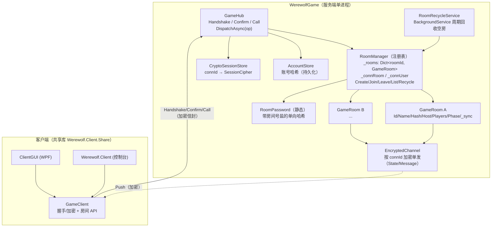
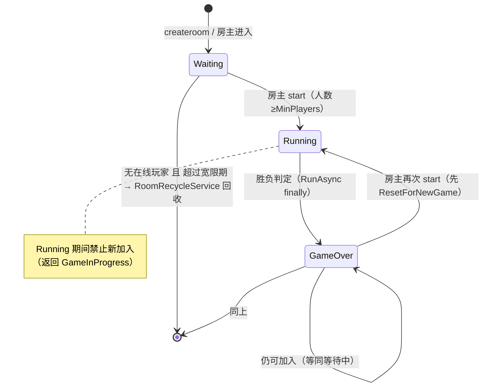
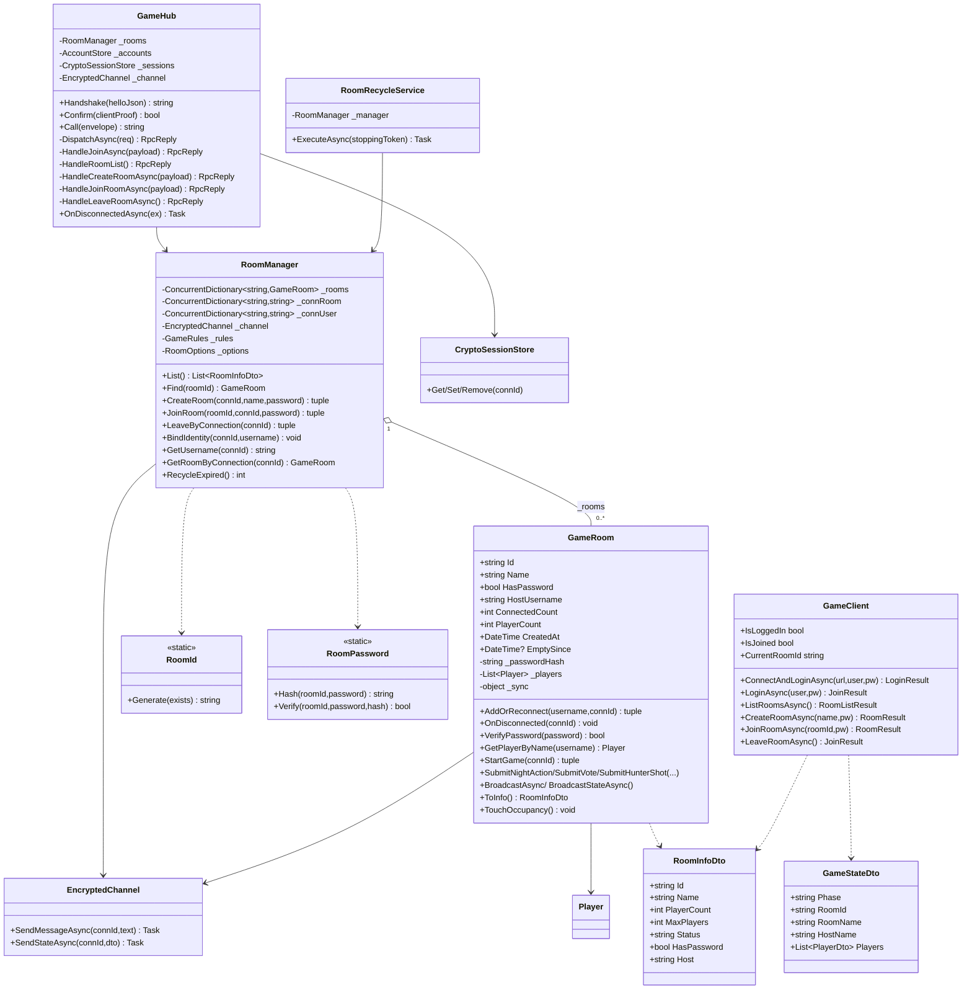
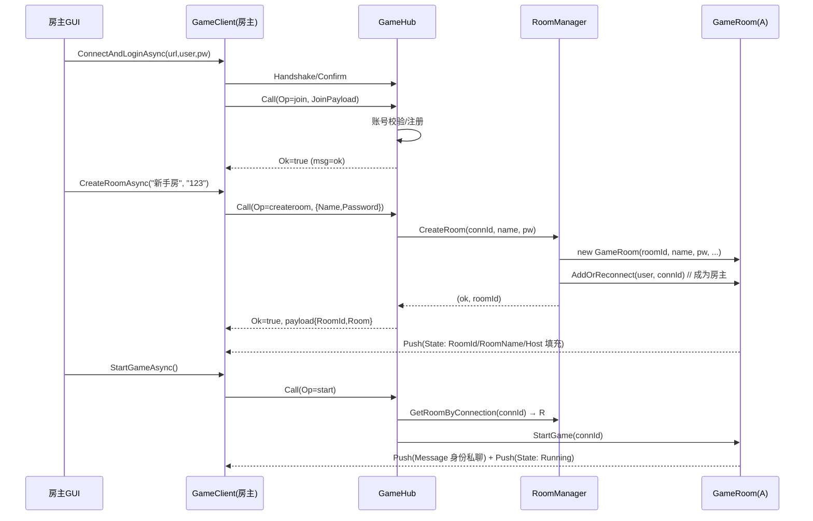
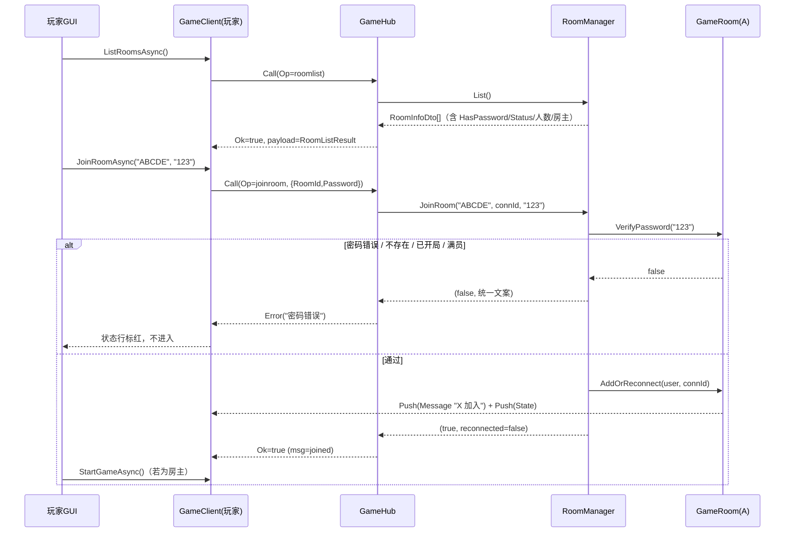
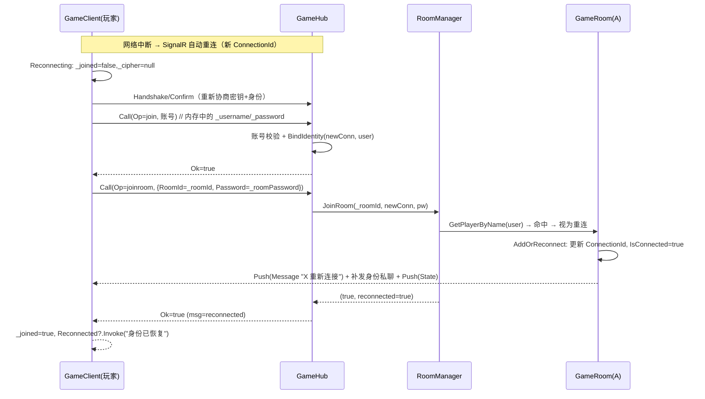
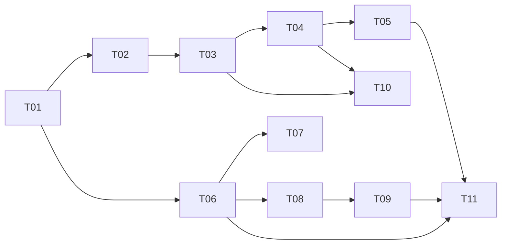

# 架构设计：多房间改造（Werewolf.Server）

> 作者：架构师 高见远（Gao）　输入：`docs/multi-room/PRD.md`　版本：v1.0
> 本文件是**实现级**设计：精确到字段名 / 方法签名 / 错误文案 / 改动顺序。工程师可逐条照做。
> 不修改任何源码；仅产出本设计文档与两张 mermaid 图。

---

## 0. 现状核对（设计依据，均来自实际代码）

| 事实 | 位置 | 对设计的影响 |
|------|------|--------------|
| Hub 只暴露 `Handshake` / `Confirm` / `Call`，`Ops` 在 `DispatchAsync` 分发 | `GameHub.cs:106/124` | 新功能只加 `Ops` 分支，**不新增 SignalR 方法** |
| `GameRoomService { public GameRoom Room { get; } }`（单例房间） | `GameRoom.cs:756` | 替换为「注册表 `RoomManager`」 |
| `GameRoom` 构造函数 `(EncryptedChannel, GameRules)`；`AddOrReconnect(username, connId)` 返回 `(ok,msg,player,reconnected)` | `GameRoom.cs:32/45` | 新增房间字段 + 改造构造；保留 `AddOrReconnect` 语义 |
| 推送只按 `ConnectionId` 单发（`EncryptedChannel.SendAsync`） | `EncryptedChannel.cs:36` | 天然「房间隔离」：只要按本房间玩家集合发即可 |
| `CryptoSessionStore` 以 `connId` 为键；`OnDisconnectedAsync` 里 `Remove` | `CryptoSessionStore.cs` / `GameHub.cs:232` | 断开时必须同时清理「连接→房间」映射 |
| `GameClient.ConnectAndJoinAsync` 一步完成「连接 + 登录 + 进房」 | `GameClient.cs:182` | 语义收窄：改为只「连接 + 账号校验」 |
| 两测试宿主直接用 `GameClient` 或反射驱动 `GameViewModel`，**不直接 new `GameRoom`** | `IntegrationProbe.cs` / `ActionComputationTests.cs` | 改类名 / 构造对测试影响可控；保留可测即可 |
| `FastPower.ModPow` 位于 `Werewolf.Client.Share.Crypto`，服务端 `AccountStore` 已复用 | `AccountStore.cs:62` | 房间密码哈希复用同风格 |

---

## 1. 方案总览

两层结构：**注册表（`RoomManager`）+ 房间实例（`GameRoom`）**。Hub 只做「协议解析 + 把连接解析到房间 + 分发」；每个 `GameRoom` 自持状态与自己的锁，只向本房间连接推送。



**关键不变量**
1. 业务请求全走 `Call`；房间操作 = 新增 `Ops` + Payload，复用加密通道。
2. 房间隔离 = 推送只遍历该 `GameRoom` 的 `Connected()` 集合（`EncryptedChannel` 单发），注册表不参与广播。
3. 连接生命周期 = `CryptoSessionStore` + `RoomManager` 的「连接→房间/身份」映射，在 `OnDisconnectedAsync` 一并清理。

---

## 2. 改动模块清单

| 文件路径 | 动作 | 改动要点 |
|----------|------|----------|
| `WerewolfGame/RoomManager.cs` | **新增** | 房间注册表 + 连接映射。见 §3/§4。取代 `GameRoomService` |
| `WerewolfGame/RoomRecycleService.cs` | **新增** | `BackgroundService`，周期调用 `RoomManager.RecycleExpired()` |
| `WerewolfGame/RoomId.cs` | **新增** | `static`，31 字符集、5 位、冲突重试 |
| `WerewolfGame/RoomPassword.cs` | **新增** | `static`，带房间号盐的 `v2:` 单向哈希 + `Verify` |
| `WerewolfGame/RoomOptions.cs` | **新增** | 配置载体：`EmptyGraceSeconds` / `MaxRooms` / `RecycleScanSeconds` |
| `WerewolfGame/GameRoom.cs` | **修改** | 类名**保留** `GameRoom`（避免大面积改名）；新增 `Id/Name/HasPassword/_passwordHash/CreatedAt/EmptySince/HostUsername/ConnectedCount/PlayerCount`、构造签名、`VerifyPassword`、`GetPlayerByName`、`ToInfo`、`TouchOccupancy`；`BuildStateFor` 增房间字段；`StartGame` 前清局内临时数据；错误文案改用 `ServerMessages`。**删除**文件末尾的 `GameRoomService` |
| `WerewolfGame/GameHub.cs` | **修改** | 注入 `RoomManager`；`DispatchAsync` 增 `roomlist/createroom/joinroom/leaveroom`；`HandleJoinAsync` 收敛为「账号校验 + BindIdentity」；`Start/Night/Vote/Hunter/Chat` 改为「先按连接找房间」；`OnDisconnectedAsync` 改用 `RoomManager.LeaveByConnection` |
| `WerewolfGame/Program.cs` | **修改** | 绑定 `Room` 配置；`AddSingleton<RoomManager>` + `AddHostedService<RoomRecycleService>`（移除 `GameRoomService`） |
| `WerewolfGame/appsettings.json` | **修改** | 新增 `"Room"` 节点（宽限期 / 房间上限 / 扫描间隔） |
| `WerewolfGame/EncryptedChannel.cs` | **不改（评估）** | 现有「按 connId 单发」已满足房间隔离；**无需**新增房间级广播辅助。若工程师偏好，可加 `SendStateAsync(IEnumerable<string> connIds, ...)` 便捷重载，非必需 |
| `WerewolfGame/Models.cs` | **修改（可选）** | `Player` 无需改（房间归属由 `GameRoom` 持有）；如需可加注释。建议不动 |
| `Werewolf.Client.Share/Protocol.cs` | **修改** | `Ops` 增 4 常量；新增 `CreateRoomPayload/JoinRoomPayload/RoomInfoDto/RoomListResult/RoomActionResult`、`ServerMessages`、`RoomStatus`；`GameStateDto` 房间字段定义在 Dtos |
| `Werewolf.Client.Share/Dtos.cs` | **修改** | `GameStateDto` 增 `RoomId/RoomName/HostName` |
| `Werewolf.Client.Share/GameClient.cs` | **修改** | `ConnectAndJoinAsync`→`ConnectAndLoginAsync`；`JoinAsync` 语义=账号校验；新增 `ListRoomsAsync/CreateRoomAsync/JoinRoomAsync/LeaveRoomAsync` 与 `IsLoggedIn/CurrentRoomId/CurrentRoomName/CurrentHostName`；重连流程恢复房间 |
| `Werewolf.Client.Share/GameRules.cs` | **不改** | 规则已随 `GameStateDto.Rules` 下发，多房间下每个房间使用同一份规则，无需改动 |
| `Werewolf.Client/Program.cs` | **修改** | 登录后进入「房间列表 → 序号加入/`c` 创建/`r` 刷新」；进入房间后新增 `leave` 指令 |
| `ClientGUI/Views/RoomListWindow.xaml(.cs)` | **新增** | 房间列表窗口：表格 + 刷新 + 创建 + 内联密码输入 + 加入 |
| `ClientGUI/ViewModels/RoomListViewModel.cs` | **新增** | 列表状态、5 秒轮询、加入/创建命令、错误状态行 |
| `ClientGUI/Views/CreateRoomWindow.xaml(.cs)` | **新增** | 创建房间对话框：房间名 + 可选密码（勾选「不设密码」） |
| `ClientGUI/ViewModels/CreateRoomViewModel.cs` | **新增** | 创建对话框的输入与校验 |
| `ClientGUI/App.xaml.cs` | **修改** | 流程改为 登录 → 房间列表 → 主窗口 → 退出房间回房间列表 |
| `ClientGUI/MainWindow.xaml(.cs)` | **修改** | 标题栏增「房间号 · 房间名 · 房主」 |
| `ClientGUI/ViewModels/GameViewModel.cs` | **修改** | 增 `RoomId/RoomName/HostName` 绑定；`LeaveRoomAsync` 改为「离开房间（不拆连接）」并触发 `RoomLeft` 事件；`IsJoined` 语义=在房间 |
| `ClientGUI/Views/LoginWindow.xaml(.cs)` / `ViewModels/LoginViewModel.cs` | **修改** | 文案改「登录后进入房间列表」；成功后交出 `GameClient` 给房间列表窗口（不再直接进主窗口） |
| `ClientGUI/Services/UiStateStore.cs` | **修改** | `UiState` 增 `LastRoomId`（记住上次房间，便于回填） |
| `ClientGUI.Themes/*` | **不改（评估）** | 复用 `Panels.xaml`/`DarkTheme.xaml` 现有样式；新窗口只引用现成资源 |
| `ClientGUI.Tests/RoomTests.cs` | **新增** | `RoomId/RoomPassword/RoomManager/协议往返` 纯逻辑断言 |
| `ClientGUI.Tests/IntegrationProbe.cs` | **修改** | 改为「账号登录 → 创建房间 → 他人按房间号加入 → 开局」多房间流程 |
| `ClientGUI.Tests/ReconnectProbe.cs` | **修改** | 加入改为「登录 + 进房间」；重连断言加入房间是否恢复 |
| `ClientGUI.Tests/UiSmokeCheck.cs` | **修改** | 增实例化 `RoomListWindow` / `CreateRoomWindow` |
| `ClientGUI.Tests/Program.cs` | **修改** | 默认分支增 `RoomTests.RunAll()` 调用 |

---

## 3. 协议与接口设计（工程师照抄）

### 3.1 `Ops` 常量与语义表（`Protocol.cs`）

```csharp
public static class Ops
{
    // —— 原有（语义有调整的标 ★）——
    public const string Join      = "join";       // ★ 收敛为「账号校验」，不再隐式进房
    public const string Start     = "start";
    public const string Night     = "night";
    public const string Vote      = "vote";
    public const string Hunter    = "hunter";
    public const string Chat      = "chat";
    public const string Ping      = "ping";

    // —— 新增 ——
    public const string RoomList   = "roomlist";
    public const string CreateRoom = "createroom";
    public const string JoinRoom   = "joinroom";
    public const string LeaveRoom  = "leaveroom";
}
```

| Op | 请求 Payload | 成功 `RpcReply.Ok` / `.Msg` / `.Payload` | 失败 `RpcReply.Error(Msg)` |
|----|--------------|------------------------------------------|----------------------------|
| `join` | `JoinPayload{Username,Password}` | `Ok=true`，`Msg="ok"`，`Payload=null` | 现有账号文案（"用户名不能为空"/"密码至少 3 位"/"密码错误"…） |
| `roomlist` | 无（`payload=null`） | `Ok=true`，`Msg=""`，`Payload=RoomListResult` | — |
| `createroom` | `CreateRoomPayload{Name,Password}` | `Ok=true`，`Msg="created"`，`Payload=RoomActionResult{RoomId,Reconnected=false,Room}` | `ServerMessages.NotLoggedIn` / `TooManyRooms` / 房间名非法 |
| `joinroom` | `JoinRoomPayload{RoomId,Password}` | `Ok=true`，`Msg="joined"` 或 `"reconnected"`，`Payload=RoomActionResult{RoomId,Reconnected,Room}` | `RoomNotFound` / `WrongPassword` / `GameInProgress` / `RoomFull(max)` / `NotLoggedIn` |
| `leaveroom` | 无 | `Ok=true`，`Msg="left"` | `NotInRoom` |
| `start` | 无 | `Ok=true` | `OnlyHostCanStart` / 人数不足 / `NotInRoom` |
| `night/vote/hunter/chat` | 原 Payload 不变 | 原语义 | `NotInRoom` 或原有文案 |

> 说明：`start/night/vote/hunter/chat` 的**请求/响应形状完全不变**，只是服务端「先按连接找房间，找不到返回 `NotInRoom`」。`ping` 不变。

### 3.2 新增 DTO / Payload（`Protocol.cs`，精确签名）

```csharp
// ---------------- 房间请求负载 ----------------

/// <summary>创建房间。Name 可空 → 服务端回退 "&lt;用户名&gt; 的房间"；Password 空/null → 公开房间。</summary>
public sealed class CreateRoomPayload
{
    public string  Name     { get; set; } = "";
    public string? Password { get; set; }
}

/// <summary>加入房间。RoomId 必填；Password 仅对加密房间有效。</summary>
public sealed class JoinRoomPayload
{
    public string  RoomId   { get; set; } = "";
    public string? Password { get; set; }
}

// ---------------- 房间数据对象 ----------------

/// <summary>房间列表摘要（服务端 → 客户端）。</summary>
public sealed class RoomInfoDto
{
    public string Id          { get; set; } = "";   // 5 位房间号（唯一标识）
    public string Name        { get; set; } = "";   // 房间名（可重名）
    public int    PlayerCount { get; set; }         // 名单人数
    public int    MaxPlayers  { get; set; }         // 上限（来自 GameRules.MaxPlayers）
    public string Status      { get; set; } = "";   // "Waiting"|"Running"|"GameOver"（用 RoomStatus）
    public bool   HasPassword { get; set; }         // 是否加密
    public string Host        { get; set; } = "";   // 房主用户名（无则 ""）
}

/// <summary>房间列表结果（同时用作 roomlist 的 Payload 与客户端返回类型）。</summary>
public sealed class RoomListResult
{
    public bool Ok { get; set; } = true;            // 客户端用；服务端 payload 中恒 true
    public string Msg { get; set; } = "";           // 客户端用；服务端 payload 中恒 ""
    public List<RoomInfoDto> Rooms { get; set; } = new();
}

/// <summary>createroom / joinroom 的 Payload。</summary>
public sealed class RoomActionResult
{
    public string  RoomId      { get; set; } = "";
    public bool    Reconnected { get; set; }
    public RoomInfoDto? Room   { get; set; }         // 冗余一份摘要，便于客户端即时显示
}

// ---------------- 统一文案（三端复用） ----------------

public static class ServerMessages
{
    public const string Ok            = "ok";
    public const string NotLoggedIn   = "尚未登录，请先登录";
    public const string NotInRoom     = "你尚未加入任何房间";
    public const string RoomNotFound  = "房间不存在或已关闭";
    public const string WrongPassword = "密码错误";
    public const string GameInProgress= "游戏进行中，无法加入";
    public const string OnlyHostCanStart = "只有房主可以开始游戏";
    public const string TooManyRooms  = "房间数已达上限，请稍后再试";
    public const string AlreadyInRoom = "该账号已在房间中";
    public static string RoomFull(int max) => $"房间已满（最多 {max} 人）";
}

/// <summary>房间在列表中的状态（服务端是唯一权威，客户端只做展示映射）。</summary>
public static class RoomStatus
{
    public const string Waiting  = "Waiting";
    public const string Running  = "Running";
    public const string GameOver = "GameOver";

    public static string Name(string status) => status switch
    {
        Waiting  => "等待中",
        Running  => "游戏进行中",
        GameOver => "已结束待重开",
        _        => status
    };
}
```

### 3.3 `GameStateDto` 新增字段（`Dtos.cs`，追加即可，向后兼容）

```csharp
public class GameStateDto
{
    // ……原有字段保持不变……

    /// <summary>当前所属房间号（5 位）。旧服务端可能为空字符串。</summary>
    public string RoomId   { get; set; } = "";

    /// <summary>当前房间名。</summary>
    public string RoomName { get; set; } = "";

    /// <summary>当前房主用户名。</summary>
    public string HostName { get; set; } = "";
}
```

> `BuildStateFor` 内一并填入 `RoomId=Id, RoomName=Name, HostName=HostUsername`。客户端 `GameClient` 收到 State 时同步更新 `CurrentRoomId/Name/HostName`，`GameViewModel` 直接绑定。

### 3.4 `GameClient` 新增 / 变更的公开 API（`GameClient.cs`）

```csharp
// —— 语义收窄（破坏性，见 §7）——
// 原: Task<LoginResult> ConnectAndJoinAsync(url, username, password)  // 一步进房
// 新: 只做「连接 + 账号校验」，不再进房
public Task<LoginResult> ConnectAndLoginAsync(string url, string username, string password);

// 账号校验（原 JoinAsync 语义收敛，仅「登录」）
public Task<JoinResult> LoginAsync(string username, string password);

// —— 房间 API（新增）——
public Task<RoomListResult> ListRoomsAsync();                            // 只读
public Task<RoomResult>     CreateRoomAsync(string name, string? password);
public Task<RoomResult>     JoinRoomAsync(string roomId, string? password);
public Task<JoinResult>     LeaveRoomAsync();

// —— 状态属性 ——
public bool   IsLoggedIn      { get; }        // 账号已校验（原 _joined 的「登录」含义）
public bool   IsJoined        { get; }        // ★ 语义=「已在某房间」（沿用旧名，GUI 直接复用）
public string CurrentRoomId   { get; }        // 进房后填充
public string CurrentRoomName { get; }
public string CurrentHostName { get; }

// —— 事件（新增）——
public event Action<RoomListResult>? RoomListReceived;  // 可选，便于推送式刷新；本轮以拉取为主
```

```csharp
/// <summary>创建/加入房间的返回。</summary>
public readonly record struct RoomResult(bool Ok, string Message, string RoomId, bool Reconnected);
```

**重连恢复流程（`Reconnected` 回调内，替换现有 Join 段落）**

```csharp
_conn.Reconnected += async _ =>
{
    _reconnecting = false;
    StatusChanged?.Invoke("已重新连接，正在重新协商密钥…");
    try
    {
        await HandshakeAsync();

        if (string.IsNullOrEmpty(_username)) return;

        var login = await LoginAsync(_username, _password);   // ① 账号校验
        if (!login.ok) { StatusChanged?.Invoke("恢复身份失败：" + login.msg); return; }

        if (string.IsNullOrEmpty(_roomId))                    // ② 当时不在房间 → 仅恢复登录
        {
            Reconnected?.Invoke("已重新登录。");
            return;
        }

        var rr = await JoinRoomAsync(_roomId, _roomPassword); // ③ 恢复房间（内存中的房间号+密码）
        if (rr.Ok)
        {
            _joined = true;
            Reconnected?.Invoke(rr.Reconnected ? "身份已恢复，继续游戏。" : "已重新加入房间。");
        }
        else StatusChanged?.Invoke("恢复房间失败：" + rr.Message);
    }
    catch (Exception ex) { StatusChanged?.Invoke("恢复身份失败：" + ex.Message); }
};
```

> `_roomId` / `_roomPassword` 为 `GameClient` **内存字段**（`LeaveRoomAsync` 时清空）；**不落盘**（满足 PRD §5.2）。因为重连发生在同一进程内，无需持久化即可带回密码。

### 3.5 错误文案表（统一，供两端复用）

| 场景 | 触发点 | 统一文案 | 常量 |
|------|--------|----------|------|
| 未登录就做房间操作 | 服务端 | 尚未登录，请先登录 | `NotLoggedIn` |
| 未加入房间就发 start/chat 等 | 服务端 | 你尚未加入任何房间 | `NotInRoom` |
| 房间号不存在 / 已被回收 | 服务端 joinroom | 房间不存在或已关闭 | `RoomNotFound` |
| 加密房间密码错 / 空 | 服务端 joinroom | 密码错误 | `WrongPassword` |
| 已开局中途加入 | 服务端 joinroom | 游戏进行中，无法加入 | `GameInProgress` |
| 满员 | 服务端 joinroom | 房间已满（最多 N 人） | `RoomFull(max)` |
| 非房主 start | 服务端 start | 只有房主可以开始游戏 | `OnlyHostCanStart` |
| 同号已在房（已连接） | 服务端 | 该账号已在房间中 | `AlreadyInRoom` |
| 房间数超上限 | 服务端 createroom | 房间数已达上限，请稍后再试 | `TooManyRooms` |

客户端**只展示服务端返回的 `Msg`**，不自行拼错误文案（避免两端漂移）；仅列表状态用 `RoomStatus.Name()` 映射。

---

## 4. 数据模型与状态机

### 4.1 `GameRoom` 字段清单（改造后）

| 成员 | 类型 | 说明 |
|------|------|------|
| `Id` | `string`（只读） | 5 位房间号，唯一标识 |
| `Name` | `string`（只读） | 房间名，可重名；空则建时回退 `"<用户名> 的房间"` |
| `HasPassword` | `bool`（只读） | 是否加密 |
| `_passwordHash` | `string?`（私有） | `RoomPassword.Hash(Id, pwd)`；无密码为 `null`。**不出房间对象** |
| `CreatedAt` | `DateTime`（只读, UTC） | 列表排序用 |
| `EmptySince` | `DateTime?`（私有, UTC） | 无在线玩家起始时间；有在线玩家为 `null` |
| `HostUsername` | `string`（只读） | `_players.FirstOrDefault(p=>p.IsHost)?.Username ?? ""` |
| `PlayerCount` / `ConnectedCount` | `int`（只读） | 名单人数 / 在线人数 |
| `_players` `_phase` `_day` `_running` `_actingRole` `_wolfTarget`… | 原样保留 | 每房间独立副本 |
| `_sync` | `object` | **每房间一把锁**，不变 |
| `_channel` `_rules` `_nightOrder` | 原样保留 | |

**新增/变更方法**

```csharp
public GameRoom(string id, string name, string? password,
                EncryptedChannel channel, GameRules rules);
// password 为 null/空白 → HasPassword=false, _passwordHash=null
// 否则 → HasPassword=true, _passwordHash=RoomPassword.Hash(id, password)

public bool   VerifyPassword(string? password);          // !HasPassword → true；否则比对哈希
public Player? GetPlayerByName(string username);         // OrdinalIgnoreCase
public RoomInfoDto ToInfo();                              // 生成列表摘要
public void   TouchOccupancy();                           // 每次玩家增/减后调用：维护 EmptySince
public (bool ok,string msg) ResetForNewGame(string connId); // StartGame 内部先清局内临时数据（见下）
```

**`StartGame` 微调**：在现有「校验房主 + 清断线玩家 + 重置玩家状态 + AssignRoles」之前，若 `_phase == GameOver`，先 `ResetNightData()` 并清空 `_wolfTarget/_guardTarget/_witchHealTarget/_witchPoisonTarget`，保证重开是干净的一局。

**`BuildStateFor`** 增：`RoomId = room.Id, RoomName = room.Name, HostName = room.HostUsername`（需把 `GameRoom` 自身只读信息传入静态方法）。

### 4.2 房间状态机



**「是否可加入」判定（服务端唯一权威，列表 `Status` 由此映射）**

| 内部条件 | `RoomInfoDto.Status` | 列表显示 | 可否加入 |
|----------|----------------------|----------|----------|
| `!_running && _phase != GameOver` | `Waiting` | 等待中 | ✅ |
| `_running` | `Running` | 游戏进行中 | ❌ |
| `!_running && _phase == GameOver` | `GameOver` | 已结束待重开 | ✅ |

> `ToInfo()` 的 `Status`：`_running ? Running : (_phase==GameOver ? GameOver : Waiting)`。

### 4.3 类图



（对应文件：`docs/multi-room/class-diagram.mermaid`）

---

## 5. 时序图（3 张）

### ① 创建房间并开局



### ② 浏览房间列表 → 输密码加入 → 开局



### ③ 断线重连恢复到原房间



（对应文件：`docs/multi-room/sequence-diagram.mermaid`）

---

## 6. 并发与隔离设计

**锁策略（两级）**
- **注册表级**：`RoomManager._rooms` / `_connRoom` / `_connUser` 全部用 `ConcurrentDictionary`，`List/Find/Create/Join` 不加全局锁，避免「建/删房阻塞所有房间」。
- **房间级**：每个 `GameRoom` 保留现有 `_sync` 单锁保护 `_players/_phase/_running/夜晚数据`。**注册表绝不持有房间锁去遍历玩家**；跨房间操作（List）只读每个房间的只读快照属性（`ConnectedCount` 等内部 `lock(_sync)` 取值，粒度极小）。

**房间→连接的映射**
- `_connRoom[connId] = roomId`：`Create/JoinRoom` 成功时写入；`LeaveByConnection`/`OnDisconnected` 时移除。
- `_connUser[connId] = username`：账号 `join` 成功后 `BindIdentity` 写入；断开时移除。
- `GetRoomByConnection(connId)` 供 `start/night/vote/hunter/chat/leaveroom` 解析房间。

**广播只发本房间玩家**
- 复用现状：`GameRoom.BroadcastAsync/BroadcastStateAsync` 只遍历 `Connected()`（本房间在线玩家）逐个 `_channel.SendMessageAsync/SendStateAsync`。**注册表不参与推送**，A 房消息物理上不可能到 B 房连接。

**回收（后台任务）**
- `RoomRecycleService : BackgroundService` 用 `PeriodicTimer(RoomOptions.RecycleScanSeconds=10s)` 循环调用 `RoomManager.RecycleExpired()`。
- `RecycleExpired()`：遍历 `_rooms`，`ConnectedCount==0 && EmptySince!=null && (now-EmptySince) > EmptyGrace` → `TryRemove` 房号并清 `_connRoom` 残留。`EmptySince` 由 `TouchOccupancy()` 维护：在线归零时打时间戳，重新有在线时置 `null`。
- 选择 `BackgroundService`（而非在 `RoomManager` 构造里起线程）→ `RoomManager` 保持**纯注册表、可被测试直接 new**，不产生后台线程副作用。

**连接→房间/会话清理时机**
- `OnDisconnectedAsync`（`GameHub.cs:232`）**必须**按序：
  1. `_sessions.Remove(connId)`（会话密钥）；
  2. `_rooms.LeaveByConnection(connId)` → 内部 `room.OnDisconnected(connId)`（未开局移出名单 / 已开局标记断线）+ 清 `_connRoom` + 清 `_connUser` + `TouchOccupancy()`；
  3. 用返回的 `(room, player)` 广播「离开/掉线」+ `room.BroadcastStateAsync()`。
- 这样**不会残留「连接已死但房间仍认为其在位」的脏玩家**。

**边界**
- 同一 `connId` 重复 `joinroom`：`LeaveByConnection` 先清旧房间（若不同）→ 再加入，保证「连接同一时刻只在一个房间」。
- 同一账号从两个连接进入不同房间：各自 `connId` 独立映射，互不影响（PRD §5.5 允许）。

---

## 7. 向后兼容评估与迁移

| 旧行为 | 是否破坏 | 迁移方案 |
|--------|----------|----------|
| `Ops.Join` = 「登录 + 进唯一房间」 | **破坏** | `join` 收敛为纯账号校验；两客户端改为「登录 → 列表 → joinroom」。旧客户端连新服务器会「登录成功但不在任何房间」，无法开局 → 需同步升级两端 |
| `GameClient.ConnectAndJoinAsync(url,user,pw)` | **破坏（签名保留/语义变）** | 改名 `ConnectAndLoginAsync`；语义=连接+账号。GUI `LoginViewModel`、控制台 `Program.cs` 同步改 |
| `GameClient.IsJoined` | 语义微调（=在房间） | 名称不变，GUI `GameViewModel.ShowGamePanel` 复用无需改判定逻辑 |
| `GameRoomService.Room`（单例） | **删除** | 替换为 `RoomManager`；无外部直接使用者（测试不 new 它） |
| `GameStateDto` 字段 | 兼容（仅新增） | 旧客户端忽略新字段；新客户端对空 `RoomId` 做兜底（显示「未加入房间」） |
| `GameRules` / `appsettings.json GameRules` | 兼容 | 不改；每房间共享同一份规则 |
| 测试宿主 `dotnet ClientGUI.Tests.dll` / `--ui` / `--server` / `--reconnect` | 兼容（需更新用例内流程） | 见 §8 T10/T11；`Check`/宿主骨架不变 |
| `Player` 模型 | 兼容（不改） | 房间归属由 `GameRoom` 持有 |

> 结论：**服务端 + 两端客户端必须整体升级**；协议信封（`Handshake/Confirm/Call`、`RpcReply` 形状）与加密通道完全不变。

---

## 8. 任务列表（有序，按依赖）

> 组序：① 共享契约 → ② 服务端 → ③ 共享客户端 → ④ 控制台 → ⑤ GUI → ⑥ 测试。每个任务 3+ 文件、按模块分组。

| 编号 | 任务名 | 源文件 | 依赖 | 优先级 | 完成标准（可验证） |
|------|--------|--------|------|--------|--------------------|
| **T01** | 共享协议扩展（契约先行） | `Werewolf.Client.Share/Protocol.cs`、`Dtos.cs` | — | P0 | 新增 `Ops×4`、`CreateRoomPayload/JoinRoomPayload/RoomInfoDto/RoomListResult/RoomActionResult`、`ServerMessages/RoomStatus`；`GameStateDto` 增 `RoomId/RoomName/HostName`。`dotnet build` 通过 |
| **T02** | 服务端房间基础构件 | `WerewolfGame/RoomId.cs`、`RoomPassword.cs`、`RoomOptions.cs` | T01 | P0 | `RoomId.Generate` 产 5 位（31 字符集，重试避冲突）；`RoomPassword.Hash(id,pwd)` 含 `v2:`、同密码不同 id 不同值；`RoomOptions` 绑定配置 |
| **T03** | `GameRoom` 多房间化改造 | `WerewolfGame/GameRoom.cs` | T01,T02 | P0 | 新增房间字段/构造/`VerifyPassword/GetPlayerByName/ToInfo/TouchOccupancy`；`BuildStateFor` 填房间信息；`StartGame` 重开清场；**删除** `GameRoomService`；错误文案改用 `ServerMessages` |
| **T04** | 注册表 `RoomManager` + DI/配置 | `WerewolfGame/RoomManager.cs`、`Program.cs`、`appsettings.json` | T03 | P0 | `CreateRoom/JoinRoom/LeaveByConnection/List/Find/BindIdentity/GetRoomByConnection/RecycleExpired` 可用；`Program.cs` 注册 `RoomManager`；`appsettings.json` 增 `Room` 节点 |
| **T05** | Hub 分发 + 连接清理 + 后台回收 | `WerewolfGame/GameHub.cs`、`RoomRecycleService.cs` | T04 | P0 | `DispatchAsync` 增 4 分支；`join` 收敛；`start/night/...` 按连接找房；`OnDisconnectedAsync` 走 `LeaveByConnection`；`RoomRecycleService` 周期回收。`dotnet build` 通过、`--server` 能起服 |
| **T06** | `GameClient` 房间 API 与重连恢复 | `Werewolf.Client.Share/GameClient.cs` | T01 | P0 | `ConnectAndLoginAsync/LoginAsync/ListRoomsAsync/CreateRoomAsync/JoinRoomAsync/LeaveRoomAsync` + `IsLoggedIn/CurrentRoomId/...`；重连按 §3.4 恢复房间；`_roomPassword` 仅内存 |
| **T07** | 控制台多房间交互 | `Werewolf.Client/Program.cs` | T06 | P0 | 登录后打印房间列表（序号/加密标记）；序号加入（加密追加输密码）、`c` 创建、`r` 刷新；进房后 `leave` 回列表 |
| **T08** | GUI 房间列表窗口 | `ClientGUI/Views/RoomListWindow.xaml(.cs)`、`ViewModels/RoomListViewModel.cs` | T06 | P0 | 进入即拉列表 + 5s 轮询 + 手动刷新；选中加密房启用密码框；加入失败在状态行标红；空态文案 |
| **T09** | GUI 创建对话框 + 主窗口房间头 + 流程编排 | `ClientGUI/Views/CreateRoomWindow.xaml(.cs)`、`ViewModels/CreateRoomViewModel.cs`、`MainWindow.xaml(.cs)`、`ViewModels/GameViewModel.cs`、`App.xaml.cs`、`ViewModels/LoginViewModel.cs`、`Services/UiStateStore.cs` | T08 | P0 | 创建对话框（可不设密码）；主窗口标题条显示「房间号·房间名·房主」；「退出房间」→ 回房间列表（保持连接）；`App` 流程为 登录→列表→主窗口→列表 |
| **T10** | 新增纯逻辑测试 | `ClientGUI.Tests/RoomTests.cs`、`Program.cs` | T03,T04 | P1 | 断言 `RoomId` 字符集/长度；`RoomPassword` 不落明文/加盐；`RoomManager` 建/列/入/离/密码门禁/满员/进行中拒绝；新 Payload 的 JSON 往返 |
| **T11** | 联调与界面冒烟用例改造 | `ClientGUI.Tests/IntegrationProbe.cs`、`ReconnectProbe.cs`、`UiSmokeCheck.cs` | T05,T06,T09 | P1 | `--server`：4 客户端各自登录→建房/加入→开局→话题隔离；`--reconnect`：重连后仍在原房；`--ui`：实例化房间列表/创建对话框无异常 |

**依赖图**



---

## 9. 共享知识（跨文件统一约定）

- **命名**：房间号类型/字段一律 `RoomId`（C# 属性名 `Id`，变量 `roomId`）；服务端类名 `RoomManager`（注册表）、`GameRoom`（房间实例，**保留原名**）。
- **房间号**：长度 5，字符集 `ABCDEFGHJKMNPQRSTUVWXYZ23456789`（31 个，排除 `0/O/1/I/L`）；冲突重试上限 32 次后抛 `InvalidOperationException`。
- **房间密码**：仅内存；存储值 `RoomPassword.Hash(roomId, pwd)` 返回 `"v2:" + HEX(SHA256(…))`（盐 = `werewolf::room::<roomId>::<pwd>`，并复用 `FastPower` 混淆以对齐 `AccountStore` 风格）；任何日志/推送/`RoomInfoDto` **不得**含明文或哈希。
- **默认值**：房间名空 → `"<用户名> 的房间"`；`EmptyGraceSeconds=60`；`MaxRooms=100`；`RecycleScanSeconds=10`；房间上限/最少人数沿用 `GameRules.MaxPlayers/MinPlayers`（12/4）。
- **文案**：新增错误一律取 `ServerMessages.*`；不硬编码字符串；客户端只显示服务端 `Msg`。列表状态用 `RoomStatus.Name()`。
- **锁**：注册表用 `ConcurrentDictionary`；房间用各自 `_sync`；**lock 内不做 `await`、不发网络**。跨房间只读快照属性。
- **异常处理**：Hub 的 `DispatchAsync` 已 `try/catch` 兜底为 `RpcReply.Error(ex.Message)`，新 handler 直接返回 `RpcReply.Error(ServerMessages.xxx)` 即可，勿抛 `HubException`（会走 SignalR 错误通道，破坏统一响应形状）。
- **推送形状**：状态走 `PushTypes.State`（`GameStateDto`），文本走 `PushTypes.Message`。房间信息随 State 下发，不新增推送类型。
- **加密**：房间操作与业务操作一样，全部经 `Call`，不新增明文 SignalR 方法，不改 `Handshake/Confirm/Call` 签名。
- **可测性**：`RoomManager` 构造注入依赖、无后台线程；`RoomPassword.Hash/Verify`、`RoomId.Generate` 均为纯静态，便于单测。

---

## 10. 待明确事项（≤5，含推荐默认值）

| # | 事项 | 推荐默认值（若主理人无异议即按此实现） |
|---|------|------------------------------------------|
| Q1 | 一局结束后 `Phase` 是停在 `GameOver` 还是立刻回 `Waiting`？ | **停在 `GameOver`**：既能让客户端展示结算与公开身份，又能让列表显示「已结束待重开」；`GameOver` 视为「等同等待中」可加入/可重开。重开时由 `StartGame` 清场复位 |
| Q2 | 重连进加密房是否重新校验密码？ | **命中「已是本房玩家」即视为重连、跳过密码校验**（`GetPlayerByName` 命中）；否则按 `HasPassword` 正常校验。客户端仍会把内存中的 `_roomPassword` 带上 |
| Q3 | 房间回收是否立即删无名单房间？ | **统一走宽限期**：`ConnectedCount==0 && 超过 60s` 才回收，避免刚建/短暂掉线即被删；不区分名单是否为空 |
| Q4 | 玩家主动 `leave` 时正开局，是否从名单移除？ | **不移除**，标记断线（`OnDisconnected` 现状语义），局内继续；仅未开局时移出名单并转移房主。避免中途拆局 |
| Q5 | 是否需要 `MaxRooms` 上限提示与配置？ | **需要**：`Room.MaxRooms=100`，超限 `createroom` 返回 `TooManyRooms`（对应 PRD P2-3 提前兜底，成本极低） |

---

## 11. 交付总监裁定与验收记录（lead，2026-10-04）

### 11.1 对 §10 待明确事项的裁定
Q1–Q5 **全部采纳架构师推荐默认值**，实现已按此落地：
1. 一局结束停在 `GameOver`（可加入 / 可重开）。
2. 重连命中本房玩家（`GetPlayerByName`）跳过密码校验。
3. 空房统一走 60s 宽限期回收（不区分名单是否为空）。
4. 开局中主动 `leave` 只标记断线、不移出名单。
5. 新增 `Room.MaxRooms=100`，超限返回 `TooManyRooms`。

### 11.2 对 QA 唯一偏差的裁定：`roomlist` 保持「免登录可查」
QA 报告 `HandleRoomList()`（`WerewolfGame/GameHub.cs`）未做登录校验，与验收清单第 14 条不符。
**裁定：维持现状（不加门禁），并把此作为明确决策而非疏漏记录在案。** 理由：
- 需求原文只对**加入**设门槛（「房间支持密码机制，玩家输入正确密码后方可加入」），查询房间属大厅公开信息，未要求登录；
- 架构 §3.1 已把 `roomlist` 的失败分支定义为「—」（无失败），实现与契约一致；
- 该行为为后续「登录前先看大厅」留出空间，且查询结果为只读摘要（房间号/名/人数/状态/是否加密/房主），不含任何机密。

### 11.3 已知限制（承接 QA 残余风险，本轮不修）
1. `roomlist` 免登录可查（见 11.2，属决策）。
2. `GameClient` 的 `Chat/Night/Vote/Hunter` 返回 `void` 并丢弃 `RpcReply`，服务端业务拒绝文案在客户端不可见（依赖界面前置门禁；本次改造前即如此，非新增问题）。
3. 未开局房间掉线即移出名单，重连退化为「凭内存密码重新加入」——房号可恢复，但 `reconnected=false`（设计 Q2 的已知取舍）。
4. 房间为内存对象、无持久化：服务端重启后所有房间丢失（PRD 已明确不做）。

### 11.4 验收证据（可复现）
- `dotnet build WerewolfGame.sln` → 0 警告 0 错误
- `dotnet ClientGUI.Tests.dll` → **430 项**断言全通过
- `dotnet ClientGUI.Tests.dll --ui` → **12 项**通过
- `dotnet ClientGUI.Tests.dll --server <url>` → **23 项**通过
- `dotnet ClientGUI.Tests.dll --rooms <url>` → **62 项**通过（多房间并行与隔离，QA 新增）
- `dotnet ClientGUI.Tests.dll --lifecycle <url>` → **15 项**通过（结束重置 / 空房回收 / 房间上限，QA 新增）
- `dotnet ClientGUI.Tests.dll --reconnect <url>` → 通过（重连回到原房间）

