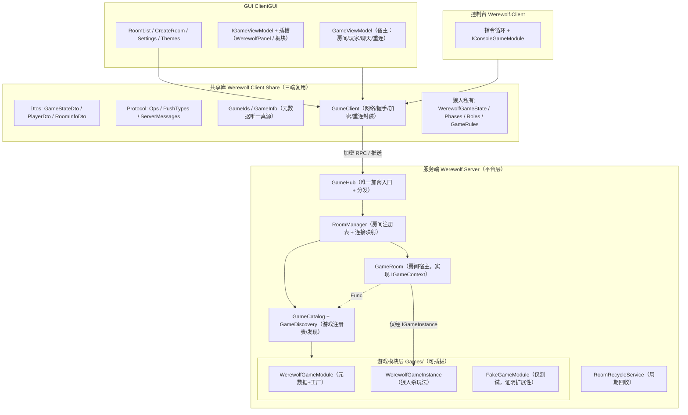
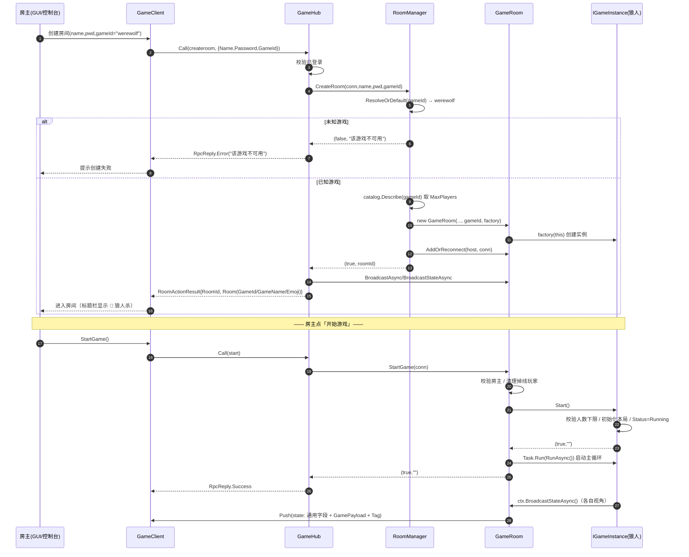
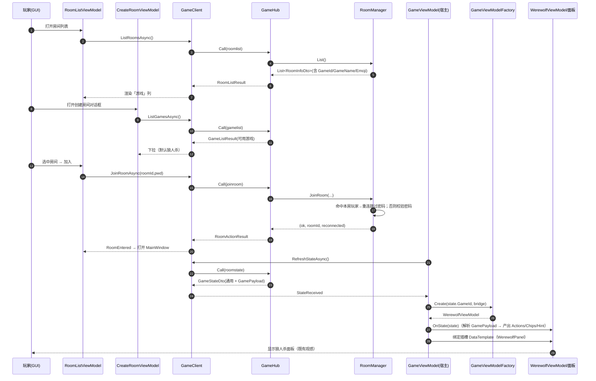
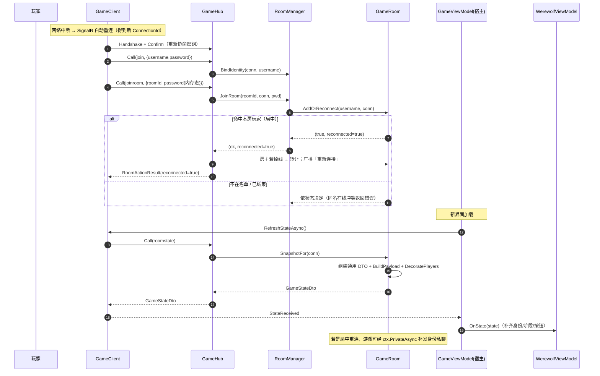
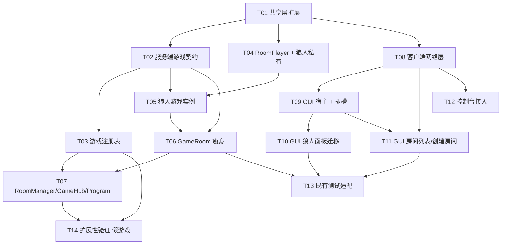

# 多游戏可插拔架构 · 实现级设计（ARCHITECTURE）

> 作者：架构师 高见远（Gao）　版本：v1.0　语言：中文
> 上游：`docs/multigame/PRD.md`（产品经理 许清楚）＋ 交付总监裁定（Q1–Q5）
> 读者：负责实现的工程师。本文只讲「怎么改、改成什么签名、按什么顺序改」，不重复 PRD。

---

## 0. 本轮裁定（先读这一节，覆盖 PRD 对应条目）

| 编号 | 裁定 | 落地要求 |
|------|------|----------|
| Q1 | 创建房间用**下拉**选游戏，默认狼人杀 | `CreateRoomWindow` 增下拉，默认 `GameIds.Werewolf` |
| Q2 | 协议用英文小写机器名，界面用中文名 + emoji，映射集中在共享库 | `GameIds`（机器名）＋ `GameInfo`（显示名/图标/简介）都在 `Werewolf.Client.Share` |
| Q3 | 房间**不能中途更换游戏** | 房间创建时绑定 `GameId`，生命周期内不可变；无「换游戏」op |
| Q4 | **本轮不中立化窗口标题**（保留「狼人杀 · 房间列表」「狼人杀 · 客户端」等现有文案），只在房间列表内新增「游戏」列 | 已在文档记录。窗口标题文案不动；房间头部是否加游戏标识见 §11-1（默认加，可一行回退） |
| Q5 | **允许破坏性协议变更，两端同步升级** | **本次为破坏性变更，服务端与 GUI/控制台双端必须同步升级。** 不实现旧客户端兼容层。服务端仍做健壮兜底：`createroom` 缺失 `GameId` → 回退 `werewolf`；未知 `GameId` → 创建失败并提示「该游戏不可用」 |

> ⚠️ **破坏性变更声明**：`GameStateDto` 的 `Phase/Day/YourRole/YourRoleDesc/ActingRole/Rules` 将**从共享协议移除**，改由各游戏私有 payload 承载（见 §4）。狼人杀「观感零变化」通过让狼人杀模块产出**等价**的标签/胶囊来实现，而不是在通用协议里保留狼人杀字段。两个客户端与服务端**必须一起升级**。

---

## 1. 方案总览

**一句话**：把「一台服务器 = 一堆狼人杀房间」改为「一台服务器 = 一个多游戏房间平台」。房间只负责**承载**（房间号/密码/房主/玩家/聊天/邀请码/重连/回收），**玩法**由可插拔的游戏模块提供。依赖方向单向：**平台 → 游戏契约（接口）**；**游戏模块 → 平台原语（`IGameContext`）**；**平台永不依赖任何具体游戏**（只通过 `GameCatalog`/反射发现间接创建）。



**边界与依赖规则（评审硬约束）**：

1. 平台层（Hub/RoomManager/GameRoom/Catalog/Recycle/AccountStore/InviteCode/ThemeManager/UiStateStore/房间列表宿主）**不得** `using`/引用任何具体游戏类型（`WerewolfGameInstance`、`WerewolfGameState` 等）。
2. 游戏模块**只能**依赖「共享库 DTO」＋「服务端 `IGameContext`/`IGameInstance` 等契约」。
3. 平台与游戏之间**唯一**的连接点是 `GameCatalog`（服务端）与「插槽 + 注册点」（客户端，见 §3.4）。新增游戏不触碰平台模块。

---

## 2. 游戏模块契约（核心）

> 命名空间：服务端契约放 `Werewolf.Server.Games`；元数据/协议放 `Werewolf.Client.Share`（三端复用）。

### 2.1 元数据与机器名（共享库）

```csharp
namespace Werewolf.Client.Share;

/// <summary>游戏机器名（协议/存储/文件命名唯一使用它；稳定不变）。</summary>
public static class GameIds
{
    public const string Werewolf    = "werewolf";
    public const string Undercover  = "undercover";   // 预留，本轮不实现
    public const string TurtleSoup  = "turtle_soup";  // 预留，本轮不实现
    public const string Default     = Werewolf;       // 缺失/未知时的回退
}

/// <summary>游戏元数据：界面显示名 / 图标 / 简介 / 人数上下限 /（可选）规则说明。
/// 由各游戏模块声明，服务器下发给客户端；界面层只从这里取显示名与图标。</summary>
public sealed class GameInfo
{
    public string GameId { get; set; } = "";
    public string DisplayName { get; set; } = "";   // 中文短名，如「狼人杀」
    public string Emoji { get; set; } = "";         // 单个 emoji，如「🐺」
    public string Tagline { get; set; } = "";       // 一句话简介（下拉/图鉴共用）
    public int MinPlayers { get; set; }
    public int MaxPlayers { get; set; }
    public string? RulesText { get; set; }          // 可选：设置/图鉴展示

    /// <summary>列表/标题里的「图标 + 显示名」，映射集中在此，避免两端拼写漂移。</summary>
    public string Label => string.IsNullOrEmpty(Emoji) ? DisplayName : $"{Emoji} {DisplayName}";
}
```

### 2.2 游戏目录 / 注册表（服务端）

```csharp
namespace Werewolf.Server.Games;

/// <summary>游戏注册表：平台查找「服务器当前可用游戏」与「实例工厂」的唯一入口。
/// 线程安全（内部 ConcurrentDictionary）；构造后只读，可被多线程并发读取。</summary>
public interface IGameCatalog
{
    /// <summary>服务器当前可用游戏（元数据，供 gamelist 下发）。</summary>
    IReadOnlyList<GameInfo> Available { get; }

    bool Contains(string gameId);
    GameInfo? Describe(string gameId);

    /// <summary>取该游戏的实例工厂；未知返回 false。</summary>
    bool TryGetFactory(string gameId, out Func<IGameContext, IGameInstance> factory);

    /// <summary>缺失/未知 gameId 的兜底解析：null/空白 → Default；未知 → 原样返回（由调用方决定拒绝）。</summary>
    string ResolveOrDefault(string? gameId);
}

public sealed class GameCatalog : IGameCatalog
{
    private readonly System.Collections.Concurrent.ConcurrentDictionary<string, IGameModule> _modules =
        new(StringComparer.Ordinal);

    /// <summary>注册一个游戏模块；重复注册以最后一次为准（幂等）。</summary>
    public void Register(IGameModule module);

    public void RegisterAll(IEnumerable<IGameModule> modules);
    // … 实现 IGameCatalog
}

/// <summary>反射发现：扫描程序集内所有「可供反射构造（公共无参构造）」的 IGameModule 实现。
/// 目的：新增游戏只需「新增一个文件」，组合根 Program.cs 不需要改。</summary>
public static class GameDiscovery
{
    public static IEnumerable<IGameModule> Discover(params System.Reflection.Assembly[] assemblies);
}
```

**为什么用反射发现**：满足「新增游戏只新增文件、不改既有平台模块」。`Program.cs` 只写一次：

```csharp
var catalog = new GameCatalog();
catalog.RegisterAll(GameDiscovery.Discover(typeof(Program).Assembly));   // 新增游戏文件即被收录
builder.Services.AddSingleton<IGameCatalog>(catalog);
```

> 备选（若担心裁剪/AOT 或需显式清单）：保留一个 `GameRegistry.RegisterDefaults(catalog)` 手写清单，作为兜底注册点。**推荐反射发现为主、手写清单为备**。

### 2.3 服务端游戏实例契约

```csharp
namespace Werewolf.Server.Games;

/// <summary>游戏状态：框架据此决定房间状态（列表 Status）与「进行中能否加入」。</summary>
public enum GameStatus { Waiting, Running, GameOver }

/// <summary>该玩家行的游戏自定义标签（狼人杀=身份名+颜色）；无标签返回 null。</summary>
public readonly record struct PlayerTag(string Text, string? ColorHex);

/// <summary>房间暴露给游戏实例的「平台能力」门面。房间实现它，游戏只依赖它。
/// 线程/锁约定：实现方内部自行加锁，调用方不应假设无锁；不得在持有房间锁时 await。</summary>
public interface IGameContext
{
    string RoomId { get; }
    string RoomName { get; }

    /// <summary>玩家快照，顺序 = 玩家编号（与 PlayerDto.Id 一致）。仅在本调用内有效。</summary>
    IReadOnlyList<RoomPlayer> Players { get; }

    /// <summary>在线（可推送）玩家快照。</summary>
    IReadOnlyList<RoomPlayer> OnlinePlayers { get; }

    RoomPlayer? FindByConnection(string connId);
    RoomPlayer? FindByName(string username);

    /// <summary>只读配置门面：游戏自取规则，无需改组合根。</summary>
    IGameConfig Config { get; }

    /// <summary>广播一条系统消息（加密后发所有在线玩家）。</summary>
    Task BroadcastAsync(string text);

    /// <summary>向单个连接私聊一条消息（加密）。</summary>
    Task PrivateAsync(string connectionId, string text);

    /// <summary>请求房间广播一次「各玩家视角状态」（房间会回调 BuildPayload / DecoratePlayers）。</summary>
    Task BroadcastStateAsync();
}

/// <summary>只读配置门面：按节点名取强类型配置（缺失返回 null），避免游戏模块改组合根。</summary>
public interface IGameConfig
{
    T? GetSection<T>(string name) where T : class, new();
}

/// <summary>一个游戏实例 = 一个房间绑定的一份玩法状态（房间锁与实例状态的关系见 §7）。</summary>
public interface IGameInstance
{
    string GameId { get; }
    GameStatus Status { get; }

    /// <summary>房主开局：校验人数下限、初始化本局状态，并把 Status 置为 Running。
    /// 框架已完成：房主身份校验、满员门禁、在线玩家清理；实例只需判「是否符合本游戏开局条件」。
    /// 返回 (成功, 错误文案)。</summary>
    (bool ok, string msg) Start();

    /// <summary>开局成功后由房间调用一次；游戏在此驱动自身主循环。
    /// 允许无阶段、纯事件驱动（海龟汤类）；必须容忍被调用时 Status 已变为 GameOver。</summary>
    Task RunAsync();

    /// <summary>处理本游戏的一次操作。op 由框架按「当前房间的游戏实例」路由到这里
    /// （框架只做透传，不理解 op 语义）。框架已做：房间存在性、连接→玩家解析、未开局兜底。</summary>
    (bool ok, string msg) HandleAction(string op, System.Text.Json.Nodes.JsonObject? payload, string connectionId);

    /// <summary>为本房间某玩家生成「该玩家视角」的游戏私有负载（序列化进 GameStateDto.GamePayload）。
    /// 视角不在房间时返回 null。</summary>
    System.Text.Json.Nodes.JsonNode? BuildPayload(string viewerConnectionId);

    /// <summary>用游戏自定义标签修饰玩家行（狼人杀填身份名/颜色）；rows 与 IGameContext.Players 同序。</summary>
    void DecoratePlayers(IReadOnlyList<PlayerDto> rows, string viewerUsername);

    /// <summary>重开清场（保留名单/房主）；由房间在 GameOver 后再次 Start 前调用。</summary>
    void Reset();

    /// <summary>玩家变更通知（可选，空实现即可）。</summary>
    void OnPlayerJoined(RoomPlayer player) { }
    void OnPlayerLeft(RoomPlayer player, bool stillInGame) { }
    void OnPlayerReconnected(RoomPlayer player) { }
}

/// <summary>游戏模块 = 元数据 + 工厂（服务端注册单元）。反射发现要求「公共无参构造」。</summary>
public interface IGameModule
{
    GameInfo Info { get; }
    IGameInstance CreateInstance(IGameContext context);
}
```

**负载承载**：`GameStateDto` 保留通用字段并新增 `GameId` + `JsonNode? GamePayload`（见 §4）。各游戏自己定义 payload 类型并解析，框架只序列化/透传。

**op 路由**：框架保留通用 op 名空间（`join/roomlist/gamelist/createroom/joinroom/leaveroom/roomstate/start/chat/ping`）；**游戏操作走「本游戏的 op 名 + 本游戏的 payload」，框架只做透传到当前游戏实例**（见 §4.3 / §4.4）。狼人杀 op（`night/vote/hunter`）由狼人杀模块自己的常量类声明，框架不认识它们。

### 2.4 客户端契约（GUI 与 控制台各自的「面板插槽」）

**GUI 侧**（`ClientGUI`）：宿主提供通用区 + 一个操作面板插槽；插槽装载的对象是 `IGameViewModel`。

```csharp
namespace ClientGUI.ViewModels;

/// <summary>标题栏/面板头部的状态胶囊（游戏自定义：狼人杀=天数/阶段/倒计时）。</summary>
public sealed class StatusChip
{
    public string Text { get; init; } = "";
    public string? ColorHex { get; init; }   // 空则用主题强调色
}

/// <summary>宿主暴露给游戏面板的桥（当前选中目标 / 房主 / 人数 / 网络客户端）。</summary>
public interface IGameHostBridge
{
    GameClient Client { get; }
    int SelectedTargetId { get; }   // -1 表示未选择
    int PlayerCount { get; }
    bool IsHost { get; }
    bool CanStartGame { get; }
}

/// <summary>每个游戏的面板视图模型契约（GUI 插槽装载的对象）。</summary>
public interface IGameViewModel
{
    string GameId { get; }

    /// <summary>操作面板按钮（绑定到插槽）。</summary>
    IReadOnlyList<GameAction> Actions { get; }

    /// <summary>标题栏/面板头的状态胶囊（游戏自定义）。</summary>
    IReadOnlyList<StatusChip> Chips { get; }

    /// <summary>阶段提示文字。</summary>
    string Hint { get; }

    /// <summary>左栏玩家行是否可作为本游戏当前操作的「目标」。</summary>
    bool CanSelectPlayer(PlayerRow row);

    /// <summary>玩家行被点选：宿主已翻转选中态；面板据此重算 Actions/Hint/Chips。</summary>
    void OnPlayerSelected(PlayerRow row);

    /// <summary>收到一次服务器状态（宿主已更新通用字段）。面板缓存之并重算。</summary>
    void OnState(GameStateDto state);

    /// <summary>选中目标 / 回合进度变化后重算（不重新拉状态）。</summary>
    void Refresh();

    /// <summary>离开房间 / 换游戏时清空。</summary>
    void Reset();
}

/// <summary>GUI 注册点：GameId → 面板视图模型。新游戏加一条 case（或用反射发现）。</summary>
internal static class GameViewModelFactory
{
    public static IGameViewModel Create(string gameId, GameClient client, IGameHostBridge bridge);
}
```

**控制台侧**（`Werewolf.Client`）：

```csharp
namespace Werewolf.Client;

/// <summary>控制台的每游戏模块：房间标题、指令处理、帮助、状态渲染。</summary>
public interface IConsoleGameModule
{
    string GameId { get; }
    string HelpText { get; }                                 // 追加到 help
    string RoomHeader(GameStateDto s);                        // 如 "🐺 狼人杀"
    string RenderState(GameStateDto s);                       // 房间内状态渲染的游戏私有部分
    /// <summary>尝试处理一条指令；返回 false 表示不是本游戏指令（交回通用指令）。</summary>
    Task<bool> TryHandleAsync(string line, GameStateDto? state, GameClient client);
}
```

---

## 3. 改动模块清单

> 图例：**新增** = 全新文件；**修改** = 改动既有文件；**移动** = 逻辑搬家（文件可能改名）。所有路径相对仓库根目录。

### 3.1 服务端 `WerewolfGame/`

| 文件路径 | 动作 | 改动要点 |
|---|---|---|
| `WerewolfGame/GameRoom.cs` | 修改 | 瘦身为**平台宿主**：只保留房间身份/玩家名单/密码/在线占用/回收相关；新增组合 `IGameInstance`；实现 `IGameContext`。`StartGame`/`SnapshotFor`/`ToInfo` 改为委托游戏实例 |
| `WerewolfGame/Models.cs` | 修改 | `Player`→`RoomPlayer`（去狼人字段，只留 `Username/ConnectionId/IsConnected/IsHost/IsAlive`）；`RoleInfo` 移到 `Games/Werewolf/RoleInfo.cs`（命名空间仍 `Werewolf.Server`，保持测试可编译） |
| `WerewolfGame/GameHub.cs` | 修改 | 分发新增 `gamelist`；`createroom` 读取 `GameId`；**默认分支**把未知 op 路由到 `room.HandleGameAction(op,payload,connId)`；删除 `start/night/vote/hunter` 的专用分支（`start` 保留为通用 op，`night/vote/hunter` 走默认分支） |
| `WerewolfGame/RoomManager.cs` | 修改 | 依赖由 `GameRules` 改为 `IGameCatalog`；`CreateRoom(connId,name,password,gameId)` 增参；未知 gameId 拒绝（`ServerMessages.GameUnavailable`）；`ToInfo` 带上游戏元数据 |
| `WerewolfGame/Program.cs` | 修改 | 构建 `GameCatalog` ＋ `GameDiscovery.Discover`；注册 `IGameCatalog` 单例；`RoomManager` 注入 catalog；启动日志改为列出可用游戏 |
| `WerewolfGame/appsettings.json` | 修改 | 狼人杀规则节点保持 `GameRules`（由狼人杀模块经 `IGameConfig.GetSection<GameRules>("GameRules")` 自取）；新增可选 `Games` 说明节点（非必需） |
| `WerewolfGame/Games/IGameModule.cs` | **新增** | `IGameInstance`/`IGameContext`/`IGameConfig`/`IGameModule`/`GameStatus`/`PlayerTag`（= §2.3） |
| `WerewolfGame/Games/GameCatalog.cs` | **新增** | `IGameCatalog` + `GameCatalog` 实现 |
| `WerewolfGame/Games/GameDiscovery.cs` | **新增** | 反射发现 `IGameModule` |
| `WerewolfGame/Games/GameConfig.cs` | **新增** | `IGameConfig` 实现（包装 `IConfiguration`，供 `IGameContext.Config`） |
| `WerewolfGame/Games/Werewolf/WerewolfGameModule.cs` | **新增** | 元数据（`GameIds.Werewolf` / 狼人杀 / 🐺 / 简介 / Min-Max）＋ `CreateInstance` |
| `WerewolfGame/Games/Werewolf/WerewolfGameInstance.cs` | **新增** | 现 `GameRoom` 的全部狼人杀玩法搬到这里（夜晚/白天/投票/猎人/胜负/角色分配/清场/主循环） |
| `WerewolfGame/Games/Werewolf/WerewolfPlayer.cs` | **新增** | 原 `Player` 的狼人字段（`Role/HasAntidote/HasPoison/LastGuardTarget/NightTarget/NightActionType/NightActionSubmitted/VoteTarget/VoteSubmitted/HunterCanShoot/HunterShotSubmitted/IsWolf`） |
| `WerewolfGame/Games/Werewolf/WerewolfOps.cs` | **新增** | 狼人杀 op 常量：`Start="start"`（复用通用）`Night="night"`、`Vote="vote"`、`Hunter="hunter"` |
| `WerewolfGame/Games/Werewolf/RoleInfo.cs` | **移动** | 原 `Models.cs` 里的 `RoleInfo`（`Name/Desc/TryParse/ResolveNightOrder`） |

### 3.2 共享库 `Werewolf.Client.Share/`

| 文件路径 | 动作 | 改动要点 |
|---|---|---|
| `Protocol.cs` | 修改 | `Ops` 精简为通用 op，新增 `GameList="gamelist"`、`Start="start"`（通用）；`ServerMessages` 新增游戏相关文案（见 §4.3） |
| `Dtos.cs` | 修改 | **破坏性**：`GameStateDto` 通用化（去 `Phase/Day/YourRole/YourRoleDesc/ActingRole/Rules`，加 `GameId/Running/Status/GamePayload`）；`PlayerDto` 的 `Role` → `Tag`/`TagColor`；`RoomInfoDto` 加 `GameId/GameName/GameEmoji`；`CreateRoomPayload` 加 `GameId` |
| `GameIds.cs` | **新增** | `GameIds` 常量类 |
| `GameInfo.cs` | **新增** | `GameInfo` 元数据（含 `Label`） |
| `Games/WerewolfGameState.cs` | **新增** | 狼人杀私有 payload：`Phase/Day/YourRole/YourRoleDesc/ActingRole/Rules` |
| `Games/WerewolfOps.cs` | **新增** | 供客户端引用的狼人杀 op 常量（与服务器同名常量对齐；可致两处同值） |
| `GameClient.cs` | 修改 | `CreateRoomAsync(name,password,gameId)`；新增 `ListGamesAsync()`；新增 `CallGameOpAsync(op,payload)`；`LastState` 保持 `GameStateDto`（新形状） |

### 3.3 GUI `ClientGUI/`

| 文件路径 | 动作 | 改动要点 |
|---|---|---|
| `MainWindow.xaml(.cs)` | 修改 | 标题栏「天数/阶段/倒计时」胶囊改为绑定 `Game.Chips`；**窗口标题文案保持「狼人杀 · 客户端」（Q4）** |
| `Views/ActionPanel.xaml(.cs)` | 修改 | 改为**插槽容器**：`<ContentControl Content="{Binding Game}" ContentTemplateSelector="{StaticResource GamePanelSelector}"/>`；`玩法提示` 静态文案移入狼人杀面板 |
| `Views/Games/WerewolfPanel.xaml(.cs)` | **新增** | 原 `ActionPanel.xaml` 的正文（阶段头 + Actions + 玩法提示），DataContext = `WerewolfViewModel` |
| `Views/Games/UnknownGamePanel.xaml(.cs)` | **新增** | 兜底面板：未知游戏时提示「本客户端暂不支持该游戏」 |
| `Themes/GamePanels.xaml` | **新增** | 插槽 DataTemplate 注册：`WerewolfViewModel→WerewolfPanel`、`UnknownGameViewModel→UnknownGamePanel` |
| `Themes/Panels.xaml` | 修改 | 合并 `GamePanels.xaml`（一行 MergedDictionaries） |
| `ViewModels/GameViewModel.cs` | 修改 | 瘦身为**宿主**：连接/心跳/房间信息/玩家列表/聊天/日志/保留询问/退出房间；游戏相关全部委托 `Game`（`IGameViewModel`）；状态到达时按 `GameId` 切换 `Game` |
| `ViewModels/IGameViewModel.cs` | **新增** | `IGameViewModel` / `IGameHostBridge` / `StatusChip`（= §2.4） |
| `ViewModels/GameViewModelFactory.cs` | **新增** | GUI 注册点：`GameId → IGameViewModel` |
| `ViewModels/Games/Werewolf/WerewolfViewModel.cs` | **新增** | 现 `GameViewModel` 的狼人逻辑：阶段/身份/夜间/投票/猎人/回合进度/倒计时 → 产出 `Actions/Hint/Chips` |
| `ViewModels/Games/Werewolf/WerewolfCommands.cs` | **移动** | 原 `GameCommands.cs`（改为狼人杀命令集） |
| `ViewModels/Games/Werewolf/WerewolfActionFactory.cs` | **移动** | 原 `GameActionFactory.cs` + `ActionContext` |
| `ViewModels/PhaseCountdown.cs` | **移动** | 移入 `Games/Werewolf/`（狼人杀私有） |
| `ViewModels/PlayerRow.cs` | 修改 | `Role`→`Tag`/`TagColor`；`RoleText`→`TagText`；`RoleBrush`→按 `TagColor` 解析 |
| `ViewModels/RoomListViewModel.cs` | 修改 | `RoomRow` 加 `GameText`；`CreateAndJoinAsync(name,password,gameId)` |
| `Views/RoomListWindow.xaml` | 修改 | 新增「游戏」列（列序：房间号→游戏→房间名→人数→状态→加密→房主）；**窗口标题保持「狼人杀 · 房间列表」（Q4）** |
| `ViewModels/CreateRoomViewModel.cs` | 修改 | 新增 `Games`（`List<GameInfo>`）＋ `SelectedGame`（默认狼人杀） |
| `Views/CreateRoomWindow.xaml(.cs)` | 修改 | 新增游戏下拉（图标+显示名+简介）；窗口高度 +一行；`SelectedGameId` 暴露给调用方 |
| `ViewModels/GamePanelPromptHelper`/`GameLog`/`GameAction`/`LogKinds` | 不变/微调 | `GameAction`/`LogEntry`/`LogKinds` 保持通用宿主类型 |

### 3.4 GUI 插槽装载机制（「操作面板插槽」的落法）

- 宿主 `GameViewModel` 持有 `public IGameViewModel Game { get; }`（随 `GameId` 切换）。
- `Views/ActionPanel.xaml` 通过 `ContentControl` + `GamePanelTemplateSelector`（资源键 `GamePanelSelector`）按**运行时类型**选模板；模板在 `Themes/GamePanels.xaml` 里按 `DataType` 注册（`WerewolfViewModel → WerewolfPanel`）。
- 新增游戏：新增 `WerewolfPanel` 同级的 `XxxPanel.xaml` + 一条 `DataTemplate` + `GameViewModelFactory` 一条 case。**这两处是「注册点」，不是平台模块**（房间/账号/邀请码/重连/主题/大厅宿主逻辑不动）。

### 3.5 控制台 `Werewolf.Client/`

| 文件路径 | 动作 | 改动要点 |
|---|---|---|
| `Program.cs` | 修改 | 房间列表每行带游戏类型；创建流程选游戏；房间标题带游戏；指令循环把「游戏指令」委派给 `IConsoleGameModule`；`help` 合并通用+游戏帮助 |
| `ConsoleGameRegistry.cs` | **新增** | `GameId → IConsoleGameModule` 注册点 + 未知兜底 |
| `Games/WerewolfConsoleModule.cs` | **新增** | 狼人杀指令（`start` 复用通用 / 数字 / `heal` / `poison x` / `none`）＋ `RenderState` 打印身份/玩家列表（复用现 `RenderState`） |

### 3.6 测试宿主 `ClientGUI.Tests/`

| 文件路径 | 动作 | 改动要点 |
|---|---|---|
| `RoomTests.cs` | 修改 | `NewManager` 改为构建 `GameCatalog`（注册狼人杀模块）＋ `new RoomManager(channel, catalog, options)`；`CreateRoom` 带 `GameIds.Werewolf` |
| `MultiRoomProbe.cs` | 修改 | `HeadlessChecks` 的 D10 改为经狼人杀实例断言「开局重置」（`new GameRoom(..., GameIds.Werewolf, werewolfFactory)`） |
| `ActionComputationTests.cs` | 修改 | 断言不变，但改为驱动 `WerewolfViewModel`（构造宿主桥 + `OnState`）；`GameViewModel` 不再含阶段/动作 |
| `UiSmokeCheck.cs` | 修改 | 增加 `WerewolfPanel` / `UnknownGamePanel` 实例化（插槽 DataTemplate 收敛性校验） |
| `FakeGameProbe.cs` | **新增** | **扩展性验证**：注册一个假游戏模块，走完 5 类接入点，证明「新增游戏不改既有平台模块」（见 §8） |
| `Program.cs` | 修改 | 默认模式追加运行 `FakeGameProbe` |
| `LifecycleProbe/IntegrationProbe/HostInviteProbe/ReconnectProbe` | 不改（预期） | 只用 `RoomInfoDto` 旧字段 + `createroom` 不带 `GameId`（服务端回退 werewolf），行为不变；若编译报错按 §4 新签名微调 |

### 3.7 逐条核对 PRD §5.4 的 5 类接入点（证明「新增游戏不改平台模块」）

| # | 接入点 | 落到哪个文件（新增） | 改既有平台模块？ |
|---|--------|----------------------|------------------|
| 1 | 登记游戏元数据 | `Games/<Game>/<Game>GameModule.cs`（`Info`）；由 `GameDiscovery` 反射自动收录 | **否** |
| 2 | 实现游戏逻辑模块 | `Games/<Game>/<Game>GameInstance.cs` | **否** |
| 3 | 声明本游戏操作协议 | `<Game>Ops.cs` + payload DTO（共享库 `Games/`）＋ 客户端 `CallGameOpAsync` | **否** |
| 4 | 提供本游戏操作面板 | GUI：`Views/Games/<Game>Panel.xaml` + `Themes/GamePanels.xaml` 一条 DataTemplate + `GameViewModelFactory` 一条 case；控制台：`Games/<Game>ConsoleModule.cs` + `ConsoleGameRegistry` 一条 case | 仅**注册点**（工厂/模板表），非平台模块 |
| 5 | （可选）声明规则展示 | `GameInfo.RulesText` | **否** |

**核对平台模块改动数 = 0**：`RoomManager` / `AccountStore`（账号登录）/ `InviteCode` / 断线重连（`GameClient` 的重连链路）/ `ThemeManager` + `UiStateStore`（主题/设置）/ 大厅与房间列表**宿主逻辑**（`RoomListViewModel` 的刷新/加入/邀请码/密码门禁）——**新增游戏均不触碰**。（本轮为**一次性抽象改造**，其中「列表新增游戏列」属本轮需求，不算「新增游戏」的接入成本。）

---

## 4. 协议设计

### 4.1 `Ops`（服务端 → 分发；客户端 → 请求）

```csharp
public static class Ops
{
    // 账号 / 房间（通用，语义不变）
    public const string Join        = "join";
    public const string RoomList    = "roomlist";
    public const string CreateRoom  = "createroom";   // 新增携带 GameId
    public const string JoinRoom    = "joinroom";
    public const string LeaveRoom   = "leaveroom";
    public const string State       = "roomstate";    // 主动拉「我视角状态」

    // 通用游戏生命周期（框架理解，非某游戏专属）
    public const string Start       = "start";        // 房主开局（对所有游戏通用）
    public const string Chat        = "chat";
    public const string Ping        = "ping";

    // 新增：查询「服务器当前可用游戏」
    public const string GameList    = "gamelist";

    // ⚠️ 注意：night / vote / hunter 不再是框架 op；它们由狼人杀模块自己的
    //    Games/WerewolfOps.cs 声明，走 GameHub 的「默认分支」路由到游戏实例。
}
```

> **路由规则**：`DispatchAsync` 的 `switch` 只列举通用 op；`default` 分支若当前连接有房间，则 `room.HandleGameAction(request.Op, request.Payload, connId)`；无房间返回 `ServerMessages.NotInRoom`。这样**框架不认识任何具体游戏的 op**。

### 4.2 新增/变更 DTO（精确 C# 定义）

```csharp
// —— 变更：创建房间请求新增 GameId ——
public sealed class CreateRoomPayload
{
    public string Name { get; set; } = "";
    public string? Password { get; set; }
    public string? GameId { get; set; }   // 新增：null/空白 → 服务端回退 werewolf
}

// —— 变更：房间摘要新增游戏元数据 ——
public sealed class RoomInfoDto
{
    public string Id { get; set; } = "";
    public string Name { get; set; } = "";
    public string GameId { get; set; } = GameIds.Werewolf;   // 新增
    public string GameName { get; set; } = "";               // 新增：显示名（冗余，便于即时渲染）
    public string GameEmoji { get; set; } = "";              // 新增：图标
    public int PlayerCount { get; set; }
    public int MaxPlayers { get; set; }
    public string Status { get; set; } = "";                 // Waiting|Running|GameOver
    public bool HasPassword { get; set; }
    public string Host { get; set; } = "";
}

// —— 新增：可用游戏列表结果（gamelist 的 Payload）——
public sealed class GameListResult
{
    public bool Ok { get; set; } = true;
    public string Msg { get; set; } = "";
    public List<GameInfo> Games { get; set; } = new();
}
```

### 4.3 `GameStateDto` 变更前后对照 + `PlayerDto`

**变更前（狼人杀语义）**

```csharp
public class GameStateDto {
    public string Phase; public int Day;
    public int YourId; public string YourRole; public string YourRoleDesc;
    public bool IsAlive; public string ActingRole;
    public GameRules? Rules;
    public string RoomId; public string RoomName; public string HostName;
    public List<PlayerDto> Players;
}
public class PlayerDto { public int Id; public string Name; public bool IsAlive;
    public bool IsHost; public bool IsYou; public bool IsConnected; public string? Role; }
```

**变更后（通用信封 + 游戏私有 payload）**

```csharp
public class GameStateDto
{
    // 平台/通用字段（框架填充，所有游戏一致）
    public string GameId { get; set; } = GameIds.Werewolf;   // 新增：房间绑定的游戏
    public string RoomId { get; set; } = "";
    public string RoomName { get; set; } = "";
    public string HostName { get; set; } = "";
    public bool Running { get; set; }                        // 新增：是否进行中
    public string Status { get; set; } = RoomStatus.Waiting;// 新增：与房间列表一致的状态
    public int YourId { get; set; }
    public bool IsAlive { get; set; } = true;                // 通用：是否仍在游戏中
    public List<PlayerDto> Players { get; set; } = new();

    // 游戏私有负载（各游戏自定义，框架原样透传；狼人杀见下表）
    public System.Text.Json.Nodes.JsonNode? GamePayload { get; set; }
}

public class PlayerDto
{
    public int Id { get; set; }
    public string Name { get; set; } = "";
    public bool IsAlive { get; set; } = true;
    public bool IsHost { get; set; }
    public bool IsYou { get; set; }
    public bool IsConnected { get; set; } = true;
    public string? Tag { get; set; }        // 通用：游戏自定义短标签（狼人杀=身份名；卧底=词条提示"你已发言"等）
    public string? TagColor { get; set; }   // 通用：标签颜色 hex（可空）
}
```

**狼人杀私有 payload（`Games/WerewolfGameState.cs`）**

```csharp
public sealed class WerewolfGameState
{
    public string Phase { get; set; } = "";          // Phases.* 常量
    public int Day { get; set; }
    public string YourRole { get; set; } = "";
    public string YourRoleDesc { get; set; } = "";
    public string ActingRole { get; set; } = "";     // 夜晚当前轮到行动的角色（中文名）
    public GameRules? Rules { get; set; }
}
```

> **观感零变化的保证**：狼人杀模块在 `DecoratePlayers` 里把 `Tag` 设为 `RoleInfo.Name(role)`（与该角色在原 `PlayerRow.RoleBrush` 中使用的颜色对应的 hex 写入 `TagColor`）；在 `BuildPayload` 里填 `Phase/Day/YourRole/YourRoleDesc/ActingRole/Rules`；面板 `WerewolfViewModel` 用它们产出与旧版**逐字相同**的按钮、提示、胶囊文案与配色。旧 `ActionComputationTests` 的断言值（如「确认击杀」「第 3 天」「💬 讨论」）在迁移后应全部保持通过。

### 4.4 狼人杀操作协议（由狼人杀模块声明，框架透传）

```csharp
// WerewolfGame/ 与 Share/ 各一份（值必须一致）
public static class WerewolfOps
{
    public const string Night  = "night";   // payload: { TargetId:int, Action:"do|heal|poison|none" }
    public const string Vote   = "vote";    // payload: { TargetId:int }（-1 弃票）
    public const string Hunter = "hunter";  // payload: { TargetId:int }（-1 放弃）
}
```

可用 payload 类型保持原样（`NightPayload` / `TargetPayload`），仅从 `GameClient` 的**狼人杀调用**里使用。

### 4.5 错误文案（统一放 `ServerMessages`）

```csharp
public static class ServerMessages
{
    // …原有保持不变（Ok/NotLoggedIn/NotInRoom/RoomNotFound/WrongPassword/
    //   GameInProgress/OnlyHostCanStart/TooManyRooms/AlreadyInRoom/RoomFull(n)）…

    /// <summary>createroom 的 GameId 服务器不支持。</summary>
    public const string GameUnavailable = "该游戏不可用";

    /// <summary>gamelist 不可用（理论不出现，兜底）。</summary>
    public const string GameListFailed  = "无法获取游戏列表";
}
```

规则：`createroom` 的 `GameId` 为 null/空白 → 回退 `GameIds.Werewolf`；非空但 `catalog.Contains(gameId)==false` → 返回 `RpcReply.Error(ServerMessages.GameUnavailable)`。**不新增「房间内换游戏」的任何 op**（Q3）。

---

## 5. 狼人杀迁移映射表（逐条）

> 现 `GameRoom` 的**每一个成员**迁到哪里。这是最容易出错的地方，请逐条对照。

### 5.1 字段

| 现成员 | 去向 | 说明 |
|---|---|---|
| `_players : List<Player>` | **平台**（`GameRoom`） | 类型改名 `RoomPlayer` |
| `Player.Username/ConnectionId/IsConnected/IsHost/IsAlive` | **平台**（`RoomPlayer`） | 通用字段保留；`IsAlive` 由游戏写、平台读（聊天门禁/列表） |
| `Player.Role` | **狼人**（`WerewolfPlayer.Role`） | 移出平台类型 |
| `Player.HasAntidote/HasPoison/LastGuardTarget` | **狼人**（`WerewolfPlayer`） | 女巫/守卫状态 |
| `Player.NightTarget/NightActionType/NightActionSubmitted` | **狼人**（`WerewolfPlayer`） | 夜间行动 |
| `Player.VoteTarget/VoteSubmitted` | **狼人**（`WerewolfPlayer`） | 投票 |
| `Player.HunterCanShoot/HunterShotSubmitted` | **狼人**（`WerewolfPlayer`） | 猎人 |
| `Player.IsWolf` | **狼人**（`WerewolfPlayer.IsWolf`） | |
| `_rng : Random` | **狼人**（`WerewolfGameInstance._rng`） | 角色洗牌/平票随机 |
| `_rules : GameRules` | **狼人**（实例读 `IGameConfig`） | 房间不再持有；房间人数上下限改取自 `GameInfo` |
| `_nightOrder : List<Role>` | **狼人** | |
| `_channel : EncryptedChannel` | **平台**（房间） | 通过 `IGameContext.Broadcast/Private` 暴露给游戏 |
| `_sync : object` | **平台**（房间） | 游戏实例用自己的锁（§7） |
| `_passwordHash` | **平台** | 不变 |
| `_emptySince` | **平台** | 不变 |
| `_persistent` | **平台** | 不变 |
| `_phase` | **狼人** | 原 `Phase` 枚举搬入狼人模块 |
| `_day` | **狼人** | |
| `_running` | **平台**（`GameRoom.IsRunning` 委托 `_game.Status`） | 平台据 `GameStatus.Running` 判定 |
| `_actingRole` | **狼人** | |
| `_wolfTarget/_guardTarget/_witchHealTarget/_witchPoisonTarget` | **狼人** | |
| `Id/Name/HasPassword/CreatedAt` | **平台** | 不变 |
| `HostUsername/PlayerCount/ConnectedCount/EmptySince/Persistent` | **平台** | 不变 |
| `IsRunning` | **平台** | 委托游戏状态 |
| `Phase`（公开属性） | **移除** | 游戏私有；如需诊断用 `_game.Status` |

### 5.2 方法

| 现方法 | 去向 | 说明 |
|---|---|---|
| 构造函数 | **平台** | 改签名为 `(id,name,password,channel,gameId,gameFactory)` |
| `TouchOccupancy` | **平台** | 不变 |
| `VerifyPassword` | **平台** | 不变 |
| `GetPlayerByName` | **平台** | 改返回 `RoomPlayer?` |
| `GetPlayer(connId)` | **平台** | 改返回 `RoomPlayer?` |
| `SnapshotFor(connId)` | **平台** | 组装通用 DTO + 调 `_game.BuildPayload` / `_game.DecoratePlayers` |
| `ToInfo()` | **平台** | 新增 `GameId/GameName/GameEmoji`；`MaxPlayers` 取自 `GameInfo` |
| `AddOrReconnect` | **平台** | 门禁人数改取 `GameInfo.MaxPlayers`；「进行中/非等待」判定改用 `_game.Status`；成功后调 `_game.OnPlayerJoined/Reconnected` |
| `OnDisconnected` | **平台** | 房主交接逻辑不变；额外调 `_game.OnPlayerLeft` |
| `StartGame(connId)` | **平台外壳** | 校验房主 → 调 `_game.Start()` → `_ = Task.Run(_game.RunAsync)` |
| `ResetForNewGame` | **狼人**（`Reset`） | |
| `AssignRoles` | **狼人** | |
| `SubmitNightAction` | **狼人**（`HandleAction(Night,…)`） | |
| `SubmitVote` | **狼人**（`HandleAction(Vote,…)`） | |
| `SubmitHunterShot` | **狼人**（`HandleAction(Hunter,…)`） | |
| `RunAsync` | **狼人**（`RunAsync`） | 通过 `IGameContext` 广播 |
| `NightPhaseAsync`/`NightStepAsync`/`GuardStep`/`WerewolfStep`/`WitchStep`/`SeerStep` | **狼人** | |
| `DayPhaseAsync`/`VotePhaseAsync`/`HunterShootAsync`/`CheckGameOverAsync` | **狼人** | |
| `ResetNightData`/`SetPhase` | **狼人** | |
| `PlayerById`/`IsAlive`/`NameOf`/`IdOf`/`AliveWithRole` | **狼人** | 基于 `IGameContext.Players` 快照 |
| `Connected()`/`ConnectedPlayers()` | **平台** | 推送目标由平台管理 |
| `PickMostVotedNight`/`WaitNightActionAsync`/`WaitUntilAsync` | **狼人** | |
| `BroadcastAsync`/`PrivateAsync`/`PrivateToAsync` | **平台**（`IGameContext`） | 游戏经接口调用 |
| `SendAllRolesAsync`/`ResendRoleAsync`/`BroadcastAllRolesAsync` | **狼人** | 身份私聊是狼人语义 |
| `BroadcastStateAsync` | **平台**（`IGameContext.BroadcastStateAsync`） | 房间遍历在线玩家、逐个生成 DTO |
| `BuildStateFor` | **平台 + 狼人** | 通用字段平台填；`GamePayload`/`Tag` 狼人填 |

---

## 6. 时序图

> 对应 `docs/multigame/sequence-diagram.mermaid`（另存），共 3 张。

### 6.1 创建指定游戏的房间并开局



### 6.2 浏览列表 → 加入 → 按游戏装载面板



### 6.3 断线重连（含主动拉取状态）



---

## 7. 并发与隔离

1. **两把锁分离**：
   - **房间锁 `GameRoom._sync`**：只保护「玩家名单 / 身份标识 / 在线占用 / 房主」这些平台状态。持锁期间**绝不 await**（沿用现约定）。
   - **游戏锁 `IGameInstance._sync`**：保护游戏私有状态（阶段/夜晚目标/各玩家技能数据）。`IGameInstance` 的所有公开方法内部自行加锁；`BuildPayload`/`DecoratePlayers` 内部取一次快照后立即释放。
   - **跨层调用顺序**：`RoomManager`（无锁，仅 `ConcurrentDictionary`）→ `Room.StartGame` 持房间锁完成玩家校验后**释放锁**再调 `_game.Start()`；`_game.RunAsync` 后台线程只走 `IGameContext`（其实现内部各自持锁），不会与房间锁形成环路。
2. **游戏目录线程安全**：`GameCatalog` 用 `ConcurrentDictionary`；启动期 `Register` 完成后只读，运行期查表无锁。
3. **房间回收**：`RecycleExpired` 只读 `Persistent/ConnectedCount/EmptySince`（平台字段），**不触碰游戏实例**，语义与现状完全一致。
4. **房主交接**：`OnDisconnected` 逻辑不变（按加入顺序转让），仅在转让后额外通知 `_game.OnPlayerLeft`（游戏据 `stillInGame`=是否开局中决定是否保留玩家数据）。
5. **保留房间 `Persistent`**：仍由平台字段决定，游戏无感知；「保留房被他人加入后新房主」语义不变。
6. **状态推送隔离**：`BroadcastStateAsync` 为**每个在线玩家生成独立 DTO**（视角隔离），游戏私有 payload（如身份）只进入该玩家自己的 DTO。

---

## 8. 测试策略

**前提：6 个既有模式全部继续可用**：默认（逻辑断言）、`--ui`、`--server`、`--rooms`、`--lifecycle`、`--hostinvite`、`--reconnect`。

- `--ui`：扫描所有 XAML 的 `{DynamicResource XxxBrush}` 并校验两套配色都覆盖 → **新增 XAML 必须复用既有配色键**（本设计不新增颜色键）；新增实例化 `WerewolfPanel`/`UnknownGamePanel` 以确认插槽 DataTemplate 收敛。
- 纯逻辑三件套（`ActionComputationTests`/`CryptoTests`/`GameRulesTests`/`RoomTests`）继续在默认模式跑；`ActionComputationTests` 改为驱动 `WerewolfViewModel`，**断言值不变**（保住狼人杀回归）。
- `RoomTests.NewManager` 改为 `new RoomManager(channel, BuildCatalog(), options)`；`CreateRoom` 带 `GameIds.Werewolf`。
- 端到端探针（`--server/--rooms/--lifecycle/--hostinvite/--reconnect`）：`createroom` 不带 `GameId` → 服务端回退狼人杀，**探针预期不改**。

**扩展性验证（硬要求，不靠文档承诺）**：新增 `ClientGUI.Tests/FakeGameProbe.cs`（默认模式运行），用一个**假游戏模块**证明「新增游戏不改既有平台模块」：

```csharp
// —— 测试专用假游戏：无阶段、无夜晚，只有"举手"一种操作 ——
internal sealed class FakeGameModule : IGameModule
{
    public GameInfo Info => new()
    { GameId = "fake_probe", DisplayName = "假游戏", Emoji = "🧪",
      Tagline = "测试用", MinPlayers = 1, MaxPlayers = 4 };

    public IGameInstance CreateInstance(IGameContext ctx) => new FakeGameInstance(ctx, Info);
}

internal sealed class FakeGameInstance : IGameInstance
{
    private readonly IGameContext _ctx;
    private readonly object _sync = new();
    private GameStatus _status = GameStatus.Waiting;
    public GameInfo Info { get; }
    public FakeGameInstance(IGameContext ctx, GameInfo info) { _ctx = ctx; Info = info; }
    public string GameId => Info.GameId;
    public GameStatus Status { get { lock (_sync) return _status; } }
    public (bool ok, string msg) Start()
    { lock (_sync) _status = GameStatus.Running; return (true, ""); }
    public async Task RunAsync() { await _ctx.BroadcastAsync("🧪 假游戏开始（无阶段）"); }
    public (bool ok, string msg) HandleAction(string op, JsonObject? p, string conn)
    { lock (_sync) { if (_status != GameStatus.Running) return (false, "未开始"); } return (true, ""); }
    public JsonNode? BuildPayload(string conn) => new JsonObject { ["note"] = "fake" };
    public void DecoratePlayers(IReadOnlyList<PlayerDto> rows, string viewer)
    { foreach (var r in rows) r.Tag = "🧪"; }
    public void Reset() { lock (_sync) _status = GameStatus.Waiting; }
}

// FakeGameProbe：注册假游戏 → 建目录/房间 → 断言平台无需改动即支持它
public static void RunAll()
{
    var catalog = new GameCatalog();
    catalog.Register(new WerewolfGameModule());
    catalog.Register(new FakeGameModule());
    Check.True(catalog.Contains("fake_probe"), "扩展性：新游戏登记后立即被目录收录");
    Check.Equal(2, catalog.Available.Count, "扩展性：目录同时列出狼人杀与假游戏");

    var mgr = new RoomManager(channel, catalog, options);
    mgr.BindIdentity("c1", "u1");
    var r = mgr.CreateRoom("c1", "假游戏房", null, "fake_probe");
    Check.True(r.ok, "扩展性：用新游戏创建房间成功（平台零改动）");
    var room = mgr.Find(r.roomId)!;
    Check.Equal("fake_probe", room.ToInfo().GameId, "扩展性：房间绑定新游戏");
    Check.Equal(4, room.ToInfo().MaxPlayers, "扩展性：人数上限取自新游戏元数据");
    Check.True(room.StartGame("c1").ok, "扩展性：新游戏可经通用 start 开局");
    var dto = room.SnapshotFor("c1")!;
    Check.Equal("fake_probe", dto.GameId, "扩展性：状态快照携带新游戏 GameId");
    Check.True(dto.GamePayload != null && dto.GamePayload["note"]!.GetValue<string>() == "fake",
        "扩展性：游戏私有 payload 原样透传");
    Check.Equal("🧪", dto.Players[0].Tag, "扩展性：游戏自定义玩家标签生效");
}

// 另需断言：本轮未修改 RoomManager/账号/邀请码/主题等平台文件即可让假游戏跑通
// （通过"FakeGameProbe 不依赖任何狼人杀类型"这一事实间接证明）。
```

**再走一遍「谁是卧底」**（§10 已逐点核对）：证明抽象不绑回合制。结论——接入点 1–4 完全覆盖，**不需要新增框架能力**。

---

## 9. 任务列表（有序、带依赖、可验证完成标准）

> 预计 14 个任务；粒度适合工程师批量实现。依赖关系见 §（末尾图）。

| # | 任务标题 | 所属文件 | 依赖 | 完成标准（可验证） |
|---|----------|----------|------|--------------------|
| T01 | **共享层扩展：元数据 + 通用协议 + 狼人 payload** | `Share/GameIds.cs`(新)、`GameInfo.cs`(新)、`Dtos.cs`、`Protocol.cs`、`Games/WerewolfGameState.cs`(新)、`Games/WerewolfOps.cs`(新) | — | 编译通过；`GameStateDto` 通用化（无 `Phase/YourRole` 等字段）；`RoomInfoDto` 带 `GameId/GameName/GameEmoji`；`CreateRoomPayload.GameId`；`Ops.GameList`；`PlayerDto.Tag/TagColor`；`WerewolfGameState` 可 JSON 往返 |
| T02 | **服务端游戏契约** | `WerewolfGame/Games/IGameModule.cs`(新)、`GameConfig.cs`(新) | T01 | 定义 `IGameModule/IGameInstance/IGameContext/IGameConfig/GameStatus/PlayerTag`；空实现可编译 |
| T03 | **服务端游戏注册表** | `Games/GameCatalog.cs`(新)、`Games/GameDiscovery.cs`(新) | T02 | `Register/Available/Contains/Describe/TryGetFactory/ResolveOrDefault` 可用；`Discover` 能反射出模块；`ResolveOrDefault(null)==werewolf` |
| T04 | **服务端类型拆分：RoomPlayer + 狼人私有** | `Models.cs`、`Games/Werewolf/RoleInfo.cs`(移动)、`Games/Werewolf/WerewolfPlayer.cs`(新)、`Games/Werewolf/WerewolfOps.cs`(新) | T01 | `RoomPlayer` 只留通用字段；狼人字段迁入 `WerewolfPlayer`；`RoleInfo` 命名空间仍 `Werewolf.Server`（旧测试可编译） |
| T05 | **狼人游戏实例（玩法迁移）** | `Games/Werewolf/WerewolfGameInstance.cs`(新)、`WerewolfGameModule.cs`(新) | T02,T04 | 夜晚/白天/投票/猎人/胜负/洗牌/清场/主循环全部迁入；`Start/HandleAction/BuildPayload/DecoratePlayers/Reset` 实现；`GameInfo` 人数 4–12 |
| T06 | **GameRoom 瘦身为平台宿主** | `GameRoom.cs` | T02,T05 | 身份/名单/密码/占用/回收逻辑保留；组合 `IGameInstance`；实现 `IGameContext`；`StartGame` 与 `SnapshotFor` 委托游戏；`IsRunning` 委托 `GameStatus`；`ToInfo` 带游戏元数据 |
| T07 | **RoomManager + GameHub + Program** | `RoomManager.cs`、`GameHub.cs`、`Program.cs`、`appsettings.json` | T03,T06 | `CreateRoom` 带 gameId（缺失回退、未知拒绝「该游戏不可用」）；Hub 新增 `gamelist`、默认分支路由游戏 op；Program 构建 catalog 并注册 |
| T08 | **客户端网络层** | `Share/GameClient.cs` | T01 | `CreateRoomAsync(name,pwd,gameId)`、`ListGamesAsync()`、`CallGameOpAsync(op,payload)`；`LastState` 为新 DTO；握手/重连链路不变 |
| T09 | **GUI 宿主瘦身 + 插槽** | `ViewModels/GameViewModel.cs`、`IGameViewModel.cs`(新)、`GameViewModelFactory.cs`(新)、`Views/ActionPanel.xaml(.cs)`、`Themes/GamePanels.xaml`(新)、`Themes/Panels.xaml`、`MainWindow.xaml(.cs)` | T08 | `GameViewModel` 仅保留宿主职责；插槽按 `GameId` 装载 `Game`；标题栏胶囊绑定 `Game.Chips`；窗口标题文案保持狼人杀 |
| T10 | **GUI 狼人面板迁移** | `Views/Games/WerewolfPanel.xaml(.cs)`(新)、`ViewModels/Games/Werewolf/WerewolfViewModel.cs`(新)、`WerewolfCommands.cs`(移)、`WerewolfActionFactory.cs`(移)、`PhaseCountdown.cs`(移)、`Views/Games/UnknownGamePanel.xaml(.cs)`(新) | T09 | 狼人杀按钮/提示/倒计时/身份展示与旧版**逐字一致**；未知游戏走兜底面板 |
| T11 | **GUI 房间列表/创建房间接入游戏** | `RoomListViewModel.cs`、`RoomListWindow.xaml`、`CreateRoomViewModel.cs`、`CreateRoomWindow.xaml(.cs)`、`PlayerRow.cs` | T08,T09 | 列表有「游戏」列（图标+显示名）；创建房间下拉默认狼人杀；`PlayerRow` 用 `Tag/TagColor`；窗口标题文案保持狼人杀 |
| T12 | **控制台接入** | `Werewolf.Client/Program.cs`、`ConsoleGameRegistry.cs`(新)、`Games/WerewolfConsoleModule.cs`(新) | T08 | 列表每行带游戏；创建流程选游戏；房间标题带游戏；狼人杀指令（start/数字/heal/poison/none）保持可用 |
| T13 | **既有测试适配** | `ClientGUI.Tests/RoomTests.cs`、`MultiRoomProbe.cs`、`ActionComputationTests.cs`、`UiSmokeCheck.cs` | T06,T10,T11 | 默认/`--ui`/`--rooms` 通过；狼人杀断言值不变 |
| T14 | **扩展性验证（假游戏）** | `ClientGUI.Tests/FakeGameProbe.cs`(新)、`ClientGUI.Tests/Program.cs` | T03,T07 | 假游戏经目录注册、建房、开局、快照全链路通过；默认模式全绿 |

**依赖图**：见 §11 之后（末尾 Mermaid）。

**任务分组说明（为什么 ≤5 之外给 14 个）**：本项目的「5 任务上限」是**面向通用 Web 脚手架的默认指引**；本任务是**对既有大型 C# 解决方案的增量改造**，涉及服务端/共享库/GUI/控制台/测试 5 个工程且存在强编译依赖，拆成 14 个可编译、可独立验证的步骤才能让工程师「每步都能 build」。若必须压缩到 5 个批次，按工程合并：①T01–T04（契约）②T05–T07（服务端）③T08–T09（客户端骨架）④T10–T12（三端面板）⑤T13–T14（测试）。

---

## 10. 共享知识（跨文件约定）

- **命名**：机器名 `snake_case`（`werewolf` / `undercover` / `turtle_soup`）；C# 类型 `PascalCase`；op 常量类 `<Game>Ops`；面板 `<Game>Panel.xaml` / `<Game>ViewModel`。
- **`GameId` 常量位置**：唯一真源 `Werewolf.Client.Share.GameIds`；服务端/客户端**都**引用它，禁止字面量散落。
- **文案**：所有面向用户的错误放 `ServerMessages`；皮肤文案放各游戏（如狼人 `RoleInfo`）。界面统一「图标 + 显示名」用 `GameInfo.Label`。
- **默认值**：缺失/未知 `GameId` → `GameIds.Default`(=werewolf)（仅在服务端 `ResolveOrDefault`）；客户端遇到服务器未列出的游戏 → 兜底面板 + 提示，不阻断聊天。
- **异常处理**：`IGameInstance.HandleAction` 内部异常由框架捕获为 `RpcReply.Error(ex.Message)`（沿用现 `DispatchAsync` 的 try/catch）；游戏主循环异常需自行 `BroadcastAsync("⚠️…")` 后把 `Status` 置 `GameOver`（沿用现 `RunAsync` 的 finally 语义）。
- **主题颜色**：**不新增颜色键**。状态胶囊用现有 `PhaseBrush`/`PrivateBrush`/`MutedBrush`/`AccentBrush`；玩家标签颜色用 hex（`TagColor`）直接构造画刷（走 `UiBrushes` 缓存）。若确需新增颜色，**必须同时加进 `Colors.Dark.xaml` 与 `Colors.Light.xaml`**（键名一致），否则 `--ui` 扫描会失败。
- **`GameStateDto` 去重**：`GameViewModel.ComputeHash` 需把 `GameId/Running/Status/GamePayload` 纳入哈希，避免游戏状态变化被误判为「相同」而跳过。
- **JSON**：所有 DTO 走 `System.Text.Json`，`PropertyNameCaseInsensitive = true`（沿用）；`GamePayload` 用 `JsonNode` 透传，两端用各自 payload 类型反序列化。

---

## 11. 待明确事项（≤5，各给推荐默认值）

| # | 事项 | 推荐默认值 |
|---|------|-----------|
| 1 | 主窗口「房间头部」是否显示游戏标识（PRD §4.3 要求；但 Q4 又要狼人杀观感零变化） | **在房间 chip 追加游戏名**（`房间 ABCDE · 新手的房间 · 🐺 狼人杀 · 房主：张三`）。理由：成功指标 4「房间与游戏类型可见可绑定」是硬指标；改动仅 1 行（`RoomHeaderText`），可一键回退。窗口**标题**（Title）保持「狼人杀 · 客户端」不动（Q4） |
| 2 | 客户端遇到「服务器已上线但本客户端不认识」的 GameId | **显示兜底面板**（`UnknownGamePanel`：「本客户端暂不支持该游戏，请升级客户端」），聊天/玩家列表仍可用；不崩溃、不阻断 |
| 3 | `PlayerDto` 游戏标签字段命名/颜色表达 | **`string? Tag` + `string? TagColor`（16 进制 hex）**；无颜色则用主题默认色。狼人杀写入身份名 + 旧 `RoleBrush` 对应 hex（Salmon=`#FFA07A`、MediumPurple=`#9370DB`、MediumSpringGreen=`#00FA9A`、SandyBrown=`#F4A460`、LightSkyBlue=`#87CEFA`、Gainsboro=`#DCDCDC`）以精确保留观感 |
| 4 | `gamelist` 何时拉取/缓存 | **进入房间列表时拉一次 + 打开「创建房间」对话框时再拉一次**（保证下拉只列服务器当前可用游戏）；不做长连接缓存 |
| 5 | 是否提供旧客户端兼容层 | **不提供**（Q5）：两端同步升级；服务端仅做「缺失 GameId 回退 werewolf / 未知拒绝」两处健壮兜底 |

---

## 12. 「谁是卧底」接入自检（证明不是假抽象）

逐点走一遍 PRD §5.4 的 5 类接入点，确认**不需要新增框架能力**：

| 接入点 | 卧底需要什么 | 现有抽象是否覆盖 |
|---|---|---|
| 1 元数据 | `GameId=undercover` / «谁是卧底» / 🕵️ / 人数 3–12 | ✅ `GameInfo` |
| 2 逻辑模块 | 发词（每人不同私有信息）、描述环节、投票环节、无夜晚角色 | ✅ `IGameInstance`：`Start` 发词、`HandleAction` 收描述/投票、`BuildPayload` 私发词条、`DecoratePlayers` 可选标签；无阶段/纯事件由 `RunAsync` 自行驱动；**私发不同私有信息**用 `BuildPayload(viewerConnId)` 的**视角隔离**天然支持（每个 DTO 独立） |
| 3 操作协议 | `undercover` 自己的 op（`describe`/`vote`）＋ payload | ✅ op 由 `<Game>Ops` 声明，走框架默认分支透传 |
| 4 面板 | 描述输入框 + 投票列表 | ✅ GUI：新增 `UndercoverPanel.xaml` + DataTemplate + factory case；控制台：`UndercoverConsoleModule`。**共用**宿主的玩家列表/聊天 |
| 5 规则展示 | 可选 | ✅ `GameInfo.RulesText` |

**结论**：接入点 1–4 完全覆盖，**无需新增框架能力**。唯一注意点：卧底的「私有词条」是**字符串私有信息**而非「身份名」——`BuildPayload(viewerConnectionId)` 已按视角隔离，天然支持；`PlayerDto.Tag` 对卧底应谨慎使用（避免泄露词条），可留空或用中立标签（如「已发言」）。已据此在设计里保留 `BuildPayload` 的**每玩家独立调用**语义（见 §7.6）。

## 13. 「海龟汤」预留口子（证明不绑回合制）

- 框架**不假设**必须有 `Phase/Day`（这些已从通用协议移除，属游戏私有）。
- 开局后框架只做三件事：`Start()`（可立即置 `Running`）、`RunAsync()`（游戏可什么都不做，纯等事件）、透传 op + 广播。
- 无「阶段超时」框架概念；需要计时的游戏自行用 `Task.Delay` + `ctx.BroadcastStateAsync`。
- 玩家「存活/淘汰」是**可选**通用语义：海龟汤若无人淘汰，`RoomPlayer.IsAlive` 恒 `true` 即可，无需任何框架改动。
- 结论：海龟汤后续接入**复用接入点 1–4**，无需新增框架能力。

---

## 附：任务依赖图



> 序列图与类图另存：`docs/multigame/sequence-diagram.mermaid`、`docs/multigame/class-diagram.mermaid`。

---

## 14. 交付总监裁定与验收记录（lead，2026-10-05）

### 14.1 对 §11 待明确事项的裁定
#1–#5 **全部采纳架构师推荐值**：房间头部追加游戏名（`房间 ABCDE · 房间名 · 🐺 狼人杀 · 房主：X`）、
未知游戏走兜底面板且不阻断聊天、`PlayerDto.Tag/TagColor`（hex，与旧 RoleBrush 一一对应）、
`gamelist` 按需拉取、**不做旧客户端兼容层**（= Q5）。

### 14.2 设计偏差纠正（lead 复核发现）
架构设计 §3.6 写「`IntegrationProbe/LifecycleProbe/HostInviteProbe/ReconnectProbe` 不改（预期）」——**该判断错误**。
这些探针（连同 `MultiRoomProbe`/`BotMode`/`HoldMode`/`ActionComputationTests`）**直接读取被移除的
`GameStateDto.Phase/YourRole/YourRoleDesc/ActingRole/Rules`**，字段移除后必然编译失败。
已在本轮任务书中纠正为：**四个探针与全部测试宿主必须一并适配**（改为解析 `GamePayload` → `WerewolfGameState`），
**断言值与语义保持不变**。整改后 T13 的实际改动范围以 §3.6 为准并扩充。

### 14.3 实现期间确定的两处接口补充（工程师发现，lead 认可）
1. `IGameInstance` 增 `GameInfo Info { get; }`（设计 §2.3 漏写，但与 §8 的 `FakeGameInstance` 一致）——
   房间据此填 `RoomInfoDto.GameName/GameEmoji` 与人数上下限。
2. `RoomManager` / `GameRoom` 构造各加**可选** `IGameConfig? config = null`（设计 §2.3 漏写）——
   保证既有探针的 3 参/6 参调用仍然合法，同时让 `IGameContext.Config` 在生产环境由 DI 注入。

### 14.4 「真可插拔」的验证方式（本轮最关键的质量门）
不靠文档承诺，而是**用一个真实的第三方游戏模块证明**：
- 工程师新增 `ClientGUI.Tests/FakeGameProbe.cs`（假游戏，无阶段无夜晚，只有一种操作）；
- **QA 独立新增 `ClientGUI.Tests/IndependentGameProbe.cs`**（自写第三个游戏 `poke_battle`：人数上限 2、无阶段、仅 `poke` 操作，
  且做了**反例**——目录里只注册 `poke_battle`、不注册狼人杀，全链路仍可用）。
- 两者**都只新增测试文件**，动手前后 8 个平台文件的 **md5 完全一致**，且平台代码中无任何 `GameId` 分支。
- 这同时证明了 PRD 成功指标 2（新增游戏既有平台模块改动数 = 0）与指标 3（接入点 ≤ 5 类）。

### 14.5 「狼人杀零回归」的验证方式
逐条比对测试文件的 git diff：所有旧断言均为**等价改写**（`s.YourRole` → `Wf(s).YourRole` 等），
`Check` 计数全部持平（`ActionComputationTests` 87→87、`RoomTests` 146→146、`IntegrationProbe` Pass/Fail 24/29 不变），
**无任何断言被放宽或删除**。`RoomTests` 中「人数上限=4 / 满员=4」的断言通过**测试专用游戏模块**（复用真实 `WerewolfGameInstance`，
只把 `GameInfo.MaxPlayers` 设为 4）保住，而非修改期望值。

### 14.6 验收证据（可复现）
- `dotnet build WerewolfGame.sln -t:Rebuild` → **0 警告 0 错误**
- `dotnet ClientGUI.Tests.dll` → **544 项**断言全通过（含工程师 `FakeGameProbe` 与 QA `IndependentGameProbe`）
- `--ui` → **47 项**通过；`--server` 通过；`--rooms` **63 项**；`--hostinvite` 通过；`--reconnect` 通过；
  `--lifecycle` **15 项**（缩减配置）；`--protocol` **44 项**（QA 新增：未知 GameId / 视角隔离 / 等待中不泄露身份 / 夜间顺序门禁）
- 服务端启动日志：`多游戏房间服务端已启动` + `可用游戏（1）：🐺 狼人杀`
- QA 路由判定：**NoOne**（未发现源码功能性 Bug）

### 14.7 已知烙印与残余风险（不阻断，记录在案）
1. **命名烙印**：程序集/命名空间仍为 `Werewolf.*`，账号与房间密码的盐前缀仍是 `werewolf::`——非逻辑耦合；
   改盐会**作废现有账号与房间密码哈希**，故本轮不动。
2. **客户端仍有注册点**：GUI `GameViewModelFactory` 与控制台 `ConsoleGameRegistry` 各需为新增游戏加一条 case。
   这是**客户端层**的注册点，服务端平台仍为零改动，符合 PRD §5.4 接入点 4 的定义。
3. **GUI 仅做 XAML 解析冒烟 + 面板实例化断言**，真实渲染未人工目视（`--ui` 无法替代人眼）。
4. `roomlist` 免登录可查为既有裁定（见 `docs/multi-room/ARCHITECTURE.md` §11.2），本轮无变化。

