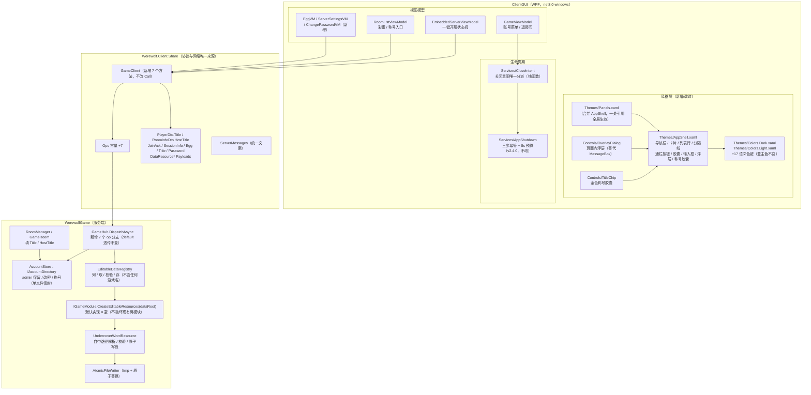
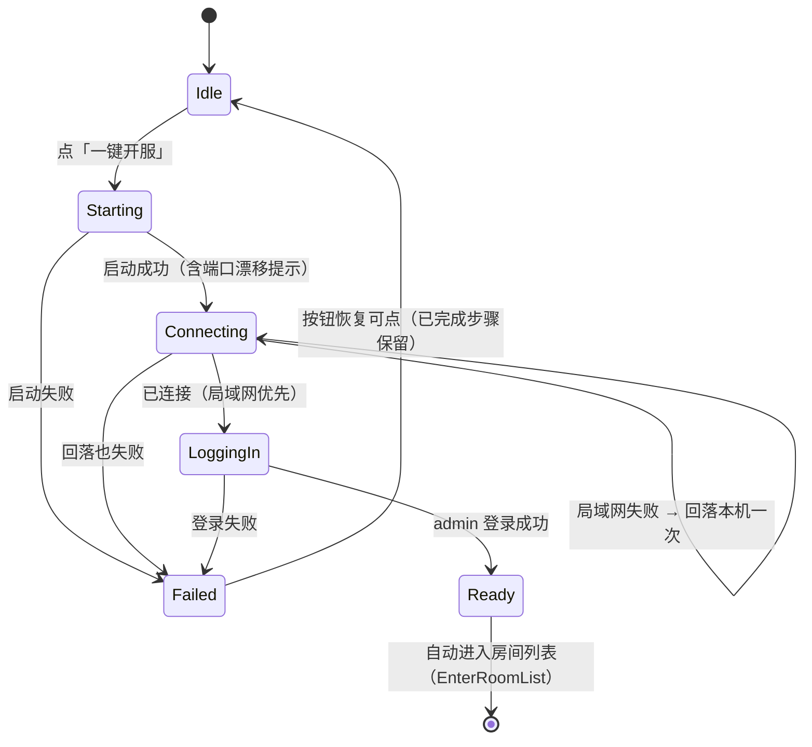
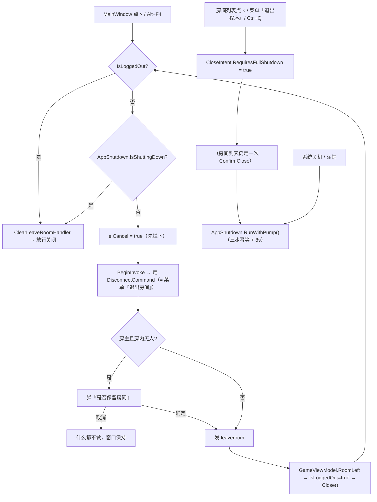
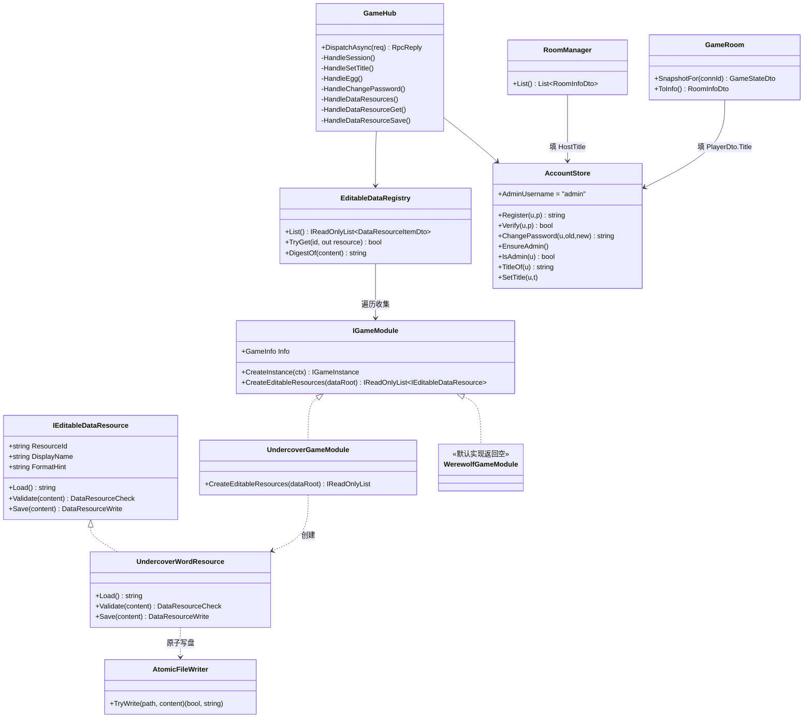
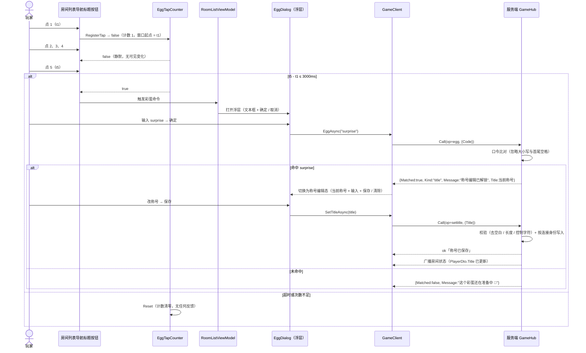
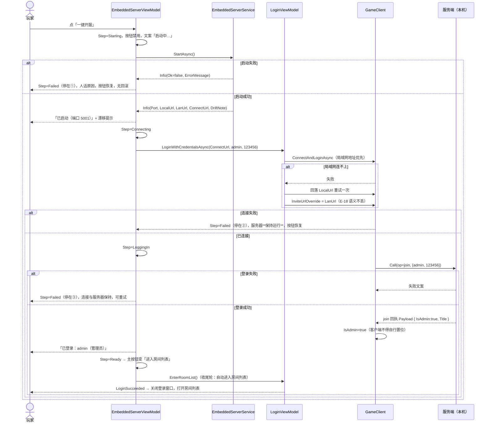
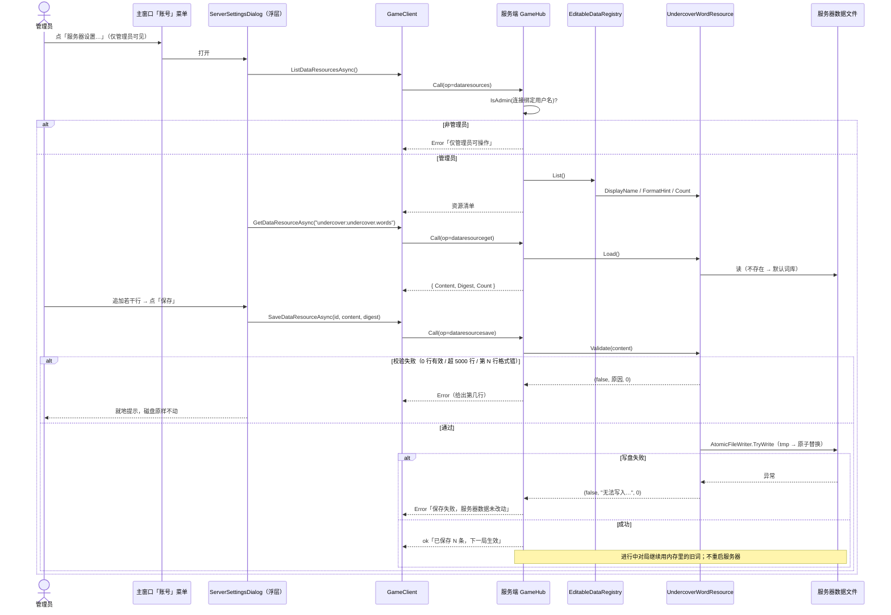
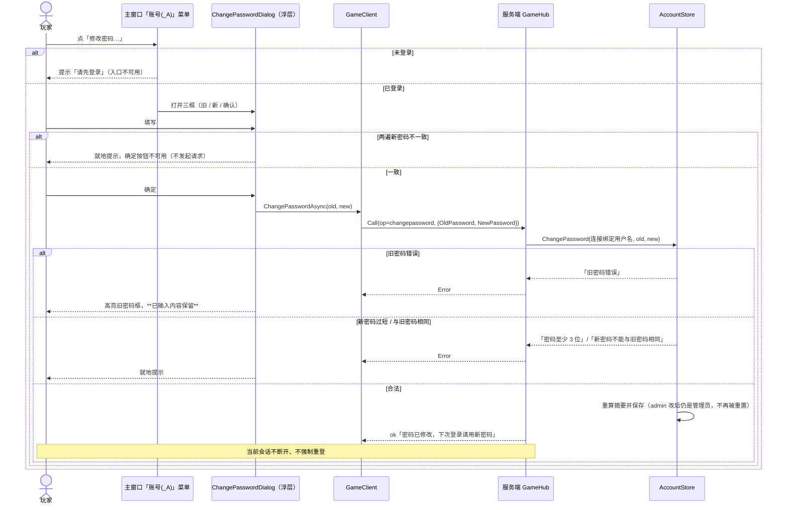
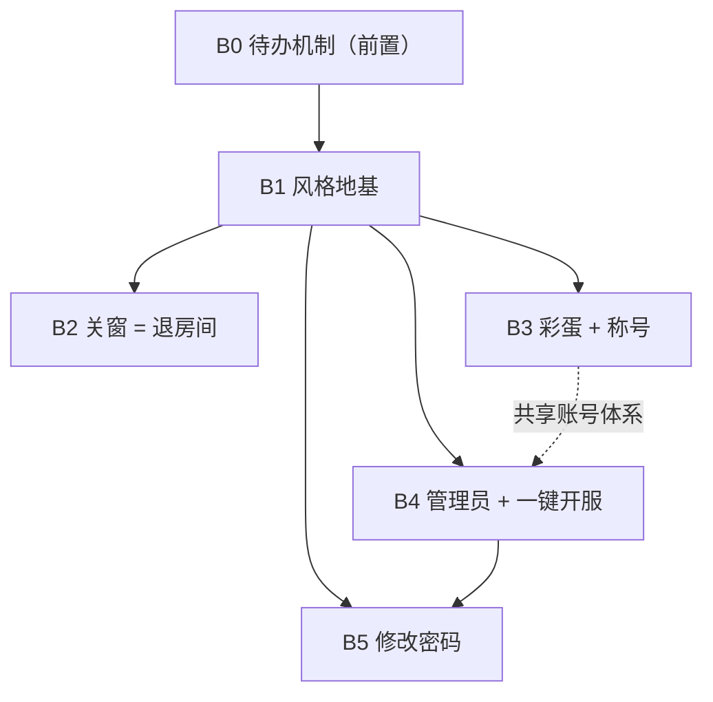

# v2.5 增量架构设计 · 移动化风格地基 + 彩蛋 / 称号 / 管理员 / 一键开服 / 改密 / 关窗语义

| 项 | 内容 |
|---|---|
| 文档语言 | 简体中文 |
| 作者 | 高见远（架构师） |
| 上游输入 | `docs/v25/PRD.md`（PM 许清楚，883 行 / 11 章）、`docs/embedded-server/ARCHITECTURE.md`（v2.4.0）、主理人转达的**用户裁定**（见文末「裁定记录」） |
| 基线版本 | GUI `2.4.0`；服务端 `Sdk.Web` / net8.0 |
| 本轮目标版本 | **2.5.0**（六批次统一发一个版本，中途不发小版本） |
| 文档性质 | **增量架构**：只描述本次 8 条需求的落地方式、契约与批次，不重写既有架构 |

---

## 1. 设计目标与范围边界

### 1.1 三个正交目标

| # | 目标 | 在架构上的落点 |
|---|---|---|
| A1 | **风格地基**：界面换上「小程序页面骨架」，且后续改动不得破坏它 | 新增一层**样式资源层** `Themes/AppShell.xaml`，由既有 `Panels.xaml` 统一合并 → 23 个 XAML **零处**改 MergedDictionaries 即可引用新样式 |
| A2 | **账号从「能登录」升级为「有身份」**：管理员 / 称号 / 改密 / 远程数据维护 | 服务端一处裁定（账号权威）；协议层只加 `Ops` 常量与 Payload；平台层只做权限 + 存取，不认识任何游戏 |
| A3 | **把日常操作收敛成一步**：开服一步、关窗即退房间、待办有闭环 | 一键开服状态机；`CloseIntent` 统一关闭意图分派；`docs/TODO.md` 每批首尾读写 |

### 1.2 范围内（In Scope）

1. 待办机制（`docs/TODO.md` + 闭环流程）。
2. GUI 小程序风格层 + 迁移范围内窗口改造 + 风格守护断言。
3. 房间列表彩蛋（3 秒 5 击）+ 彩蛋输入框。
4. 称号系统（服务端存储 / 金色胶囊 / `surprise` 编辑入口）。
5. 内置管理员 + 服务端管理员判定 + 「服务器设置」+ **通用可编辑数据资源**机制（词库是第一个资源）。
6. 内置服务器页收敛为「一键开服」。
7. 修改密码对话框 + 服务端裁定。
8. 房间内主窗口关闭 = 退出房间（不停服务器、不退出程序）。

### 1.3 范围外（Out of Scope）

| 项 | 说明 |
|---|---|
| 真正的手机 / 小程序工程 | 本轮只做风格与可移植性约束 |
| 新增 SignalR 方法 / 改 `Call` 契约 | **硬性禁止**；新增能力 = 新增 `Ops` 常量 + Payload |
| 多级管理员 / 角色分组 / 称号审核 | 本轮只有「是 / 否管理员」与「自己给自己取一个」 |
| 第二个可编辑数据资源 | 机制通用，但本轮只接词库一个 |
| 游戏专属面板 / 聊天与玩家面板内部细节 | P1，单开一批；容器跟上即可 |
| 控制台客户端的等价新界面 | P2，仅预留，不影响 GUI 交付 |
| 任何 git commit / push | 用户明确要求，全程禁止 |

### 1.4 架构级红线（贯穿全文）

- 构建**零警告零错误**（Nullable 全开）。
- 既有断言**只增不减**：默认组 1350 / `--ui` 93 / `--embedded` 32 / `--embeddedqa` 50。
- 平台层**不得**出现任何游戏专属文件名、词库格式、玩法逻辑。
- 一切权限与合法性以**服务端**为准；客户端只做提示与按钮可用性。
- 颜色一律 `{DynamicResource XxxBrush}`；两套主题键名集合**完全一致**；禁止颜色字面量。
- 业务异常一律 `return RpcReply.Error(...)`，错误文案统一放 `ServerMessages`。
- **主色保持现有蓝紫**，不引入微信绿（用户裁定 Q12）。

---

## 2. 总体方案（组件关系）



**一句话概括**：GUI 侧新增一层「可被所有窗口零改动引用」的骨架样式层；账号能力全部收拢到服务端 `AccountStore` 与三个新 op 组（会话 / 称号彩蛋 / 密码）；服务器数据维护走「游戏模块自己声明资源、平台只做存取」的通用机制；关窗语义改造通过新增 `CloseIntent` 纯函数接入既有 `AppShutdown`，**不改**三步编排。

---

## 3. 九个关键技术决策（逐条结论）

### D1 · GUI 风格重构的落地方式（第 2 条）

**结论：新增一个资源字典 `Themes/AppShell.xaml`，由既有 `Panels.xaml` 合并它。**

理由与机制：

1. **23 个 XAML 已经全部合并了 `Panels.xaml`**（`MainWindow` / `RoomListWindow` / `LoginWindow` / `HostSettingsWindow` / `SettingsWindow` / `CreateRoomWindow` 等逐个核对过）。只要在 `Panels.xaml` 的 `MergedDictionaries` 里加一行 `AppShell.xaml`，**所有窗口立刻能引用新样式键，无需改动任何一个窗口的字典声明**。这是本次「不大规模重写」的核心杠杆。
2. **不并入 `Controls.xaml`**：`Controls.xaml` 是「基础控件皮肤」（按钮 / 输入框 / 菜单 / 滚动条），语义是「控件长什么样」；`AppShell.xaml` 是「页面骨架」（导航栏 / 卡片 / 列表行 / 通栏按钮 / 浮层），语义是「页面怎么组织」。分开才能各自演进；`AppShell` 内部通过 `BasedOn` 复用 `Controls.xaml` 的基础样式。
3. **AppShell 的键命名统一前缀**，避免与既有键冲突：
   - 容器：`NavBarPanel` / `PageScroll` / `CardPanel` / `CardSection` / `ListRow` / `DividerLine` / `FooterBar`
   - 文字：`NavTitleText` / `SectionTitleText` / `BodyText` / `MinorText` / `FootnoteText`
   - 按钮：`BlockPrimaryButton` / `BlockSecondaryButton` / `NavIconButton`
   - 胶囊：`ChipBorder`（通用）/ `TitleChipBorder`（称号金）/ `StatusChipBorder`
   - 表单：`FieldLabel` / `FieldInput`（高 44，圆角 8）/ `FieldError`（11px，就地提示）
   - 浮层：`OverlayHost` / `OverlayCard` / `OverlayTitle`
4. **尺寸阶梯用 `x:Static` 常量还是直接写？** 直接写在样式里（WPF 没有 CSS 变量），但**只用 4/8/12/16/24 五档、圆角只用 12/10/8/999 四档、字号只用 17/15/14/12/11 五档**，并在 `AppShell.xaml` 顶部注释里写死这张表作为规范来源。
5. **窗口尺寸的取舍（重要）**：`MainWindow` **不套「手机逻辑宽度 375」**——UI 冒烟会对它 `Measure(1220,780)`，且它最小宽度 1000。MainWindow 的迁移范围限定为「顶部导航栏 + 底部状态条 + 三栏容器」，三栏内部细节列 P1。新增页面（彩蛋 / 服务器设置 / 修改密码）一律按 375 逻辑宽度设计，WPF 端用固定宽度 + 居中模拟。

**取舍掉的备选**：
- ❌ 逐个窗口手写骨架 → 改 23 处，必漏，且无法守护。
- ❌ 引入第三方控件库（HandyControl / MahApps）→ 引入新依赖、新主题体系，与「两套色键零缺失」断言冲突，且不可控地改变 93 项 UI 断言依赖的控件行为。
- ❌ 把骨架做成 `UserControl`（如 `PageShell`）→ 各窗口内容需要塞进 `Content` 槽，反而增加一层间接，且让 UI 冒烟的 `FindName` 路径变深；样式层 + 少量 `ControlTemplate` 更轻。

---

### D2 · 色键方案（保留蓝主色 · 用户裁定 Q12）

**结论：新增一个语义键 `ActionBrush`，但取值直接沿用现有 `AccentBrush` 的值（深色 `#FF5B8DEF` / 浅色 `#FF2F6BE0`）。视觉上看不出换色，同时保留「语义名与现实解耦」的价值。不引入任何微信绿。**

命名与取值规则：
- **语义键**（`Action*` / `Title*` / `NavBar*` / `PageBg` / `Divider` / `Mask` …）：名字描述**用途**，不描述**色相**。将来若真要换主色，只改 `ActionBrush` 三兄弟的取值，全界面一次生效。
- **沿用键**：`Accent*` 保持不变（选中态 / 链接 / 强调文字仍用蓝），不与 `Action*` 混用；`TextBrush` / `MutedBrush` / `FaintBrush` / `ChipBrush` / `CardBrush` / `InputBrush` / `BorderBrush2` 全部沿用，**不新增同义键**。
- **两套取值来源**：深色沿用 `Colors.Dark.xaml` 现有色阶的邻近值；浅色在「微信灰底 + 纯白卡片」体系下按对比度 ≥ 4.5:1 取。
- **零缺失保证**：新增键必须**同时**写进两份文件；`UiSmokeCheck.CheckTheme` 用 `Check.SequenceEqual` 排序后比对，多一个少一个都会红。

完整清单见 §4。

**取舍掉的备选**：
- ❌ PRD 原推荐的微信绿 `ActionBrush` —— 用户裁定推翻，不采纳。
- ❌ 不新增 `ActionBrush`、主按钮继续用 `AccentBrush` —— 放弃了「语义名与现实解耦」；主按钮与选中态共用一个键，将来任何一方要变都会误伤另一方。

---

### D3 · 不破坏 93 项 `--ui` 断言（红线）

**结论：先固化「结构契约清单」（§5），风格重构只做加法 —— 加样式、加导航栏、加命名元素；不改类名、不改构造签名、不改既有命名元素、不改菜单模板体系。**

三条共存原则：

1. **新增而非替换**：新样式是新的 `x:Key`，既有的 `FlatButton` / `PrimaryButton` / `FlatTextBox` / `FlatMenuItem` / `FlatTabItem` 全部保留语义（可以**重设外观**，但不能改变「它们是被这些键引用的控件」这一事实）。
2. **容器可加层，树不可断**：`FindLogical<Menu>` 与 `FindName` 都依赖逻辑树；导航栏作为新的 `Grid/Border` 插在原有内容**外面或上面**，不删除任何既有元素。
3. **命名元素只增不删**：既有 `x:Name`（见 §5 S2）一个都不能少；彩蛋热区新增 `NavTitleButton` 这样的新名字。

**已识别的客观冲突与「不改断言」的解法**：

| # | 冲突 | 解法（不动断言） |
|---|---|---|
| C1 | 彩蛋热区 = 「房间列表左上角那个字」，但风格化后它是**居中**的导航栏标题 | 导航栏标题做成一个 `Button`（透明底、无边框、内容居中、MinWidth/MinHeight 44）→ 既是标题又是热区；PRD 3.1 要求「整块 ≥44×44」，正好满足 |
| C2 | PRD 4.2.1 要求「弹窗改为页面内浮层」，但 `KeepRoomWindow` / `InviteCodeWindow` 是 `Window` 子类且被断言实例化 | 既有窗口保留 `Window` 子类（S1 契约），仅把它们的**外观**改成浮层风（无边框、圆角卡片、居中）；**新增**的 3 个对话框一律用 `OverlayDialog`（UserControl 浮层），不新增 Window 子类 → 完全不触碰 S1 |
| C3 | `MainWindow` 用 375 手机宽度会与 `Measure(1220,780)` / `MinWidth=1000` 冲突 | MainWindow 不套 375；迁移范围限定为「导航栏 + 状态条 + 三栏容器」（PRD §4.4.1 原话就是这个范围） |
| C4 | `SettingsWindow` 的 3 个标签页与顺序被断言锁死，不能改成「卡片列表导航」 | 保留 `TabControl` 与 3 页顺序，在其**上方**加导航栏；`FlatTabItem` 风格化成「微信小程序的分段控件」外观 |
| C5 | 一键开服要删掉「仅启动服务器 / 登录」两个按钮 | 只从 XAML 移除按钮；`EmbeddedServerViewModel` 的 `StartOnlyCommand` / `LoginToEmbeddedCommand` **保留**（断言只测 VM 属性与命令，不测按钮存在） |
| C6 | `CheckReferencedColorKeys` 扫描 `ClientGUI/**/*.xaml` 所有 `{DynamicResource *Brush}` | 新增色键必须两套都加；`Colors.*.xaml` 注释里的示例引用会被正则剥掉，安全 |

---

### D4 · 称号的数据流与协议（第 4 条）

**结论：服务端 `AccountStore` 权威存储 → 随房间状态自然下发（`PlayerDto.Title` / `RoomInfoDto.HostTitle`）→ 独立 op 只负责「写」与「查自己」。**

途径选择理由：
- **扩 `PlayerDto` 而非独立查询 op**：称号要在「房间列表房主列」和「房间内玩家行」显示，这两处的数据本来就来自 `roomlist` / `state` 推送。扩两个字段 = 零额外往返、零缓存一致性问题。若走独立查询 op，客户端要为每个玩家发一次请求，且状态刷新时会闪烁。
- 独立 op 只保留两个：`Ops.SetTitle`（写，只能改自己）、`Ops.Session`（查自己的当前称号 / 管理员标记，用于打开对话框时回填）。

协议设计（只加常量，不改 `Call`）：

```csharp
// Werewolf.Client.Share/Protocol.cs
public const string SetTitle = "settitle";   // 设置/清除自己的称号
public const string Egg      = "egg";        // 彩蛋口令
public const string Session  = "session";    // 查自己的会话身份（用户名 / 是否管理员 / 当前称号）
```

- `SetTitlePayload { string Title }` —— 空 / 全空白 = 清除。
- `EggPayload { string Code }` → `EggReplyPayload { bool Matched; string Kind; string Message; string? Title }`
  - `Kind = "title"` 表示进入称号编辑态；其他输入返回 `Message = ServerMessages.EggPending`，**不报错**。
- `SessionInfoDto { string Username; bool IsAdmin; string Title }`
- `join` 回执新增 Payload：`JoinAckPayload { bool IsAdmin; string Title }`（登录即填充客户端，省一次往返）。

服务端权威规则：
- 称号归属只认**连接绑定的用户名**，请求里的任何用户名字段一律忽略（PRD 4.8）。
- 校验：非空去空白、**长度 ≤ 8 个中文字符或 16 个英文字符**（按「字符数 ×（中文算 2）」的等价口径：以 `TextInfo`/`char.IsSurrogate` 计算 UTF-16 长度 ≤ 16 且不含控制字符为准，文案统一说「最多 8 个汉字或 16 个字符」）、不含换行与控制字符。
- 存储：`AccountStore` 内新增 `titles` 字典，与账号同文件（`accounts.json`），文件升级为信封格式 `{"Version":2,"Accounts":{...},"Titles":{...}}`，**旧格式（纯字典）照旧加载** → 不新增文件、不改 csproj 清理规则、不破坏 `accounts.json` 相关 QA 断言。

渲染：`Controls/TitleChip`（金色胶囊，`TitleTextBrush` 文字 + `TitleBorderBrush` 1px 描边 + `TitleBgBrush` 极淡底，`CornerRadius=999`，字号比相邻正文小一档 = 12），**文本为空时 `Visibility=Collapsed`**（不留空胶囊）。

**取舍掉的备选**：
- ❌ 独立 `titlelist` 批量查询 op → 多一次往返 + 缓存一致性负担，且要自己维护失效时机。
- ❌ 客户端本地缓存称号 → 违反 PRD T12（服务端权威数据不得塞进本地偏好）。

---

### D5 · 管理员与「服务器设置」的通用资源机制（第 5 条）

**结论：扩 `IGameModule` 契约（带默认实现），让游戏模块自己声明可编辑资源 + 自带校验与解析；平台只做「列资源 / 取文本 / 提交文本 / 校验管理员 / 原子落盘」。**

接口签名（新建 `WerewolfGame/Games/IEditableDataResource.cs`）：

```csharp
/// <summary>一个「服务器声明可编辑的数据资源」。</summary>
public interface IEditableDataResource
{
    /// <summary>资源机器名（由游戏自己定，平台不解释，如 "undercover.words"）。</summary>
    string ResourceId { get; }

    /// <summary>显示名（如「谁是卧底 · 词库」）。</summary>
    string DisplayName { get; }

    /// <summary>格式说明（多行，游戏自己给；平台原样下发给客户端展示）。</summary>
    string FormatHint { get; }

    /// <summary>当前全文（UTF-8）。文件不存在时返回游戏自己的默认内容。</summary>
    string Load();

    /// <summary>校验整份内容；返回 (是否通过, 错误文案, 有效条数)。</summary>
    DataResourceCheck Validate(string content);

    /// <summary>原子落盘；返回 (是否成功, 错误文案, 有效条数)。</summary>
    DataResourceWrite Save(string content);
}

public readonly record struct DataResourceCheck(bool Ok, string Error, int Count);
public readonly record struct DataResourceWrite(bool Ok, string Error, int Count);

// IGameModule 新增（默认实现 = 空 → 现有两个模块零改动）
IReadOnlyList<IEditableDataResource> CreateEditableResources(string dataRoot)
    => Array.Empty<IEditableDataResource>();
```

- **发现方式**：`EditableDataRegistry`（DI 单例）在构造时遍历 `IGameCatalog` 全部模块，调用 `CreateEditableResources(contentRoot)`，按 `GameId + ":" + ResourceId` 建索引。C# 8 的默认接口成员保证：狼人杀模块**一行不改**（返回空），卧底模块新增一个 `UndercoverWordResource` 即可。
- **平台层零后门**：平台只见到 `ResourceId / DisplayName / FormatHint / Load / Validate / Save` 六个成员；**不出现** `words.undercover.txt`、不出现 `"|"` 分隔、不知道「平民词 / 卧底词」。行数上限（建议 5000）与行格式校验由 `UndercoverWordResource.Validate` 自己实现。
- **路径解析**：资源文件路径由模块用 `dataRoot`（= 服务器工作目录，来自 `ServerBootstrapOptions.ContentRoot`）+ 自己的配置节点（卧底是 `Undercover:WordFile`）拼出。新增一个纯函数 `UndercoverWordBank.ResolvePath(string dataRoot, string? wordFile)`，让**对局读取**与**远程编辑**共用同一份路径解析，杜绝两处漂移。
- 三个新 op（全部先过管理员校验）：
  - `Ops.DataResources = "dataresources"` → 资源清单（含 `Id / GameId / GameName / DisplayName / FormatHint / Count`）
  - `Ops.DataResourceGet = "dataresourceget"` → `{ Id, Content, Digest }`
  - `Ops.DataResourceSave = "dataresourcesave"` → `{ Id, Content, Digest }`（P0 整份覆盖；`Digest` 随取回下发，P1 用于二次确认）
- `Digest` = 内容 UTF-8 字节的 SHA-256 前 16 位十六进制（平台算，与格式无关）。

**管理员判定只由服务端决定并随会话下发**：
- `AccountStore.AdminUsername = "admin"`（`OrdinalIgnoreCase`）；`IsAdmin(string username)` 是**唯一**判定入口（PRD T6）。
- 启动时（组合根构建后）调用 `EnsureAdmin()`：不存在则创建，默认密码 `123456`（常量 `AdminDefaults.DefaultAdminPassword`，放共享层供 GUI 明文展示「将以管理员 admin 登录」）。
- 注册路径拦截：`admin`（大小写不敏感）返回 `ServerMessages.AdminReserved`，普通用户抢不到。
- 下发：`join` 回执 Payload 的 `IsAdmin` + 可重查的 `Ops.Session`。客户端 `GameClient.IsAdmin` 是**只读**属性，只能由服务端回执写入；客户端请求里带自称管理员字段 → 服务端**不采信**。
- 所有管理员 op 的入口第一句就是 `if (!_accounts.IsAdmin(_rooms.GetUsername(connId))) return RpcReply.Error(ServerMessages.AdminOnly);`

**取舍掉的备选**：
- ❌ 平台层写 `words.undercover.txt` 常量 → 直接破「平台不为游戏开后门」红线。
- ❌ 新增 `IAdminModule` 之类第二条发现链 → 多一套反射发现，且无法保证与 `IGameModule` 同步。
- ❌ 客户端本地判断「用户名 == admin」→ 可被绕过，违反「一切以服务端为准」。

---

### D6 · 词库热更新的原子性（第 5 条）

**结论：整份提交 → 模块自己校验 → 写临时文件 → `File.Move(overwrite: true)` 原子替换 → 失败即删临时文件并返回原因（磁盘原样）→ 成功返回「已保存 N 条，下一局生效」。**

新建设施：`WerewolfGame/AtomicFileWriter.cs`

```csharp
public static (bool ok, string error) TryWrite(string path, string content)
{
    var tmp = $"{path}.tmp-{Guid.NewGuid():N}";
    try
    {
        File.WriteAllText(tmp, content, new UTF8Encoding(false));
        File.Move(tmp, path, overwrite: true);   // NTFS 上是原子替换
        return (true, "");
    }
    catch (Exception ex) { TryDelete(tmp); return (false, "无法写入：" + ex.Message); }
}
```

- **整份覆盖**（PRD Q11 P0）：不做行级 diff，避免「半份新半份旧」。
- **校验前置**：`Validate` 通过才写盘；至少 1 行有效、UTF-8、行数 ≤ 5000、行格式错误给出**第几行**；校验失败整份不落盘。
- **与 v2.3.3「编译期内嵌 + 工作目录优先」兼容**：
  - 远程保存写的就是「工作目录优先」的那份文件（`dataRoot + WordFile`），因此下一局 `LoadOrDefault(path)` 必然优先读到它 → **下一局生效**。
  - 内嵌资源（`ReadEmbedded()`）只在**文件不存在或没有有效行**时兜底；保存成功后文件一定有有效行 → 内嵌兜底不会被误触发。
  - 文件不存在时也允许保存（等于新建一份），保存后 `EnsureSample` 不会再覆盖它（它只在文件不存在时生成）。
- **进行中对局不受影响**：`UndercoverGameInstance` 开局时把 `List<Pair>` 读进内存，整局只在内存里用；保存只改磁盘，不动任何实例字段 → 下一局 `LoadWordBank()` 才读新词。
- **不重启服务器**：保存是纯文件操作，不涉及 DI / 配置重载。
- **并发**：P0 保证「不会写坏文件」（原子替换 + 单文件写锁 `lock`）；P1 用 `Digest` 做「内容已被改过」二次确认。

---

### D7 · 一键开服（第 6 条）

**结论：在 `EmbeddedServerViewModel` 上新增「一键开服」状态机，复用 v2.4.0 的 `EmbeddedServerService.StartAsync()` 与 `LoginViewModel.LoginWithServerUrlAsync()`；新增一个「显式凭据登录」重载，避免覆盖用户手填的用户名 / 密码。**

状态机（`enum OneClickStep`）：



关键实现点：
- `OneClickCommand`（`AsyncRelayCommand`）：`StartAsync()` → `ConnectWithFallbackAsync(url, admin, pwd)` → 设置 `Step=Ready` → **调用 `LoginViewModel.EnterRoomList()` 自动进入房间列表**（收尾轮用户裁定：点一次就落到房间列表；失败分支在此之前均已 return，故「失败不进入」语义不变）。
- **局域网优先、失败回落本机一次**：复用现有 `ConnectAndLoginAsync` 里的回落逻辑，把它抽成 `LoginViewModel.ConnectWithFallbackAsync(string url, string username, string password)`（新增重载，`LoginWithServerUrlAsync` 继续走原路径，行为不变）。回落成功后仍要设 `InviteUrlOverride = info.LanUrl`（v2.4.0 的 E-18 语义，不能丢）。
- **显式凭据登录**：新增 `LoginViewModel.LoginWithCredentialsAsync(string url, string username, string password, bool persistUrl = false)`，内部**不写** `UsernameInput / PasswordInput` → 用户手填的凭据一字不改（PRD 6.6 / E-20）。
- **失败保留策略**：任一步失败 → 写人话状态文案 + 徽章 `Failed`，`Step` 停在失败那一步，**不回滚已完成的步骤**（服务器起来了就保持运行、`StopCommand` 仍可用），按钮恢复可点，可原地重试。
- **端口漂移**：`EmbeddedServerService` 已支持；一键开服把 `DriftNote` 直接显示为状态条文案。
- **已完成态**：`IsOneClickDone = 已用 admin 登录 && 服务器运行中` → 主按钮文案切「进入房间列表」，点击触发 `LoginSucceeded`（复用既有进入流程）。**收尾轮变更**：到达就绪态后**自动**调用 `LoginViewModel.EnterRoomList()` —— 点一次就落到房间列表；主按钮仍切「进入房间列表」作为**幂等兜底**（再点同样能进）。
- **保留**：`PortInput` 命名元素、`停止服务器` 次按钮、地址复制按钮、工作目录入口。从 XAML 移除「仅启动服务器」与「登录」两个按钮（VM 命令保留，见 D3-C5）。
- **界面明文标注**：主按钮下方一行 `MinorText`：「将以管理员 admin 登录（默认密码 123456，开服后建议尽快修改）」。

---

### D8 · 关窗语义重构（第 8 条）

**结论：新增 `Services/CloseIntent.cs`（纯函数，可单测）统一分派三种关闭来源；MainWindow 关闭改为「拦下真正的关闭 → 走与菜单『退出房间』完全相同的路径」；完整收尾的触发点收拢到「关房间列表 / 退出程序 / 系统关机」，并继续调用 v2.4.0 的 `AppShutdown.RunWithPump()`。**

现状链路（已核实）：

```
App.OnStartup: ShutdownMode = OnExplicitShutdown
App.ShowLogin → LoginWindow.ShowDialog()==true → RunRoomLoop(session)
RunRoomLoop: AttachSession → while { RoomListWindow.ShowDialog()!=true break; MainWindow.ShowDialog(); if(!main.IsLoggedOut) break } → finally AppShutdown.RunWithPump() → Shutdown()
App.OnExit / App.SessionEnding → AppShutdown.RunWithPump()
MainWindow.OnClosing: SaveUiState → if IsLoggedOut { ClearLeaveRoomHandler(); return } → AppShutdown.ConfirmClose(this) ? 放行 : e.Cancel=true
RoomListWindow.OnClosing: 非进房关闭时 AppShutdown.ConfirmClose → 放行 → break → finally 收尾
AppShutdown.RunStepsAsync: ① 退出房间(3s) → ② session.DisposeAsync(3s) → ③ service.StopAsync(5s)，整体 8s，Interlocked 幂等
```

改造后链路：



精确改动点：

1. **新增 `Services/CloseIntent.cs`**（纯函数，PRD T9 的落点）：
   ```csharp
   public enum CloseIntentSource { RoomWindow, RoomListWindow, ExitProgram, SystemSession }
   public static bool RequiresFullShutdown(CloseIntentSource src) => src != CloseIntentSource.RoomWindow;
   ```
   —— 三种来源的行为集中在一张表上，改一眼看全。
2. **`MainWindow.OnClosing` 改为**：
   - `SaveUiState()`（不变）；
   - `IsLoggedOut` → `ClearLeaveRoomHandler(); return;`（不变）；
   - `AppShutdown.IsShuttingDown` → `return;`（收尾期不重复触发）；
   - **其余情况**：`e.Cancel = true;` 然后 `Dispatcher.BeginInvoke` 异步执行 `_vm.DisconnectCommand`（等价于点「退出房间」，含房主保留房间确认）。用户在「是否保留房间」里取消 → 什么都没发生，窗口保持打开。
3. **删除 `MainWindow.OnClosing` 里的 `AppShutdown.ConfirmClose(this)` 调用** —— 这是 PRD 8.7 的要求（关主窗口不停服务器，因此不需要「会断开他们」的确认）。
4. **`AppShutdown` 三步编排一行不改**。关主窗口 → 退出房间 → `ClearLeaveRoomHandler()` → 收尾时第 ① 步跳过 → 到「关房间列表 / 退出程序 / 系统关机」时才真正走完三步。两次调用靠 `Interlocked` 幂等，天然合并。
5. **`RoomListWindow.OnClosing` 保持既有 `ConfirmClose`**（它才是真正会停服务器的入口）。
6. **房间列表上要能看出服务器仍在运行**（PRD 8.6 P1）：导航栏右侧复用 `EmbeddedServerService.IsRunning` 显示一个状态胶囊。

**取舍掉的备选**：
- ❌ 在 `MainWindow.Closing` 里直接 `AppShutdown.RunWithPump()` 的某个子集 → 与既有幂等闸冲突，且会停服务器（违反 8.2）。
- ❌ 改 `App.ShutdownMode` → 会牵动登录窗口 / 房间列表的既有退出链路，风险远大于收益。

---

### D9 · 第 1 条「待办事项」的工程落点

**结论：条目模板与闭环流程写进 `docs/TODO.md` 本身；执行时机 = **B0 前置**，且 B1–B5 每批开工前读一次、收尾回写一次。**

文件内必须写清的四件事（§文件结构）：
1. **顶部警示**：「本仓库改动**不自动同步远端**：禁止 git commit / push，由用户显式提出并单独确认后才执行。」
2. **闭环流程 5 步**：① 读 → ② 挑（至少 1 条，否则写明原因）→ ③ 记（`- [ ]` → `- [~]` 进行中）→ ④ 销（移入「已完成」+ 日期 + 一句话结论）→ ⑤ 回写（新增至少 1 条，无则写「本轮无新增」）。
3. **条目模板**（做什么 / 为什么 / 落点 / 优先级 / 完成判定 / 来源），并规定**完成判定必须可观测**、**不得静默删除**。
4. **13 条种子条目**（PRD §3.4 的 T1–T13），按 `P0 尽快做` / `P1 该做` / `P2 有空做` / `已完成` 四组。

责任与时机：
- 建立：B0（与版本号统一到 2.5.0 同一批）。
- 谁更新：**执行该批次的工程师**（人或 AI 同责），不得跨批次代写。
- 交付说明（每批次结束的回传消息）必须含一节「**本轮待办闭环：挑了 X / 做了 Y / 新增 Z**」。
- 本轮的**具体认领**：B1 认领 T1/T2/T4/T5（风格地基天然覆盖）；B4 认领 T6/T8/T10；B2 认领 T9；B5 认领 T7；T3/T11/T12/T13 视进度顺手做或降级为 P1 并注明。

---

## 4. 最终色键清单（新增 / 沿用，两套取值）

### 4.1 新增 17 个语义键（**两套必须同时加，键名完全一致**）

| # | 色键 | 用途 | 深色取值 | 浅色取值 |
|---|---|---|---|---|
| 1 | `PageBgBrush` | 页面级背景（卡片外的底） | `#FF0E1117` | `#FFF2F3F5` |
| 2 | `NavBarBgBrush` | 导航栏底（与卡片区分） | `#FF181D28` | `#FFFFFFFF` |
| 3 | `NavBarTextBrush` | 导航标题文字 | `#FFE8EDF6` | `#FF1A1A1A` |
| 4 | `DividerBrush` | 列表分隔线（1px，左缩进 16） | `#FF2C3546` | `#FFE5E7EB` |
| 5 | `CardAltBrush` | 卡片内次级区块 / 分组头 | `#FF1A2029` | `#FFF7F8FA` |
| 6 | `ActionBrush` | **主操作按钮底（沿用现有主色的值）** | `#FF5B8DEF` | `#FF2F6BE0` |
| 7 | `ActionTextBrush` | 主按钮文字 | `#FFFFFFFF` | `#FFFFFFFF` |
| 8 | `ActionHoverBrush` | 主按钮悬停 | `#FF6E9CF5` | `#FF4A82EA` |
| 9 | `ActionPressedBrush` | 主按钮按下 | `#FF4A78D6` | `#FF2455B8` |
| 10 | `ActionDisabledBrush` | 主按钮禁用底 | `#FF3A4252` | `#FFC8CDD4` |
| 11 | `TitleTextBrush` | 称号文字（金） | `#FFFFD98A` | `#FFB07D12` |
| 12 | `TitleBorderBrush` | 称号圆角边框（金，同色系） | `#FFE0B96B` | `#FFD9A83A` |
| 13 | `TitleBgBrush` | 称号框内极淡底 | `#33FFD98A` | `#1AC9971F` |
| 14 | `MaskBrush` | 页面内浮层遮罩 | `#99000000` | `#66000000` |
| 15 | `PlaceholderBrush` | 输入框占位文字 | `#FF6F7C93` | `#FFA8AFBA` |
| 16 | `ChipTextBrush` | 通用胶囊文字 | `#FFC3CCDC` | `#FF5A6472` |
| 17 | `ChipBorderBrush` | 通用胶囊描边（1px） | `#FF3A4459` | `#FFDDE1E7` |

> 说明：`Action*` 三兄弟的取值**逐字沿用**现有 `AccentBrush` / `AccentHoverBrush` / `AccentPressedBrush`，因此界面上**看不出换色**（用户裁定 Q12）。称号三键是唯一新增的**色相**。

### 4.2 沿用（**不新增同义键**）

`BgBrush` / `PanelBrush` / `PanelAltBrush` / `CardBrush` / `ChipBrush` / `InputBrush` / `ChatBgBrush` / `HoverBrush` / `BorderBrush2` /
`TextBrush` / `TextSoftBrush` / `TextMidBrush` / `MutedBrush` / `FaintBrush` /
`AccentBrush` / `AccentHoverBrush` / `AccentPressedBrush` / `AccentSoftBrush` /
`Danger*` / `OkBrush` / `ChatBrush` / `PrivateBrush` / `ErrorBrush` / `PhaseBrush` / `WarnBrush`

其中：
- `AccentBrush`（蓝）= 选中态 / 链接 / 强调文字；`ActionBrush` = 主操作按钮。两者**语义分离**，值暂时相同。
- `MutedBrush` 兼任「禁用态文字」，不再新增 `DisabledTextBrush`。
- `WarnBrush` 是既有键且被 `UiBrushes` / 状态文案依赖，**必须保留**。

### 4.3 硬规则

1. 新增键**同时**写进 `Colors.Dark.xaml` 与 `Colors.Light.xaml`。
2. XAML 一律 `{DynamicResource XxxBrush}`；禁止 `{StaticResource}` 引颜色、禁止 `#RRGGBB` 字面量。
3. 窗口 / UserControl 根元素的 `Background` / `Foreground` 也必须用 DynamicResource（UI 冒烟会断言登录窗口背景随主题变化）。
4. 深色背景的 R+G+B 之和必须**小于**浅色背景（现有断言）。

---

## 5. 必须保留的结构契约清单（为不破坏 93 项 `--ui` 断言）

> 以下每一条都由 `ClientGUI.Tests/UiSmokeCheck.cs`（`--ui`，93 项）直接或间接断言。**任何改动都不得违反**。

### S1 · 窗口类名与构造签名（一个都不能改，只能加可选参数）

| 类型 | 必须可用的构造 |
|---|---|
| `LoginWindow` | `new LoginWindow()` |
| `RoomListWindow` | `new RoomListWindow(GameClient)` |
| `CreateRoomWindow` | `new CreateRoomWindow()` |
| `MainWindow` | `new MainWindow(GameClient)` |
| `AboutWindow` / `ChangelogWindow` / `KeepRoomWindow` / `SettingsWindow` | 无参 |
| `InviteCodeWindow` | `new InviteCodeWindow(string)` |
| `HostSettingsWindow` | `new HostSettingsWindow(GameClient)` |
| `WerewolfPanel` / `UndercoverPanel` / `UnknownGamePanel` | 无参 `FrameworkElement` |

### S2 · 命名元素（`FindName` 命中且类型正确）

| 窗口 | 命名元素 |
|---|---|
| `LoginWindow` | `Tabs`（TabControl，2 页，页头依次含「创建内置服务器」「连接现有服务器」，**默认选中第 1 页**）、`PortInput`、`ServerUrlInput`、`InviteCodeInput`、`UsernameInput`、`PasswordInput` |
| `SettingsWindow` | `Tabs`（**3 页，顺序 外观 / 主界面 / 上次使用**）、`ThemeDark`、`ThemeLight`、`ShowChat`、`ShowPlayers`、`ShowActions`、`ServerText`（非空） |
| `HostSettingsWindow` | `MaxPlayersInput`、`PasswordInput`、`AutoLayoutBox`、`LayoutTab`、`GameEmojiText`、`GameBadge`（ToolTip 含游戏名） |
| `CreateRoomWindow` | `GameBox`（`ItemTemplate != null`；模板内 `ToggleButton` 必须有自己的空模板） |

### S3 · 主窗口菜单体系

- 逻辑树中必须能找到 `Menu`；顶级下拉 **≥ 3 个**（新增「账号(_A)」后为 4）。
- `MenuLeafTemplate` / `MenuTopLevelHeaderTemplate` / `MenuTopLevelItemTemplate` / `MenuSubmenuHeaderTemplate` 四个模板必须能从**窗口资源**解析。
- 所有层级 `MenuItem`（递归收集，总数 **≥ 8**）的 `Template` 必须是上述四个之一 → `Controls.xaml` 末尾的隐式样式 `<Style TargetType="MenuItem" BasedOn="{StaticResource FlatMenuItem}" />` **必须保留**，新增菜单项不得单独设 `Template`。
- 主窗口必须能 `Show()` + `UpdateLayout()`（不得在构造期做网络 / 阻塞）。

### S4 · 主题与配色

- `Colors.Dark.xaml` 与 `Colors.Light.xaml` 的键集合**排序后完全一致**（`Check.SequenceEqual`）；深色键数 **≥ 20**（新增后 ≈ 45）。
- `LoginWindow.Background` 必须是 `{DynamicResource ...}` 且随主题切换变化。
- 深色背景 R+G+B 之和 < 浅色背景。
- `ClientGUI/**/*.xaml` 中所有 `{DynamicResource XxxBrush}` 的键必须在两套配色中都存在（自动扫描，注释会被剥掉）。
- 主题偏好可切回「跟随系统」。

### S5 · 视图模型契约（断言直接读属性）

- `LoginWindow.Embedded`（`EmbeddedServerViewModel`）：`PortText` 默认 `"5000"`、`WorkDirectoryText` 以 `embedded-server` 结尾、未启动 `LanUrlText == "—"`、`StateText == "未启动"`、`CanEditPort == true`、`CanStart == true`、`CanStop == false`、`CanLogin == false`；端口非法时 `IsPortValid == false` 且 `PortError` 非空、`CanStart == false`。
- `LoginWindow.Login`：`ServerUrl` 默认 `LoginViewModel.DefaultServerUrl`（`http://localhost:5000/gamehub`）；`UsernameInput` 可写且两个标签页共享。
- `HostSettingsWindow.RefreshFromServerState(HostSettingsDto)` 必须保留，且**不得覆盖正在编辑的** `MaxPlayersInput.Text` / `PasswordInput.Password` / `AutoLayoutBox.IsChecked`；`LayoutTab.Visibility` 随 `HasPlayerConfig` 显隐；窗口 `Title` 含游戏名。
- `UiStateStore.Enabled = false` 时不得落盘（冒烟会关掉持久化）。
- `AppInfo.Version` 非空且不含 `+`。
- `App.IsSettingsShortcut(Key.OemComma, ModifierKeys.Control) == true`，其它组合为 false。
- `GameInfo.ToString()` == 「🐺 狼人杀」。

### S6 · 不得放宽的其它既有组

默认组 **1350**、`--embedded` **32**、`--embeddedqa` **50** —— 只增不减。新增断言一律**追加**，不得修改既有 `Check.*` 的期望值或删除调用。

---

## 6. 文件清单

### 6.1 新建

| 相对路径 | 职责（一句话） |
|---|---|
| `docs/TODO.md` | 跨版本待办文件：闭环流程 + 条目模板 + 13 条种子条目 + 禁同步警示 |
| `ClientGUI/Themes/AppShell.xaml` | 小程序骨架样式层：导航栏 / 卡片 / 列表行 / 分隔线 / 通栏按钮 / 胶囊 / 表单 / 浮层 |
| `ClientGUI/Controls/TitleChip.xaml` + `.xaml.cs` | 金色称号胶囊控件（文本为空时 Collapsed） |
| `ClientGUI/Controls/OverlayDialog.xaml` + `.xaml.cs` | 页面内浮层宿主（遮罩 + 居中卡片 + 主/次按钮），替代 `MessageBox` 承载业务流程 |
| `ClientGUI/Views/EggDialog.xaml` + `.xaml.cs` | 彩蛋输入框 / 称号编辑态的浮层内容 |
| `ClientGUI/Views/ServerSettingsDialog.xaml` + `.xaml.cs` | 服务器设置：资源列表 + 全文编辑 + 保存（仅管理员） |
| `ClientGUI/Views/ChangePasswordDialog.xaml` + `.xaml.cs` | 修改密码：旧 / 新 / 确认三框 + 就地提示 |
| `ClientGUI/ViewModels/EggViewModel.cs` | 彩蛋口令请求 + 称号编辑态 + 保存 / 清除 |
| `ClientGUI/ViewModels/ServerSettingsViewModel.cs` | 资源清单拉取 / 取全文 / 整份提交 / 冲突与结果文案 |
| `ClientGUI/ViewModels/ChangePasswordViewModel.cs` | 三框表单校验（一致性） + 提交 + 服务端文案透传 |
| `ClientGUI/Services/EggTapCounter.cs` | 「3 秒 5 击」纯逻辑（滚动窗口，可单测，不依赖 Dispatcher） |
| `ClientGUI/Services/CloseIntent.cs` | 关闭意图枚举 + `RequiresFullShutdown` 纯函数（三种来源一张表） |
| `Werewolf.Client.Share/AdminDefaults.cs` | 管理员用户名与默认密码常量（`admin` / `123456`）+ 弱口令提示文案 |
| `Werewolf.Client.Share/AccountProtocol.cs` | 账号域新增 Payload / DTO：`JoinAckPayload`、`SessionInfoDto`、`SetTitlePayload`、`EggPayload`、`EggReplyPayload`、`ChangePasswordPayload`、`DataResourceListPayload`、`DataResourceContentPayload`、`DataResourceSavePayload`、`DataResourceSaveResult` |
| `WerewolfGame/Games/IEditableDataResource.cs` | 可编辑数据资源接口 + `DataResourceCheck` / `DataResourceWrite` |
| `WerewolfGame/Games/EditableDataRegistry.cs` | 遍历 `IGameCatalog` 收集资源、按 `GameId:ResourceId` 索引（平台只认接口） |
| `WerewolfGame/Games/Undercover/UndercoverWordResource.cs` | 卧底词库资源：路径解析 / 校验（含第几行）/ 原子保存 |
| `WerewolfGame/AtomicFileWriter.cs` | 临时文件 + `File.Move(overwrite)` 原子写盘，失败可回滚 |
| `ClientGUI.Tests/AppShellGuard.cs` | 风格守护断言 A1–A6 + 彩蛋计数 / 关闭意图 / 称号校验的纯函数断言 |

### 6.2 修改

| 相对路径 | 改动要点 |
|---|---|
| `ClientGUI/Themes/Colors.Dark.xaml` | 新增 §4.1 的 17 个键 |
| `ClientGUI/Themes/Colors.Light.xaml` | 同上（键名集合必须一致） |
| `ClientGUI/Themes/Panels.xaml` | `MergedDictionaries` 增加 `AppShell.xaml`（一处引用，全局生效） |
| `ClientGUI/Themes/Controls.xaml` | `FlatTextBox` 升到高 44 / 圆角 8；`FlatTabItem` 风格化为分段控件；菜单模板风格化（**不改模板 key 与隐式样式**）；新增 `PlaceholderBrush` 用法 |
| `ClientGUI/Views/LoginWindow.xaml` + `.xaml.cs` | 内置服务器页：一键开服主按钮 + 分步状态 + 端口/停止/复制保留；两页加导航栏；移除「仅启动 / 登录」按钮（VM 命令保留） |
| `ClientGUI/Views/RoomListWindow.xaml` + `.xaml.cs` | 导航栏（`NavTitleButton` = 彩蛋热区）+ 卡片列表 + 房主列称号胶囊 + 服务器运行胶囊 |
| `ClientGUI/MainWindow.xaml` + `.xaml.cs` | 新增「账号(_A)」顶级菜单（修改密码… / 服务器设置…）+ 导航栏 + `OnClosing` 改为「取消关闭 → 退出房间」+ 玩家行称号 |
| `ClientGUI/Views/CreateRoomWindow.xaml`、`HostSettingsWindow.xaml`、`SettingsWindow.xaml`、`InviteCodeWindow.xaml`、`KeepRoomWindow.xaml` | 按 `AppShell` 风格化（保留全部命名元素与标签页结构） |
| `ClientGUI/Themes/GamePanels.xaml`、`Views/PlayerPanel.xaml`、`ChatPanel.xaml`、`ActionPanel.xaml` | 容器跟上（P1 内部细节可延后），玩家行插入 `TitleChip` |
| `ClientGUI/ViewModels/EmbeddedServerViewModel.cs` | 一键开服状态机（`OneClickCommand` / `Step` / `StepText` / `CanOneClick` / `IsOneClickDone`） |
| `ClientGUI/ViewModels/LoginViewModel.cs` | 新增 `LoginWithCredentialsAsync(url, user, pwd, persistUrl)`，抽出 `ConnectWithFallbackAsync` |
| `ClientGUI/ViewModels/RoomListViewModel.cs` | 彩蛋命令 + 称号展示数据源（`RoomInfoDto.HostTitle`） |
| `ClientGUI/ViewModels/GameViewModel.cs` | 暴露 `IsAdmin` / `MyTitle` / 账号菜单命令；复用既有 `DisconnectCommand` |
| `ClientGUI/ViewModels/PlayerRow.cs` | 新增 `Title` 属性（供 `TitleChip` 绑定） |
| `ClientGUI/App.xaml.cs` | `RunRoomLoop` 注释与关闭来源标注；保持 `OnExit` / `SessionEnding` → `AppShutdown` 不变 |
| `ClientGUI/Services/AppShutdown.cs` | **不改三步编排**；仅把 `ConfirmClose` 的触发点从 `MainWindow` 迁出（调用方变更，本文件可仅补注释） |
| `ClientGUI/ClientGUI.csproj` | `<Version>` → `2.5.0` |
| `ClientGUI/Models/Changelog.cs` | 新增 2.5.0 更新日志（大白话 7 条） |
| `Werewolf.Client.Share/Protocol.cs` | `Ops` 新增 7 个常量；`ServerMessages` 新增/统一文案 |
| `Werewolf.Client.Share/Dtos.cs` | `PlayerDto.Title`、`RoomInfoDto.HostTitle` |
| `Werewolf.Client.Share/GameClient.cs` | 新增 `IsAdmin` / `Title` 只读属性与 7 个方法；`CallAsync` 与 `Call` 契约不变 |
| `WerewolfGame/GameHub.cs` | `DispatchAsync` 新增 7 个分支；管理员校验；默认透传分支不变 |
| `WerewolfGame/AccountStore.cs` | 实现 `IAccountDirectory`：admin 保留与 seed、改密、称号读写；文件升级为信封格式（兼容旧格式） |
| `WerewolfGame/RoomManager.cs` | 可选注入 `IAccountDirectory`（末尾可选参数）；`List()` 填 `HostTitle`；构造 `GameRoom` 时传入 |
| `WerewolfGame/GameRoom.cs` | `SnapshotFor` 填 `PlayerDto.Title`；`ToInfo` 填 `HostTitle` |
| `WerewolfGame/ServerBootstrap.cs` | 注册 `EditableDataRegistry`；构建后 `EnsureAdmin()` |
| `WerewolfGame/Games/IGameModule.cs` | 新增 `CreateEditableResources` **默认实现（返回空）** |
| `WerewolfGame/Games/Undercover/UndercoverGameModule.cs` | 实现 `CreateEditableResources` → `UndercoverWordResource` |
| `WerewolfGame/Games/Undercover/UndercoverWordBank.cs` | 新增 `ResolvePath(dataRoot, wordFile)` 纯函数 + `Validate(content)` 复用 `ParseLines` |
| `WerewolfGame/Games/Undercover/UndercoverGameInstance.cs` | `LoadWordBank` 改用 `ResolvePath` 纯函数（玩法不变） |
| `Werewolf.Client/EmbeddedServerConsole.cs` | （P2，可选）控制台一键开服入口 |

---

## 7. 关键类型与接口

### 7.1 协议层（`Werewolf.Client.Share`）

```csharp
// Protocol.cs —— 新增常量（不改 Call / 不新增 SignalR 方法）
public static class Ops
{
    public const string Session          = "session";          // 查自己的会话身份
    public const string SetTitle         = "settitle";         // 设置 / 清除自己的称号
    public const string Egg              = "egg";              // 彩蛋口令
    public const string ChangePassword   = "changepassword";   // 修改密码
    public const string DataResources    = "dataresources";    // 可编辑资源清单（管理员）
    public const string DataResourceGet  = "dataresourceget";  // 取资源全文（管理员）
    public const string DataResourceSave = "dataresourcesave"; // 整份提交（管理员）
}

public static class ServerMessages
{
    public const string AdminOnly      = "仅管理员可操作";
    public const string AdminReserved  = "该用户名为系统保留，请换一个";
    public const string TitleSaved     = "称号已保存";
    public const string TitleCleared   = "称号已清除";
    public const string TitleTooLong   = "称号太长（最多 8 个汉字或 16 个字符）";
    public const string TitleBadChars  = "称号不能包含换行或控制字符";
    public const string OldPasswordWrong = "旧密码错误";
    public const string PasswordSameAsOld = "新密码不能与旧密码相同";
    public const string PasswordChanged  = "密码已修改，下次登录请用新密码";
    public const string EggPending     = "这个彩蛋还在准备中 🐣";
    public const string EggTitleUnlocked = "称号编辑已解锁";
    public const string ResourceNotFound = "该数据资源不存在";
    public const string ResourceEmpty  = "至少要有一行有效内容";
    public const string ResourceSaveFailed = "保存失败，服务器数据未改动";
    public const string ResourceConflict = "服务器上的内容已被改过，是否覆盖？";
    public static string PasswordMinLength(int n) => $"密码至少 {n} 位";   // 值与现状一致
    public static string ResourceSaved(int n)     => $"已保存 {n} 条，下一局生效";
    public static string ResourceLineError(int line) => $"第 {line} 行格式不对，整份未保存";
}

// AdminDefaults.cs
public static class AdminDefaults
{
    public const string Username = "admin";
    public const string DefaultPassword = "123456";
    public const string WeakPasswordNotice = "内置管理员默认密码是弱口令，开服后建议尽快修改密码。";
}
```

```csharp
// AccountProtocol.cs
public sealed class JoinAckPayload { public bool IsAdmin { get; set; } public string Title { get; set; } = ""; }
public sealed class SessionInfoDto { public string Username { get; set; } = ""; public bool IsAdmin { get; set; } public string Title { get; set; } = ""; }
public sealed class SetTitlePayload { public string Title { get; set; } = ""; }              // 空 = 清除
public sealed class EggPayload { public string Code { get; set; } = ""; }
public sealed class EggReplyPayload { public bool Matched { get; set; } public string Kind { get; set; } = ""; public string Message { get; set; } = ""; public string Title { get; set; } = ""; }
public sealed class ChangePasswordPayload { public string OldPassword { get; set; } = ""; public string NewPassword { get; set; } = ""; }

public sealed class DataResourceItemDto { public string Id { get; set; } = ""; public string GameId { get; set; } = ""; public string GameName { get; set; } = ""; public string DisplayName { get; set; } = ""; public string FormatHint { get; set; } = ""; public int Count { get; set; } }
public sealed class DataResourceListPayload { public List<DataResourceItemDto> Items { get; set; } = new(); }
public sealed class DataResourceRefPayload { public string Id { get; set; } = ""; }
public sealed class DataResourceContentPayload { public string Id { get; set; } = ""; public string Content { get; set; } = ""; public string Digest { get; set; } = ""; public int Count { get; set; } }
public sealed class DataResourceSavePayload { public string Id { get; set; } = ""; public string Content { get; set; } = ""; public string Digest { get; set; } = ""; }
public sealed class DataResourceSaveResult { public bool Ok { get; set; } public int Count { get; set; } public string Message { get; set; } = ""; }
```

```csharp
// Dtos.cs —— 只加字段
public class PlayerDto { /* 既有 */ public string? Title { get; set; } }           // 空 = 无称号
public sealed class RoomInfoDto { /* 既有 */ public string HostTitle { get; set; } = ""; }
```

```csharp
// GameClient.cs —— 只加成员，不改 CallAsync / Call
public sealed class GameClient
{
    public bool IsAdmin { get; private set; }       // 只由服务端回执写入
    public string Title { get; private set; } = ""; // 只由服务端回执写入

    public Task<SessionInfoDto?>  GetSessionAsync();
    public Task<(bool ok, string msg)> SetTitleAsync(string title);
    public Task<EggReplyPayload?> EggAsync(string code);
    public Task<(bool ok, string msg)> ChangePasswordAsync(string oldPassword, string newPassword);
    public Task<DataResourceListPayload?> ListDataResourcesAsync();
    public Task<DataResourceContentPayload?> GetDataResourceAsync(string id);
    public Task<DataResourceSaveResult> SaveDataResourceAsync(string id, string content, string digest);
}
```

### 7.2 服务端（账号与资源）

```csharp
public interface IAccountDirectory
{
    bool IsAdmin(string username);                 // 唯一管理员判定入口
    string TitleOf(string username);               // 无称号返回 ""
    void SetTitle(string username, string title);  // 已做校验
}

public class AccountStore : IAccountDirectory
{
    public const string AdminUsername = "admin";
    public bool Exists(string username);
    public string? Register(string username, string password);   // admin 大小写不敏感受保留
    public bool Verify(string username, string password);
    public string? ChangePassword(string username, string oldPassword, string newPassword);
    public void EnsureAdmin();                                   // 启动期 seed
    public bool IsAdmin(string username);
    public string TitleOf(string username);
    public void SetTitle(string username, string title);
}
```

```csharp
public interface IEditableDataResource { /* 见 D5 */ }

public partial interface IGameModule
{
    IReadOnlyList<IEditableDataResource> CreateEditableResources(string dataRoot)
        => Array.Empty<IEditableDataResource>();   // 默认空 → 现有模块零改动
}

public sealed class EditableDataRegistry
{
    public EditableDataRegistry(IGameCatalog catalog, string dataRoot);
    public IReadOnlyList<DataResourceItemDto> List();
    public bool TryGet(string id, out IEditableDataResource resource);
    public static string DigestOf(string content);   // SHA-256 前 16 位十六进制
}

public static class AtomicFileWriter
{
    public static (bool ok, string error) TryWrite(string path, string content);
}
```



### 7.3 GUI（风格与生命周期）

```csharp
// Services/EggTapCounter.cs —— 纯逻辑，可单测
public sealed class EggTapCounter
{
    public EggTapCounter(int requiredTaps = 5, int windowMs = 3000);
    public int Count { get; }
    public bool RegisterTap(long nowMs);   // 第 requiredTaps 次且 (tN - t1) <= windowMs → true
    public void Reset();
}

// Services/CloseIntent.cs —— 纯函数
public enum CloseIntentSource { RoomWindow, RoomListWindow, ExitProgram, SystemSession }
public static class CloseIntent
{
    public static bool RequiresFullShutdown(CloseIntentSource source) => source != CloseIntentSource.RoomWindow;
}

// ViewModels/EmbeddedServerViewModel.cs —— 新增
public enum OneClickStep { Idle, Starting, Connecting, LoggingIn, Ready, Failed }
```

---

## 8. 关键时序图

### 8.1 彩蛋触发 → 称号编辑（第 3 + 4 条）



### 8.2 一键开服（第 6 条）



### 8.3 管理员编辑词库（第 5 条）



### 8.4 修改密码（第 7 条）



---

## 9. 分批次任务列表（B0 → B5）

> 每批的验收标准一律叠加：**`dotnet build` 零警告零错误** + **既有断言组只增不减（1350 / 93 / 32 / 50）** + **未执行任何 git commit / push**。

### B0 · 第 1 条 待办机制（前置）

| 项 | 内容 |
|---|---|
| 改哪些文件 | 新建 `docs/TODO.md`；修改 `ClientGUI/ClientGUI.csproj`（`<Version>` → `2.5.0`）、`ClientGUI/Models/Changelog.cs`（预留 2.5.0 条目占位，B5 回填正文） |
| 依赖 | 无 |
| 可断言验收标准 | ① `docs/TODO.md` 存在且含：禁同步警示、闭环 5 步、条目模板、四组分组（P0/P1/P2/已完成）、13 条种子条目；② `AppInfo.Version` == `2.5.0` 且不含 `+`（既有断言自动覆盖）；③ `--ui` 仍 93 项全绿 |

### B1 · 第 2 条 GUI 小程序风格（**风格地基，必须先于其它界面改动**）

| 项 | 内容 |
|---|---|
| 改哪些文件 | 新建 `ClientGUI/Themes/AppShell.xaml`、`ClientGUI/Controls/OverlayDialog.xaml(.cs)`；修改 `Themes/Colors.Dark.xaml`、`Colors.Light.xaml`（+17 键）、`Themes/Panels.xaml`（合并 AppShell）、`Themes/Controls.xaml`（输入框 44/8、分段控件、菜单风格化）、`Views/LoginWindow.xaml`、`Views/RoomListWindow.xaml`、`MainWindow.xaml`、`Views/CreateRoomWindow.xaml`、`Views/HostSettingsWindow.xaml`、`Views/SettingsWindow.xaml`、`Views/InviteCodeWindow.xaml`、`Views/KeepRoomWindow.xaml` |
| 依赖 | B0 |
| 可断言验收标准 | ① 两套配色键**排序后完全一致**且 ≥ 45 项；② `ClientGUI/**/*.xaml` 中**零处** `#RRGGBB` / `Color.FromRgb` 字面量（新增断言 A2）；③ 迁移范围内每个窗口存在导航栏结构元素且标题居中（A3）；④ 列表行实测 ≥ 56、按钮热区 ≥ 44（A4）；⑤ 主按钮宽度 ≥ 内容区 80%（A5）；⑥ 无 `DataGrid` / `PropertyGrid` / `Ribbon` / `Canvas.Left` 绝对定位（A6）；⑦ **既有 93 项 `--ui` 断言逐条仍绿**（S1–S5 全表复核）；⑧ 认领并完成 TODO T1 / T2 / T4 / T5 |

### B2 · 第 8 条 关主窗口 = 退出房间

| 项 | 内容 |
|---|---|
| 改哪些文件 | 新建 `ClientGUI/Services/CloseIntent.cs`；修改 `MainWindow.xaml.cs`（`OnClosing` → 取消关闭 + 走 `DisconnectCommand`）、`MainWindow.xaml`（导航栏右侧服务器运行胶囊）、`App.xaml.cs`（来源标注与注释）、`Services/AppShutdown.cs`（仅注释：三步编排不改）、`ClientGUI.Tests/AppShellGuard.cs`（关闭意图纯函数断言） |
| 依赖 | B1 |
| 可断言验收标准 | ① `CloseIntent.RequiresFullShutdown(RoomWindow) == false`，其余三种 == true（纯函数断言）；② 关主窗口后：程序未退出、内置服务器仍在运行、连接未断（人工 + 探针）；③ 房主且房内无人时弹「是否保留房间」，取消则窗口不关；④ 从房间列表点 × 与菜单「退出程序」仍走完整收尾（退房间 → 断连 → 停服务器，8s 预算）；⑤ 连点两次 × 幂等，不重复离开；⑥ 完成 TODO T9 |

### B3 · 第 3 + 4 条 彩蛋 → 称号

| 项 | 内容 |
|---|---|
| 改哪些文件 | 新建 `ClientGUI/Services/EggTapCounter.cs`、`ClientGUI/Controls/TitleChip.xaml(.cs)`、`ClientGUI/Views/EggDialog.xaml(.cs)`、`ClientGUI/ViewModels/EggViewModel.cs`、`Werewolf.Client.Share/AccountProtocol.cs`（部分）、`ClientGUI.Tests/AppShellGuard.cs`（计数断言）；修改 `Werewolf.Client.Share/Protocol.cs`（`Ops.Egg` / `Ops.SetTitle` / 文案）、`Dtos.cs`（`PlayerDto.Title` / `RoomInfoDto.HostTitle`）、`GameClient.cs`、`WerewolfGame/AccountStore.cs`（称号读写 + 信封格式）、`GameHub.cs`、`RoomManager.cs`、`GameRoom.cs`、`Views/RoomListWindow.xaml`（热区 + 房主列称号）、`ViewModels/RoomListViewModel.cs`、`ViewModels/PlayerRow.cs`、`Views/PlayerPanel.xaml` |
| 依赖 | B1 |
| 可断言验收标准 | ① `EggTapCounter`：5 击且跨度 ≤ 3000ms → true；4 击后停 4 秒再 1 击 → false；跨度 3001ms → false（纯函数断言 ≥ 4 条）；② 称号校验：空 → 清除、超长 → 拒绝并给长度限制、含 `\n` → 拒绝、请求里带他人用户名 → **按连接身份写入**（协议级探针）；③ 房间列表房主列与房间内玩家行渲染金色胶囊，无称号时不渲染（UI 断言：`TitleChip` 文本为空时 `Visibility == Collapsed`）；④ 重登 / 换设备称号一致（服务端权威）；⑤ 非 `surprise` 输入返回占位文案且不报错 |

### B4 · 第 5 + 6 条 管理员 → 一键开服

| 项 | 内容 |
|---|---|
| 改哪些文件 | 新建 `Werewolf.Client.Share/AdminDefaults.cs`、`WerewolfGame/Games/IEditableDataResource.cs`、`WerewolfGame/Games/EditableDataRegistry.cs`、`WerewolfGame/Games/Undercover/UndercoverWordResource.cs`、`WerewolfGame/AtomicFileWriter.cs`、`ClientGUI/Views/ServerSettingsDialog.xaml(.cs)`、`ClientGUI/ViewModels/ServerSettingsViewModel.cs`；修改 `Werewolf.Client.Share/Protocol.cs`（3 个 `Ops.DataResource*` + `Session`）、`AccountProtocol.cs`、`GameClient.cs`、`WerewolfGame/GameHub.cs`、`AccountStore.cs`（admin 保留 + seed + `IAccountDirectory`）、`ServerBootstrap.cs`、`Games/IGameModule.cs`（默认实现）、`Games/Undercover/UndercoverGameModule.cs`、`UndercoverWordBank.cs`（`ResolvePath` / `Validate`）、`UndercoverGameInstance.cs`、`ClientGUI/ViewModels/EmbeddedServerViewModel.cs`（一键开服状态机）、`LoginViewModel.cs`（显式凭据 + 回落抽取）、`MainWindow.xaml(.cs)`（账号菜单 + 服务器设置入口显隐）、`Views/LoginWindow.xaml`（一键开服按钮与分步状态）、`ClientGUI.Tests/AppShellGuard.cs` |
| 依赖 | B1（风格）、B3（共享账号体系可选并行） |
| 可断言验收标准 | ① 服务端启动确保 `admin` 存在；注册 `Admin` / `ADMIN` 被拒；② 非管理员直发 `dataresources` / `dataresourcesave` → 统一返回「仅管理员可操作」；③ **平台层代码零游戏专属文件名**：全仓搜 `words.undercover` / `"|"` 格式串，只出现在 `Games/Undercover/**` 与 `ConfigBootstrap.cs`（断言可自动化为源码扫描）；④ 词库保存：校验失败整份不落盘并给第几行；写盘后文件 UTF-8、行数正确、下一局生效、进行中对局不受影响；⑤ 一键开服：三步状态机正确，局域网失败回落本机一次，任一步失败按钮恢复且已启动的服务器**不停**；用户手填凭据不被覆盖；⑥ 完成 TODO T6 / T8 / T10 |

### B5 · 第 7 条 修改密码

| 项 | 内容 |
|---|---|
| 改哪些文件 | 新建 `ClientGUI/Views/ChangePasswordDialog.xaml(.cs)`、`ClientGUI/ViewModels/ChangePasswordViewModel.cs`；修改 `Werewolf.Client.Share/Protocol.cs`（`Ops.ChangePassword` + 文案）、`AccountProtocol.cs`、`GameClient.cs`、`WerewolfGame/GameHub.cs`、`AccountStore.cs`（`ChangePassword`）、`MainWindow.xaml(.cs)`（账号菜单项 + 命令）、`ClientGUI/Models/Changelog.cs`（2.5.0 正文 7 条）、`docs/TODO.md`（回写） |
| 依赖 | B4 |
| 可断言验收标准 | ① 两遍不一致 → 提交按钮不可用（VM 断言）；② 旧密码错误 → 服务端「旧密码错误」且输入保留；③ 新密码过短 / 与旧密码相同 → 服务端拒绝并给具体文案；④ 成功后当前会话不断开、不强制重登；⑤ admin 改密后仍是管理员，且不再被重置回 `123456`（协议级探针）；⑥ 更新日志含 2.5.0 七条大白话；⑦ 完成 TODO T7 |

### 9.6 批次依赖图



---

## 10. 共享知识 / 跨文件约定

| # | 约定 | 说明 |
|---|---|---|
| K1 | **新增 `Ops` 常量命名**：全小写无分隔符，与既有风格一致（`roomlist` / `hostsettings`） | `session` / `settitle` / `egg` / `changepassword` / `dataresources` / `dataresourceget` / `dataresourcesave` |
| K2 | **禁止新增 SignalR 方法、禁止改 `Call` 契约** | 平台层只保留 `Handshake` / `Confirm` / `Call`；新增业务 = 新 `Ops` + Payload |
| K3 | **业务异常一律 `return RpcReply.Error(msg)`，不抛 `HubException`** | 文案统一放 `ServerMessages`；客户端只显示服务端返回的文案 |
| K4 | **新增色键必须两套主题同时加** | 键名集合排序后必须完全一致；`Action*` 沿用现有 `Accent*` 取值（**不引入微信绿**） |
| K5 | **管理员判定唯一入口** = `AccountStore.IsAdmin(username)`（OrdinalIgnoreCase） | 全局不得出现 `username == "admin"` 的硬编码比较；客户端不得自称管理员 |
| K6 | **称号归属只认连接绑定的身份** | 请求里的用户名字段一律忽略；客户端本地不得持久化称号（仅内存展示缓存） |
| K7 | **平台层零游戏后门** | 不得出现 `words.undercover.txt`、词库行格式、`"|"` 分隔等游戏专属知识；一律经 `IEditableDataResource` |
| K8 | **原子写盘统一走 `AtomicFileWriter`** | 临时文件 + `File.Move(overwrite: true)`；失败删临时文件并给出人话原因 |
| K9 | **关闭意图统一走 `CloseIntent.RequiresFullShutdown`** | 关主窗口 = false（只退房间）；关房间列表 / 退出程序 / 系统关机 = true（完整收尾） |
| K10 | **完整收尾仍只由 `AppShutdown.RunWithPump()` 执行** | 三步幂等 + 8s 预算**一行不改**；关主窗口路径要 `ClearLeaveRoomHandler()` |
| K11 | **新增对话框一律用 `OverlayDialog` 页面内浮层** | 业务流程不再用 `MessageBox.Show`；既有 `KeepRoomWindow` / `InviteCodeWindow` 保留 `Window` 子类（S1 契约） |
| K12 | **导航栏标题即彩蛋热区** | 做成 `Button`（透明底、居中、≥44×44），命名 `NavTitleButton` |
| K13 | **一键开服不覆盖手填凭据** | 用 `LoginWithCredentialsAsync`，不写 `UsernameInput` / `PasswordInput`；界面明文标注「将以管理员 admin 登录」 |
| K14 | **TODO 规范** | `- [ ]` → `- [~]` → 移入「已完成」（+ 日期 + 结论）；完成判定必须可观测；不得静默删除；每批交付说明含「本轮待办闭环」 |
| K15 | **版本控制** | 全程禁止 `git commit` / `git push`；改动留在工作区；交付说明写明「本轮未执行任何提交 / 推送」 |
| K16 | **版本号** | GUI 与更新日志统一 `2.5.0`；六批次中途不发小版本 |
| K17 | **构建** | `dotnet build` 必须零警告零错误（Nullable 全开）；新增公共成员必须有 XML 注释（与现有风格一致） |
| K18 | **断言基线只增不减** | 默认组 1350 / `--ui` 93 / `--embedded` 32 / `--embeddedqa` 50；新增断言一律追加到 `ClientGUI.Tests/AppShellGuard.cs` 或新探针文件 |

---

## 11. 待明确事项

| # | 事项 | 当前假设 | 影响 |
|---|---|---|---|
| U1 | `AppInfo.Version` 来自 csproj 的 `<Version>`；若 csproj 未改而只改日志，会与断言 `!Contains('+')` 冲突 | 假设 B0 一并改 csproj | 低 |
| U2 | `AccountStore` 改成信封格式后，仓库根目录 `WerewolfGame/accounts.json` 是**旧格式**（纯字典） | 假设旧格式照旧加载，不需要迁移脚本 | 若已有账号文件带真实数据，需人工确认；建议在更新日志里说明 |
| U3 | `RoomManager` 增加 `IAccountDirectory` 依赖采用**末尾可选参数**，以免破坏测试里可能存在的直接 `new RoomManager(...)` | 需工程师施工时确认实际调用点 | 低 |
| U4 | 服务器设置对话框的「资源列表」本轮只有卧底词库一个资源；狼人杀返回空列表 | 空列表时界面给空态文案 + 一个次按钮 | 低 |
| U5 | 字数上限的精确口径（「8 个汉字或 16 个英文字符」） | 按 UTF-16 码元数 ≤ 16 且不含控制字符实现 | 中：若用户用 emoji 会算 2 个码元，可能触发上限；文案已说明 |
| U6 | 一键开服的 admin 默认密码 `123456` 若已被改过，一键开服会登录失败 | 失败时停在③、给服务端文案、提示可用当前账号登录（P1 次级入口） | 中：属于已知弱口令运维场景，文档说明 |
| U7 | `docs/TODO.md` 的 T3（画刷缓存去色值）风险较高：`UiBrushes` 的半透明行底色依赖主题极性 | 本轮**降级为 P1**，只把与主题同义的 `Warning` / `Muted` 改为主题查询，其余保留并加注释说明原因 | 中：若强行全量改造可能触碰玩家行渲染断言 |
| U8 | 控制台客户端（`Werewolf.Client`）的等价能力 | 本轮 P2，仅预留接口，不改 | 低 |

---

## 裁定记录

> 以下为本次设计中**用户（或主理人代为转达）的裁定原文**，存档备查。凡与 PRD 推荐值冲突处，**一律以本记录为准**。

- **Q12 主色：【推翻 PRD 推荐】保留现有蓝色，不换微信绿。** PRD 推荐新增微信绿 `ActionBrush` 作主按钮、蓝 `Accent` 退给选中态——**不采纳**。请保留现有蓝紫主色作为主操作色。若你认为"语义名与现实解耦"有价值，可以新增一个语义键名但**取值沿用现有主色**（例如 `ActionBrush` 指向现有 Accent），视觉上必须看不出换色。**不得引入微信绿**。
- **Q1 改密入口：** 采纳推荐 —— 房间主窗口顶部新增**「账号(_A)」顶级菜单**，内含「修改密码…」；管理员还能在同一菜单看到「服务器设置…」。
- **Q9 关主窗口语义：** 采纳推荐 —— 房间主窗口（MainWindow.xaml）点「关闭」= **只退出房间**，回到房间列表；**不退出程序、不停内置服务器**。完整收尾（退出房间→断连接→停服务器）只在「关房间列表 / 退出程序 / 系统关机」时执行。
- 其余 PRD 待确认问题（Q2 称号可自定义 ≤8 汉字 / Q3 所有人可见 / Q4 `surprise` = 进入称号编辑态 / Q5 默认密码可改 / Q6 一键开服总是以 admin 登录 / Q7 彩蛋对所有已登录用户开放 / Q8 P0 只实现 surprise→称号 / Q10 改词库不重启下一局生效 / Q11 P0 整份覆盖 / Q13 菜单栏保留但风格化 / Q14 滚动窗口 3 秒 5 击 / Q15 全程禁 git commit+push）**全部采纳 PRD 推荐值**。

---

## QA 验收记录（B0 + B1）

| 项 | 内容 |
|---|---|
| 验收人 | 严过关（QA 工程师） |
| 验收日期 | 2026-10-11 |
| 验收方式 | **背靠背独立验证** —— 不复用工程师自测结论，新增断言文件与判定代码与 `AppShellGuard` 完全不共享 |
| 验收范围 | 仅 B0（待办机制）与 B1（GUI 风格地基）；B2–B5 未开工属正常，不计缺陷 |
| 新增断言文件 | `ClientGUI.Tests/AppShellQaGuard.cs` |
| 挂载点 | `Program.cs` 默认组（文档 / 源码级）+ `UiSmokeCheck.cs` `--ui` 组（真实布局实测），均为**纯追加** |

### 一、逐条验证结论

| # | 验证点 | 结论 | 关键证据 |
|---|---|---|---|
| 1 | `docs/TODO.md` 存在、路径稳定、内容可执行 | ✅ 通过 | 164 行；含警示 / 闭环表 / 模板 / 四组 / 本轮闭环记录 |
| 2 | 含禁同步警示 + 闭环 5 步 + 条目模板 | ✅ 通过 | 顶部「⛔ 顶部警示」点名 `git commit` / `git push`；闭环表 ①–⑤；模板六字段齐全 |
| 3 | 13 条种子条目（T1–T13） | ✅ 通过 | 逐条正则 `\bT1\b`…`\bT13\b` 全部命中；另有 T14–T17（闭环第 ⑤ 步回写新增） |
| 4 | 标记完成的条目是否真做（抽查 T1/T2/T4/T5/T13） | ✅ 通过 | T4：`#7C8AA5` 已移入两套 `Colors.*.xaml` 的 `GameBadgeFallbackColor`，XAML 改 `{DynamicResource}`，代码改为解析失败保留主题色；T1/T2/T5/T13 逐一复核属实 |
| 5 | 两套主题色键对称 | ✅ 通过 | 源码解析：深色 47 键 / 浅色 47 键，`diff` 与双向差集**均为空**；基线 29 键 → 新增 18 键（17 语义 + `GameBadgeFallbackColor`） |
| 6 | XAML 零硬编码颜色 | ✅ 通过 | 扫 `ClientGUI/**/*.xaml`（排除两套 Colors 与 obj，剥注释）：**零命中**；额外扫 `{StaticResource *Brush}` 引颜色亦零命中（`HexToBrush` 是转换器，非颜色） |
| 7 | `ActionBrush` == `AccentBrush` | ✅ 通过 | 深色 `#FF5B8DEF` / 浅色 `#FF2F6BE0`，三对（Brush / Hover / Pressed）**逐字相等**；全仓搜 `07C160` 等微信绿**零命中** |
| 8 | 8 个窗口挂上骨架（导航栏 + 高 ≥56 + 标题居中） | ✅ 通过（附 P3） | 8/8 均有 `NavBar` + `NavTitle*`；实测高 ≥56；5 个窗口标题几何居中（偏移 ≤0.3px），3 个有 4.7 / 22 / 42px 偏移 → 见 Q-B1-01 |
| 9 | 行高 / 热区达标 | ✅ 通过 | 行高实测 **56.0px**、主按钮 **48.0px**、导航按钮 **44×44**、输入框 **44.0px** |
| 10 | 主按钮通栏 ≥80% | ✅ 通过 | 8 个窗口逐个实测：登录 86% / 88%，房间列表 97%，创建房间 93%，房主设置 95%，设置 94%，邀请码 94%，保留房间 93% |
| 11 | `dotnet build --no-incremental` 零警告零错误 | ✅ 通过 | 「已成功生成。0 个警告 0 个错误」（含 QA 新增断言后复跑仍 0/0） |
| 12 | 四组断言只增不减 | ⚠️ 见下 | 默认 1350→**1433**、`--ui` 93→173→**264**、`--embedded` **32**、`--embeddedqa` **50**；既有 87 处 `Check.*` 调用点**一处未删**（HEAD 与现在均为 87） |
| 13 | 未执行 `git commit` / `git push` | ✅ 通过 | HEAD 仍是 `8ae1e00`（2026-10-07），`git reflog` 最近一条即该提交；23 个改动文件全留在工作区 |
| 14 | `Werewolf.Client.Share` / `WerewolfGame/**` 改动范围 | ✅ 通过 | `git status --short -- Werewolf.Client.Share WerewolfGame` **为空**，B1 未触碰协议层与服务端，符合架构预期 |

### 二、全量回归结果

| 组 | 基线 | 工程师交付后 | QA 第 1 轮 | **QA 第 2 轮（终）** |
|---|---|---|---|---|
| 默认组 | 1350 | 1350 | 1433（1430 通过 / **3 失败**） | **1433 全绿** ✅ |
| `--ui` | 93 | 173 | 264（全绿） | **264 全绿** ✅ |
| `--embedded` | 32 | 32 | 32（全绿） | **32 全绿** ✅ |
| `--embeddedqa` | 50 | 50 | 50（全绿） | **50 全绿** ✅ |

构建：`dotnet build WerewolfGame.sln --no-incremental` → **0 警告 / 0 错误**（第 1、2 轮均如此）。

> 第 2 轮出现过一次 `MSB3027`（`Werewolf.Server.dll` / `ClientGUI.dll` 被一个残留的 `.NET Host` 进程锁住，6 错误 / 37 警告）。这是**环境文件锁**不是代码问题 —— 该进程自行退出后重建即为 0/0。遇到同类情况：杀掉占用 dll 的那个 PID（**不要** `taskkill /IM dotnet.exe`）。

### 二·补 第 2 轮回归（P1 / P2 闭环后）

| 问题 | 修复方式 | 复核结果 |
|---|---|---|
| **Q-B1-02（P1）** | `ClientGUI/Views/AboutWindow.xaml` **整份回退到 HEAD**（`git status` 已不再列出该文件），信息表 / 技术栈 / 🐺 图标全部恢复，窗口尺寸回到 560×470 | ✅ 3 条守卫断言转绿 |
| **Q-B1-03（P2）** | `WerewolfGame.slnx` 恢复 `ClientGUI.Tests` 项目，并补上与 `.sln` 一致的 `Id="a1b2c3d4-0005-4000-9000-000000000005"` | ✅ 测试宿主重新随解决方案构建 |

第 2 轮完成后四组断言**全部为绿**，既有断言一条未坏，新增断言一条未减。

### 三、问题清单

#### Q-B1-02 · P1 · 关于窗口的三个信息区块被静默删除（越权改动）

- **现象**：`ClientGUI/Views/AboutWindow.xaml` 被删掉了 🐺 图标、**整个「信息表」卡片**（解决方案 / 客户端 / 网络加密 三行）、**整个「技术栈」徽章列表**；窗口从 560×470 缩到 315×460。原位置的 `<!-- 信息表 -->` `<!-- 技术栈 -->` 注释还在，内容没了。
- **为什么是缺陷**：
  1. PRD §4.4.2 把「关于 / 更新日志窗口」列为 **P2 允许暂缓**，本轮只要求「已登记为待办 T11」——**不该改，更不该删内容**；
  2. 架构 §9 B1 的「改哪些文件」清单**不含** AboutWindow；
  3. 被删的是**用户可见信息**（`AppInfo.SolutionName`、「PSK 认证 DH 握手 + AES-GCM 会话加密」、`AppInfo.TechStack`），不是样式；
  4. 既有 93 项断言只 `Try("AboutWindow", ...)` 实例化，不校验内容 → **静默通过**，正是需要 QA 把关的地方。
- **复现**：`git diff -- ClientGUI/Views/AboutWindow.xaml`（`-73` 行）；或跑 `dotnet ClientGUI.Tests.dll`（默认组）看 3 条 `QA·范围：关于窗口仍显示…` 失败。
- **期望行为**：回退对 AboutWindow 的内容删除，恢复信息表与技术栈区块；若确属有意的风格精简，需在交付说明中显式声明并同步更新 PRD §4.4.2 / TODO T11。

#### Q-B1-01 · P3 · 导航标题未相对「整条导航栏」居中

- **现象**：导航栏为 `Auto | * | Auto` 三列，标题居中在中间列；左右槽位不等宽时整体偏移 —— 房间列表 **42.0px**（左 1 个按钮 / 右 2 个按钮）、房主设置 **22.0px**（左 44px 徽章 / 右空）、房间主窗口 **4.7px**；其余 5 个窗口偏移 ≤0.3px。
- **为什么只判 P3**：架构 §D1 给的 `NavTitleText` 样式就是 `HorizontalAlignment="Center"`，工程师按契约实现；架构没有要求「相对整条导航栏绝对居中」。但微信小程序导航栏的标题是**死居中**的，这是该风格的显著特征，若产品要求像素级还原需处理。
- **复现**：`dotnet ClientGUI.Tests.dll --ui`，日志里带 ⚠ 的三行。
- **建议修法**：左右槽位设为等宽（如共享 `MinWidth` 或 `Width="Auto"` + `MinWidth=96`），或把标题做成不参与测量的覆盖层绝对居中。
- **守护现状**：`AppShellGuard` 的 A3 只校验 `HorizontalAlignment` 属性，**量不出这个偏差**；QA 新增的实测断言守住「偏移 ≤ 导航栏宽 5%」的回归底线并打印真实偏移。

#### Q-B1-03 · P2 · 从 `WerewolfGame.slnx` 里移除了测试项目

- **现象**：`WerewolfGame.slnx` 删除了 `<Project Path="ClientGUI.Tests/ClientGUI.Tests.csproj" />` 一行；`.sln` 里仍在。
- **为什么是缺陷**：与 B0/B1 无关、未在交付说明中声明；若有人用 slnx 打开 / 构建，测试宿主不再随解决方案编译，等同于**削弱「断言只增不减」这条红线的可执行性**。
- **期望行为**：恢复该行，或在交付说明中说明理由。

#### Q-B1-04 · P3 · 更新日志 2.5.0 正文写进了尚未实现的功能

- **现象**：`Models/Changelog.cs` 的 2.5.0 条目正文已包含「一键开服…自动以内建管理员登录」等描述，而一键开服属 **B4**，本轮未开工。
- **期望行为**：B5 收尾回填正文时复核；若 B2–B5 任一被砍，需同步删除，避免用户看到未兑现的说明。

#### Q-B1-05 · P3 · 工作区残留备份目录

- **现象**：仓库根目录出现 `ClientGUIBackup-20261011,1436/`，并被追加进 `.gitignore`。
- **期望行为**：无功能影响；建议交付前清理，避免误把备份当源码。

#### 其它已复核、不构成缺陷的观察

- 登录窗口「⚙ 设置」→「设置」、玩家面板「🎬 开始游戏」→「开始游戏」：去掉按钮 emoji，符合小程序风格，无功能损失。
- `HostSettingsWindow` 的 `SaveButton` 更名为 `PrimaryAction`：全仓无残留引用，构建通过。
- `UiBrushes.cs` 仍保留 5 处 `Color.FromArgb` 半透明行底色：架构 U7 已裁定降级 P1，TODO T3 标记为 `- [~]` 进行中，与声明一致。
- `HostSettingsWindow.xaml` 注释里出现 `#7C8AA5`：是说明文字不是用法，`StripComments` 后零命中。

### 四、路由判定

> **第 1 轮判定：Engineer（P1 未闭环）—— 已闭环**
> **第 2 轮（终）判定：NoOne —— B0 + B1 验收通过，可进入 B2**

- **Q-B1-02（P1）：已修复 ✅** 第 1 轮判 Engineer 的依据是**源码侧缺陷** —— 断言期望的是 PRD §4.4.2 定义的行为（范围外窗口本轮不改动、用户可见信息不得丢失），实际输出不符；判定本身经复核无误（旧版文件里这三处内容确实存在）。工程师已整份回退 `AboutWindow.xaml`，第 2 轮 3 条守卫断言转绿。
- **Q-B1-03（P2）：已修复 ✅** `WerewolfGame.slnx` 已恢复测试项目（并补了与 `.sln` 一致的 Id）。
- **Q-B1-01 / Q-B1-04 / Q-B1-05（P3）：未修、不阻塞**，作为 Known Issues 留给主理人 / 产品排期：
  - Q-B1-01 导航标题未死居中（42.0 / 22.0 / 4.7px）—— 现有实测断言已守住「≤ 导航栏宽 5%」的回归底线，量值打进日志，将来要收紧只需改一个阈值；
  - Q-B1-04 更新日志 2.5.0 正文含 B4 才做的「一键开服」，B5 回填时需复核；
  - Q-B1-05 工作区残留 `ClientGUIBackup-20261011,1436/`（已 ignore），建议交付前清理。

**QA 自修项（已完成，不计入 Engineer 路由）**：QA 自己的 `Panels.xaml` 合并顺序断言先误命中了注释里的文件名，已改为剥注释后再比序 —— 属测试代码 bug，已自行修复。

### 五、给后续批次（B2–B5）的交接约束

1. **四组断言基线已抬高**：默认组 **1433**、`--ui` **264**、`--embedded` **32**、`--embeddedqa` **50**，每批只准涨不准跌。
2. **`AppShellQaGuard` 与 `AppShellGuard` 双份守护**：任何界面改动若让风格回退（色键不对称、XAML 出现颜色字面量、行高 / 热区缩水、主按钮不通栏、导航栏变矮），`--ui` 会立刻变红。
3. **范围外窗口别再顺手动**：`AboutWindow` / `ChangelogWindow` 本期已回退，B2–B5 若要迁移它们，需先更新 PRD §4.4.2 与 TODO T11，再同步改 `CheckOutOfScopeWindows()` 的契约。
4. **B3–B5 新增对话框**一律走 `OverlayDialog`（页面内浮层），不要用 MessageBox 承载业务流程（K11）。

---

## 六、v2.5.0 收尾轮 · 用户裁定（B4 + B5 + T18 + T19）

> **本节效力最高**：以下四条是用户在收尾轮直接下达的裁定，**覆盖本文件正文里任何与之冲突的旧表述**
> （含正文 §D5 关于默认密码的表述）。实现、断言与界面文案一律以本节为准。

### 裁定 1 · 内置管理员默认密码 = `123456`

- 默认密码就是 `123456`（用户拍板，覆盖正文其它任何写法）。
- 唯一来源落在 `Werewolf.Client.Share/AdminDefaults.cs` 的 `DefaultAdminPassword`；
  `AccountStore` 引用它（`AdminUsername` 也指向 `AdminDefaults.Username`），界面文案（`OneClickLoginHint`）同源。
- 用户明说「他后面可以自己改」，因此**不**对弱口令做强制拦截，只在主按钮下方明文提示「建议尽快修改」。

### 裁定 2 · 管理员是**真正的登录账户**（保留只作用于注册路径）

- 一键开服（B4 第 6 条）**一次点击 = 创建服务器 + 连接 + 用内置管理员登录**；界面**不再要求用户输入用户名**。
- `admin` + 默认密码**必须能登录成功**。
- 「保留用户名」**只作用于注册路径**：别人注册 `admin`（大小写不敏感）→ `ServerMessages.AdminReserved`。
- **登录路径绝不能复用这条保留拦截** —— 这是用户特别强调的一条。
  实现见 `GameHub.HandleJoin`：登录分支先 `IsAdmin` 判定 → `EnsureAdmin()` 兜底 → `Verify`，
  不再走 `Register`，因此 admin 不会被自己人挡在门外。
- `join` 回执新增 `IsAdmin`（服务端回执写入的只读值），客户端**不得自称**管理员（K5）。

### 裁定 3 · 修改密码入口放在「设置」窗口（不新增顶级「账号」菜单）

- 「设置」窗口第二张卡片「账号」里放「修改密码…」；打开后正文是三框
  （当前密码 + 两遍新密码）的 `ChangePasswordDialog`，**两遍不一致时「确定」不可点、且不发请求**。
- 服务端仍二次校验（旧密码错误 / 长度 / 与新密码相同），文案统一来自 `ServerMessages`（同时闭环 TODO T7）。
- 成功**不断开、不强制重登**；「服务器设置…」入口与它同放这张卡片、**按 `IsAdmin` 显隐**，
  这样不必新增顶级菜单，服务端仍是唯一权威（非管理员发起管理员 op 会被 `AdminOnly` 拒绝）。

### 裁定 4 · 关掉最后一个窗口 → 内置服务器也必须停

- 语义链必须真正覆盖「关最后一个窗口 → 完整收尾」：`ShutdownMode = OnExplicitShutdown`（关窗不自动退出）
  → 窗口流程走到 `Shutdown()` → `App.OnExit` → `AppShutdown.RunWithPump()` → 第 ③ 步停内置服务器。
- **不与 B2 冲突**：关**房间主窗口**只是「退出房间」（回房间列表，服务器继续跑）；
  只有**最后一个窗口**（房间列表 / 退出程序 / 系统关机）才走完整收尾。行为表在 `CloseIntent`。
- **可观测断言**：`AppShellQaGuard.CheckShutdownChain()`（默认组）守住链条每一环（行为表 + 源码关键调用）；
  真正的端到端证明在 `--embeddedqa`（`AppShutdown.RunAsync()` 真起服 → 真收尾 → 端口 5 秒内释放）。

### 本轮断言基线（只增不减）

| 组 | 收尾轮 | 上一轮基线 | 说明 |
|---|---|---|---|
| 默认组 | **1535** | 1480 | +55（管理员生命周期 / 可编辑资源 / 关窗链条 / 词库原子写） |
| `--ui` | **308**（B4/B5 收口时为 **297**，B2/B3 追加彩蛋 / 称号断言后为 308 · 实测） | 271 | +37 |
| `--embedded` | **37** | 32 | +5（管理员默认密码端到端登录） |
| `--embeddedqa` | **50** | 50 | 持平（收尾语义链未改） |

> **`--ui` 基线口径（统一）**：当前实测 **308**（`dotnet ClientGUI.Tests.dll --ui` 末行「✅ 界面冒烟通过：308 项断言」）。演进链：93 → 264（B1）→ **297**（B4/B5 收口中间态）→ **308**（B2/B3 追加）。**后续任何迁移/重构一律以 308 为下限，勿引用 297。**
>
> T18 已闭环：8 个窗口导航栏由 `Auto|*|Auto` 改为 `*|Auto|*`，实测标题偏移 ≤0.33px（≤1px 达标）。

---

## 12. 后续演进：外壳化重构（单窗口 + 页面）

v2.5.0 交付后，用户提出新的**架构级**需求：**「重构全部 gui 使全部『窗口』作为页面集中到同一个窗口」**。该项不属于本文档 §1.2 的 v2.5.0 范围，已单独设计并另立文档：

> **`docs/v25/SHELL-ARCHITECTURE.md`**（外壳化重构 · 单窗口 + 页面架构设计）

要点（详见该文档）：

| 主题 | 结论 |
|---|---|
| 选型 | `ContentControl` + 自建 `NavigationService`（页面 = `UserControl`），**不用** `Frame`+`Page` |
| 形态 | 唯一 `ShellWindow` + 10 个页面（9 个由 Window 搬迁、1 个由「保留房间询问」升级）+ 3 个既有页内浮层不变 |
| 导航栏归属 | **留在每个页面自己身上**（不抽到 Shell）—— 这是保住本文档 D3「结构契约」与 A3/A5 几何断言的关键 |
| 关闭语义 | 外壳关闭 = 「关闭当前页」：房间页 → 只退出房间（本文档 D8 / K9 的 I1）；其它页 → 完整收尾（I2）。`CloseIntentSource` **必须保持 4 个值**（既有断言锁死），新维度用 `ShellCloseIntent` + `Resolve` 映射 |
| 状态归属 | `GameClient` / `LoginViewModel` / `EmbeddedServerViewModel` 上提到 `AppSession`（进程级）；`GameViewModel` / `RoomListViewModel` 随页面创建与销毁，**必须新增 `Detach()` 退订**（现状无退订，页面化后会累积订阅） |
| 断言 | `--ui` 现值 **308**（实测；本文档 §11 表格里的 297 是 B4/B5 收口时的值，B2/B3 追加后为 308）；窗口强绑定约 170–180 条逐条 1:1 换成页面形态，另加 ≥25 条页面化专项 → 终值 ≥ 308 |
| 分批 | S1 外壳 + 3 页（可交付最小闭环）→ S2 四页 / S3 三页 → S4 删旧窗口收口 → S5 打磨 |

本文档 §3（九项决策）、§5（结构契约 S1–S6）、§10（共享约定 K1–K18）在外壳化重构中**继续有效**，冲突时以 `SHELL-ARCHITECTURE.md` 的显式说明为准（例如 S1 的窗口构造签名在 S4 批次后由「页面构造」取代，且该批必须保证断言净不减）。
