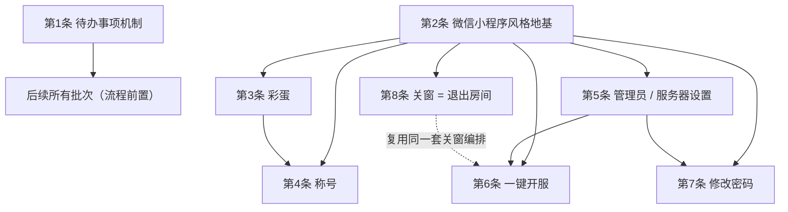
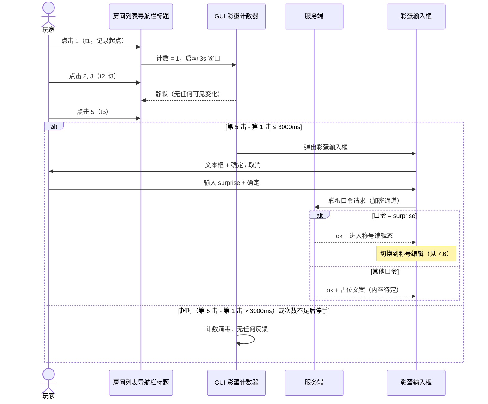
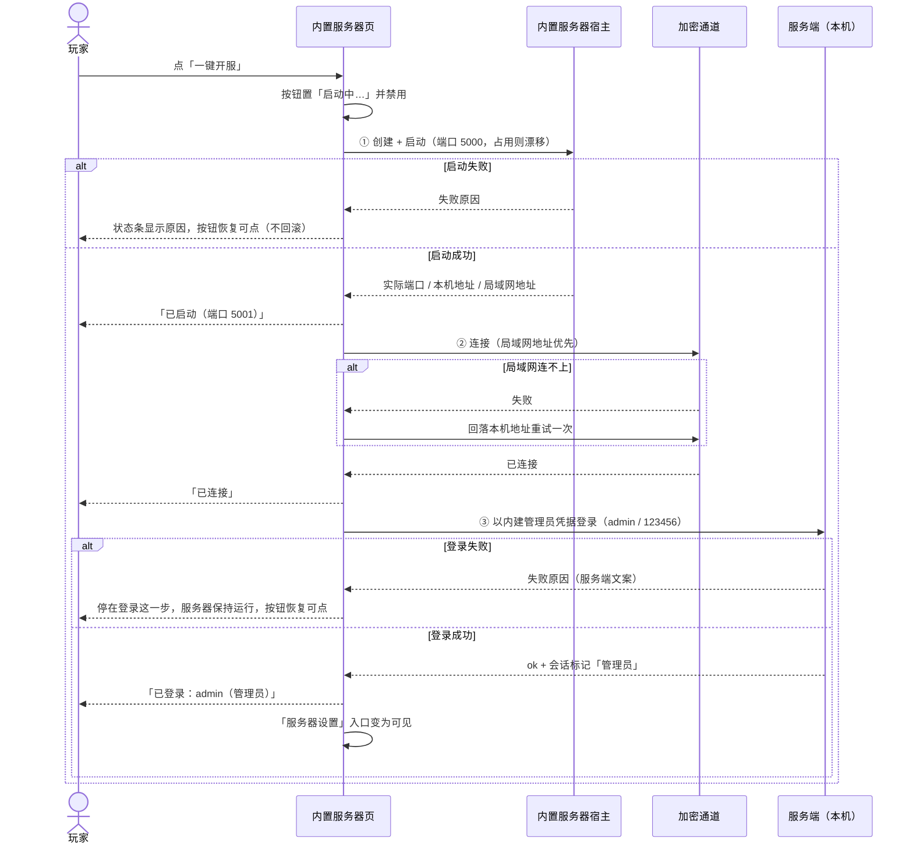
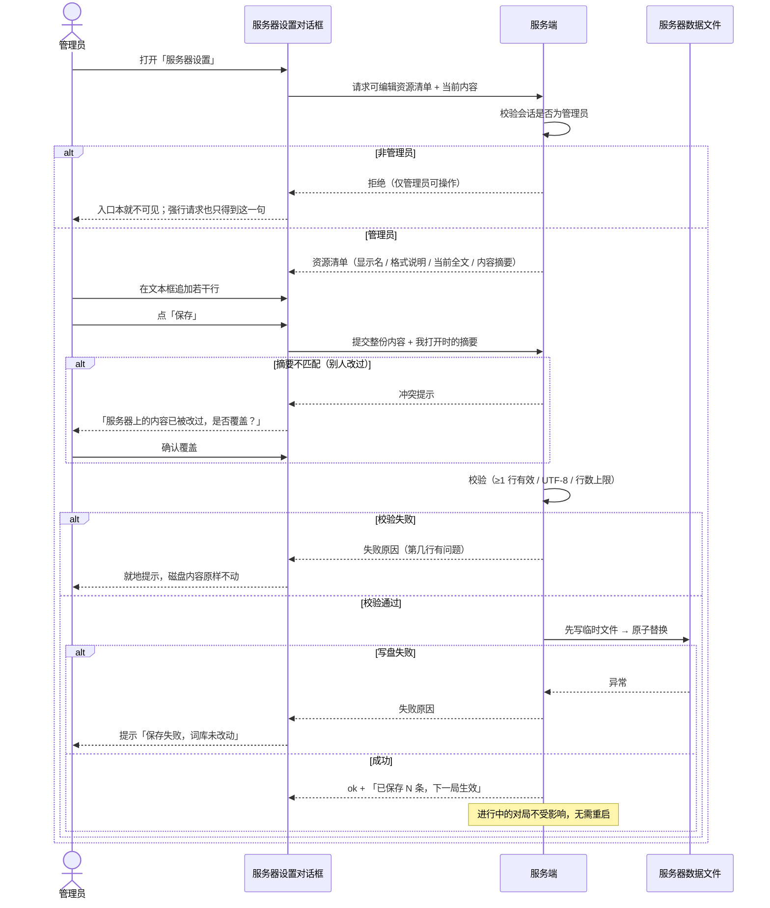
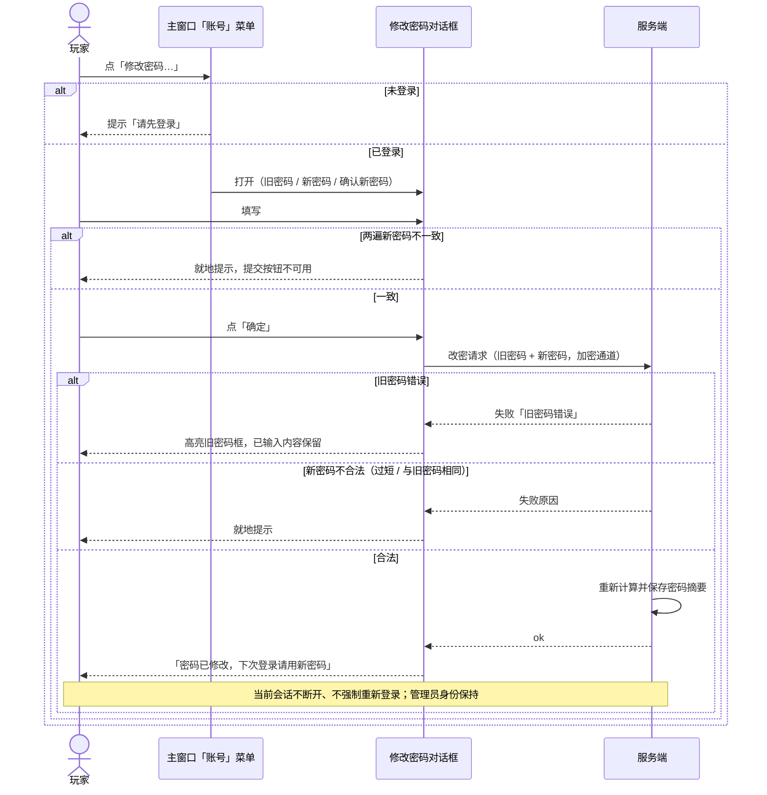
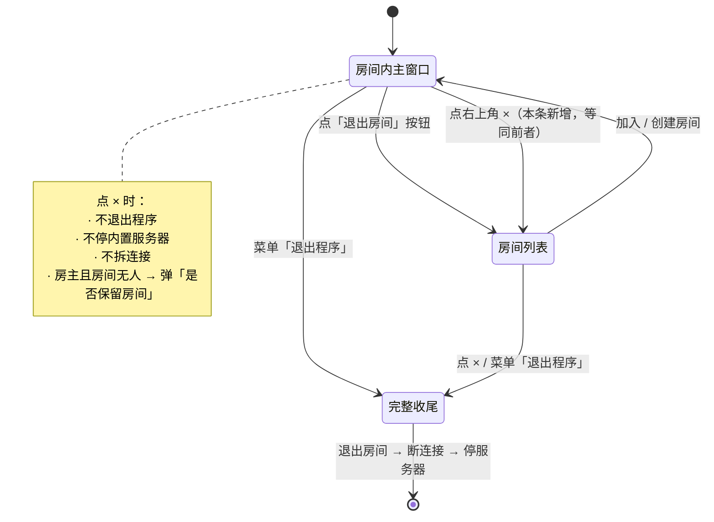

# v2.5 PRD · 移动化风格地基 + 彩蛋 / 称号 / 管理员 / 一键开服 / 改密 / 关窗语义

| 项 | 内容 |
|---|---|
| 文档语言 | 简体中文 |
| 适用项目 | `Werewolf.Server`（.NET 8；`WerewolfGame` 服务端 / `Werewolf.Client.Share` 协议与网络层 / `ClientGUI` WPF 客户端 / `Werewolf.Client` 控制台 / `ClientGUI.Tests` 测试宿主） |
| 技术栈 | 服务端 `Sdk.Web`（net8.0）；GUI `net8.0-windows` + WPF；协议与网络层唯一来源在 `Werewolf.Client.Share` |
| 基线版本 | GUI `2.4.0`（内置服务器已交付，见 `docs/embedded-server/`） |
| 本轮目标版本 | **2.5.0**（见 §10） |
| 文档性质 | **增量 PRD**：只描述「做什么、验收什么」，不含类名 / 方法名 / 文件改动清单 |

## 0. 用户原话（逐条保留编号）

> 请一条条完成：
> 1. 生成一个"代办事项"，里面放优化建议，每次任务开始执行时先执行"优化建议"中的东西。
> 2. 重构整个 gui 项目，让他更符合手机程序（微信小程序）的风格，为后续重构成手机项目做准备，并且后面的 gui 修改不能破坏这一风格。
> 3. 加入彩蛋，"房间列表"左上角的字在 3 秒内点 5 下触发，是个输入框，彩蛋内容待定。
> 4. 增加"称号"（头衔）系统，称号将用金黄色字体显示，字体稍微缩小，用同样颜色的圆角框圈起来（注意深浅主题），在"彩蛋"的输入框中输入"surprise"获取或编辑，存储在服务器，由服务器管理。
> 5. 加入"内置管理员"账户：用户名为 admin，密码默认 123456，仅管理员用户可以打开"服务器设置"对话框，目前支持"编辑词库"功能，可以给服务器词库远程添加内容，连接加密，服务器校验权限。
> 6. 优化"内置服务器"gui，仅需 1 个按钮"一键开服"即可完成创建服务器、连接服务器内置管理员账户 2 项工作。
> 7. 添加"修改密码"对话框（命令），输入旧密码和 2 遍新密码，服务器校验合法性。
> 8. 点击 MainWindow.xaml 所表示的窗口（也就是房间内的主窗口）的"关闭"按钮等效于按下"退出房间"按钮。
>
> 另外，不要每次作出修改后立刻同步至 github。

**顺序是有设计的**：第 2 条先立「风格」，后续所有界面改动都必须长在这个风格里。依赖在 §2 中强制化。

---

## 1. 产品目标与范围边界

### 1.1 产品目标（3 条，正交）

| # | 目标 | 可度量判据 |
|---|---|---|
| G1 | **把客户端界面换成「手机 App / 微信小程序」的观感与交互**，让它将来能 1:1 移植到手机项目 | 迁移范围内的窗口 100% 采用「导航栏 + 卡片内容区 + 底部操作条」骨架；`ClientGUI.Tests` 的风格守护用例全绿；两套主题色键集合完全一致 |
| G2 | **把「账号能力」从「能登录」升级为「有身份」**：管理员、称号、改密、远程词库维护 | 4 项能力全部经服务端裁定后生效；客户端绕过界面直接构造请求时，全部被服务端拒绝 |
| G3 | **把日常操作收敛成一步**：开服一步、退出房间与关窗一致、待办建议有固定落点并被循环消费 | 开服从「最多 5 步」降到 1 步；关主窗口与点「退出房间」行为完全一致；`docs/TODO.md` 在每轮任务首尾各被读写一次 |

### 1.2 范围内（In Scope）

1. 建立仓库内的**待办事项机制**（第 1 条）。
2. GUI 风格重构与配套规范、可移植性约束、风格守护验收（第 2 条）。
3. 房间列表彩蛋触发 + 彩蛋输入框（第 3 条）。
4. 称号系统：服务端存储 / 金色展示 / `surprise` 编辑入口（第 4 条）。
5. 内置管理员账号 + 服务端管理员判定 + 「服务器设置」对话框 + 远程编辑词库（第 5 条）。
6. 内置服务器页收敛为「一键开服」单按钮（第 6 条）。
7. 修改密码对话框与服务端校验（第 7 条）。
8. 房间内主窗口关闭 = 退出房间（第 8 条）。

### 1.3 范围外（Out of Scope）

| 项 | 说明 |
|---|---|
| 真正的手机 / 小程序项目 | 本轮只做准备（风格与约束），不产出移动端工程 |
| 新增 SignalR 方法 / 改 `Call` 契约 | 硬性禁止，见 §9 |
| 角色扮演、权限分组、多级管理员 | 本轮只有「是 / 否管理员」两态 |
| 称号商城 / 成就系统 / 称号审核 | 本轮只有「自己给自己取一个」 |
| 词库之外的服务器数据远程编辑 | 词库是第一个也是唯一一个资源；机制要通用，但本轮不接第二个资源 |
| 控制台客户端（`Werewolf.Client`）的等价新界面 | 仅在 §6 需求池中标 P2，可延后；不影响 GUI 交付 |
| 任何 git commit / push | 用户明确要求，见 §9.6 |

### 1.4 关键约束下的既定复用（不是新东西）

- 业务请求**全部**走单一加密入口（握手 PSK 认证 DH + 会话加密），新增能力 = 新增一个操作名 + 负载；平台层只认 `Handshake` / `Confirm` / `Call` 三个入口。
- 错误文案统一由服务端产出，客户端只负责显示；业务异常一律返回失败回执，不抛异常。
- 一切权限与合法性**以服务端校验为准**，客户端只做提示与按钮可用性。
- 内置服务器有一套「关窗收尾」编排（退出房间 → 断连接 → 停服务器，三步各有预算、整体幂等、8 秒硬超时），第 8 条必须**接入**它而不是另起一套。

---

## 2. 执行顺序与依赖关系

### 2.1 依赖图



**为什么第 2 条必须先做（强制）**

- 第 3 条的彩蛋挂在「房间列表左上角那个字」上 —— 风格重构后那个字就是**导航栏居中标题**，位置与热区都会变。先立风格再挂彩蛋，否则彩蛋会被二次改造。
- 第 4 条称号是一个**胶囊标签控件**，第 5/6/7 条各有一个**新对话框**。它们都是新增界面，必须一出生就长在风格里。
- 第 6 条「一键开服」是**按钮数量与布局的重构**，它本身就是风格迁移的一部分。
- 结论：**任何新增或改动的界面，在第 2 条完成前不得开工**。第 8 条虽然只改行为，但它改的是主窗口的关闭链路，主窗口同时是风格迁移对象，因此也必须排在后面。

### 2.2 建议执行批次

| 批次 | 内容 | 前置 | 产出可验收点 |
|---|---|---|---|
| **B0** | 第 1 条：待办机制 | 无 | `docs/TODO.md` 存在，含 §3.4 的种子条目；闭环流程写入文档 |
| **B1** | 第 2 条：风格地基 | B0 | 迁移范围内窗口完成骨架改造；新增色键双主题齐全；风格守护用例通过 |
| **B2** | 第 8 条：关窗 = 退出房间 | B1 | 关窗与「退出房间」行为逐项一致（§8.8 清单） |
| **B3** | 第 3 + 4 条：彩蛋 → 称号 | B1 | 3 秒 5 击触发；`surprise` 进入称号编辑；称号在房主列与玩家列表显示为金色圆角框 |
| **B4** | 第 5 + 6 条：管理员 → 一键开服 | B1 | admin 登录后可开服务器设置并改词库；一键开服三步一条龙 |
| **B5** | 第 7 条：修改密码 | B4（共用账号体系） | 三框表单 + 服务端裁定 + 成功提示 |

> B5 与 B4 可合并执行（同属账号能力域）；若分拆，B5 必须在 B4 之后，因为管理员判定与改密共用同一套「连接 → 用户名 → 权限」服务端逻辑。

---

## 3. 第 1 条：待办事项机制（长期机制，不是一次性文档）

### 3.1 落点

**`docs/TODO.md`**（仓库根 `docs/` 下，与 `docs/embedded-server/`、`docs/ui/` 同级）。

选择理由：
- 路径稳定、不含版本号，将来不用搬家；
- 与既有 `docs/` 文档体系同构，人和 AI 都能一眼找到；
- 不在 `docs/v25/` 下 —— 它是**跨版本**的机制，不能随某个版本目录一起被遗忘。

### 3.2 文件结构

```markdown
# 待办事项（优化建议）

> 开始任何任务前先读本文件；做完任务后回写本文件。流程见 §「闭环流程」。

## 闭环流程
（抄 §3.3 的 5 步）

## 待办
### P0 尽快做
- [ ] ...
### P1 该做
- [ ] ...
### P2 有空做
- [ ] ...

## 已完成
- [x] 2026-xx-xx ...
```

分组固定为三组：`P0 尽快做` / `P1 该做` / `P2 有空做` / `已完成`。

### 3.3 闭环流程（每次任务照做）

| 步骤 | 动作 | 判据 |
|---|---|---|
| ① **读** | 任务开始时先打开 `docs/TODO.md`，通读 P0/P1 | 在动手写代码之前完成 |
| ② **挑** | 从中挑出「本轮顺手可做」的项，与本次需求合并执行 | 至少挑 1 项；一条都不做需在交付说明里写明原因 |
| ③ **记** | 开工前把待办条目标记为进行中（`- [ ]` → `- [~]`） | 避免多轮任务重复挑同一条 |
| ④ **销** | 做完后把该条移入「已完成」，加完成日期与一句话结论 | 完成判定栏打勾 |
| ⑤ **回写** | 把任务过程中**新发现的**优化建议按模板追加进对应优先级分组 | 至少 1 条；确实没有则写「本轮无新增」 |

补充约定：
- **完成判定必须可观测**，禁止写「优化一下 XX」这种无法判定的条目。
- 条目被做完或确认不再需要才能删除；**不得静默删除**未在交付说明里解释的条目。
- 每次交付说明里必须有一节「本轮待办闭环：挑了 X、做了 Y、新增 Z」。

### 3.4 条目模板

```markdown
- [ ] **做什么**（一句话）
    - 为什么：<价值 / 不做的代价>
    - 落点：<建议的模块或文件（可写"建议"，架构师可改）>
    - 优先级：P0 / P1 / P2
    - 完成判定：<怎么算做完，可观测>
    - 来源：第 N 条需求 / 现状扫描
```

### 3.5 首次种子条目（从本次 8 条需求与现状扫描提炼，非空话）

| # | 做什么 | 为什么 | 建议落点 | 优先级 | 完成判定 |
|---|---|---|---|---|---|
| T1 | 抽掉各窗口重复的「标题行 + 底部状态条」XAML 样板 | 房间列表 / 登录 / 房主设置 / 设置各自抄了一遍；改风格时要改 4 处，必漏 | GUI 主题样式层 | P0 | 4 个窗口的标题行与状态条均引用同一样式键，无重复块 |
| T2 | 列表行最小高度提到 ≥56px，点击热区 ≥44px | 现状行高约 40、字号 12.5，手指点不准，也不符合移动端热区下限 | 房间列表 / 玩家列表 | P0 | 实测行高 ≥56，整行可点 |
| T3 | 把界面画刷集中缓存里写死的一组 RGB 颜色迁到主题色键 | 它们不随深浅主题切换，是「深色底上看不见的字」的隐患来源 | GUI 视图模型画刷缓存 | P0 | 该文件中不再出现颜色字面量 |
| T4 | 房主设置窗口的游戏徽章边框颜色写死为 `#7C8AA5` | 违反主题铁律，浅色主题下边框发灰 | 房主设置窗口 XAML | P0 | 改为动态资源引用 |
| T5 | 菜单下拉项模板的隐式样式覆盖加守护断言 | 新增菜单层级极易漏注册，漏了就落回系统浅色外观 | 测试宿主 UI 冒烟 | P0 | 冒烟用例遍历菜单树断言模板覆盖 |
| T6 | 把「是否管理员」收敛为服务端一处判定 | 第 5 条引入角色后，若在各处散落 `用户名 == admin` 比较，将来加权限必漏 | 服务端账号 / 会话层 | P0 | 全局搜索不到按用户名硬编码判断权限的代码 |
| T7 | 密码长度下限这类规则统一到共享文案常量 | 现状服务端校验与客户端提示各写一份，改规则时容易漂移 | 协议层统一文案 | P1 | 规则常量单一来源，两端引用同一处 |
| T8 | 词库远程编辑抽象成「服务器可编辑数据资源清单」 | 平台层一旦认识 `words.undercover.txt` 这个游戏专属文件名，就破了「平台不为具体游戏开后门」 | 服务端游戏模块 / 平台层 | P0 | 平台层代码中不含任何游戏专属文件名或格式 |
| T9 | 统一「关闭意图」入口（关主窗口 / 关房间列表 / 退出程序） | 第 8 条后三者行为不同且分散在三处，改一处容易忘另外两处 | GUI 应用生命周期 | P1 | 三种关闭来源走同一个意图分派，行为表可一眼看全 |
| T10 | 内置服务器页按钮数量复核 | 一键开服上线后，原来的「启动并进入 / 仅启动 / 登录」可能变成冗余入口 | 登录窗口内置服务器页 | P1 | 页面上不再存在两个语义重复的启动按钮 |
| T11 | 关于 / 更新日志窗口排进风格迁移队列 | 第 2 条允许暂缓，但不能忘了它们 | GUI 次要窗口 | P2 | 已在迁移清单中登记并给出预计批次 |
| T12 | 客户端本地偏好存储不要塞进服务端权威数据 | 称号 / 管理员标记是服务端权威，本地缓存只用于展示，混进去会出现"改了不生效" | GUI 本地偏好存储 | P1 | 本地状态里不含称号 / 角色字段 |
| T13 | 明确「改动不自动同步远端」的执行约定 | 用户已两次强调；写进文档才能约束后续每一轮 | `docs/TODO.md` 顶部 + 本文档 §9.6 | P0 | 两份文档均有该条，且交付说明中确认未执行提交/推送 |

---

## 4. 第 2 条：微信小程序风格规范（地基）

### 4.1 设计原则（一句话）

> **把每个窗口当成一个「小程序页面」来设计：顶部一条导航栏，中间一块可滚动的卡片内容区，底部一条操作条。窗口 chrome 感越弱越好。**

### 4.2 视觉与交互规范（WPF 可实现）

#### 4.2.1 页面骨架（三层楼）

```
┌──────────────────────────────────────┐  ← 导航栏 56px（高 56，不是 WPF 的窗口标题栏）
│  ‹ 返回        房间列表          ···  │     居中标题 17px SemiBold
├──────────────────────────────────────┤     左侧返回 / 右侧操作，各 ≥44×44 热区
│                                      │
│  ┌────────────────────────────────┐  │  ← 内容区：页面底色 PageBg
│  │ 卡片 1（圆角 12，内边距 16）    │  │
│  └────────────────────────────────┘  │
│  ┌────────────────────────────────┐  │     卡片之间 12px 间隔
│  │ 列表项                      ›   │  │     列表项高 ≥56，右侧箭头/胶囊
│  ├────────────────────────────────┤  │     分隔线：1px，左对齐文字（不顶格）
│  │ 列表项                      ›   │  │
│  └────────────────────────────────┘  │
│                                      │  ← 可滚动
├──────────────────────────────────────┤
│  ┌────────────────────────────────┐  │  ← 底部操作条：主按钮通栏
│  │          一键开服               │  │     左右 16px 边距，高 48，圆角 10
│  └────────────────────────────────┘  │
└──────────────────────────────────────┘
```

#### 4.2.2 逐条规范

| 维度 | 规范 | 说明 |
|---|---|---|
| 导航栏 | 高 **56**；标题**居中**、17px、SemiBold；左「返回 / 关闭」、右「更多 / 主操作」 | 用页面内的 Grid 实现，**不是** Win32 窗口标题栏；左右槽位没有内容时留空，不放占位按钮 |
| 页面背景 | 页面底用 `PageBgBrush`（浅色 = 微信灰 `#F2F3F5`，深色 = 近黑），卡片用 `CardBrush`（浅色纯白） | 关键：**内容区是白色卡片浮在灰底上**，而不是窗口整体一个底色 |
| 卡片 | 圆角 **12**，内边距 **16**，卡片间距 **12**，页面左右边距 **12–16** | 卡与卡之间靠留白分隔，不要描边 |
| 列表项 | 行高 **≥56**，整行可点；主标题 15px / 副标题 12px；右侧统一放箭头 `›` 或状态胶囊 | 箭头与胶囊二选一，不同行不要混用 |
| 分隔线 | **1px `DividerBrush`**，左缩进与文字对齐（16），最后一行不画 | 用分隔线替代边框；卡片本身不描边 |
| 底部操作条 | 主按钮**通栏**（左右 16，高 48，圆角 10）；一屏最多一个主按钮 | 两个按钮时：主按钮通栏在上，次按钮通栏在下（次按钮用描边样式），**不要并排挤在右下角** |
| 圆角阶梯 | 卡片 12 / 按钮 10 / 输入框 8 / 胶囊 999（全圆） | 只允许这四档 |
| 字号阶梯 | 导航标题 17 / 区块标题 15 / 正文 14 / 次要 12 / 脚注 11 | 只允许这五档 |
| 间距阶梯 | 4 / 8 / 12 / 16 / 24 | 只允许这五档 |
| 输入框 | 高 44，圆角 8，`InputBrush` 底；占位文字用弱化色；错误提示在框下方 11px，不弹框 | 一行一个输入框，标签在框上方 |
| 空态 | 居中图标 + 一句人话 + 一个通栏次按钮 | 不要只写「暂无数据」 |
| 加载态 | 按钮变「…中」并禁用，**不弹模态等待框** | 全程可取消 |

#### 4.2.3 与现有主题系统共存（强制）

- 颜色**只能**定义在 `ClientGUI/Themes/Colors.Dark.xaml` 与 `Colors.Light.xaml`，**两套键名必须完全一致**（现有测试宿主已会扫描 XAML 引用的色键，缺一个就断言失败）。
- XAML 一律 `{DynamicResource XxxBrush}` 引用；**禁止** `{StaticResource XxxBrush}` 引颜色，**禁止**任何 `#RRGGBB` / RGB 字面量。
- 窗口 / UserControl 根元素的 `Background` / `Foreground` 也必须用 DynamicResource。
- 现有 `AccentBrush`（蓝）**保留**，用于「选中态、链接、强调文字」；新增 `ActionBrush`（微信绿）作为**主操作按钮**专用色 —— 两者语义分离，不要混用。

#### 4.2.4 新增业务色键清单（语义名 + 建议值）

| 色键（语义名） | 用途 | 深色建议 | 浅色建议 |
|---|---|---|---|
| `PageBgBrush` | 页面级背景（卡片外的底） | `#FF0E1117` | `#FFF2F3F5` |
| `CardAltBrush` | 卡片内次级区块 / 分组头 | `#FF1A2029` | `#FFF7F8FA` |
| `DividerBrush` | 列表分隔线（1px） | `#FF2C3546` | `#FFE5E7EB` |
| `NavBarBgBrush` | 导航栏底（与卡片区分） | `#FF181D28` | `#FFFFFFFF` |
| `NavBarTextBrush` | 导航标题文字 | `#FFE8EDF6` | `#FF1A1A1A` |
| `ChipBgBrush` | 通用胶囊底（状态标签） | `#FF2A3346` | `#FFF0F2F5` |
| `ChipTextBrush` | 胶囊文字 | `#FFC3CCDC` | `#FF5A6472` |
| `ChipBorderBrush` | 胶囊描边（1px） | `#FF3A4459` | `#FFDDE1E7` |
| `ActionBrush` | **主操作按钮底**（微信绿系） | `#FF2E9E63` | `#FF07C160` |
| `ActionTextBrush` | 主按钮文字 | `#FFFFFFFF` | `#FFFFFFFF` |
| `ActionPressedBrush` | 主按钮按下 | `#FF268A53` | `#FF06AD56` |
| `ActionDisabledBrush` | 主按钮禁用底 | `#FF3A4252` | `#FFC8CDD4` |
| `TitleTextBrush` | **称号文字（金）** | `#FFFFD98A` | `#FFB07D12` |
| `TitleBorderBrush` | **称号圆角边框（金，同色系）** | `#FFE0B96B` | `#FFD9A83A` |
| `TitleBgBrush` | 称号框内极淡底色 | `#33FFD98A` | `#1AC9971F` |
| `MaskBrush` | 浮层遮罩 | `#99000000` | `#66000000` |
| `DisabledTextBrush` | 禁用态文字 | `#FF6F7C93` | `#FFB0B7C2` |
| `PlaceholderBrush` | 输入框占位文字 | `#FF6F7C93` | `#FFA8AFBA` |

> 已有键（`BgBrush` / `PanelBrush` / `CardBrush` / `InputBrush` / `HoverBrush` / `BorderBrush2` / 各文字色 / `Accent*` / 状态色）继续沿用，不新增同义键。

### 4.3 移植友好度检查清单（面向将来改成手机项目）

新增或重写的界面，提交前逐项自检：

| # | 检查项 | 不合格示例 |
|---|---|---|
| C1 | 布局只用基础容器（栅格 / 线性堆叠 / 相对停靠） | 用了数据表格、属性网格、功能区等重型控件 |
| C2 | 不依赖 WPF 特有的复杂模板、触发器链、可视化状态管理器 | 用了一长串 `MultiDataTrigger` 才能表达一个状态 |
| C3 | 不依赖鼠标专属交互：右键菜单、悬停才出现的操作、**双击**、拖拽 | 某个功能只能靠双击触发 |
| C4 | 交互状态**单一来源**：一个状态一个属性，界面只做映射 | 同一个「是否可点」在两处各算一遍，可能不一致 |
| C5 | 页面骨架是「导航栏 + 滚动内容 + 底部操作条」三层，可 1:1 映射成小程序页面 | 用多窗格 / 可拖动分隔条 |
| C6 | 不使用绝对像素定位与画布坐标 | `Canvas.Left` 满屏 |
| C7 | 尺寸用自适应（星号列 / 自动高），不写死像素宽高（按钮高度这类控件规范除外） | 写死 `Width="960"` 且不可缩放 |
| C8 | 按**手机逻辑宽度 375** 设计：WPF 端用固定宽度模拟一屏，内容超长时滚动 | 依赖宽屏并排三栏 |
| C9 | 图标用文本 / emoji / 矢量路径，不用位图资源 | 依赖 PNG 图标集 |
| C10 | 颜色只引用语义色键（将来映射成移动端的设计变量） | 直接写色值 |
| C11 | 弹窗一律实现为**页面内浮层**（遮罩 + 居中卡片），不用系统模态框 | `MessageBox.Show` 承载业务流程 |
| C12 | 文案与格式不拼接在界面层；输入校验规则由服务端给出、界面只提示 | 界面里写死一份校验规则 |

### 4.4 迁移范围与验收

#### 4.4.1 必须遵守新风格（本轮 P0）

| 界面 | 说明 |
|---|---|
| 登录窗口（两个标签页） | 内置服务器页要收敛为一键开服（第 6 条） |
| 房间列表窗口 | 彩蛋挂在这里（第 3 条），房主列要显示称号（第 4 条） |
| 房间内主窗口（骨架与三栏容器） | 三栏的内部细节可暂缓 |
| 创建房间窗口 | — |
| 房主设置窗口 | — |
| 设置窗口 | — |
| **本轮全部新增对话框**：彩蛋输入 / 服务器设置 / 修改密码 | 新界面必须一出生就合规 |
| 邀请码窗口、保留房间窗口 | 小窗口，顺手改 |

#### 4.4.2 允许暂缓（P1/P2，但必须登记）

| 界面 | 级别 | 说明 |
|---|---|---|
| 游戏专属面板（狼人杀 / 谁是卧底的操作区与信息区） | P1 | 玩法密度高，先保功能，风格迁移单开一批 |
| 聊天面板、玩家面板内部细节 | P1 | 容器跟上，内部条目暂缓 |
| 关于 / 更新日志窗口 | P2 | 纯展示，已登记为待办 T11 |

#### 4.4.3 如何断言「没有破坏这一风格」

**机器断言（测试宿主 UI 冒烟扩展）**

| 断言 | 内容 |
|---|---|
| A1 | 两套主题色键集合**完全一致**（差集为空） |
| A2 | 全部 XAML 中**不存在**颜色字面量（`#[0-9A-Fa-f]{6,8}` 与 `Color.FromRgb`） |
| A3 | 迁移范围内每个窗口存在导航栏结构元素，且导航标题居中 |
| A4 | 列表项实测高度 ≥ 56；按钮类控件可点区域 ≥ 44 |
| A5 | 主操作按钮宽度为内容区宽度的 ≥ 80%（通栏） |
| A6 | 新增 / 改动的界面不出现 C1–C3 的禁用控件清单 |

**人工验收清单（每批次交付时走一遍）**

1. 切到浅色主题、深色主题各看一遍，**没有**看不见的字、没有发灰的边框。
2. 每个页面能说出「导航栏 / 内容区 / 底部操作条」分别是什么；说不出来就是没做完。
3. 把窗口宽度拉到最小，内容不重叠、不出现横向滚动条。
4. 只用键盘（Tab + 回车）能走完主流程 —— 对应移动端的「只靠点击」。
5. 截一张浅色、一张深色图，与 §4.2.1 的骨架并排看，结构一致。

---

## 5. 用户故事总表（覆盖 8 条）

| # | 用户故事 | 可观测验收标准 |
|---|---|---|
| **US-1** | 作为**开发者（人和 AI 都算）**，我希望仓库里有一份固定位置的优化建议清单，每次开工先消费它，这样技术债不会越积越多 | ① `docs/TODO.md` 存在且含 §3.4 的 13 条种子条目；② 每一轮任务的交付说明里都有「本轮待办闭环」小节，写明挑了哪条、做了哪条、新增了哪条；③ 挑出的条目状态可追踪（进行中 / 已完成） |
| **US-2** | 作为**玩家**，我希望客户端看起来像手机 App 而不是传统桌面窗口，这样将来换到手机上不用重新学 | ① 迁移范围内窗口呈现「导航栏 + 卡片 + 底部操作条」三层结构；② 深浅两套主题下均无可读性问题；③ §4.4.3 的 A1–A6 全绿；④ 新增的 3 个对话框一律符合规范 |
| **US-3** | 作为**好奇的玩家**，我想在房间列表左上角那个字上连点几下触发彩蛋，这样能发现隐藏内容 | ① 在房间列表**导航栏标题「房间列表」**上 3 秒内点击 5 下 → 弹出彩蛋输入框；② 点 4 下后停手，等 4 秒再点 1 下 → **不触发**；③ 误触期间界面无任何可见变化、无弹窗；④ 触发后输入框为「文本框 + 确定 / 取消」，风格与全局一致 |
| **US-4** | 作为**玩家**，我想在彩蛋输入框里输入 `surprise` 拿到/改一个称号，并且这个名字由服务器记住，换电脑登录还在 | ① 输入 `surprise`（忽略大小写与首尾空格）→ 进入称号编辑态；② 保存后，房间列表「房主」列与房间内玩家列表里我的名字后面出现**金色、字号略小、同色圆角描边框**的称号；③ 深色/浅色主题下都清晰可读；④ 关闭客户端重登，称号还在；⑤ 换一台电脑用同一账号登录，称号还在 |
| **US-5** | 作为**服务器管理员**，我希望只有我能打开「服务器设置」并远程给词库加内容，这样不用跑去服务器上改文件 | ① 以 admin 登录后能看到「服务器设置」入口，普通账号**看不到**该入口；② 普通账号绕过界面直接发同款请求 → 服务端拒绝并给出「仅管理员可操作」；③ 在对话框里追加若干行词并保存 → 返回「已保存，共 N 条，下一局生效」；④ 保存后开新局能用到新词；⑤ 进行中的对局不受影响 |
| **US-6** | 作为**想立刻开黑的人**，我只想点一个按钮就把服务器开起来并连上，最好直接是管理员 | ① 内置服务器页**主操作区只有一个主按钮「一键开服」**；② 点击后依次给出「启动服务器 → 连接 → 以管理员登录」的可视进度，最终状态显示「已登录：admin（管理员）」；③ 端口被占用时自动换端口并在界面说明；④ 中途任一步失败：按钮恢复可点、给出人话原因、已完成的步骤保留（服务器起来了就保持运行）；⑤ 完成后「服务器设置」入口立即可用 |
| **US-7** | 作为**玩家**，我想改掉自己的密码，旧密码输错要被拦住 | ① 有「修改密码…」入口，打开后出现「旧密码 / 新密码 / 确认新密码」三个输入框；② 两遍新密码不一致 → 提示且不允许提交；③ 旧密码错误 → 服务端拒绝，提示「旧密码错误」，已输入内容保留；④ 成功 → 提示「密码已修改，下次登录请用新密码」，当前会话不断开；⑤ 用新密码重新登录成功、用旧密码登录失败 |
| **US-8** | 作为**玩家**，我点房间窗口右上角的 × 就应该等同于点「退出房间」，别把我整个程序退掉了 | ① 点 × → 退出房间并回到房间列表，**程序没退出**；② 与点菜单「退出房间」的表现逐项一致（见 §8.8 对照表）；③ 我是房主且房间里没人时，与「退出房间」一样弹「是否保留房间」；④ 内置服务器**保持运行**（不被关掉）；⑤ 从房间列表窗口点 × 或点「退出程序」→ 仍然走完整收尾（退房间 → 断连 → 停服务器） |
| **US-9** | 作为**用户**，我不希望每次改完就自动同步到远端 | ① 本轮所有批次结束时，版本控制状态为「有未提交改动」，**没有**任何提交与推送；② 交付说明里明确写出「未执行提交/推送」 |

---

## 6. 需求池（P0 / P1 / P2，含涉及端）

端缩写：**G** = GUI 客户端，**C** = 控制台客户端，**S** = 服务端，**P** = 协议与网络层（共享库），**T** = 测试宿主。

### 6.1 第 1 条 · 待办机制

| ID | 需求 | 优先级 | 端 |
|---|---|---|---|
| 1.1 | 在 `docs/TODO.md` 建立待办事项文件，含闭环流程说明 | P0 | 文档 |
| 1.2 | 写入 §3.4 的 13 条种子条目（按 P0/P1/P2 分组） | P0 | 文档 |
| 1.3 | 把「开工先读、做完回写」写进流程节，让执行者照做即可 | P0 | 文档 |
| 1.4 | 每轮交付说明含「本轮待办闭环」小节 | P0 | 文档 |
| 1.5 | 「禁止自动同步远端」写入待办文件顶部与本文档 | P0 | 文档 |

### 6.2 第 2 条 · 微信小程序风格地基

| ID | 需求 | 优先级 | 端 |
|---|---|---|---|
| 2.1 | 定义页面骨架规范（导航栏 56 / 内容区 / 底部操作条） | P0 | G |
| 2.2 | 定义圆角、字号、间距三级阶梯并落地为可复用样式 | P0 | G |
| 2.3 | 新增 §4.2.4 的 18 个业务色键，两套主题键名完全一致 | P0 | G |
| 2.4 | 清除界面层的颜色字面量（含视图模型里的写死画刷） | P0 | G |
| 2.5 | 迁移范围内窗口按新骨架重写（§4.4.1） | P0 | G |
| 2.6 | 列表行高 ≥56、点击热区 ≥44 | P0 | G |
| 2.7 | 弹窗改为页面内浮层（遮罩 + 居中卡片），业务流程不再用系统模态框 | P0 | G |
| 2.8 | 测试宿主新增风格守护断言 A1–A6 | P0 | T |
| 2.9 | 游戏专属面板与聊天 / 玩家面板内部细节迁移 | P1 | G |
| 2.10 | 关于 / 更新日志窗口迁移 | P2 | G |
| 2.11 | 移植友好度检查清单纳入交付自检 | P0 | 文档 |

### 6.3 第 3 条 · 彩蛋

| ID | 需求 | 优先级 | 端 |
|---|---|---|---|
| 3.1 | 房间列表**导航栏标题「房间列表」**成为触发热区（整块 ≥44×44） | P0 | G |
| 3.2 | 「3 秒内点 5 下」判定：滚动窗口，从第一次点击起算，第 5 次点击时 `(t5 - t1) ≤ 3000ms` 才触发 | P0 | G |
| 3.3 | 未达成条件（次数不足 / 超时）→ 计数清零，**无任何可见反馈** | P0 | G |
| 3.4 | 触发后弹出彩蛋输入框（文本框 + 确定 / 取消），风格合规 | P0 | G |
| 3.5 | 彩蛋文案与语义由服务端返回，客户端不内嵌内容 | P0 | P / S |
| 3.6 | 非 `surprise` 的输入 → 返回占位文案（内容待定），**不报错** | P0 | S |
| 3.7 | 已登录用户均可触发（不区分管理员） | P0 | G |
| 3.8 | 第 3 次点击起给极轻的视觉暗示（不改变布局） | P2 | G |

### 6.4 第 4 条 · 称号

| ID | 需求 | 优先级 | 端 |
|---|---|---|---|
| 4.1 | 称号由**服务端**按账号存储，随账号持久化 | P0 | S |
| 4.2 | 协议层：房间列表条目与房间内玩家行增加「称号」字段（空表示无称号） | P0 | P |
| 4.3 | 展示样式：金色文字 + 字号比相邻正文小一档 + **同色系圆角描边框**（`TitleTextBrush` / `TitleBorderBrush` / `TitleBgBrush`），深浅主题均清晰 | P0 | G |
| 4.4 | 无称号时不渲染该框（不留空胶囊） | P0 | G |
| 4.5 | 展示位置：房间列表「房主」列、房间内玩家列表（玩家名后） | P0 | G |
| 4.6 | 输入 `surprise` → 进入称号编辑态（显示当前称号 + 输入 + 保存 / 清除） | P0 | G |
| 4.7 | 称号可自定义；服务端校验：非空、去空白、长度 ≤ 8 个中文字符（或 16 个英文字符）、不含换行与控制字符 | P0 | S |
| 4.8 | **只能改自己的称号**：服务端按「当前连接绑定的用户名」写入，请求中携带的用户名一律忽略 | P0 | S |
| 4.9 | 称号对所有已登录玩家可见 | P0 | S / G |
| 4.10 | 聊天消息发送者名后显示称号 | P1 | G |
| 4.11 | 控制台能查看 / 设置自己的称号 | P2 | C |
| 4.12 | 敏感词 / 特殊字符过滤（服务端） | P1 | S |

### 6.5 第 5 条 · 内置管理员

| ID | 需求 | 优先级 | 端 |
|---|---|---|---|
| 5.1 | 服务端启动时确保 `admin` 账号存在（不存在则创建，默认密码 `123456`） | P0 | S |
| 5.2 | 普通注册流程**不能抢占** `admin` 用户名（大小写不敏感） | P0 | S |
| 5.3 | 管理员身份由**服务端**判定并随会话下发；客户端不得自称管理员 | P0 | S / P |
| 5.4 | 协议层：会话信息中带「是否管理员」标记（登录后可获得） | P0 | P |
| 5.5 | 「服务器设置」入口**仅管理员可见** | P0 | G |
| 5.6 | 非管理员直接发起管理员请求 → 服务端拒绝，返回统一文案 | P0 | S |
| 5.7 | 服务器设置对话框：以「可编辑数据资源」为单位的通用机制（资源名 / 显示名 / 格式说明 / 当前内容），**平台层不得出现任何游戏专属文件名或格式** | P0 | S / P |
| 5.8 | 编辑词库：拉取当前全文 → 编辑 → 整份提交保存 | P0 | G / S |
| 5.9 | 保存校验：至少 1 行有效、UTF-8、行数上限（建议 ≤ 5000） | P0 | S |
| 5.10 | 保存失败**原子回滚**（先写临时文件再替换），返回失败原因，磁盘内容保持原样 | P0 | S |
| 5.11 | 保存成功返回「已保存 N 条，下一局生效」；**进行中的对局不受影响**，无需重启服务器 | P0 | S |
| 5.12 | 并发编辑：保存时校验「我打开时的内容摘要」，若服务端已被改过则提示并二次确认 | P1 | S / G |
| 5.13 | 连接全程加密（复用既有加密通道），管理员请求不额外开通道 | P0 | P |
| 5.14 | 控制台管理员可维护词库 | P2 | C |

### 6.6 第 6 条 · 一键开服

| ID | 需求 | 优先级 | 端 |
|---|---|---|---|
| 6.1 | 内置服务器页主操作区收敛为**一个主按钮「一键开服」** | P0 | G |
| 6.2 | 一键串起三步：创建并启动服务器 → 连接 → 以内建管理员账号登录 | P0 | G |
| 6.3 | 每一步都在同一处给出可视状态（分步文案 + 状态徽章） | P0 | G |
| 6.4 | 端口占用时自动漂移并明确告知实际端口 | P0 | G |
| 6.5 | 任一步失败：停在失败那一步、给出人话原因、按钮恢复可点、已完成的步骤**保留**（不自动停服务器） | P0 | G |
| 6.6 | 一键开服**不覆盖**用户手填的用户名 / 密码；界面明确标注「将以管理员 admin 登录」 | P0 | G |
| 6.7 | 已完成（已登录 admin）时按钮变为不可用或变为「进入房间列表」 | P0 | G |
| 6.8 | 保留一个「停止服务器」次按钮（必须能停）与地址复制入口 | P0 | G |
| 6.9 | 提供「用当前账号登录」的次级入口（非 admin） | P1 | G |
| 6.10 | 控制台同样提供一键开服 | P2 | C |

### 6.7 第 7 条 · 修改密码

| ID | 需求 | 优先级 | 端 |
|---|---|---|---|
| 7.1 | 新增「修改密码…」入口（推荐：主窗口新增「账号」菜单项，见 Q1） | P0 | G |
| 7.2 | 对话框含「旧密码 / 新密码 / 确认新密码」三个输入框，风格合规 | P0 | G |
| 7.3 | 两遍新密码不一致 → 禁止提交并提示 | P0 | G |
| 7.4 | 服务端裁定：旧密码正确性、新密码长度下限（与注册规则同源）、新旧不能相同 | P0 | S |
| 7.5 | 旧密码错误 → 保留已输入内容，提示「旧密码错误」 | P0 | G |
| 7.6 | 成功后提示「密码已修改，下次登录请用新密码」，**当前会话不断开**、不强制重新登录 | P0 | G / S |
| 7.7 | 未登录时入口不可用（或提示先登录） | P0 | G |
| 7.8 | admin 改密后仍保持管理员身份；改密后**不再**被重置回 `123456` | P0 | S |
| 7.9 | 控制台提供改密命令 | P2 | C |

### 6.8 第 8 条 · 关窗 = 退出房间

| ID | 需求 | 优先级 | 端 |
|---|---|---|---|
| 8.1 | 房间内主窗口关闭（× 关闭按钮）**等同**触发「退出房间」 | P0 | G |
| 8.2 | 关主窗口**不退出整个程序**、不停内置服务器、不拆连接 | P0 | G |
| 8.3 | 与既有「关窗收尾」编排**合并**：完整收尾只在「真正退出程序」时执行 | P0 | G |
| 8.4 | 房主且房间内无其他人时，与「退出房间」一样弹「是否保留房间」 | P0 | G |
| 8.5 | 关闭意图统一分派：关主窗口 / 关房间列表 / 退出程序 三种来源行为一致且可一眼看全 | P1 | G |
| 8.6 | 退出房间后，房间列表窗口能看出服务器仍在运行 | P1 | G |
| 8.7 | 内置服务器开着、房间里还有别人时关主窗口 → **不再**弹「会断开他们」的确认（因为不停服务器） | P0 | G |

---

## 7. UI 草图与关键时序图

### 7.1 风格骨架（迁移后统一形态）

```
┌────────────────────────────────────────────┐
│ ‹            房 间 列 表              ⚙    │  导航栏 56
├────────────────────────────────────────────┤
│  ┌──────────────────────────────────────┐  │
│  │ 邀请码  [___________________] [加入] │  │  卡片 1
│  └──────────────────────────────────────┘  │
│  ┌──────────────────────────────────────┐  │
│  │ 🐺 12345  狼人杀  快乐的夜晚      ›  │  │  列表项 56
│  │ ──────────────────────────────────── │  │  分隔线（左缩进）
│  │ 🎭 12346  卧底    谁在说谎        ›  │  │
│  │ ──────────────────────────────────── │  │
│  │ 🐺 12347  狼人杀  缺 3 人          ›  │  │
│  └──────────────────────────────────────┘  │
│  ┌──────────────────────────────────────┐  │
│  │ 已选：12345 快乐的夜晚   密码 [____] │  │  卡片 3
│  └──────────────────────────────────────┘  │
├────────────────────────────────────────────┤
│  ┌──────────────────────────────────────┐  │
│  │            加 入 房 间               │  │  底部主按钮通栏 48
│  └──────────────────────────────────────┘  │
└────────────────────────────────────────────┘
```

> 彩蛋触发点 = 导航栏里「房间列表」四个字所在的整块热区（图中 `房 间 列 表` 位置）。

### 7.2 称号展示（第 4 条）

```
房间列表「房主」列                房间内玩家列表
┌──────────────────────────┐     ┌────────────────────────────────┐
│ 小明 ╭──────╮            │     │ ① 小明  ╭───────╮              │
│      │ 预言家│            │     │         │ 村长  │              │
│      ╰──────╯            │     │         ╰───────╯              │
└──────────────────────────┘     │ ② 小红                          │
                                 │ ③ 小刚  ╭──────────╮           │
样式：                            │         │ 熬夜冠军 │           │
  文字 TitleTextBrush（金）       │         ╰──────────╯           │
  字号 = 相邻正文 - 1 档（12）    └────────────────────────────────┘
  边框 1px TitleBorderBrush（同色系）
  圆角 999（胶囊）  内边距 6,1
  底色 TitleBgBrush（极淡，浅色主题下几乎不可见）
  无称号 → 不渲染
```

### 7.3 彩蛋触发判定（时序 · 第 3 条）



### 7.4 一键开服（时序 · 第 6 条）



### 7.5 管理员编辑词库（时序 · 第 5 条）



### 7.6 修改密码（时序 · 第 7 条）



### 7.7 关窗语义（状态 · 第 8 条）



---

## 8. 异常与边界（逐条给期望行为）

### 8.1 第 1 条 · 待办机制

| 场景 | 期望行为 |
|---|---|
| 一轮任务里一条待办都做不了（与本次需求无交集） | 允许；但交付说明的「本轮待办闭环」必须写明「未挑，原因：……」 |
| 待办条目已过时 | 移入「已完成」并注明「已过时/不需要」，**不静默删除** |
| 两个人（或两轮任务）同时想做同一条 | 开工前标记进行中；发现已被标记则换一条 |
| 回写时没有新发现 | 写「本轮无新增」，不留空 |

### 8.2 第 2 条 · 风格

| 场景 | 期望行为 |
|---|---|
| 新增色键只加了一套主题 | 测试宿主断言 A1 失败；**必须在两套里同时加** |
| 某处必须写死颜色（如第三方控件） | 写明原因并登记为待办；不得成为常态 |
| 窗口拉到最小宽度 | 内容不重叠、不出现横向滚动条；底部操作条仍可见 |
| 深色主题下金色称号 | 用 `TitleTextBrush` 的深色值（偏亮的金），不得沿用浅色值 |
| 系统标题栏跟随不了主题 | 已知限制，接受；页面内导航栏必须完整呈现 |

### 8.3 第 3 条 · 彩蛋

| 场景 | 期望行为 |
|---|---|
| 点 4 下后停手，隔 4 秒再点 1 下 | **不触发**；计数从新一次点击重新开始 |
| 3 秒内点了 6 下 | 第 5 下即触发，第 6 下不再计数（输入框已打开，不重复弹） |
| 点击间隔均匀但总时长 3.1 秒 | 不触发（严格 ≤ 3000ms；边界值以第 1 击到第 5 击的时间差为准） |
| 点在 🐺 图标或副标题上 | 不计数（只有标题文字所在的整块热区算） |
| 未登录（理论上不会在房间列表看到未登录态） | 不触发、无副作用 |
| 彩蛋输入框已打开时再点标题 | 不重复打开；已开的输入框保持在最前 |
| 输入空内容点确定 | 提示「请输入内容」，不发起请求 |
| 输入非 `surprise` 的内容 | 服务端返回占位文案（内容待定），**不报错、不弹异常** |
| 服务器不可达 / 请求超时 | 提示"网络不通"级别的人话，**不弹异常堆栈**；输入框保持打开可重试 |
| 快速连点被系统识别为双击 | 双击也必须计入点击次数（用底层按下事件计数，而不是双击事件） |

### 8.4 第 4 条 · 称号

| 场景 | 期望行为 |
|---|---|
| 称号为空 / 全是空格 | 服务端按「清除称号」处理；界面不渲染框 |
| 称号超长 | 服务端拒绝并返回长度限制；界面就地提示 |
| 称号含换行、控制字符、`\|` | 服务端拒绝或过滤（推荐直接拒绝，文案说明不允许的字符） |
| 请求里指定了别人的用户名 | **忽略**请求中的用户名，只按当前连接的身份写入 |
| 未登录就请求改称号 | 服务端拒绝（沿用「尚未登录」统一文案） |
| 服务端不可用时的展示 | 沿用上一份已知值展示；不得显示空白框或占位金框 |
| 称号与其他 UI 元素挤在一行 | 称号截断（省略号），不挤压主内容；房间列表列宽相应调整 |
| 浅色主题 | 金色改用深色金（可读），边框同色系，底色极淡 |
| 重登 / 换设备 | 称号来自服务端，一致 |

### 8.5 第 5 条 · 管理员与词库

| 场景 | 期望行为 |
|---|---|
| 服务端首次启动 | 自动确保 `admin` 存在（默认密码 `123456`），并在服务启动输出中可确认 |
| 有人注册用户名 `Admin` / `ADMIN` | 拒绝（用户名大小写不敏感，保留给管理员） |
| 普通账号打开「服务器设置」 | 入口不可见；即便绕过界面发请求，服务端也返回「仅管理员可操作」 |
| 客户端自己声称是管理员 | 服务端**不采信**；只看服务端会话标记 |
| 词库保存时内容为空 / 全是注释 | 拒绝保存并提示「至少要有一行有效内容」 |
| 行格式错误（缺 `\|`、某侧为空） | 给出**第几行**有问题；整份不落盘 |
| 文件编码非 UTF-8 | 按 UTF-8 解析并保存；保存后的文件必须是 UTF-8 |
| 保存过程中写盘失败（只读 / 被占用 / 磁盘满） | 原子回滚，磁盘保持原样，返回失败原因 |
| 保存时有对局进行中 | 允许保存；**当前对局继续用旧词**，下一局生效；提示语明确说明 |
| 两个管理员同时编辑 | P1：后保存者收到「内容已被改过」二次确认；P0 阶段至少保证不会写坏文件 |
| 词库行数巨大（如 10 万行） | 超过上限（建议 5000）拒绝，避免拖垮服务器 |
| 通道未加密 | 不可能发生（所有业务都在既有加密通道内） |

### 8.6 第 6 条 · 一键开服

| 场景 | 期望行为 |
|---|---|
| 端口 5000 被占用 | 自动改用空闲端口，界面明确显示实际端口；**不要**静默 |
| 端口手工填了非法值 | 内联提示，按钮禁用，不弹异常框 |
| 服务器启动失败 | 停在第 ① 步，给出人话原因，按钮恢复可点 |
| 服务器起来了但连不上 | 局域网地址失败后回落本机地址重试一次；仍失败 → 停在第 ② 步，**服务器保持运行**，按钮恢复可点 |
| 连接成功但管理员登录失败 | 停在第 ③ 步，给出服务端文案；服务器与连接保持；可重试 |
| 已经用 admin 登录且服务器在跑 | 主按钮不可用或变为「进入房间列表」，不重复开服 |
| 用户手填了用户名密码 | **不被覆盖**；界面明确写「将以管理员 admin 登录」，避免误解 |
| 一键开服途中用户点停止 | 允许中断；状态回到「未启动 / 已停止」，按钮恢复 |
| 防火墙弹窗 | 沿用现有说明（提示选择允许） |

### 8.7 第 7 条 · 修改密码

| 场景 | 期望行为 |
|---|---|
| 两遍新密码不一致 | 就地提示，确定按钮不可用 |
| 旧密码错误 | 服务端拒绝；提示「旧密码错误」；**已输入内容保留**，旧密码框高亮 |
| 新密码长度不足 | 服务端拒绝（与注册规则同源）；提示具体下限 |
| 新密码与旧密码相同 | 服务端拒绝，提示「新密码不能与旧密码相同」 |
| 未登录打开入口 | 提示先登录（或入口不可用） |
| 成功 | 提示「密码已修改，下次登录请用新密码」；当前会话不断开；管理员身份保持 |
| admin 改密 | 允许；改后仍是管理员；**不会再被重置回 123456** |
| 忘记 admin 密码 | 文档说明恢复方式（删除该服务器工作目录下的账号数据即恢复默认）—— 属于运维说明，不是隐藏后门 |

### 8.8 第 8 条 · 关窗语义（与「退出房间」逐项对照）

| 观察点 | 点「退出房间」按钮 | 点右上角 ×（本条之后） |
|---|---|---|
| 是否退出房间 | 是 | **是** |
| 是否回到房间列表 | 是 | **是** |
| 是否退出整个程序 | 否 | **否** |
| 是否断开连接 | 否 | **否** |
| 是否停止内置服务器 | 否 | **否** |
| 房主且房间内无其他人 | 弹「是否保留房间」 | **同样弹** |
| 房间里还有别人 | 房主转让给下一位（既有行为） | **同样** |
| 内置服务器开着且上面还有别的玩家 | 不弹「会断开他们」的确认 | **不弹**（因为不再停服务器） |
| 重复触发（连点两次 × / 收尾期间再关） | 幂等，不重复离开 | **幂等**，不重复离开（复用既有幂等闸） |
| 从**房间列表**窗口点 × | 退出程序，走完整收尾（退房间 → 断连 → 停服务器） | **不变** |
| 菜单「退出程序」 | 完整收尾 | **不变** |
| 系统关机 / Ctrl+C | 完整收尾（8 秒硬超时） | **不变** |

---

## 9. 约束（硬性，不可违反）

### 9.1 协议与通道

1. **不得新增 SignalR 方法**；平台层只保留 `Handshake` / `Confirm` / `Call` 三个入口。
2. **不得修改 `Call` 的请求 / 响应契约**。
3. 新增业务一律是「新增一个操作名 + 相应负载」；本协议层是两端唯一来源，两端不得各自定义。
4. 新增的统一错误文案放在协议层的文案常量里，客户端**只显示服务端返回的文案**。
5. 业务异常一律返回失败回执，**不得抛 Hub 异常**。

### 9.2 平台与游戏解耦

6. **平台层不得为任何具体游戏开后门**：不得出现游戏专属的文件名、文件格式、玩法逻辑。
7. 第 5 条的远程编辑必须走「服务器声明可编辑数据资源」的通用机制，由游戏模块自己注册资源与校验规则，平台只做权限校验、内容存取与原子写盘。

### 9.3 权限与校验

8. 一切权限与合法性**以服务端校验为准**；客户端只做提示与按钮可用性。
9. 管理员判定、称号归属、密码校验、词库格式校验 —— 全部服务端裁定。
10. 客户端不得在请求中指定「我是谁 / 我要改谁」，服务端只认当前连接绑定的身份。

### 9.4 主题与界面

11. 颜色**只能**定义在深色 / 浅色两套配色文件中，**键名必须完全一致**。
12. XAML 一律 `{DynamicResource XxxBrush}`；禁止硬编码色值、禁止用 `{StaticResource}` 引颜色。
13. 窗口 / 用户控件根元素的背景与前景也必须用动态资源。
14. 第 2 条完成前，不得开工任何新增或改动的界面（第 3–8 条中的界面部分）。

### 9.5 数据安全

15. 密码存储沿用既有哈希方案，**不得**存明文、不得降级为弱哈希。
16. 词库写盘必须原子（临时文件 + 替换），失败可回滚。
17. 内置管理员的默认密码属于**已知弱口令**，必须在文档与界面上提示「开服后建议尽快修改密码」。

### 9.6 版本控制

18. **本轮全程禁止 git commit、git push**（用户明确要求：「不要每次作出修改后立刻同步至 github」）。所有改动保留在工作区，交付说明中需明确写出「本轮未执行任何提交 / 推送」。
19. 如需同步，由用户显式提出，且单独确认后再执行。

---

## 10. 待确认问题（每条已给推荐默认，可直接采纳不阻塞）

| # | 问题 | 推荐默认值 | 理由 / 影响 |
|---|---|---|---|
| **Q1** | 第 7 条「修改密码（命令）」的触发入口到底在哪？ | **主窗口新增顶级菜单「账号(_A)」，内含「修改密码…」**；管理员在同一菜单里还能看到「服务器设置…」。登录窗口在未登录状态下点击 → 提示「请先登录」。可选快捷键 `Ctrl+Shift+P`（P1） | 原文「（命令）」含义含糊（菜单命令 / 控制台命令 / 协议命令）。放在「账号」菜单下能同时容纳第 5 条的管理员入口，两者共用一套「账号能力」语义，用户也最好找 |
| **Q2** | 称号可否自定义（而不是只能选预设）？ | **可自定义**。长度 ≤ 8 个中文字符（或 16 个英文字符），非空、去首尾空白、不含换行与控制字符；服务端校验 | 原文说「输入 surprise 获取或编辑」，「编辑」暗示可自己填。预设词库要额外设计，本轮不做 |
| **Q3** | 称号是否所有人可见？ | **是**，对所有已登录玩家可见。展示位置：房间列表「房主」列（P0）、房间内玩家列表（P0）、聊天消息发送者名后（P1） | 称号是社交属性，藏起来就没意义。若将来需要审核，再加「仅自己可见」开关 |
| **Q4** | `surprise` 在输入框里的确切语义（解锁？进入编辑？获取一个随机称号？） | **口令 = 进入称号编辑态**。忽略大小写与首尾空格；匹配后服务端返回「称号编辑已解锁」，界面在同一对话框内切换为称号编辑（当前称号 + 输入框 + 保存 / 清除）。**不做随机赠送** | 原文「获取或编辑」：理解为「拿到编辑资格并立即编辑」最贴合，也省掉一套预设称号库 |
| **Q5** | 默认密码 `123456` 是否允许修改？与第 7 条什么关系？ | **允许修改，且走第 7 条同一套改密流程**（不单独开接口）。改后**不再**被重置回 `123456`。忘记密码时的恢复方式写进运维说明（删掉该服务器工作目录里的账号数据即恢复默认） | 弱口令可改是安全底线；复用第 7 条避免两套逻辑漂移 |
| **Q6** | 第 6 条「一键开服」是否**总是**以 admin 登录？ | **是**（这是原文字面要求）。按钮下方标注「将以管理员 admin 登录」，且**不覆盖**用户手填的用户名 / 密码。P1 增加次级入口「用当前账号登录」 | 用户明确写「连接服务器内置管理员账户」。不覆盖手填凭据是为了避免「我的名字怎么变成 admin 了」的困惑 |
| **Q7** | 第 3 条彩蛋是否对所有用户开放？ | **对所有已登录用户开放**，不区分管理员。触发条件与输入框表现对所有账号一致，只有 `surprise` 有实质功能 | 彩蛋是趣味性功能，限制给管理员会让它几乎无人发现；且它不涉及权限 |
| **Q8** | 彩蛋内容「待定」怎么处理？ | **P0 只实现 `surprise` → 称号**；其他输入返回占位文案「这个彩蛋还在准备中 🐣」，不报错。后续要加内容只需在服务端扩充，不动客户端 | 把「待定」隔离在服务端，客户端不内嵌彩蛋内容，将来加彩蛋零改动 |
| **Q9** | 第 8 条之后，内置服务器什么时候停？ | **关房间内主窗口不停**；只有「关闭房间列表 / 登录窗口」或「退出程序」才走完整收尾（退房间 → 断连 → 停服务器） | 「关窗 = 退出房间」的必然推论。若关主窗口就停服务器，房间里其他玩家会被无辜踢掉 |
| **Q10** | 词库编辑后需要重启服务器吗？ | **不需要**。保存即生效于**下一局**；进行中的对局继续用旧词，不受影响 | 中途换词会让当前对局出现「同一个词两个值」的荒谬情况 |
| **Q11** | 多人同时编辑词库怎么处理？ | P0：**整份覆盖** + 打开时展示「服务器当前 N 条」；P1：保存时带内容摘要，服务端内容已变则二次确认「是否覆盖」 | P0 先保证可用且不写坏文件，冲突提示作为增强 |
| **Q12** | 主按钮颜色要不要改成微信绿？ | **改**。新增 `ActionBrush`（微信绿系）作为主操作按钮专用；现有 `AccentBrush`（蓝）保留给「选中态 / 链接 / 强调文字」 | 「更符合微信小程序风格」的核心观感之一；蓝绿分工也避免语义混淆 |
| **Q13** | 主窗口的菜单栏怎么办？（小程序没有菜单栏） | **保留但风格化**：它是 WPF 桌面端承载快捷键与显隐开关的必要容器，不作为移植目标；**新增页面一律用「导航栏 + 内容 + 底部操作条」骨架** | 强行去掉菜单会丢失 Ctrl+, 等既有能力；承认它是桌面端残留，并在移植友好度清单里标注 |
| **Q14** | 第 3 条的「3 秒内点 5 下」如何计时？ | **滚动窗口**：从第 1 次点击起算，第 5 次点击时 `(t5 - t1) ≤ 3000ms` 即触发；未达成则计数清零、**不做滑动窗口**、无任何反馈 | 最符合「3 秒内点 5 下」的直觉；滑动窗口会让用户觉得"我明明点了 5 下" |
| **Q15** | 本轮是否同步到远端？ | **不同步**。全程禁止 commit / push，改动留在工作区 | 用户明确要求，已写入 §9.6 |

---

## 11. 版本号建议

| 项 | 建议 |
|---|---|
| 当前版本 | `2.4.0`（GUI） |
| **本轮目标版本** | **`2.5.0`** |
| 理由 | 第 2 条是「整个 GUI 项目的风格重构」，属于**次版本号级**的能力变更（不是补丁修复，但也不是架构级不兼容升级） |
| 发布策略 | 六个批次（B0–B5）**统一归到一个 2.5.0**：中途不发小版本，避免用户拿到「半成品风格」 |
| 更新日志 | 大白话，不写类名。建议要点方向：① 界面改成手机 App 的样子了；② 房间列表左上角那几个字连点几下有彩蛋；③ 可以给自己取一个金色称号；④ 内置服务器只要点一下「一键开服」就开好并自动以管理员登录；⑤ 管理员可以远程改词库；⑥ 可以改密码了；⑦ 关掉房间窗口等于退出房间，不会再整个退出程序 |
| 待办文件 | `docs/TODO.md`（跨版本，不随版本目录走） |
| 本文档 | `docs/v25/PRD.md` |
