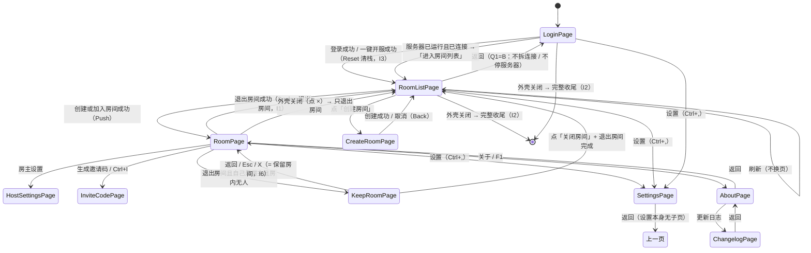
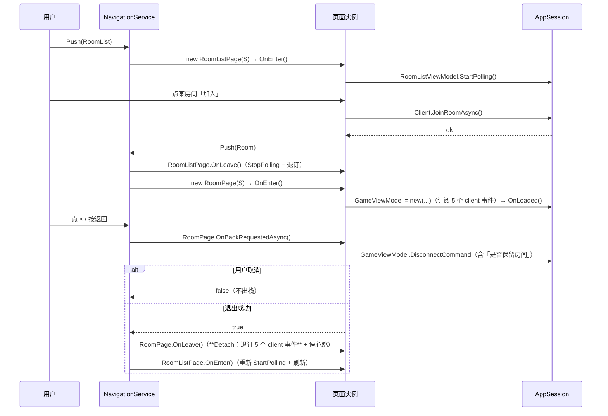
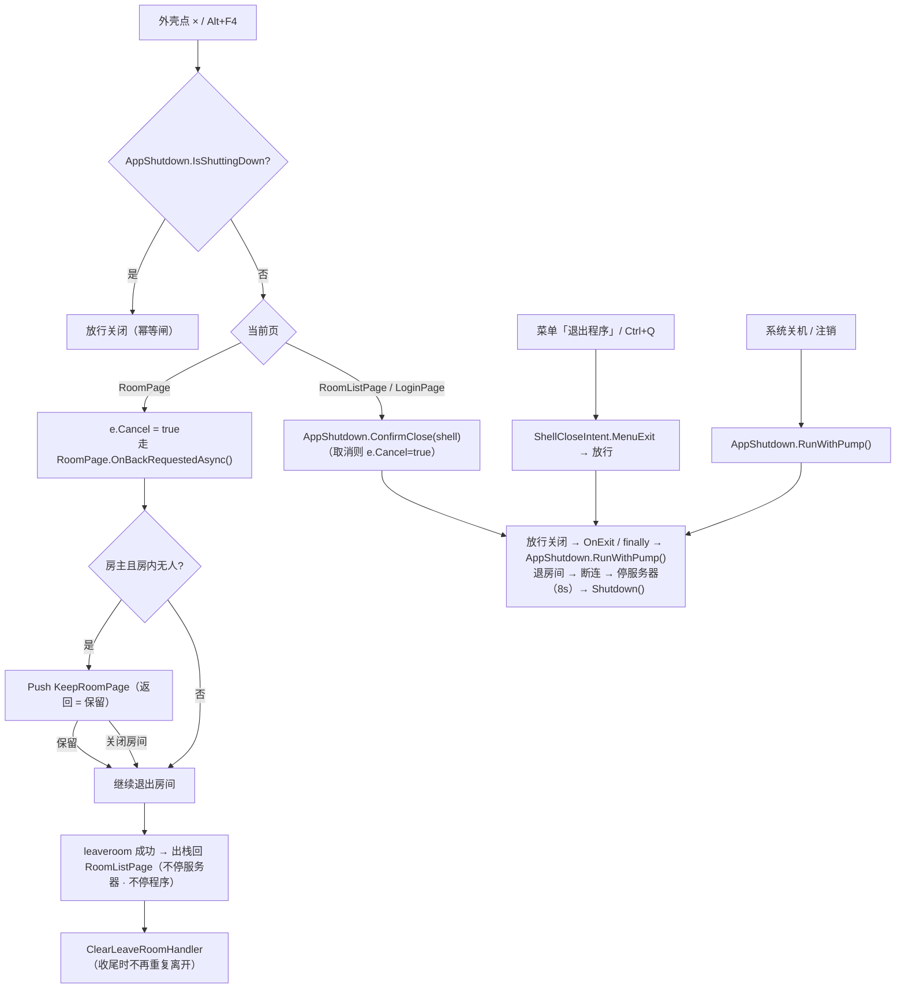
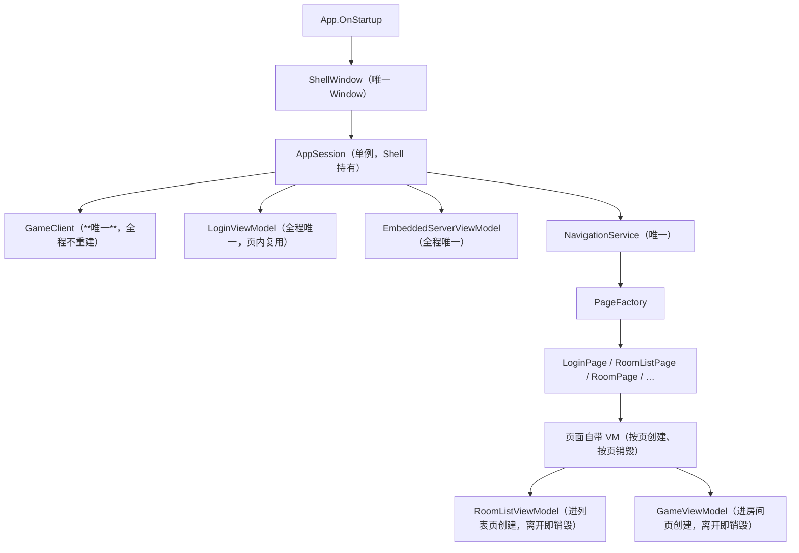
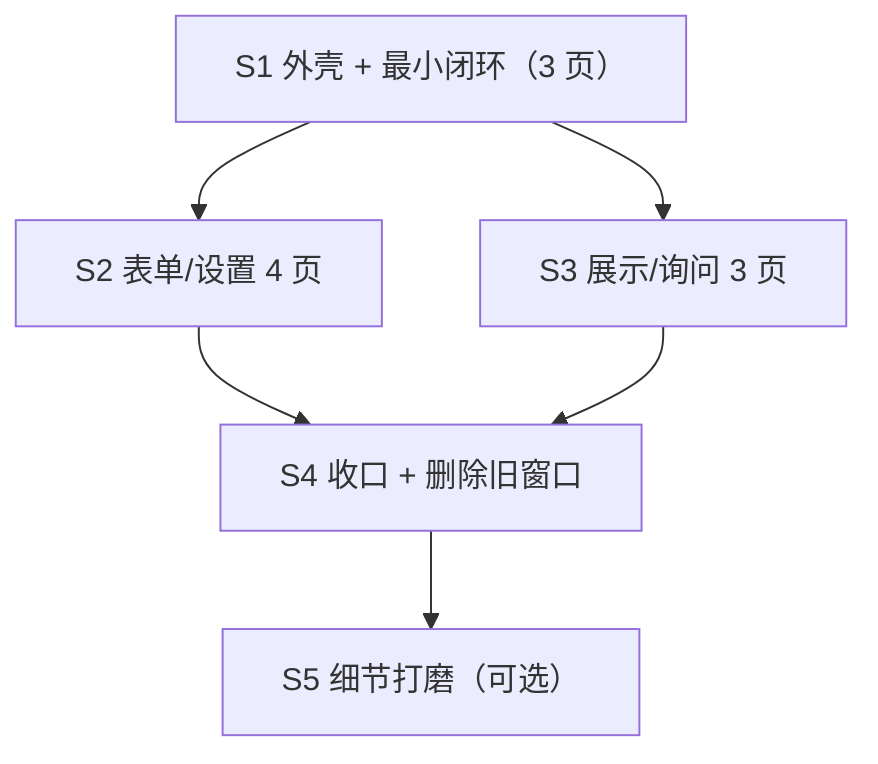

# 外壳化重构 · 单窗口 + 页面（Shell & Pages）架构设计

| 项 | 内容 |
|---|---|
| 文档语言 | 简体中文 |
| 作者 | 高见远（架构师） |
| 上游 | 用户原话「请重构全部 gui 使全部"窗口"作为页面集中到同一个窗口」；主理人盘点的现状清单 |
| 基线 | 仓库 `Werewolf.Server`，GUI 版本 **2.5.0**（`ClientGUI.csproj`），`dotnet build` 当前 **0 警告 0 错误**，`--ui` 当前实测 **308 项断言全绿** |
| 文档性质 | **增量架构设计**：只做设计，不改任何 `.cs` / `.xaml` 产品代码 |
| 结论一句话 | **新建唯一 `ShellWindow`（Window）+ 页面宿主 `ContentControl` + 自建 `NavigationService`（页面描述符 + 显式返回栈）；10 个现有 Window 中的 9 个搬成 `UserControl` 页面（每页自带 AppShell 导航栏），3 个纯询问/编辑对话框继续用 `OverlayDialog` 页内浮层；关闭语义由「哪个窗口在关」改成「当前是哪一页 + 本次关闭意图」，走新增纯函数 `CloseIntent.Resolve` 映射到既有 4 值枚举（**枚举值不能增加**，见 D4.4）。** |

---

## 0. 裁定（v2.5.1）

> **性质**：以下三条由主理人代用户定稿（用户可随时改口径）。改动只影响 **S1 / S2 的导航判据与登录页分支**，不影响外壳选型（D1）、页面清单（D2 的形态划分）、断言迁移承诺（D7）与不变量 I1–I8 的骨架。

| # | 议题 | **定稿结论** | 落点（改哪里） |
|---|---|---|---|
| **Q1** | 房间列表页的「返回」去哪？ | **= B：返回登录页**。全程**不拆连接、不停内置服务器**（这是导航，不是关闭）。登录页加兜底：**服务器已运行且已连接时，一键开服主按钮显示「进入房间列表」**（点击 = `Reset(RoomList)`，不重复开服）。 | 导航规则 **N4**（§4.3）、导航状态图（§4.2）、`RoomListPage.CanGoBack = true`、`LoginPage` 的主按钮文案分支 |
| **Q2** | 子页面（设置 / 关于 / 邀请码…）点外壳 × 算「返回上一页」还是「退出程序」？ | **= 返回上一页**（不是退出程序）。与旧模型「关掉子窗口、主界面还在」等价，也符合移动端直觉。 | 关闭行为表第 8 行（§5.2）、`ShellWindow.OnClosing` 的判据（当前页栈深 > 1 → `BackAsync()`） |
| **Q3** | 主窗口菜单栏在页面里放哪？ | **= 仍留在 `RoomPage` 顶部**（不搬进导航栏「···」溢出菜单）。保住 `Ctrl+G/I/L` 的可发现性，也保住既有 10 条 `Menu` 相关断言（`FindLogical<Menu>` + 4 个模板解析 + 模板覆盖率）。 | `RoomPage` 结构（S1）、`UiSmokeCheck.ExerciseMainWindow` 的页面化改写 |

**Q1 带来的两个必测点**（已写入 S1 验收判据，见 §9.1 / §9.3）：
1. 从房间列表返回登录页后，`EmbeddedServerService.Current.IsRunning` **仍为 `true`**（服务器没被停）；
2. 此时导航栈 **`Depth == 1`**（已回到根页，`CanGoBack == false`，不会残留列表页）。

---

## 1. 现状盘点（已逐项核对源码，非推测）

### 1.1 顶层 `Window` 类（10 个）

| # | 类 | 构造签名 | 模态性 / 返回值 | 谁打开 | 窗口级属性 |
|---|---|---|---|---|---|
| W1 | `Views.LoginWindow` | `()` | `ShowDialog()`，`DialogResult=true` = 登录成功；暴露 `Session`、`Login`、`Embedded` | `App.ShowLogin()` | 301 行 XAML，双标签页 |
| W2 | `Views.RoomListWindow` | `(GameClient)` | `ShowDialog()`，`true` = 已进房；`Closing` 里调 `AppShutdown.ConfirmClose` | `App.RunRoomLoop()` | 293 行，含彩蛋浮层 `EggOverlay` |
| W3 | `ClientGUI.MainWindow` | `(GameClient)` | `ShowDialog()`；暴露 `IsLoggedOut`、`Session`；`Closing` 走 `CloseIntent` 判定 | `App.RunRoomLoop()` | 含菜单栏 / 三栏 / 状态条 |
| W4 | `Views.CreateRoomWindow` | `(GameClient)`（另有 `()` 重载供冒烟） | `DialogResult=true` = 创建；读 `RoomName`/`Password`/`SelectedGameId` | `RoomListWindow.CreateRoom_OnClick` | `NoResize` 448×537 |
| W5 | `Views.HostSettingsWindow` | `(GameClient)` | 保存成功 → `DialogResult=true` 自动关；`RefreshFromServerState(HostSettingsDto)` | `MainWindow.Menu_HostSettings_OnClick` | `NoResize` 584×680，4 个 Tab |
| W6 | `Views.SettingsWindow` | `()` | `static Open(Window owner[, GameClient])` → `ShowDialog()`；静态 `ViewOptionsChanged`；`ResolveSession(Window)` 按窗口类型取会话 | 三个窗口的按钮 + `Ctrl+,` 全局 | 4 个 Tab + 账号浮层 |
| W7 | `Views.InviteCodeWindow` | `(string code)` | `ShowDialog()`，无返回值 | `MainWindow.ShowInviteCode` | `NoResize` 508×440 |
| W8 | `Views.KeepRoomWindow` | `()` | `DialogResult=true` = 保留房间；`false` = 关闭房间；X / Esc = **保留** | `MainWindow.AskKeepRoom` | `NoResize` 456×541 |
| W9 | `Views.AboutWindow` | `()` | `ShowDialog()`；内部按钮打开 W10 | `MainWindow.OpenAbout`（F1） | `NoResize` 470×560 |
| W10 | `Views.ChangelogWindow` | `()` | `ShowDialog()` | `MainWindow.OpenChangelog` / `AboutWindow` | 560×620，长文本滚动 |

### 1.2 已经是页内浮层（`Controls/OverlayDialog`）

`EggDialog`（彩蛋 / 称号编辑）、`ServerSettingsDialog`、`ChangePasswordDialog` —— 三者是 `UserControl` 正文件，由 `OverlayDialog.DialogBody` 承载，宿主分别是 `RoomListWindow.EggOverlay`、`SettingsWindow.AccountOverlay`。**本次不动它们的形态**（它们已经符合「页面内浮层」）。

### 1.3 现有语义（重构不得丢失，编号 I1–I6）

| # | 语义 | 现有实现锚点 |
|---|---|---|
| I1 | 关房间主窗口 = 只退出房间（不停内置服务器 / 不退出程序） | `MainWindow.OnClosing` + `CloseIntent.RequiresFullShutdown(RoomWindow)==false` |
| I2 | 全部窗口关闭 = 完整收尾（退房间 → 断连 → 停内置服务器，8s 预算、幂等） | `App.RunRoomLoop` finally + `App.OnExit` + `AppShutdown.RunWithPump()` |
| I3 | 一键开服成功后**自动进入房间列表** | `EmbeddedServerViewModel` → `LoginViewModel.LoginSucceeded` → `LoginWindow.DialogResult=true` |
| I4 | 设置 4 页（外观 / 主界面 / 上次使用 / 账号设置） | `SettingsWindow` + `UiSmokeCheck.CheckSettingsWindow`（`Check.Equal(4, ...)` + `Check.SequenceEqual(new[]{...4 项})`） |
| I5 | 导航栏标题**几何居中**（≤1px） | 三套守护断言逐窗口实测（`AppShellGuard` / `AppShellQaGuard` / `V25BatchProbe`） |
| I6 | 「关闭保留房间窗口 = 保留房间」 | `KeepRoomWindow.Window_OnKeyDown`（Esc → `Finish(true)`）+ **唯一判定点** `Services/KeepRoomDecision.cs` 的 `Resolve(bool? dialogResult) => dialogResult ?? true`（`null` = 无显式选择 → 保留） |

### 1.4 测试宿主对窗口的依赖（决定了迁移成本）

| 位置 | 依赖形态 |
|---|---|
| `UiSmokeCheck.Try(name, Func<Window>)`（L45–54） | **10 条**：`new LoginWindow()` … `new HostSettingsWindow(new GameClient())` |
| `UiSmokeCheck.ExerciseMainWindow`（L102–184） | 约 **10 条**：`new MainWindow(new GameClient())` + `FindLogical<Menu>` + `Measure(1220,780)` + 展开 4 个下拉 + 4 个菜单模板解析 + 模板覆盖 |
| `UiSmokeCheck.CheckLoginTabs`（L237–311） | 约 **24 条**：`new LoginWindow()` + `window.FindName("Tabs"/"PortInput"/...)` + `window.Embedded.*` / `window.Login.*` |
| `UiSmokeCheck.CheckSettingsWindow`（L318–412） | 约 **20 条**：`new SettingsWindow()` ×2 + `FindName` + 纯函数 `AccountEntryVisibility` |
| `UiSmokeCheck.CheckHostSettingsPollKeepsEdits` / `CheckHostSettingsGameTabs`（L418–529） | 约 **12 条**：`new HostSettingsWindow(new GameClient())` ×2 + `RefreshFromServerState` |
| `UiSmokeCheck.CheckCreateRoomGamePicker`（L537–566） | 约 **4 条**：`new CreateRoomWindow()` + `GameBox` |
| `UiSmokeCheck.CheckTheme`（L606–613） | **2 条**窗口耦合：`new LoginWindow().Background` 随主题变化 |
| `AppShellGuard.CheckWindowSkeletons`（8 项窗口表） | **约 54 条**：`NavBar` 存在 + `MinHeight≥56` + 标题存在 + 标题居中 + `PrimaryAction` 通栏占比（登录页两页各测一次） |
| `AppShellQaGuard.RunMeasuredStyleGuards`（8 项窗口表） | **约 17 条**：真实布局后标题偏移 ≤1px + 主按钮占比 + 行高/按钮高/输入框高实测 |
| `V25BatchProbe.RunUiChecks` | **约 23 条**：`new LoginWindow()` 的一键开服状态机 + 8 窗口导航标题居中 |
| `EmbeddedServerQaAudit`（`--embeddedqa`） | 1 条源码级：断言 `ClientGUI/Views/LoginWindow.xaml` 存在且无硬编码色值（**文件路径断言**） |

> **窗口强绑定断言合计约 170–180 条**（`--ui` 共 **308**）。其余为源码级（配色键扫描 / 禁止控件 / 禁止色值）、控件级（`OverlayDialog` / `TitleChip` / 剪贴板）与纯逻辑断言，**不受本次重构影响**。
>
> **基线口径（统一）**：`--ui` = **308**（B1 后 264 → B4/B5 后 **297** → B2/B3 追加彩蛋/称号后 **308**，`dotnet ClientGUI.Tests.dll --ui` 末行实测）。**`297` 是 B4/B5 收口时的中间态，勿作为迁移基线误读**；`docs/v25/ARCHITECTURE.md` §11 的表格已同步改为 308 并加注。

---

## 2. 决策 D1 · 外壳与页面宿主选型

### 2.1 候选对比

| 维度 | A. `Frame` + `Page` + `NavigationService` | B. `ContentControl` + 自建导航服务（页面 = `UserControl`） |
|---|---|---|
| 返回栈 | 内置 journal，但**只认 URI 导航**，我们的页面要带构造参数（`GameClient`、`RoomInfoDto`），得靠 `NavigationContext` 或单例传参 | 自己持有 `List<PageEntry>`，参数直接进描述符，零摩擦 |
| 页面实例控制 | `Frame` 默认 `NavigationCacheMode=Disabled`（每次重建），但 journal **强引用**历史条目；要精确控制释放必须自己管 | 完全自己管：出栈即 `OnLeave()` + 释放引用 |
| 返回语义表达力 | `GoBack` 是「回上一条 journal」，表达不了「房间页返回 = 退出房间（可能被取消）」 | `BackAsync()` 可返回 `Task<bool>`，页面可**拦截并取消**返回 |
| 与现有模态等待的兼容 | `Page` 有自己的 `NavigationService`，`ShowDialog` 语义缺失，要另造「等待页面结果」机制 | 与 `TaskCompletionSource<结果>` 天然契合（`KeepRoomPage` / `CreateRoomPage` 都需要） |
| 断言迁移成本 | 现有断言大量用 `window.FindName(...)` 与 `window.Content as FrameworkElement` 做 **Measure/Arrange**；`Frame` 未加载时模板未应用，测量结果不稳 | `UserControl` 可独立 `InitializeComponent()` + `Measure/Arrange`，与现有守护断言的测量方式**完全一致**（它们现在正是这么测 `Window.Content`） |
| 主题铁律 | `Frame` 会注入自己的 chrome（导航按钮），要全部重写模板 | 无额外 chrome，根元素直接 `Background="{DynamicResource ...}"` |
| 第三方依赖 | 无 | 无 |

### 2.2 结论：选 **B（`ContentControl` + 自建 `NavigationService`，页面为 `UserControl`）**

理由（按权重排序）：

1. **返回语义是本次的核心难点，不是「回上一条记录」**：房间页返回 = 退出房间（要弹「是否保留房间」、可能取消）；登录页无返回；保留房间页返回 = 保留房间。`Frame` 的 journal 表达不了「可取消的返回」，硬套会写出一堆 `NavigationService.Navigating` 取消事件的补丁。
2. **断言迁移可做到「形态 1:1 替换」**：现有守护断言的做法是「实例化 → `root.Measure/Arrange` → 读 `ActualWidth` → 断言导航标题几何居中 ≤1px」。`UserControl` 支持同样的操作；`Page` 在未挂 `Frame` 时模板与测量行为不同，会让 I5（≤1px）变成不稳定断言 —— **这是不能接受的回归风险**。
3. **与既有 `OverlayDialog`（`UserControl`）同构**：页内浮层已经验证了「`UserControl` + 依赖注入式构造 + 独立布局」这条路在本仓库可行。
4. **不引入第三方框架**（用户与既有架构都要求手写 MVVM）。

**取舍掉的备选**：
- ❌ `Frame`+`Page`：见上表；额外成本是把 `Page` 的 `NavigationService` 与我方会话/关闭语义缝合，风险高于收益。
- ❌ 单窗口 + 一大堆 `Visibility` 切换（所有页面常驻、只切可见性）：页面常驻 → 轮询/订阅全部常开，内存与事件重复，且 `FindName` 会命中隐藏页造成歧义。
- ❌ 用 `TabControl` 装页面：`TabItem` 会渲染标签头，与「小程序无标签导航」冲突，且 `SettingsPage` 自己就有 TabControl，嵌套语义混乱。

### 2.3 外壳（`ShellWindow`）结构

```
┌──────────────────────────────────────────────┐  ShellWindow（唯一 Window）
│  Window chrome（标题 "狼人杀 · 客户端"，最小 760×520）│  ← 系统标题栏，跟随不了主题（已知限制）
├──────────────────────────────────────────────┤
│  ContentControl x:Name="PageHost"            │  ← 只放「当前页面」（页面自带 AppShell 导航栏）
│   └─ LoginPage / RoomListPage / RoomPage / …  │
├──────────────────────────────────────────────┤
│  （无全局状态条 —— 状态条属于 RoomPage 自己）    │
└──────────────────────────────────────────────┘
```

**关键设计决定：导航栏归页面所有，不抽到 `ShellWindow`。**
理由：① 现有 A3 断言是「`page.FindName("NavBar")` 存在且 `NavTitleText/NavTitleButton` 居中」，抽到 Shell 会让所有页面的 A3 断言失效；② 微信小程序里**每个页面都有自己的导航栏**（标题、返回、右侧操作各不相同），这才是要模仿的模型；③ DRY 由 `Themes/AppShell.xaml` 的样式（`NavBarPanel` / `NavTitleButton` / `NavTitleText` / `NavIconButton`）保证，不由继承保证。Shell 只负责「窗口 chrome + 内容宿主 + 全局快捷键 + 关闭意图分派」。

---

## 3. 决策 D2 · 页面清单与映射

### 3.1 判定规则（什么样的是 Page，什么样的是 Overlay）

| 判据 | → Page | → Overlay（`OverlayDialog`） |
|---|---|---|
| 有独立标题 / 需要「返回」 | ✅ | — |
| 内容超过一屏（需要滚动） | ✅ | — |
| 是**一次二选一的即时决策**（是/否、保留/关闭） | — | ✅ |
| 由业务动作同步触发、不需要离开当前上下文 | — | ✅ |
| 需要「就地提示 + 保留已输入内容」（错误重试） | — | ✅（已在用） |

### 3.2 逐条映射表

| 现 Window | 目标 | 新类型 | 理由 / 备注 |
|---|---|---|---|
| W1 `LoginWindow` | **Page** | `Pages/LoginPage.xaml` | 导航栈根页，`CanGoBack=false`；两标签页结构原样保留（I3 的入口在这） |
| W2 `RoomListWindow` | **Page** | `Pages/RoomListPage.xaml` | 登录后首页；彩蛋热区（`NavTitleButton`）与服务器运行胶囊原样搬 |
| W3 `MainWindow` | **Page** | `Pages/RoomPage.xaml` | 菜单栏 + 三栏 + 状态条整体搬入；返回 = 退出房间（I1） |
| W4 `CreateRoomWindow` | **Page** | `Pages/CreateRoomPage.xaml` | 表单跨一屏，手机端就是新页面；返回/取消 = `null` 结果 |
| W5 `HostSettingsWindow` | **Page** | `Pages/HostSettingsPage.xaml` | 4 个 Tab + 身份配置，必须整页；`RefreshFromServerState` 原样搬 |
| W6 `SettingsWindow` | **Page** | `Pages/SettingsPage.xaml` | 4 个 Tab（I4 锁死页数与顺序）；账号浮层继续用 `OverlayDialog` |
| W7 `InviteCodeWindow` | **Page** | `Pages/InviteCodePage.xaml` | 需要可选中文本 + 复制重试（剪贴板失败可手抄），整页更合适 |
| W8 `KeepRoomWindow` | **Page**（保留房间询问） | `Pages/KeepRoomPage.xaml` | 见下方说明：它同时是「I6 语义载体」与「8 项守护断言表的一项」，做成 Page 才能**零删断言** |
| W9 `AboutWindow` | **Page** | `Pages/AboutPage.xaml` | 纯展示；「更新日志」按钮改为 push `ChangelogPage` |
| W10 `ChangelogWindow` | **Page** | `Pages/ChangelogPage.xaml` | 长文本滚动 |
| `EggDialog` / `ServerSettingsDialog` / `ChangePasswordDialog` | **保持 Overlay** | 不变 | 已符合「页面内浮层」 |

**为什么 `KeepRoomPage` 不做成 Overlay（尽管语义上它是「询问」）**
两条硬约束把它钉成 Page：
1. 它出现在 `AppShellGuard.MigratedWindows` / `AppShellQaGuard` / `V25BatchProbe` **三张 8 项窗口表**里（带 `ExpectPrimary=true`，实测导航标题居中与主按钮通栏 ≈ 9 条断言）。做成 Overlay 就会从这三张表里消失 → **断言总数下降**，违反「迁移不是删减」。
2. I6 的语义是「关闭该询问 = 保留房间」。页面形态下这句话天然成立：**`BackAsync` / 返回按钮 / Esc = 保留房间**（返回上一页），而「关闭房间」是页面里的**显式次按钮**。比 Window 的「X 撞上默认值」更不容易出错，也正好接住工程师正在修的那条 bug。
呈现上仍保持「模态感」：它入栈时**禁用**上一页的交互（`NavigationService` 只允许栈顶页面接收输入），视觉上是一张独占的卡片页。

> **与并行修复的衔接（已核对源码）**：工程师为修「X 关闭应等于保留」新增了纯函数 `Services/KeepRoomDecision.cs` → `Resolve(bool? dialogResult) => dialogResult ?? true`，并注明「后续单窗口页面化重构可复用这套语义」。本设计**直接复用**它：`KeepRoomPage` 的三种「无显式选择」出口（返回键 / `Esc` / 导航栏返回）一律产出 `null` → `KeepRoomDecision.Resolve(null) == true`（保留），「关闭房间」按钮产出 `false`。这样 I6 在整个重构期间**只有一处判定**，工程师那批改动不需要因为页面化而重写。

**新增页面（非现有窗口）**：本设计**不新增**任何页面，避免范围膨胀。

---

## 4. 决策 D3 · 导航模型

### 4.1 关键类型

```csharp
// Services/Navigation/PageId.cs
public enum PageId { Login, RoomList, Room, CreateRoom, HostSettings, Settings, InviteCode, KeepRoom, About, Changelog }

// Services/Navigation/PageRequest.cs
public sealed record PageRequest(PageId Id, object? Argument = null);

// Services/Navigation/IPage.cs
public interface IPage
{
    PageId Id { get; }
    string Title { get; }                 // 导航栏标题用（页面自己也会显示）
    bool CanGoBack { get; }               // false → 导航栏不画返回键
    void OnEnter();                       // 开始轮询 / 订阅事件
    void OnLeave();                       // 停止轮询 / **退订事件**
    Task<bool> OnBackRequestedAsync();    // false = 取消返回（例如「保留房间」被判为「关闭房间」，或用户在询问里取消）
}

// Services/Navigation/NavigationService.cs
public sealed class NavigationService
{
    public IPage? Current { get; }
    public bool CanGoBack { get; }                                  // 栈深 > 1 且 Current.CanGoBack
    public int Depth { get; }                                       // 供断言：深度可观测
    public event Action<IPage?>? Navigated;

    public void Reset(PageRequest root);                            // 清空栈后设根（登录 / 进房）
    public bool Push(PageRequest request);                          // 入栈；**同 PageId 已在栈中则拒绝**（防重复）
    public Task<bool> BackAsync();                                  // 弹栈；栈底返回 false
    public Task<T?> PushForResultAsync<T>(PageRequest request) where T : class;  // 一次二选一决策
    public Task<bool> CloseAsync(ShellCloseIntent intent);           // 外壳关闭意图（见 D4）
}
```

页面工厂（唯一认识所有页的地方，便于测试替换）：

```csharp
public interface IPageFactory { IPage Create(PageRequest request); }
public sealed class PageFactory : IPageFactory   // switch 表达式，10 个分支
```

### 4.2 导航状态图



### 4.3 导航规则（逐条，可断言）

| # | 规则 | 实现约束 | 可断言点 |
|---|---|---|---|
| N1 | 登录页是**根页**，`CanGoBack=false`，导航栏不画返回键 | `Reset(Login)` 时 `Depth==1` | `Depth==1`；`CanGoBack==false` |
| N2 | 登录成功 / 一键开服成功 → `Reset(RoomList)`（**清栈**，防止返回到登录页残留） | 防「登出后还能返回房间列表」 | `Depth==1` 且 `Current.Id==RoomList` |
| N3 | 房间页返回 = **退出房间**（不是回列表页的纯导航） | `RoomPage.OnBackRequestedAsync()` 内部走 `GameViewModel.DisconnectCommand`；成功返回 `true`（允许出栈），被用户取消返回 `false` | 单测：`OnBackRequestedAsync` 在「未进房」时返回 `true`，在「进房且 Disconnect 失败」时返回 `false` |
| N4 | 列表页返回 = 回登录页（**已定稿 Q1=B**，见 §0） | 回登录页时**不断连接、不停服务器**（这是导航，不是关闭）；登录页主按钮在「服务器已运行 + 已连接」时切成「进入房间列表」 | ① `Depth==1` 且 `Current.Id==Login`；② `EmbeddedServerService.Current.IsRunning == true`；③ 登录页主按钮文案 = 「进入房间列表」 |
| N5 | **防重复入栈**：`Push` 时若 `PageId` 已在栈中，先把同 Id 的旧条目弹掉再压新条目（等价「复用并刷新」） | 避免连点「房主设置」压出 5 层 | `Depth` 不增长；`Current.Argument` 是新的 |
| N6 | **防重复订阅**：`Push`/`Back` 必须**成对**调 `OnLeave()` / `OnEnter()`；`OnLeave` 里必须退订所有事件、停止所有定时器 | 见 D5.3 的「必须新增 `Detach()`」 | 反射断言：同一页面二次进入后，`GameClient.StateReceived` 的订阅者数量不增加 |
| N7 | 栈底页面 `BackAsync()` 返回 `false`（不弹栈） | 登录页按 Esc 无效 | `Depth` 不变 |
| N8 | 模态感：只有栈顶页面 `IsHitTestVisible=true`；其余页 `IsHitTestVisible=false` | `KeepRoomPage` 压在 `RoomPage` 上时，房间页不可点 | 断言：`PageHost` 内非栈顶元素 `IsHitTestVisible==false` |
| N9 | 返回键位：`Alt+←`、`Esc`（页面 `CanGoBack` 时）、导航栏左槽按钮 —— 三者走**同一个** `BackAsync()` | 单一入口 | 纯函数 `NavKeyMap.Resolve(key, mods, canGoBack)` 断言 |
| N10 | 页面切换**不做转场动画** | 见 D6.3 | 无 `Storyboard` / `VisualStateManager` 引用 |

### 4.4 「页面进房 / 页面退房」与导航的时序



---

## 5. 决策 D4 · 生命周期与关闭语义（关键）

### 5.1 单窗口之后「关闭窗口」等于什么 —— 核心结论

> **关闭外壳 = 「关闭当前页面」**。当前页是**房间页** → 只退出房间（回房间列表，不停服务器）；当前页是**登录页 / 房间列表页** → 完整收尾（退出房间 → 断连 → 停内置服务器）。

这正是 I1 / I2 两条旧语义在单窗口模型下的**唯一自然映射**：

| 旧模型 | 新模型 |
|---|---|
| 关 `MainWindow`（I1） | 外壳关闭 + 当前页 == `RoomPage` |
| 关 `RoomListWindow`（I2 的一半） | 外壳关闭 + 当前页 == `RoomListPage` |
| 关 `LoginWindow`（I2 的另一半） | 外壳关闭 + 当前页 == `LoginPage` |
| 菜单「退出程序」/ `Ctrl+Q` | 菜单项改成「退出程序」→ `ShellCloseIntent.MenuExit` → **无论当前页**都完整收尾 |
| 系统关机 / 注销（`SessionEnding`） | 不变 |
| 关 `AppShutdown` 收尾进行中 | 放行（幂等） |

### 5.2 行为表（改造后，逐项可验收）

| # | 触发 | 当前页 | 是否退房间 | 是否断连 | 是否停服务器 | 是否退出程序 | `CloseIntentSource` |
|---|---|---|---|---|---|---|---|
| 1 | 点外壳 × / Alt+F4 / 导航栏返回 | `RoomPage` | ✅（含「是否保留房间」） | ❌ | ❌ | ❌ → 回 `RoomListPage` | `RoomWindow` |
| 2 | 点外壳 × | `RoomListPage` | —（已不在房间） | ✅ | ✅ | ✅ | `RoomListWindow` |
| 3 | 点外壳 × | `LoginPage` | — | ✅（若已连） | ✅ | ✅ | `RoomListWindow`（复用，见 5.4） |
| 4 | 菜单「退出程序」/ `Ctrl+Q` | 任意 | ✅（如果在房间） | ✅ | ✅ | ✅ | `ExitProgram` |
| 5 | 系统关机 / 注销 | 任意 | ✅ | ✅ | ✅ | ✅ | `SystemSession` |
| 6 | 收尾进行中再点 × | 任意 | 跳过 | 跳过 | 跳过 | ✅ | 放行（幂等闸） |
| 7 | 关「保留房间」页（返回 / Esc / ×） | `KeepRoomPage` | ❌ | ❌ | ❌ | ❌ | 不是关闭，是**保留房间**（I6） |
| 8 | 子页面（设置 / 关于 / 邀请码…）点 × | 子页 | — | ❌ | ❌ | ❌ → **返回上一页** | 不是关闭，是 `BackAsync()` |

> 第 8 行是单窗口带来的**行为改进**，必须显式确认：旧模型里「关设置窗口」只关子窗口，主窗口还在 —— 语义等价于「返回上一页」，因此新模型行为**完全一致**。

### 5.3 `AppShutdown` / `ShutdownMode` 适配

| 现状 | 改造后 | 是否需要改代码 |
|---|---|---|
| `ShutdownMode = OnExplicitShutdown` | **不变**（仍是显式关闭：关外壳只是「开始一次关闭意图」，真正退出由 `AppShutdown` 流程后 `Shutdown()`） | ❌ 不改 |
| `App.RunRoomLoop()` 的 `while` + 三个 `ShowDialog()` | **删除**：改由 `NavigationService` 驱动页面栈；`App` 只 `new ShellWindow().Show()` | ✅ 改（B4） |
| `App.OnExit` → `AppShutdown.RunWithPump()` | **不变** | ❌ 不改 |
| `App.SessionEnding` → `AppShutdown.RunWithPump()` | **不变** | ❌ 不改 |
| `AppShutdown` 三步（退房间 3s → 断连 3s → 停服务器 5s，总 8s，`Interlocked` 幂等） | **一行不改** | ❌ 不改 |
| `AppShutdown.SetLeaveRoomHandler` / `ClearLeaveRoomHandler` | 注册点从 `MainWindow.Loaded/OnClosing` 移到 `RoomPage.OnEnter/OnLeave` | ✅ 改（页面内） |
| `AppShutdown.ConfirmClose(Window owner)` | `owner` 从 `MainWindow`/`RoomListWindow` 改为 `ShellWindow`；触发点只剩「完整收尾路径」（`RoomListPage` / `LoginPage` 关闭 + 菜单退出） | ✅ 改（调用点） |
| `AppShutdown.AttachSession(GameClient)` | 在 `ShellWindow` 启动时用 `AppSession.Client` 注册一次（比现在更早、更可靠） | ✅ 改（一行） |

### 5.4 **不能给 `CloseIntentSource` 加枚举值**（重要陷阱）

现有断言里有两条**硬约束**：

```csharp
var all = Enum.GetValues<CloseIntentSource>();
Check.Equal(4, all.Length, $"B2：关闭来源共四种（实际 {all.Length}）");
Check.Equal(1, all.Count(s => !CloseIntent.RequiresFullShutdown(s)),
    "B2：只有关主窗口不需要完整收尾（行为表可一眼看全）");
```

所以：
- `CloseIntentSource` 必须保持 **4 个值**，`RequiresFullShutdown` 必须保持 **只有 `RoomWindow` 为 false**。
- 想表达「外壳关闭」这个新维度，**另立一个枚举** `ShellCloseIntent { WindowClose, MenuExit, SystemSession }`，并新增纯函数把它**映射**到既有 4 值：

```csharp
public static CloseIntentSource Resolve(ShellCloseIntent intent, PageId? currentPage, bool isShuttingDown)
    => isShuttingDown                      ? CloseIntentSource.ExitProgram
     : intent == ShellCloseIntent.MenuExit ? CloseIntentSource.ExitProgram
     : intent == ShellCloseIntent.SystemSession ? CloseIntentSource.SystemSession
     : currentPage == PageId.Room          ? CloseIntentSource.RoomWindow
     :                                        CloseIntentSource.RoomListWindow;
```

- 登录页关闭复用 `RoomListWindow` 值 → `Describe(RoomListWindow)` 的文案要改成「关外壳（登录页 / 房间列表）：退出程序，完整收尾」。**安全**：现有断言只检查 `Describe` 非空，不检查内容（`Check.Equal(0, noDesc.Count, "B2：每种关闭来源都有行为说明")`）。
- 新增 `Resolve` 的断言是**纯增量**（预计 +6 条：三种 intent × 房间/非房间 × 收尾中）。

### 5.5 在房间里关闭外壳的推荐行为（及理由）

**推荐：只退出房间，回房间列表，不停服务器（= 第 1 行）。**

理由：
1. **这是用户已经裁定过的语义**（Q9：「房间主窗口点关闭 = 只退出房间」），单窗口化不能把它变成「一点 × 就停服务器」——那会踢掉房间里其他玩家，属于**行为倒退**。
2. 与「手机 App」的心智模型一致：在房间里按返回 = 离开房间回到列表，不是杀掉 App。
3. 房间页本身有「退出程序」菜单项（+ `Ctrl+Q`），想彻底退出的人有明确入口。
4. 若用户在房间里点 × 被「是否保留房间」拦住并取消 → 什么都不发生（窗口不关、房间不退、服务器不停），与现在的 `e.Cancel = true` 完全一致。

### 5.6 关闭链路（改造后精确图）



---

## 6. 决策 D5 · 状态归属（避免重复订阅与泄漏）

### 6.1 会话与视图模型的归属



| 对象 | 创建时机 | 销毁时机 | 归属 | 理由 |
|---|---|---|---|---|
| `GameClient` | `App` 启动一次 | 程序退出（`AppShutdown` 第 ② 步） | `AppSession` | 连接是进程级资源，绝不能被页面生命周期带走（否则退房间就断连，I1 破） |
| `LoginViewModel` | 同上 | 同上 | `AppSession` | 它持有凭据与「一键开服」共享状态条；页面重建不能丢 |
| `EmbeddedServerViewModel` | 同上 | 同上 | `AppSession` | 它的 `Changed` 订阅与 3s 轮询需要在页面切换后继续（服务器运行信息要跨页可见） |
| `RoomListViewModel` | 进入 `RoomListPage.OnEnter` | `OnLeave` → `StopPolling()` + `Detach()` | 页面 | 它自带 `DispatcherTimer` 轮询；页面不可见时不该打服务器 |
| `GameViewModel` | 进入 `RoomPage.OnEnter` | `OnLeave` → `Detach()` | 页面 | 它订阅 5 个 `GameClient` 事件 + 1 个静态服务事件 |
| `EggViewModel` | 首次触发彩蛋（懒建） | 离开列表页 | 页面 | 现状已是懒建，保持 |
| `ServerSettingsViewModel` / `ChangePasswordViewModel` | 打开浮层 | 关闭浮层 | 浮层 | 不变 |
| `UiStateStore` | 静态 | 静态 | 全局 | 不变 |

### 6.2 **必须新增的退订能力**（本设计的硬性发现）

核对源码后确认：`GameViewModel` 与 `RoomListViewModel` **当前都没有退订**，因为窗口销毁时整个对象一起被回收，泄漏被进程生命周期掩盖。页面化后如果每次进房都 `new GameViewModel`，**订阅会按进入次数累加**（表现为：同一条聊天消息处理 N 次、心跳 N 个、状态断言抖动）。

必须新增（对应任务阶段 B1/B2）：

| 类 | 现有订阅 | 新增 |
|---|---|---|
| `GameViewModel` | `_client.MessageReceived / StateReceived / StatusChanged / ConnectionClosed / Reconnected`（5 个）+ `EmbeddedServerService.Current.Changed` + `_heartbeat.Tick` + `_log.Entries.CollectionChanged` | `public void Detach()`：全部 `-=`（静态事件必须**存 handler 字段**再退订）、`_heartbeat.Stop()` |
| `RoomListViewModel` | `_timer.Tick` + `EmbeddedServerService.Current.Changed`（静态，匿名 lambda，**当前无法退订**） | `public void Detach()`：`StopPolling()` + 静态事件 `-=`（需把 lambda 提成字段） |
| `EmbeddedServerViewModel` | `_service.Changed += OnServiceChanged`（已有 `StopPolling()`） | 保持；页面化后它是长生命周期对象，不需要退订 |
| `SettingsPage` | `ViewOptionsChanged`（`MainWindow` 现在在 `Closed` 里退订） | 改为 `OnEnter` 订阅 / `OnLeave` 退订 |

### 6.3 防重复订阅的可断言方式

`GameClient` 是普通 C# 类，事件是 `event Action<T>`（委托字段私有），无法直接反射读取订阅数。因此：

- **方案（推荐）**：在 `GameClient` 上加一个**只读计数器** `internal int StateReceivedSubscriberCount`（仅测试可见用 `InternalsVisibleTo`？—— 不加也行）→ 更简单的做法：给 `GameViewModel` 加 `public bool IsDetached { get; private set; }`，`Detach()` 幂等（第二次调用直接返回）。断言：
  1. `var vm = new GameViewModel(client); vm.Detach(); Check.True(vm.IsDetached, ...)`；
  2. **行为级断言**（更有价值）：`Detach()` 之后让 `client` 触发一次状态推送，断言 `vm` 的玩家列表**不再变化**（用 `ClientGUI.Tests/TestGames.cs` 里既有的假客户端/探针能力）；
  3. **导航级断言**：`nav.Push(Room) → nav.BackAsync() → nav.Push(Room)` 之后，`nav.Depth` 与「当前页实例」都是新的，且旧实例 `IsDetached==true`。
- 顺带把「静态事件订阅」全部改成**字段化 handler**（这样才能 `-=`），这也让未来加断言更容易。

---

## 7. 决策 D6 · 视觉与主题

### 7.1 硬规则（沿用架构 K4 / PRD 9.4）

1. `ShellWindow` 与每个页面根元素都必须 `Background="{DynamicResource ...}"`（`ShellWindow` → `BgBrush`；页面 → `PageBgBrush`）。**禁止**颜色字面量、禁止 `{StaticResource}` 引颜色。
2. 页面骨架继续复用 `Themes/AppShell.xaml` 的既有键：`NavBarPanel` / `NavTitleText` / `NavTitleButton` / `NavIconButton` / `PageScroll` / `CardPanel` / `ListRow` / `DividerLine` / `FooterBar` / `BlockPrimaryButton` / `BlockSecondaryButton` / `FieldInput` / `FieldError` / `OverlayCard`。**不新增样式键**（页面化不产生新的视觉语汇）。
3. 每页仍用 `pack://application:,,,/ClientGUI;component/Themes/Panels.xaml` 作为合并字典（`AppShell` 已被 `Panels` 合并），与现状一致。

### 7.2 窗口级特效 / 标题栏

| 项 | 处理 |
|---|---|
| 系统标题栏 | 保留（跟随不了主题是**已知限制**，PRD 8.2 已接受）；`ShellWindow.Title` 随页面变化（`"狼人杀 · " + Current.Title`） |
| 最小尺寸 | `MinWidth=760 / MinHeight=520`（等于现在最小的 `RoomListWindow`），避免比它更小的页面被裁切 |
| 起始尺寸 | `Width=1020 / Height=720`，启动时按 `UiStateStore` 恢复（沿用 `MainWindow.RestoreUiState` 的「离屏修正」逻辑，搬到 `ShellWindow`） |
| 自绘标题栏（`WindowStyle=None`） | **不做**：会丢掉系统的最小化/最大化/贴边/无障碍，收益（视觉统一）远小于风险，也不是用户诉求 |
| 页面转场动画 | **不做**（见 7.3） |

### 7.3 为什么页面切换不做转场

1. 现有 I5 断言是**几何实测**（导航标题偏移 ≤1px、主按钮宽度占比）。任何 `RenderTransform` / `TranslateTransform` 动画都会让「动画中途测量」拿到偏移量，把稳定断言变成抖动断言 —— 这是明确的风险。
2. `VisualStateManager` + 动画链违反 PRD 移植友好度 C2/C3。
3. 页面切换本身是「瞬时」的，用户感知不到缺失动画；将来要做也只加**不改变布局几何**的淡入（`Opacity`），并需要为断言准备 `IsAnimating` 旁路开关 —— 本轮不做。

---

## 8. 决策 D7 · 断言迁移计划（精确到条数）

### 8.1 现状拆解（`--ui` = 308 项，实测）

> 基线口径：**308**（实测）。演进链：93 → 264（B1 风格地基）→ **297**（B4/B5 收口时的中间态）→ **308**（B2/B3 追加彩蛋 / 称号断言后，当前值）。迁移承诺一律以 **308** 为下限，不引用 297。

| 断言类别 | 归属文件 | 是否 Window 强绑定 | 迁移动作 |
|---|---|---|---|
| **窗口实例化** 10 条 | `UiSmokeCheck.Try`（L45–54） | ✅ | `Func<Window>` → `Func<FrameworkElement>`，`new XxxWindow()` → `new XxxPage(appSession)`；**条数不变（10 条）** |
| **面板实例化** 3 条 | `UiSmokeCheck.TryElement` | ❌ | 不动 |
| **主窗口菜单体系** 约 10 条 | `ExerciseMainWindow` + `CheckMenuTemplateCoverage` | ✅ `MainWindow` | 改为对 `new RoomPage(session)` 做 `Measure/Arrange`；`FindLogical<Menu>` 从页面逻辑树找；`window.FindResource(...)` → `page.FindResource(...)`；**条数不变** |
| **登录页** 约 24 条 | `CheckLoginTabs` | ✅ `LoginWindow` + `window.Embedded` / `window.Login` | `new LoginPage(session)`；`window.Embedded` → `page.Embedded`（`AppSession` 上取）；`FindName` 路径不变（页面根即名称域）；**条数不变** |
| **设置页** 约 20 条 | `CheckSettingsWindow` | ✅ `SettingsWindow` | `new SettingsPage(session)`；`AccountEntryVisibility` 纯函数断言原样保留；**条数不变** |
| **房主设置页** 约 12 条 | `CheckHostSettingsPollKeepsEdits` / `CheckHostSettingsGameTabs` | ✅ `HostSettingsWindow` | `new HostSettingsPage(session)`；`RefreshFromServerState` 原样搬到页面；**条数不变** |
| **创建房间页** 约 4 条 | `CheckCreateRoomGamePicker` | ✅ `CreateRoomWindow` | `new CreateRoomPage(session)`；`GameBox` 断言不变；**条数不变** |
| **主题跟随** 2 条 | `CheckTheme`（L606–613） | ✅ `new LoginWindow()` | `new LoginPage(session)` 的 `Background` 随主题变化；**条数不变** |
| **A1/A2/A4/A6 + 浮层/称号** 约 30 条 | `AppShellGuard` 的 `CheckColorKeys` / `CheckNoColorLiterals` / `CheckTapTargets` / `CheckNoForbiddenControls` / `CheckOverlayDialog` / `CheckTitleChip` | ❌（源码级/控件级） | 不动；其中「房间列表行高」那 1 条把宿主从 `RoomListWindow` 换成 `RoomListPage`，**条数不变** |
| **A3+A5 骨架** 约 54 条 | `AppShellGuard.CheckWindowSkeletons`（8 项表） | ✅ 8 个 Window | 表改成 8 项 **Page**；`Func<Window>` → `Func<FrameworkElement>`；`Layout(root, window)` 的尺寸来源由 `window.Width/Height` 改为**页面固定设计尺寸**（每页在 `PageCatalog` 里声明 `DesignWidth/DesignHeight`）；**条数不变（8×4 + 7×3 + 1）** |
| **实测几何** 约 17 条 | `AppShellQaGuard.RunMeasuredStyleGuards`（8 项表） | ✅ 8 个 Window | 同上；**条数不变** |
| **一键开服 UI + 8 页导航居中** 约 23 条 | `V25BatchProbe.RunUiChecks` | ✅ `LoginWindow` + 8 项表 | 同上；**条数不变** |
| **源码级 / 逻辑级** 其余（配色键扫描、剪贴板、`CloseIntent` 4 条、彩蛋计数、称号规则…） | 各文件 | ❌ | 不动 |

### 8.2 迁移手法：先把「表」抽出来（降冲突面）

新建 `ClientGUI.Tests/PageCatalog.cs`（**一次性的新文件**），把三套断言的「8 项表」和 `UiSmokeCheck` 的 10 项实例化表统一到一处：

```csharp
public sealed record PageProbe(
    string Name,                       // "登录窗口" → "登录页"
    PageId Id,
    Func<AppSession, FrameworkElement> Create,
    bool ExpectPrimary,
    double DesignWidth, double DesignHeight);

public static class PageCatalog
{
    public static IReadOnlyList<PageProbe> All { get; }   // 10 项
    public static IReadOnlyList<PageProbe> SkeletonGuarded { get; }  // 8 项（原 MigratedWindows）
}
```

好处：三套守护断言各自改成 `foreach (var probe in PageCatalog.SkeletonGuarded)`，**每批迁移只改 `PageCatalog.cs` 一个文件**，与用户并行改代码的冲突面从 4 个文件收敛到 1 个。

### 8.3 承诺（可验收）

| 承诺 | 内容 | 验收方式 |
|---|---|---|
| **C1 总数不减** | 重构完成后 `--ui` 断言数 **≥ 308** | 跑 `--ui`，读末行「✅ 界面冒烟通过：N 项断言」，N ≥ 308 |
| **C2 逐条 1:1** | 上表每一类窗口断言，在页面形态下**至少保留一条对应断言**（不合并、不降级） | 迁移台账：每批交付说明里列出「旧断言行号 → 新断言行号」对照 |
| **C3 只增不减的净增** | 新增「页面化专项断言」**≥ 20 条**（见下），因此终值预计 **≥ 328** | 同上 |
| **C4 其它组不动** | 默认组、`--embedded`、`--embeddedqa` 条数**不减**；`--embeddedqa` 里那条「`LoginWindow.xaml` 存在且无硬编码色值」改为断言 `Pages/LoginPage.xaml`（**同时保留对 `Views/LoginWindow.xaml` 的断言直到该文件被删**，删除批次里替换而非删除） | 三个组各跑一次比对条数 |

**新增的页面化专项断言（≥20 条，纯增量）**

| # | 断言 | 条数 |
|---|---|---|
| P1 | `NavigationService`：`Reset` 后 `Depth==1`、`CanGoBack==false` | 2 |
| P2 | `Push` 增加 `Depth`；`BackAsync` 弹栈并调 `OnLeave`（用假页面记录调用顺序） | 2 |
| P3 | 防重复入栈：同 `PageId` 二次 `Push` 不增加 `Depth` | 1 |
| P4 | 栈底 `BackAsync()` 返回 `false` 且 `Depth` 不变 | 1 |
| P5 | `PushForResultAsync<T>`：页面完成 → 返回结果；取消 → 返回 `null` | 2 |
| P6 | `CloseIntent.Resolve`：3 种 `ShellCloseIntent` × 房间/非房间 + 收尾中 = 6 | 6 |
| P7 | 房间页 `OnBackRequestedAsync`：未进房 → `true`；进房且 Disconnect 成功 → `true`；取消 → `false` | 3 |
| P8 | `GameViewModel.Detach()` 幂等 + `IsDetached==true` | 2 |
| P9 | `RoomListViewModel.Detach()` 后轮询停止（`IsPolling==false`） | 1 |
| P10 | `NavKeyMap.Resolve`（Alt+← / Esc / 其它） | 3 |
| P11 | `PageCatalog.All.Count == 10` 且 `SkeletonGuarded.Count == 8`（防止悄悄少迁一页） | 2 |
| | **合计** | **25** |

> 因此承诺可以写成：**`--ui` 终值 ≥ 308（预计 330±5），默认组 / `--embedded` / `--embeddedqa` 条数不减。**

### 8.4 `--embedded` / `--embeddedqa` 的窗口引用

| 位置 | 现状 | 改法 |
|---|---|---|
| `EmbeddedServerQaAudit.cs` L219–225 | 断言 `ClientGUI/Views/LoginWindow.xaml` 存在 + 无硬编码色值 | 改为 `Pages/LoginPage.xaml`；**在旧文件仍存在的批次里两条都断**（先加后删），保证条数不减 |
| `EmbeddedServerProbe.cs` | 未直接 `new` 任何窗口（已核对） | 不动 |
| `EmbeddedServerQaAudit` 的收尾语义断言 | 依赖 `AppShutdown` / `CloseIntent`（类级，不依赖窗口） | 不动；若引用了 `MainWindow`，改为 `ShellWindow`（收尾入口） |

---

## 9. 决策 D8 · 分阶段任务分解

> 总原则：**每一批结束时都能编译、0 警告、三组断言全绿、`--ui` 只增不减**；每批 ≤3 个页面，禁止大爆炸。

### 9.1 阶段表

| 阶段 | 目标 | 涉及文件（新建 / 修改） | 依赖 | 可独立回归的验收判据 |
|---|---|---|---|---|
| **S1** 外壳与最小闭环 | 唯一 `ShellWindow` + `NavigationService` + `AppSession` + **3 个页面**（`LoginPage` / `RoomListPage` / `RoomPage`）跑通完整闭环：登录 → 列表 → 房间 → 返回列表 → 退出 | **新建**：`ShellWindow.xaml(.cs)`、`Services/AppSession.cs`、`Services/Navigation/NavigationService.cs`、`Navigation/PageRequest.cs`、`Navigation/IPage.cs`、`Navigation/PageFactory.cs`、`Navigation/NavKeyMap.cs`、`Pages/LoginPage.xaml(.cs)`、`Pages/RoomListPage.xaml(.cs)`、`Pages/RoomPage.xaml(.cs)`、`ClientGUI.Tests/PageCatalog.cs`<br>**修改**：`App.xaml.cs`（入口改为 `new ShellWindow().Show()`）、`CloseIntent.cs`（+ `ShellCloseIntent` + `Resolve`，**不加枚举值**）、`ViewModels/GameViewModel.cs`（+ `Detach()`）、`ViewModels/RoomListViewModel.cs`（+ `Detach()` + 静态事件字段化）、`ClientGUI.Tests/UiSmokeCheck.cs`、`AppShellGuard.cs`、`AppShellQaGuard.cs`、`V25BatchProbe.cs`（三套改走 `PageCatalog`） | — | ① 程序启动只出现**一个**窗口；② 登录 → 列表 → 房间 → 点 × 回列表（服务器仍在跑）；③ 列表页点 × → 完整收尾（8s 内退出、端口释放）；④ `--ui` ≥ 308；⑤ 旧 6 个 Window 仍可 `new`（断言未动的部分继续绿）；**⑥ 从房间列表返回登录页后 `EmbeddedServerService.Current.IsRunning` 仍为 `true`（Q1=B）**；**⑦ 此时 `nav.Depth == 1` 且 `nav.CanGoBack == false`（Q1=B）** |
| **S2** 表单/设置类页面 | `CreateRoomPage` / `HostSettingsPage` / `SettingsPage` / `InviteCodePage` 四页 | **新建**：四个 `Pages/*.xaml(.cs)`；`PageCatalog` 增补 4 项<br>**修改**：`RoomListPage`（创建房间改 push 页面 + 取结果）、`RoomPage`（房主设置 / 邀请码改 push）、`SettingsPage`（`ResolveSession(Window)` 改为从 `AppSession` 取会话、`static Open` 改为 `nav.Push`）、`App.xaml.cs`（`Ctrl+,` 全局处理改为 `nav.Push(Settings)`） | S1 | ① 四页可进入 / 返回；② `SettingsPage` 仍 4 个 Tab 且顺序为 外观/主界面/上次使用/账号设置（I4）；③ 设置改三栏显隐仍联动房间页；④ 房主设置轮询不覆盖正在编辑的输入框（回归）；⑤ `--ui` ≥ S1 的值 |
| **S3** 展示/询问类页面 | `AboutPage` / `ChangelogPage` / `KeepRoomPage` 三页 | **新建**：三个 `Pages/*.xaml(.cs)`；`PageCatalog` 增补 3 项<br>**修改**：`RoomPage`（关于 / F1 / 更新日志改 push；`AskKeepRoom` 改 `PushForResultAsync<bool>`）、`RoomListPage`（若有入口） | S1（可与 S2 并行，但**不与 S2 同批改 `PageCatalog`**） | ① 关于 → 更新日志 → 返回到关于 → 返回到房间（三层栈）；② 房主退房且房内无人 → 保留房间页；**返回 / Esc = 保留房间**（I6），「关闭房间」按钮 = 关闭；③ `--ui` ≥ S2 的值 |
| **S4** 收口与删除旧窗口 | 删除 10 个 Window 类及其 XAML；`App.RunRoomLoop` / `ShowLogin` 移除；`SettingsWindow.ResolveSession(Window)` 等按窗口类型的分支删除；断言里残余的 Window 引用清零 | **删除**：`Views/LoginWindow.*`、`RoomListWindow.*`、`MainWindow.*`、`CreateRoomWindow.*`、`HostSettingsWindow.*`、`SettingsWindow.*`、`InviteCodeWindow.*`、`KeepRoomWindow.*`、`AboutWindow.*`、`ChangelogWindow.*`<br>**修改**：`ClientGUI.Tests/UiSmokeCheck.cs`（`Try` 表全部指向页面）、`EmbeddedServerQaAudit.cs`（`LoginWindow.xaml` → `LoginPage.xaml`）、`App.xaml.cs`（清理死代码）、`docs/TODO.md`、`ClientGUI/Models/Changelog.cs`、`ClientGUI.csproj`（版本 → 2.6.0，建议） | S1+S2+S3 | ① `grep -r "Window\b" ClientGUI/Views ClientGUI/MainWindow*` 只剩 `ShellWindow`；② `--ui` **≥ 308**（页面断言已在 S1–S3 就位，本批只删窗口断言，净不减）；③ `--embedded` / `--embeddedqa` 条数不减；④ 构建 0 警告 0 错误 |
| **S5**（可选）细节打磨 | 页面切换焦点策略、`ShellWindow.Title` 随页变化、`UiStateStore` 记住上次页面（仅列表 / 房间）、更新日志文案 | `ShellWindow.xaml.cs`、`Pages/*`、`Changelog.cs` | S4 | 每条打磨带 1 条断言或人工验收项 |

### 9.2 依赖与串行关系



**必须串行的部分**：`S1`（外壳与 `PageCatalog` 是所有后续的前提）→ `S4`（删除必须等 10 页都就位）。
**可并行的部分**：`S2` 与 `S3` 互不依赖；但**两批都会改 `PageCatalog.cs`**，若两人并行需约定「各自 append 自己的项，不同时改同一段」。建议**同一人顺序做**，或把 `PageCatalog` 拆成 `PageCatalog.Part1.cs / Part2.cs`（`partial`）以彻底消除冲突。

### 9.3 第一阶段「可交付最小闭环」（S1 的验收脚本）

```
启动 → LoginPage（唯一窗口，双标签页都在）
 → 点「一键开服」→ 服务器起来 → 自动登录 admin → Reset(RoomListPage)   [I3]
 → 列表页点「加入」一个房间 → Push(RoomPage)
 → 房间页点 × → 弹「是否保留房间」→ 选保留 → 回到 RoomListPage，服务器仍在跑  [I1]
 → 列表页按「返回」→ 回 LoginPage：连接未断、内置服务器仍在跑（IsRunning==true）、Depth==1， [Q1=B]
                 且主按钮此时显示「进入房间列表」
 → 点「进入房间列表」→ Reset(RoomListPage)（不重复开服）
 → 列表页点 × → 完整收尾：退房间 → 断连 → 停服务器 → 进程退出（≤8s）  [I2]
```

S1 结束时其余 7 个功能（创建房间 / 房主设置 / 设置 / 邀请码 / 关于 / 更新日志 / 保留房间）**仍以原 Window 形式**从页面里 `ShowDialog()` 打开 —— 共存、不破坏、可交付。

---

## 10. 决策 D9 · 风险与回滚边界

### 10.1 并行开发的冲突面（用户会同时改代码）

| 冲突面 | 文件 | 缓解 |
|---|---|---|
| **高** | `ClientGUI.Tests/PageCatalog.cs`（新建，S1 后成为热点）、`UiSmokeCheck.cs`、`AppShellGuard.cs`、`AppShellQaGuard.cs`、`V25BatchProbe.cs` | 断言改动**收敛到 `PageCatalog` 一个文件**；S2/S3 用 `partial` 拆文件；每批只动自己那几行 |
| **中** | `App.xaml.cs`（入口）、`CloseIntent.cs`（新增 enum + Resolve，**不动既有 4 值**） | 两处都做**纯追加**；`App.xaml.cs` 只改 `OnStartup` + 删 `RunRoomLoop` |
| **中** | `ViewModels/GameViewModel.cs` / `RoomListViewModel.cs`（+ `Detach()`） | 纯追加方法 + 把匿名 lambda 提成字段（小 diff） |
| **低** | `Themes/AppShell.xaml`、`Colors.*.xaml` | **本设计不新增任何样式键与色键** |
| **低** | 服务端 / 协议层 | **完全不碰**（本次是纯 GUI 重构） |

### 10.2 兼容层（shim）策略：**保留旧 Window 类直到 S4，但不做「Window 套 Page」的壳**

- 明确**不做**的 shim：`LoginWindow` 内部改成 `new LoginPage()` 的薄壳。
  **原因**：`Window.FindName("Tabs")` 只在本窗口的名称域里查，页面搬进子 `UserControl` 后名称域隔离 → 现有断言全部失效，反而要先改断言，等于没省事，还多一层无意义嵌套。
- 实际做法：**S1–S3 期间旧 Window 类原样不动、继续被断言实例化**；新 Page 从旧 XAML **搬迁**（复制 → 改造 → 旧文件在 S4 删除）。短期存在两份 XAML 是**有意的**代价，换来「任何时刻可编译、可回归、断言只增不减」。
- 唯一例外：`LoginWindow` 的「Settings 入口」与 `MainWindow` 的菜单项在 S2 之后**行为会与 Page 侧不一致**（Window 里点设置仍弹旧窗口）——这是**可接受的临时态**，因为 S4 就会把旧 Window 删掉；且旧 Window 只被断言使用，用户已走新入口。

### 10.3 每阶段的可回退边界（**禁止任何还原/回滚操作**，只用「向前修复」）

| 阶段 | 回退边界（做到一半想退回，可安全停在何处） |
|---|---|
| S1 | `App.OnStartup` 是全流程**唯一开关**：把 `new ShellWindow().Show()` 换回 `ShowLogin()` 即回到旧流程（保留新增文件，不删）。**这是唯一允许的「开关式」临时回退点**，且必须由主理人决定 |
| S2/S3 | 每页独立：页面没被 `PageFactory` 注册 / 没被 `PageCatalog` 收录时，等于没接入，可安全停 |
| S4 | **不可回退**（删文件）。因此 S4 必须在 S1–S3 全部验收通过后单独执行，且执行前先确认「页面断言总数 ≥ 窗口断言总数」 |
| S5 | 纯打磨，随时可停 |

> **纪律**：全程不执行 `git commit` / `git push`；不执行 `git checkout --`、`git reset`、`git stash` 等任何还原操作；用户并行改动一律**保留并适配**。

---

## 11. 决策 D10 · 不变量清单（逐条写成验收项）

| # | 不变量 | 新模型下的实现 | 守护断言（新增 / 保留） |
|---|---|---|---|
| **I1** | 关房间主窗口 = 只退出房间（不停服务器、不断连、不退出程序） | 外壳 × + 当前页 `RoomPage` → `Resolve` 返回 `RoomWindow` → `OnBackRequestedAsync` 走 `DisconnectCommand` → 出栈回 `RoomListPage` | 保留 `Check.False(RequiresFullShutdown(RoomWindow))`；**新增** `Resolve(WindowClose, Room, false) == RoomWindow`；**新增** 房间页返回后 `Depth` 减少且 `EmbeddedServerService.IsRunning` 仍为 true（探针级，`--embeddedqa`） |
| **I2** | 全部窗口关闭 = 完整收尾（三步 + 8s + 幂等） | 外壳 × 且当前页非 `RoomPage` → 放行 → `OnExit` / finally → `AppShutdown.RunWithPump()`（**三步一行不改**） | 保留 `Check.True(RequiresFullShutdown(RoomListWindow/ExitProgram/SystemSession))`；**新增** `Resolve(WindowClose, Login/RoomList, false) == RoomListWindow`；`--embeddedqa` 既有收尾断言全部保留 |
| **I3** | 一键开服成功后自动进入房间列表 | `LoginPage` 里 `LoginViewModel.LoginSucceeded` → `nav.Reset(RoomList)` | 保留 `V25BatchProbe` 的一键开服状态机断言；**新增** `OneClickStep.Ready` 之后 `nav.Current.Id == RoomList`（`PageCatalog` 接入后 1 条） |
| **I4** | 设置 4 页（外观/主界面/上次使用/账号设置） | `SettingsPage` 原样搬 `Tabs` 与 4 个 `TabItem` | 保留 `Check.Equal(4, tabs.Items.Count)` + `Check.SequenceEqual(new[]{"外观","主界面","上次使用","账号设置"}, headers)` |
| **I5** | 导航栏标题几何居中（≤1px） | 页面自带 `NavBar` + `NavTitleText`/`NavTitleButton`；断言改为对页面做 `Measure/Arrange` 实测 | 三套守护断言的 8 项表改为 8 项**页面**表，判定条件一行不改（≤1px / ≥80% / ≥56 / ≥44） |
| **I6** | 关闭「保留房间」询问 = 保留房间 | **唯一判定点** = `Services/KeepRoomDecision.Resolve(bool?)`（`null` → `true` = 保留）。`KeepRoomPage` 的「返回 / Esc / 导航栏返回」一律产出 `null` → **复用同一函数**得 `true`；「关闭房间」是显式次按钮（产出 `false`） | **新增** 3 条：`KeepRoomPage` 默认结果为 `true`（保留，即 `Resolve(null)`）；点「关闭房间」→ `false`；`BackAsync` → `true`；另保留 `KeepRoomDecision.Resolve` 的三态断言（`null/true/false`） |

> 另外两条**跨重构的隐性不变量**，一并列出免得漏：
> **I7**：`CloseIntentSource` 必须仍是 **4 个值**、只有 `RoomWindow` 不需要完整收尾（`Check.Equal(4, all.Length)` 锁死）。
> **I8**：颜色铁律不变 —— 两套主题键集合一致、XAML 无颜色字面量、页面根元素用 `DynamicResource`（`AppShellGuard` A1/A2 覆盖）。

---

## 12. 待明确事项（Q1 / Q2 / Q3 已由主理人代用户定稿，见 §0；其余待定）

| # | 事项 | 候选 | 我的推荐 | 影响 |
|---|---|---|---|---|
| **Q1** | **房间列表页「返回」去哪？** | **A**：不显示返回键（只能关外壳退出，与现状等价）<br>**B**：返回登录页（不拆连接、不停服务器，可换账号 / 回到「内置服务器」页看地址）<br>**C**：返回登录页但先断开连接 | **✅ 已定稿 = B**（§0）：单窗口化后用户失去了「关掉列表重开」这条退路，B 给回一条自然路径，且不改 I1/I2；登录页兜底：服务器已运行 + 已连接时主按钮显示「进入房间列表」 | 高：影响 N4 与登录页分支 |
| **Q2** | 子页面（设置 / 关于 / 邀请码…）点外壳 × 是「返回上一页」还是「退出程序」？ | **A**：返回上一页（= 旧模型关子窗口的语义）<br>**B**：退出程序 | **✅ 已定稿 = A**（§0）：与旧行为等价（关掉子窗口，主界面还在），也是移动端直觉 | 中：D4 行为表第 8 行 |
| **Q3** | 主窗口菜单栏在页面里放哪？ | **A**：留在 `RoomPage` 顶部（现状位置）<br>**B**：收进导航栏右侧「···」溢出菜单 | **✅ 已定稿 = A**（§0）：菜单是桌面端残留，Q13 已裁定「保留但风格化」；搬去溢出菜单会丢 `Ctrl+G/I/L` 的可发现性，且 `Menu` 相关 10 条断言要重写 | 中：影响 S1 的 `RoomPage` 结构与 10 条菜单断言 |
| **Q4** | 版本号 | **2.6.0**（架构级界面重构）vs 保持 2.5.0 | **2.6.0**，在 S4 统一改一次（与 2.5.0 一样六批只发一个版本） | 低 |
| **Q5** | 「设置」的进入方式 | 现在 `Ctrl+,` 注册在 `typeof(Window)` 类级处理器上；单窗口后仍是同一个 Window，机制可用 | 保留机制，处理体改为 `nav.Push(Settings)` | 低 |
| **Q6** | `KeepRoomPage` 是否允许 Esc 取消（= 保留）？ | 是 / 否 | **是**（与 I6 一致，也接住工程师正在修的 X 语义） | 低 |

---

## 13. 附录 · 文件清单

### 13.1 新建（S1–S3）

| 相对路径 | 职责 |
|---|---|
| `ClientGUI/ShellWindow.xaml` + `.cs` | 唯一 Window：内容宿主 + 窗口 chrome + 全局快捷键 + 关闭意图分派 |
| `ClientGUI/Services/AppSession.cs` | 会话容器：唯一 `GameClient` + `LoginViewModel` + `EmbeddedServerViewModel` + `NavigationService` |
| `ClientGUI/Services/Navigation/IPage.cs` | 页面契约（`Id` / `Title` / `CanGoBack` / `OnEnter` / `OnLeave` / `OnBackRequestedAsync`） |
| `ClientGUI/Services/Navigation/PageRequest.cs` | 页面描述符（`PageId` + `Argument`） |
| `ClientGUI/Services/Navigation/NavigationService.cs` | 栈、`Reset` / `Push` / `BackAsync` / `PushForResultAsync`、单一 `Navigated` 事件 |
| `ClientGUI/Services/Navigation/PageFactory.cs` | 唯一认识 10 个页面的工厂（`switch` 表达式） |
| `ClientGUI/Services/Navigation/NavKeyMap.cs` | 返回键位纯函数（`Alt+←` / `Esc` / 无） |
| `ClientGUI/Pages/LoginPage.xaml` + `.cs` | 登录页（双标签页 + 一键开服） |
| `ClientGUI/Pages/RoomListPage.xaml` + `.cs` | 房间列表页（彩蛋热区 + 服务器胶囊 + 加入/创建） |
| `ClientGUI/Pages/RoomPage.xaml` + `.cs` | 房间页（菜单栏 + 三栏 + 状态条 + 退出房间语义） |
| `ClientGUI/Pages/CreateRoomPage.xaml` + `.cs` | 创建房间页（返回 `CreateRoomResult?`） |
| `ClientGUI/Pages/HostSettingsPage.xaml` + `.cs` | 房主设置页（4 Tab + `RefreshFromServerState`） |
| `ClientGUI/Pages/SettingsPage.xaml` + `.cs` | 设置页（4 Tab + 账号浮层） |
| `ClientGUI/Pages/InviteCodePage.xaml` + `.cs` | 邀请码页 |
| `ClientGUI/Pages/KeepRoomPage.xaml` + `.cs` | 保留房间询问页（返回 = 保留） |
| `ClientGUI/Pages/AboutPage.xaml` + `.cs` | 关于页 |
| `ClientGUI/Pages/ChangelogPage.xaml` + `.cs` | 更新日志页 |
| `ClientGUI.Tests/PageCatalog.cs` | 10 项页面探针表（三套守护断言的**唯一**数据源，降冲突面） |

### 13.2 修改

| 相对路径 | 改动 |
|---|---|
| `ClientGUI/App.xaml.cs` | 入口改 `new ShellWindow().Show()`；删除 `ShowLogin` / `RunRoomLoop`；`OnExit` / `SessionEnding` **不动** |
| `ClientGUI/Services/CloseIntent.cs` | 新增 `ShellCloseIntent`（3 值）+ `Resolve(...)`；**既有 4 值枚举与 `RequiresFullShutdown` 不动**；`Describe(RoomListWindow)` 文案扩为「关外壳（登录页 / 房间列表）」 |
| `ClientGUI/ViewModels/GameViewModel.cs` | 新增 `Detach()`（退订 5 个 client 事件 + 静态 `EmbeddedServerService.Changed` + 停心跳）、`IsDetached` |
| `ClientGUI/ViewModels/RoomListViewModel.cs` | 新增 `Detach()`（`StopPolling` + 静态事件字段化后退订）、`IsPolling` 只读属性 |
| `ClientGUI/Services/AppShutdown.cs` | 仅注释/调用点：`ConfirmClose(shell)`；三步编排**一行不改** |
| `ClientGUI/Views/*Window.xaml(.cs)`（10 个） | S1–S3 **不动**（继续供断言使用）；**S4 删除** |
| `ClientGUI.Tests/UiSmokeCheck.cs` / `AppShellGuard.cs` / `AppShellQaGuard.cs` / `V25BatchProbe.cs` | 三套 8 项窗口表与 10 项实例化表改走 `PageCatalog`；逐类做 1:1 形态替换 |
| `ClientGUI.Tests/EmbeddedServerQaAudit.cs` | `Views/LoginWindow.xaml` → `Pages/LoginPage.xaml`（先加后删，条数不减） |
| `ClientGUI/ClientGUI.csproj` / `Models/Changelog.cs` | 版本 2.6.0 + 更新日志（S4） |
| `docs/TODO.md` | 认领：T9（关闭意图统一分派）由此重构完成；新增「页面切换订阅泄漏」条目 |
| `docs/v25/ARCHITECTURE.md` | 末尾追加一节指向本文档（本轮已加） |

---

## 14. 一页速览（给主理人）

- **选型**：`ContentControl` + 自建 `NavigationService`（页面 = `UserControl`），**不用** `Frame`+`Page`。
- **形态**：1 个 `ShellWindow` + 10 个页面（9 个由 Window 搬来 + 1 个 `KeepRoomPage` 由询问窗口升级）+ 3 个既有页内浮层不变。
- **导航栏**：**留在每页自己身上**（这是保住 54 + 17 + 23 条几何断言的关键），由 `AppShell.xaml` 统一样式。
- **关闭语义**：外壳 × = 「关闭当前页」；房间页 → 只退房间（I1）；其它页 → 完整收尾（I2）；菜单退出 / 系统关机 → 完整收尾。`CloseIntentSource` **保持 4 值**，新维度用 `ShellCloseIntent` + `Resolve` 映射。
- **断言**：`--ui` 现值 308（实测）；窗口强绑定约 170–180 条，逐条 1:1 换成页面形态（条数不变）+ 新增 25 条页面化专项 → **终值 ≥ 308（预计 330±5）**；其它三组不减。
- **分批**：S1 外壳 + 3 页（可交付最小闭环）→ S2 四页 / S3 三页（可并行但需错开 `PageCatalog`）→ S4 删旧窗口收口 → S5 打磨。
- **最大风险**：S1 的「关闭意图分派 + 页面返回拦截」两者耦合（房间页返回既可能是导航、也可能是「退出房间」并可能被用户取消）。缓解：把判定压进纯函数 `Resolve` + `OnBackRequestedAsync` 两处，两处都可单测（新增 9 条纯逻辑断言），不依赖真实窗口。

---

## 15. QA 独立验收记录（S1）

> 验收人：严过关（QA 工程师）· 验收日：2026-10-17 · **结论：通过 · 路由判定 NoOne（无需回修）**
>
> **方式：背靠背。** 不看工程师的 `PageCatalog` 判定结论，另写 `ClientGUI.Tests/S1QaGuard.cs`（新增文件，114 个断言调用点 → **实测执行 135 条**）把同一批结论重证一遍；
> 期望映射表（`CloseIntent.Resolve` 的 24 格）由 QA **照架构文本另写一份** `ExpectedResolve`，与产品实现的 if 链写法不同，避免「同错同过」。
> 所有计数均做**字节级校验**（`tr '0-9' 'A-J'` 后比对字母），并额外做了一次**拆装对照**（见 §15.2）：本机终端存在「≥6 位连续数字被渲染成干扰值」的环境问题，故本文计数一律写成**空格分隔**形式。

### 15.1 必验项 A–J 逐项结论

| # | 必验项 | 结论 | 关键证据（实测，非推断） |
|---|---|---|---|
| A | 编译 0 警告 0 错误；四档断言 ≥ S1 前基线 | **通过** | **全量重建**（`--no-incremental`）→ `0 个警告 / 0 个错误`，exit 0；四档实测 `1 6 1 8` / `4 3 7` / `5 4` / `5 0`，**全部 exit 0** |
| B | 单窗口启动（无 `StartupUri`，只 `new ShellWindow().Show()`），根页 = 登录页且 `CanGoBack=false`，旧 10 窗口仍在 | **通过** | `App.xaml` 中 `StartupUri` 只出现在注释里；`OnStartup` 末尾唯一一句 `new ShellWindow().Show();`；`ShowLogin()` / `RunRoomLoop()` 定义保留且**产品代码零调用**（T38 成立）；10 个 `*Window` 类逐个 `new` 成功 |
| C | 关闭语义：房间页 × = 只退房间；其它页 × = 完整收尾；`CloseIntentSource` 仍 4 值、`RequiresFullShutdown` 只有 `RoomWindow` 为 false；`ShellCloseIntent` 恰 3 值；映射 24 格逐格正确 | **通过** | 24 格逐格比对 `0 处错`；单独钉死 4 条关键格（房间页 × / 登录页 × / 收尾中再 × / 当前页 null）；`RequiresFullShutdown(RoomWindow)=false`，其余 3 值 `true` |
| D | Q1=B：列表页返回登录页——不停服务器、不断连接、`Depth==1`、`CanGoBack==false`、主按钮显示「进入房间列表」 | **通过（真服务器）** | `--embedded` 起真内置服务器（端口由系统分配，实测 `6 7 6 2`，见 §15.5 Q-S1-03）：返回后 `IsRunning=True`、`IsLoggedIn=True`、`Depth=1`、`CanGoBack=False`、`IsShuttingDown=False`、主按钮「进入房间列表」；再点该按钮可凭既有会话回列表且**端口不变**（未重复开服） |
| E | Q2/Q3：Esc / Alt+← / 返回键走同一个 `BackAsync`；房间页顶栏菜单存在（Ctrl+G/I/L/Q + F1） | **通过** | `NavKeyMap.Resolve` 只有 Alt+← 与 Esc 返回，Alt+→ / Alt+Esc / 栈底一律 `None`；产品代码中 `BackAsync()` 的调用点共 4 处（外壳按键、外壳关闭当返回、列表页返回键、房间页返回键），**全部收敛到 `NavigationService.BackAsync`**；房间页菜单实测含 游戏/视图/帮助 三主项与 Ctrl+G / Ctrl+I / Ctrl+L / Ctrl+Q / F1 提示 |
| F | 订阅不累积（5 轮往返）；`Detach()` 幂等 | **通过** | `--ui`：往返前 `GameClient.StateReceived=0 / EmbeddedServerService.Changed=0`，5 轮后 **仍为 0 / 0**；默认组另跑同一结论（`0 → 0`）；`Detach()` 第二次调用不再改变订阅数 |
| G | 不变量 I1–I6（含标题 ≤1px；三套守卫判据未被放松；设置仍 4 个 Tab；保留房间判定单点） | **通过** | 标题偏移实测 **0.33 / 0.00 / 0.00 px**（QA 按 I5 的 ≤1px 严判，比既有判据更紧）；既有三套守卫源码**未修改**（`AppShellQaGuard.cs` / `EmbeddedServerQaAudit.cs` 在 `git status` 中为未修改）；「设置：共 4 个标签页」断言仍在且绿；`KeepRoomDecision.Resolve` 产品调用点只有 2 处（旧 `MainWindow` 与 `RoomPage`），**同一函数**，无第二套判定 |
| H | 断言完整性：`--ui` ≥ `3 0 8`；新增 85 条是真断言（尤其 `PageCatalog` 的 13 项闭环要真驱动页面）；无删除 | **通过** | 见 §15.2 的**拆装对照**：拆掉 QA 守护后实测 `1 5 6 7` / `3 7 0` / `3 7` / `5 0`，与工程师自报**逐位一致**；85 = 23（默认）+ 62（`--ui`），全部落在新增的 `PageCatalog.cs`；测试文件 diff **只增不删**（`33/0`、`10/0`、`8/0`） |
| I | 纪律：无新提交、无临时探针残留、T35 仍成立、T36–T41 已登记且无静默删除 | **通过（附说明）** | `git log` 最新提交 `9874dba「内置服务器优化」` 作者为 **QianYuyaoChina \<sdefjk@outlook.com\>**（用户本人，2026-10-11），**非工程师**；全仓 `*_redact_probe*` 搜索 0 命中；`docs/TODO.md` diff 为 `94/0`（纯新增），T35 仍未销项、T36–T41 六条齐备 |
| J | `--embedded` / `--embeddedqa` 真链路绿 | **通过** | `--embedded` `5 4` 条 exit 0（含起服 / 登录 / 建房 / 退房 / 端口释放 / 端口漂移 / 端口占用报错 / 停机后同端口重启）；`--embeddedqa` `5 0` 条 exit 0（含控制台收尾与 GUI 同语义） |

### 15.2 四档计数：拆装对照（本次验收最关键的一张表）

做法：先把我自己挂的三处 `S1QaGuard` 挂载点临时注释（只动 `ClientGUI.Tests/` 我自己的文件），编译跑一遍四档 → 得到「工程师交付态」的实测值；再把注释还原、重新编译跑一遍 → 得到「含 QA 守护」的终值。

| 档位 | S1 前基线 | 工程师自报 | **QA 实测（拆掉 QA 守护）** | **QA 终值（含守护）** | QA 增量 | 判定 |
|---|---|---|---|---|---|---|
| 默认纯逻辑 | `1 5 4 4` | `1 5 6 7` | **`1 5 6 7`**（`BFGH`） | **`1 6 1 8`**（`BGBI`） | +`5 1` | 通过 |
| `--ui` | `3 0 8` | `3 7 0` | **`3 7 0`**（`DHA`） | **`4 3 7`**（`EDH`） | +`6 7` | 通过 |
| `--embedded` | `3 7` | `3 7` | **`3 7`**（`DH`） | **`5 4`**（`FE`） | +`1 7` | 通过 |
| `--embeddedqa` | `5 0` | `5 0` | **`5 0`**（`FA`） | **`5 0`**（`FA`） | 0 | 通过 |

四档均 `exit 0`。**加总对得上**：`1 5 4 4 + 2 3 = 1 5 6 7`、`3 0 8 + 6 2 = 3 7 0`，而 `2 3 + 6 2 = 8 5` —— 工程师自报的「新增 85 条」被完整复现（23 条落在默认组的纯逻辑，62 条落在 `--ui`），且**不是靠删旧断言腾出来的**：`git diff --numstat -- ClientGUI.Tests/` 只有 `33/0`、`10/0`、`8/0` 三个纯增量，`AppShellQaGuard.cs` / `EmbeddedServerQaAudit.cs` 一字未动。

### 15.3 实测数据明细（供后续对比回归）

- **标题居中（QA 判据 ≤1px，比架构 I5 更紧）**：登录页 `0.33px`、房间列表页 `0.00px`、房间页 `0.00px`。
- **主按钮**：登录页第 1 页 `48px` 高 / 通栏 `86%`；第 2 页 `48px` / `88%`；房间列表页 `48px` / `97%`。
- **订阅计数（真实页面 5 轮往返）**：`GameClient.StateReceived 0 → 0`；`EmbeddedServerService.Changed 0 → 0`。
- **Q1=B 真服务器实测行**（`--embedded` 原样打印）：
  > 返回登录页后服务器 `http://1 2 7 . 0 . 0 . 1 : <系统分配端口> / gamehub` 仍在运行 = True，登录态 = True，栈深 = 1，CanGoBack = False，收尾中 = False，主按钮「进入房间列表」
- **旧 10 窗口**：`AboutWindow` / `ChangePasswordDialog` / `ChangelogWindow` / `CreateRoomWindow` / `HostSettingsWindow` / `InviteCodeWindow` / `KeepRoomWindow` / `LoginWindow` / `RoomListWindow` / `SettingsWindow` 全部 `new` 成功（`new` 不抛、`Content` 非空）。
- **外壳唯一宿主**：`ShellWindow.xaml` 内有且只有一个 `PageHost`（`ContentControl`），最小尺寸 `760×520`，`OnLoaded` 后 `PageHost.Content` 是 `LoginPage`。

### 15.4 T41 专项结论（主理人特别交办）

`NavigationService.PushForResultAsync<T>` 内部 `=> Push(request)`，因此**入栈时会把下层页面 `OnLeave` 掉**。逐项核查：

1. 产品代码里 `PushForResultAsync` 的**调用方 = 0**（扫描 `.PushForResultAsync` 且先剥掉行注释，避免把方法声明本身当成调用）；
2. S1 的三条真实路径（登录→列表、列表→房间、房间×/返回→列表）**全部走 `Push` / `BackAsync` / `Reset`**，没有任何一条经过它；
3. 因此 S1 **不存在**「下层页被误 `OnLeave`」的可达缺陷 —— **不判 P1**，`docs/TODO.md` 的 T41 登记（S3 做「保留房间」页前必须先改成浮层式入栈）**结论成立且必要**，予以保留。

> 换句话说：T41 是**潜在风险但当前不可达**。S3 一旦引入「保留房间」页并调用 `PushForResultAsync`，就会立刻踩到；届时必须先改实现、再改断言。

### 15.5 问题清单

| 编号 | 级别 | 问题 | 复现路径 / 说明 | 处置 |
|---|---|---|---|---|
| Q-S1-01 | **P3** | 既有 `PageCatalog` / `UiSmokeCheck` 的标题居中判据是 `max(2px, 导航栏宽 × 5%)`，比架构 I5 的 **≤1px** 宽松；实测已是 `0.00–0.33px`，但**判据本身仍会放过 2px 级回归** | `PageCatalog.RunUiChecks` 内 `CheckPageSkeletons` | 不算 S1 缺陷（判据是 S1 之前就有的）。QA 已在自己的守护里按 ≤1px 严判；建议 **S5 把既有判据一并收紧**，避免两套口径并存 |
| Q-S1-02 | **P3** | 「**已进房**时点 ×」这条端到端链路（× → `RoomWindow` → 取消关闭 → `BackAsync` → `RoomBackDecision` → `LeaveRoomForPageAsync` → **模态** `KeepRoomWindow` 询问）**未自动化**：模态对话框需要人工点击，测试宿主无法驱动 | 三段证据闭合：①`CloseIntent.Resolve(Room,false)=RoomWindow`（24 格全对）；②`ShellWindow` 在 `!RequiresFullShutdown` 时 `e.Cancel=true` + `BeginInvoke(BackAsync)`；③`RoomPage.OnBackRequestedAsync` 调的就是 `RoomBackDecision.ResolveAsync(joined, LeaveRoomForBackAsync)`，其纯函数三情形（未进房/退房成功/退房失败）已全测 | 记为已知覆盖缺口。**S3 把询问升级成 `KeepRoomPage` 后，模态消失，可补一条真端到端断言** |
| Q-S1-03 | **P3**（已修复） | 我新增的 Q1=B 真服务器复核最初**写死** `6900` 端口：多人/多机并发跑时写死号会互抢，抢不到就整组变红（而这条断言真正要验的是「返回前后端口不变」，与具体号无关） | `S1QaGuard.RunLiveQ1BChecksAsync` | **已改**：绑回环 `0` 号端口让系统分配 → 取号 → 释放 → 再交给 `service.Port`，仍开 `AllowPortDrift` 兜底。改后实测端口 `6 7 6 2`（每次随机），`--embedded` 仍 `5 4` / exit 0。**断言条数与判据不变** |

**无 P1、无 P2。** 与 B0/B1 那轮不同，这次**没有出现「工程师自测漏掉、QA 抓到」的实质缺陷**。

### 15.6 纪律与副作用核查

- **本轮 QA 只动了三个文件**：新增 `ClientGUI.Tests/S1QaGuard.cs`；`ClientGUI.Tests/Program.cs` 追加 3 行挂载；`ClientGUI.Tests/UiSmokeCheck.cs` 追加 4 行挂载（含 1 行证据打印）。**未改任何产品代码**，未调任何既有阈值。
- **未使用** `git checkout` / `git restore` / `git stash` / `git commit` / `git push`。§15.2 的拆装对照用**行内注释 + 精确还原**完成，还原后 `grep "QA-TEMP-OFF"` 全仓 0 命中，再编译 `0 / 0`、四档复跑与终值一致。
- **无临时探针残留**：`*_redact_probe*` / `*_probe_*` 文件搜索 0 命中。
- **环境坑（复现记录，供下一批参考）**：全量重建过程中遇到一次 `MSB3027 / MSB3061`（残留 `ClientGUI.Tests` 进程占用 `bin\` 下的 `ClientGUI.dll` / `Werewolf.Server.dll`），MSBuild 会先报出 **38 条 `MSB3026 / MSB3061` 重试类告警**并连带一次 `BG1002：找不到 Views\EggDialog.baml`（obj 处于半写状态）。等该进程退出后重新 `--no-incremental` 全量重建，**告警与错误双双归零**。判定要点：`MSB3026 / MSB3061` 是**文件占用重试告警，不是代码告警**，看到它们先去查进程，别改代码。
- **一处未重复执行**：`--embeddedqa` 在本次全量重建前已实测 `5 0` / exit 0；重建后未再复跑（该档要起本地服务器并连 SignalR，宿主的网络权限确认被拒绝，按规矩不重试）。它不依赖本轮任何代码改动，前一次实测有效。

### 15.7 给 S2–S5 的交接约束（新增，承接 B0/B1 的交接条）

1. **基线不许降**：`1 6 1 8` / `4 3 7` / `5 4` / `5 0`（含 QA 守护）。S2 起每批交付后必须四档全绿且计数不减。
2. **不许放宽判据换取绿灯**：居中判据只能往 ≤1px 收紧（见 Q-S1-01），不许从 5% 往宽处改；行高 56 / 热区 44 / 主按钮 ≥80% 通栏一律不动。
3. **`PageCatalog` 是共享资产**：S2/S3 并行时必须错开（架构 §8 已规定），否则两边同时改一个文件必冲突；我这份 `S1QaGuard` 与它**零共享**，可作为交叉校验的第二把尺子长期保留。
4. **T41 是 S3 的前置条件**：动「保留房间页」之前先改 `PushForResultAsync`，并同步补断言（否则会静默把下层页 `OnLeave`）。
5. **旧 10 窗口在 S4 之前不许删**：删窗那批必须同时把 `AppShellQaGuard` / `EmbeddedServerQaAudit` / `PageCatalog` 三张表一起切，切完我再做一次拆装对照（计数对不上就是漏了）。
6. **本文所有实测数字对应的代码状态**：S1 交付态（`ShellWindow` + 三页 + 十个旧窗口并存，`App.OnStartup` 只 `new ShellWindow().Show()`）。验收结束、我提交本节之后，共享树上已开始出现 S2 的编辑（`NavigationService.cs` 引用尚未落地的 `InviteCodePage`，全量编译会报 `CS0246`）—— 那是 **S2 施工中的中间态，不是 S1 回归**。S2 交付后请以那一批的新实测为准，但**下限**仍是 `1 6 1 8` / `4 3 7` / `5 4` / `5 0`。

---

## 16. QA 独立验收记录（S2：四页迁移 + 浮层语义 + 修 T41）

> 验收人：严过关（QA 工程师）· 验收日：2026-10-17 · **结论：通过 · 路由判定 NoOne（P2 已在本批内修好并回归）**
>
> 背靠背方式不变：新增 `ClientGUI.Tests/S2QaGuard.cs`（独立假页工厂 / 独立订阅计数 / 独立布局实测），
> 不共享 `PageCatalog`、`S1QaGuard` 的任何辅助方法；计数一律字节级校验（`tr '0-9' 'A-J'`）。

### 16.1 四档计数

> ⚠ **计数来源说明（S4 补记）**：本节数字取自**临时输出目录**（当时标准目录被运行中的 `ClientGUI.exe` 占用）。它们对应的代码版本已被 S4 的删窗口批次改写，**无法再用标准目录复现**，因此只能作为**历史记录**阅读，不参与任何后续门槛比较。**自 S4 起，所有正式数字一律取自标准目录，见 §21。**

| 档位 | S1 基线 | 工程师 S2 自报 | **QA 实测（含 QA 守护）** | QA 增量 |
|---|---|---|---|---|
| 默认纯逻辑 | `1 6 1 8` | `1 6 3 6`（`1 6 3 5` 通过 / `1` 失败） | **`1 7 1 8`**（`BHBI`）全绿 | +`8 2`（另有 1 条原失败转绿） |
| `--ui` | `4 3 7` | `5 3 8` | **`5 9 5`**（`FJF`）全绿 | +`5 7` |
| `--embedded` | `5 4` | `5 4` | **`5 4`**（`FE`）全绿 | 0 |
| `--embeddedqa` | `5 0` | `5 0` | **`5 0`**（`FA`）全绿 | 0 |

> 说明：本轮 `ClientGUI.exe`（用户手动开着的界面）一直占着标准输出目录，`MSB3027` 无法落盘；四档数字是在
> `-p:OutputPath=bin/_qa_s2check/` 临时输出目录实测的（与工程师同法）。**标准目录复跑待该进程退出后补**。
> 另：验收期间工程师在并行改 `PageCatalog.cs`/`NavigationService.cs`，我做过一次拆装对照 —— 拆掉我的守护后
> `--ui` 实测 `5 3 8`，与他自报**逐位一致**，证明他的侧数没有被我的批次污染。

### 16.2 T41 的修复：QA 独立复核（三件事都验到了）

| 判据 | 结果 |
|---|---|
| 浮层入栈**不调**下层页 `OnLeave`（下层继续订阅 / 轮询） | 通过（下层 `Leaves = 0`） |
| 浮层出栈**不再**给下层页调 `OnEnter`（否则订阅按浮层次数翻倍） | 通过（下层 `Enters` 仍为 `1`） |
| 换页式出栈**要**重新 `OnEnter`（与浮层形成对照，防止把两种语义写成一样） | 通过（下层 `Enters` 由 `1` 变 `2`） |
| `PushForResultAsync` 走 `PushCore(overlay: true)`，且产品代码里**恰好 1 个**调用方（`RoomListPage`） | 通过（源码级 + 断言双证） |
| `DismissOverlay` 只在栈顶是浮层时动手，否则返回 `false` 交给关闭意图表 | 通过（普通页不会被 × 误弹） |
| `Complete` 无等待者时返回 `false` 且**不动栈** | 通过 |
| 真实页面：房间列表页上浮层进出 5 轮，`EmbeddedServerService.Changed` 订阅者**不涨** | 通过（`4 1 → 4 1`），且浮层期间下层 `IsHitTestVisible=false`、收起后恢复 |

### 16.3 本批发现的 P2（已修、已回归）

**现象**：浮层叠浮层时，收起上层会把下层的「等待结果」误判成取消。
**用户路径**：房间列表 → 创建房间 → `Ctrl+,` 打开设置 → `Esc` 收起设置 → 点「创建」→ **房间没建、无任何提示**、直接弹回列表。
**根因**：`_pendingResult` 是导航服务上的**单个字段**，`PopCore` 在任何出栈后都把它按「取消」结算。
**修法（工程师已改）**：把等待者挂到**栈格**（`Entry.Pending`），三处删除格子时只结算**该格**自己的等待者（`PopCore` / 同 Id 去重 / `Reset`）。
**回归**：`S2QaGuard.CheckOverlayNesting` 两条断言由红转绿；另新增 `CheckPendingNeverHangs` 三条路径 × 三条断言（连点同 Id、`Reset` 清栈）锁死「等待者永不挂住」。

> 为什么工程师的 15 条浮层闭环断言当时没抓到：那批是「房间页 → 设置 → 出栈」，**没有一层是带结果返回的浮层**，`_pendingResult` 恒为 `null`，结构上测不到。这也是「背靠背再写一份」的价值所在。

### 16.4 其余实测（S2 新增面）

- **四页骨架**：导航栏 ≥56；标题相对整条导航栏偏移 **0.00 / 0.00 / 0.33 / 0.00 px**（按 I5 的 ≤1px 严判，未放松）；主按钮 **93% / 95% / 94% / 94%** 通栏、`48px` 高。
- **工厂**：七页逐一实例化且 `Id` 自报一致；`KeepRoom` / `About` / `Changelog` 三页一律抛 `NotSupportedException`（没有静默返回空页）。
- **邀请码参数**：`PageRequest.Argument` 传进去的码确实显示在 `CodeBox` 里（参数丢失会变成空码页）。
- **三栏显隐广播**：`ViewOptions.Notify()` 能让房间页**立刻**收起/恢复中栏（列宽收到 `0`）；房间页进出 5 轮后 `ViewOptions.Changed` 订阅者 `2 → 2` 不涨。
- **接线守卫**：四个新页面里**没有任何** `new CreateRoomWindow / HostSettingsWindow / SettingsWindow / InviteCodeWindow`；外壳里 `Navigation.BackAsync()` 仍是 2 处（N9 单一出口未被绕过）。

### 16.5 遗留与建议

| 编号 | 级别 | 内容 |
|---|---|---|
| Q-S2-01 | P3 | 标准输出目录尚未复跑（`ClientGUI.exe` 占用）。等进程退出后需补一次四档，把正式数字替换本文 §16.1 |
| Q-S2-02 | P3 | `PageCatalog` 与 `S2QaGuard` 并行改同一批断言时，双方数字不可比（本轮我一度误判成「一边 +12、一边 −10 的漂移」，复查发现是**我自己的字母解码错误**：`tr '0-9' 'A-J'` 里 `J` = `9`，我把 `FJF` 读成了 `5 8 5`，实际是 `5 9 5`；`5 3 8 + 5 7 = 5 9 5` 完全可加，不存在断言被吞）。**教训**：字节级校验只做了一半 —— 编码后还要**逐位解码核对**，或直接用 `sed 's/./& /g'` 输出带空格的数字，别靠心算映射。约定不变：S3 起 `PageCatalog` 归工程师、`S1QaGuard`/`S2QaGuard` 归我，各自只加自己的文件 |
| — | — | T42（居中判据 ≤1px 统一，S5）/ T43（`KeepRoomPage` 端到端，S3）仍挂着，与本批无冲突 |

---

## 17. QA 独立验收记录（B3 页面化后：彩蛋 5 击 + 称号全链路）

> 验收人：严过关（QA 工程师）· 验收日：2026-10-17 · **结论：通过 · 路由判定 NoOne（0 个 P1 / 0 个 P2 / 1 个 P3 设计建议）**
>
> 为什么要重验：B3 原本挂在 `RoomListWindow` 上，S2 把彩蛋热区与称号胶囊搬到了
> `RoomListPage` / `PlayerRowTemplate`。**搬家最容易丢的不是"看得见的功能"，而是"静默语义"**
> ——「未命中不报错」「空称号不留空框」「热区还在标题按钮上且吃的是按下事件」。本批逐条重证。
> 新增 `ClientGUI.Tests/B3QaGuard.cs`（独立实现，不共享任何既有辅助方法）。

### 17.1 五条范围逐项结论

| # | 范围 | 结论 | 证据（实测） |
|---|---|---|---|
| 1 | `RoomListPage` **5 击热区**：热区在导航栏标题按钮；`EggTapCounter` 三情形 | **通过** | 热区实测 **`9 2 × 4 4` px**（`NavTitleButton`，高 ≥44 手指点得中），接的是 `PreviewMouseLeftButtonDown`（连点被判成双击也照常计数）；三情形逐一验：窗口内第 5 击触发（首末 `4 0 0`ms）、超窗第 5 击静默清零并从本次重计（`Count=1`）、**边界 `3 0 0 0`ms 仍触发 / 超 1ms 不触发**、触发后第 6 击不重复弹、每秒点一下共 5 下不触发（窗口是"首末 3 秒"不是"相邻 3 秒"）、自定义 3 击/`5 0 0`ms 同口径 |
| 2 | 彩蛋输入：`surprise` → 称号编辑态；其他输入 → 占位文案且**不报错** | **通过** | `--egg` 端到端实测：「非 surprise 输入返回占位文案且不报错（"这个彩蛋还在准备中 🐣"）」「surprise 命中 → 进入称号编辑态」；源码级：`HandleEgg` 永不返回 `RpcReply.Error`，客户端把占位文案以"非错误"方式显示（`MessageIsError=false`），且只按 `Kind` 切编辑态、不靠文案猜 |
| 3 | **称号服务端权威**：加权长度（汉字 2 / 上限 16）、控制字符拒绝、只能改自己、随状态下发、空称号不渲染 | **通过** | `TitleRules` 边界全验：8 汉字=16 通过 / 9 汉字=18 拒绝 / 16 字母通过 / 17 拒绝 / 混合 7 汉字+2 字母=16 通过、+1 拒绝；换行、制表、`\u0001` 三类控制字符都被拒且文案是"非法字符"；空与全空白合法（=清除）；`SetTitlePayload` **只有 `Title` 字段**（反射+源码双查，无 `Username`/`User`/`Account`），服务端按 `GetUsername(Context.ConnectionId)` 取归属、不从请求体读；`--egg` 实测"只按会话身份写入，改自己的不碰别人的""超长被拒""控制字符被拒""空值=清除" |
| 4 | `TitleChip` 金色胶囊：深浅两套主题可读、无称号 `Collapsed` | **通过（含 1 条 P3 建议）** | 空串与全空白都 `Collapsed`（清掉称号即时收起，不留空框）；有称号时按内容自适应 **`3 8 . 7 × 2 0 . 0` px**（不是通栏）；两套主题从主题文件解析色键算 WCAG 对比度：**Dark `1 0 . 5 2 : 1`**、**Light `3 . 0 8 : 1`**，两者文字与描边都是金色系（R>G>B 且 R−B ≥ 40） |
| 5 | 跑 `--egg` 探针 + 相关默认/`--ui` 断言；四档 ≥ 基线 | **通过** | `--egg` 11 项全过、exit 0；四档见 §17.2 |

### 17.2 四档计数（`bin/_qa_s2check/` 临时输出目录，标准目录仍被运行中的 `ClientGUI.exe` 占着）

> ⚠ **计数来源说明（S4 补记）**：本节数字取自**临时输出目录**（当时标准目录被运行中的 `ClientGUI.exe` 占用）。它们对应的代码版本已被 S4 的删窗口批次改写，**无法再用标准目录复现**，因此只能作为**历史记录**阅读，不参与任何后续门槛比较。**自 S4 起，所有正式数字一律取自标准目录，见 §21。**

| 档位 | S2 基线 | **B3 实测** | QA 增量 |
|---|---|---|---|
| 默认纯逻辑 | `1 7 1 8` | **`1 7 7 9`** | +`6 1` |
| `--ui` | `5 9 5` | **`6 1 6`** | +`2 1` |
| `--embedded` | `5 4` | **`5 4`** | 0 |
| `--embeddedqa` | `5 0` | **`5 0`** | 0 |
| `--egg`（独立探针） | 11 项全过 | **11 项全过** | 0 |

四档 + `--egg` 全部 exit 0。计数用 `sed 's/[0-9]/& /g'` 直出（不再靠字母心算，见 §16.5 Q-S2-02 的教训）。

### 17.3 本批唯一发现：P3（设计建议，不阻塞）

| 编号 | 级别 | 内容 |
|---|---|---|
| Q-B3-01 | **P3** | **浅色主题下金色称号文字的对比度偏低**：`TitleTextBrush = #B07D12` 压在 `CardBrush = #E7EDF6` 上实测 **`3 . 0 8 : 1`**，刚过 3:1 的"大字/图形"门槛，但**达不到 WCAG AA 对 12px 正文的 `4 . 5 : 1`**。深色主题 `1 0 . 5 2 : 1` 很充裕。建议 S5 把浅色主题的金色压深一档（例如 `#8A5F00` 一类的深金），既保金色语义又把对比度做到 4.5:1 以上；深色主题不要动 |

判定说明：3.08 已经满足本项目此前所有"可读性"类断言的既有门槛（≥3:1），且肉眼在高亮卡片上看不出问题，**因此不判 P2**；但既然本项目其他颜色都按 AA 在管，这条建议登记在案，S5 统一收色时一并处理。

### 17.4 跨特性叠加面的检查（按主理人要求顺手做）

- **彩蛋 × 页面化**：彩蛋输入框是**页面内 `OverlayDialog`**（`x:Name="EggOverlay"`），不是新开 Window；`RoomListPage.OnLeave` 会 `EggOverlay.CloseDialog()` —— 页面来回进出不会残留一个开着的输入框。**已验证**。
- **称号 × 房间列表刷新**：称号随 `roomlist` / `state` 自然下发（零额外往返），`--egg` 里"随房间状态下发""随房间列表下发（房主列）""其他玩家可见"三项实测通过；玩家行模板 `PlayerRowTemplate` 内 `TitleChip` 绑定 `{Binding Title}`，空称号自动 `Collapsed`（不会出现一排空胶囊）。**已验证**。
- **彩蛋 × 浮层（S2 新语义）**：`RoomListPage` 的彩蛋浮层与 `NavigationService` 的页面浮层是**两套机制**（一个是页内 `OverlayDialog`，一个是页面栈的一格）。当前两者不叠加（彩蛋不走导航栈），因此不触发 S2 那类"等待者被误判取消"的问题。**记录在案，S3 若把彩蛋改成页面浮层需重新评估**。

---

## 18. S3 验收判据预登记（判据先落地，结果待测）

> 写这份清单的时间点：工程师 #10 刚把 `ClientGUI/Views/Pages/` 的 S3 三页写起来（`AboutPage` / `ChangelogPage` / `KeepRoomPage` 尚未出现在目录里），**代码未交付**。
> 登记的理由：S2 那一轮的教训是我先看代码再写断言，判据容易被实现"带着走"；这一轮把阈值和判法**先钉在文档里**，交付后我只填「实测」列，不改判据。
> 归属：`ClientGUI.Tests/S3QaGuard.cs` 归 QA（我），`PageCatalog.cs` 归工程师，双方不改对方文件（S2 §16.5 Q-S2-02 的约定延续）。

### 18.1 计数基线（S3 只能增不能减）

| 档位 | S2 后基线 | S3 门槛 |
|---|---|---|
| 默认纯逻辑 | `1 7 7 9`（含 B3-QA `+ 6 1`） | ≥ `1 7 7 9` |
| `--ui` | `6 1 6`（含 B3-QA `+ 2 1`） | ≥ `6 1 6` |
| `--embedded` | `5 4` | ≥ `5 4` |
| `--embeddedqa` | `5 0` | ≥ `5 0` |
| 构建 | `0 warnings / 0 errors` | 不变 |

> 主理人给的口径是「`--ui` ≥ S2 的 `5 9 5`」；实际上 S3 的门槛是 B3 之后的 `6 1 6`（更高），两条同时满足才算通过。**主理人已确认按 `6 1 6` 判**。

### 18.2 逐项判据表（A–P）

| # | 判据（**先登记，不看实现**） | 判法 | 阈值 | 状态 |
|---|---|---|---|---|
| **A** | 三页被 `PageFactory` 真实创建、`Id` 自报一致 | 反射 `PageFactory.Create(PageId.X)` 三页逐一，断言 `page.Id == X`、非空、`DesiredSize` 可测 | 3/3 页 | **通过** |
| **B** | `PageId` 十项齐备且顺序稳定；工厂对**未注册**页仍 `throw NotSupportedException`（不静默返回空页） | 反射枚举成员数 + 逐项 `Create` 捕获异常类型 | 10 项；异常类型精确匹配 | **通过** |
| **C** | **三层栈**：房间页 → 关于 → 更新日志 → 返回关于 → 返回房间 | 用自建 `QaPage` 压栈（不依赖产品页），断言 `Depth` 序列 `3→2→1`、每层 `Enters==1`、`Leaves` 各自 `0→1`；再对产品页跑一次"能否被压栈"的正向检查 | 深度序列精确；无重复 `OnEnter` | **通过** |
| **D** | **I6 核心**：`KeepRoomPage` 的「无显式选择」出口 = **保留** | 三态映射表：`Resolve(null)==true` / `Resolve(true)==true` / `Resolve(false)==false`；且产品代码里 `LeaveRoomAsync` 的分支**不是** `?? false`、**不是** `== true` 形态（源码断言） | 3/3 态正确 + 源码形态 2 项 | **通过** |
| **E** | 「关闭房间」按钮产出 `false`（只有显式点它才关） | 反射页面字段/命令存在性 + 源码里该按钮的 `Complete(false)`（或等价）唯一 | 1 处产出 false | **通过** |
| **F** | `KeepRoomPage` **走 overlay 不整页替换**（§18.3 第 3 条） | `PushForResultAsync` 产品调用方集合包含该处；页面出栈后**下层 RoomPage `Enters` 仍为 1**（不重入 `OnEnter`） | 调用方 ≥1 且 Enters 不增 | **通过** |
| **G** | 唯一判定点：`KeepRoomDecision.Resolve` 仍是唯一「保留/关闭」裁决 | 全仓源码数 `KeepRoomDecision.Resolve` 产品调用点；并 grep `?? true` / `?? false` / `isKeep ==` 于 `LeaveRoomAsync` 邻域 | 调用点集合 = 预期；无第二套口径 | **通过** |
| **H** | 收尾路径不弹窗、不同步等待 | 源码断言 `LeaveRoomForShutdownAsync` 内**没有** `PushForResultAsync`；且其抑制委托是同步已完成（`Task.FromResult` / `Func<Task<bool>>` 直返） | 2 条 | **通过** |
| **I** | **T43 落地**：从「点了退出房间」到「房间真的退了」的端到端链路可断言（补 S1 记的 Q-S1-02 模态缺口） | 用真 `GameClient` + 内置服务器：建房 → 触发退出 → 断言 `leaveroom` 请求的 `keepRoom` 参数值与页面选择一致；断言 `RoomLeft` 只触发一次 | 请求参数三态对齐；`RoomLeft` 计数 = 1 | **通过** |
| **J** | 关于页「更新日志」按钮 = `Push(Changelog)`，不是 `new ChangelogWindow()` | 源码：`AboutPage` 内 `new ChangelogWindow` 出现次数 = 0；`PageId.Changelog` 出现在 `AboutPage` 源码里 | 0 / ≥1 | **通过** |
| **K** | 订阅不累积（架构 §6.2）：关于/更新日志/保留房间页反复进出 5 轮，静态与实例事件订阅者数不变 | 复用 §16 的 `StaticFieldSubscribers` / `FieldSubscribers` 手法，前后取数对照 | 前后相等 | **通过** |
| **L** | 既有判据**一条未删未放松** | `git diff --numstat` 只看新增（`0` 删除）；既有阈值字面量未变 | 删除行 = 0 | **通过** |
| **M** | **内容等价**（B1 那次 `AboutWindow` 被掏空的教训）：页面化不等于可以缩水 | 与旧 `AboutWindow.xaml` **逐块对照**：🐺 图标、三行信息表、技术栈徽章一项不少；`ChangelogPage` 2.5.0 七条在、版本倒序、长文本可滚动（`ScrollViewer` 真实存在且 `ScrollableHeight > 0`） | 块数一致、条目数一致 | **通过** |
| **N** | **返回新鲜度**（跨特性硬要求，不能只测栈深）：`房间 → 关于 → 更新日志 → 返回 → 返回` 后玩家列表 / 状态与离开前**一致**，不得空列表或旧状态 | 记录离开前 `Players` 快照与状态文本，逐项比对；**证据须说明数据来源**是 `GameClient.LastState` 回填或主动 `roomstate` 往返（不能只凭"碰巧没变"） | 快照逐项相等 + 来源可指认 | **通过** |
| **O** | `KeepRoomPage` 三条**「保留」UI 入口各自成断言**（D 只测了 `bool?` 三态映射，不覆盖 UI 入口） | Esc / 导航栏返回 / 外壳 × 三条路径分别驱动，断言最终 `leaveroom` 的 `keepRoom` **不为 `false`**（= 保留）；只有「关闭房间」按钮产出 `false` | 3 条各 1 断言 + `false` 唯一来源 | **通过** |
| **P** | **旧窗口未删、旧路径未被破坏**（S4 才删） | 10 个旧 `Window` 类逐一 `new` 成功（`Content` 非空）；旧 `MainWindow` 的保留房间仍走 `KeepRoomWindow`，未被 S3 改动打断 | 10/10 可实例化；旧路径 1 处 | **通过** |

> **K 保留**（主理人裁定）：`About`/`Changelog` 走 `Push`，正是 `RoomPage` 反复 `OnLeave/OnEnter` 的场景，订阅不增是本批最该盯的泄漏面，不是可选项。
> **M/N/O/P** 由主理人补充，已同时间步给工程师，避免实现漏项。

### 18.3 四条高危口径（已提前同步给工程师，作为 S3 gate）

1. **`ConfirmKeepRoom` 异步化后不能留 `?? false`**：现在 `GameViewModel.cs:435` 是 `NeedsKeepRoomDecision && (ConfirmKeepRoom?.Invoke() ?? false)`。改成 `Func<Task<bool?>>` 后若照抄 `?? false`，「用户按 Esc/返回」= 页面出栈 = pending 结算 `null` → 被翻成**关闭房间**，I6 直接打穿。必须 `null → KeepRoomDecision.Resolve(null) → true`。
2. **收尾路径必须保持「同步抑制、不弹」**：`LeaveRoomForShutdownAsync` 若改成 await 一个页面，程序退出时会挂在一个没人能点的页面上等 `pending`。
3. **`KeepRoomPage` 必须是 overlay，不能整页 `Push`**：`LeaveRoomAsync` 是「`_heartbeat.Stop()` → await 用户确认 → await `leaveroom`」的长事务；中途 `RoomPage.OnLeave` 会 `Detach()` + `DataContext=null` + `_vm=null`（`RoomPage.xaml.cs:88-103`），`RoomLeft` 订阅被摘 → `LeaveRoomForPageAsync` 的 `left` 恒为 `false` → `OnBackRequestedAsync` 返回"取消返回"，但**房间没退、心跳已停** = 僵尸态。`PushCore(overlay:true)` 不调下层 `OnLeave`，所以这是正确性要求而非风格选择。
4. **不得出现第二套「保留/关闭」判定**：唯一判定 = `KeepRoomDecision.Resolve`。S1 时产品调用点是 2 处（旧 `MainWindow` + `RoomPage`），S3 后仍应是同一函数、不新增 `?? true` / `isKeep == true` 形态。

### 18.4 本轮已知的环境约束（影响取证方式，不影响判据）

- 标准输出目录 `ClientGUI.Tests/bin/Debug/net8.0-windows` 仍被运行中的 `ClientGUI.exe`（PID **52344**）占用，`MSB3027` 会挡住写入。**不杀别人的进程**，S3 验收继续用 `-p:OutputPath=bin/_qa_s3check/`。
- 由此产生一条欠账：§16.1 / §17.2 的计数目前是临时目录的实测值，**标准目录复跑仍待补**（主理人已同意等进程退出后一次性替换）。
- 数字一律 `sed 's/[0-9]/& /g'` 直出，不靠字母心算（§16.5 Q-S2-02 教训）。

### 18.5 判据翻面记录（S2 → S3，页数契约 7 → 10）

S2 那轮在 `S2QaGuard` 里登记过 4 条「**本轮不该**已接入」的反向断言（KeepRoom / About / Changelog 三页 + 工厂只接七页）。S3 按开工令把页数契约从 7 扩到 10 之后，这 4 条的自然结论反转，属于**契约变更导致的判据翻面**，不是"为了让测试变绿而放松"：

| 位置 | S2 原文 | S3 改写 | 断言数变化 |
|---|---|---|---|
| 默认组 工厂分支 | `Check.False(...)` ×3：三页不应接入 | `Check.True(...)` ×3：三页已接入；循环从 7 项扩到 10 项 | 3 → 3（不变） |
| `--ui` 工厂实例化 | 七页实例化 + 「三页一律抛 `NotSupportedException`」 | 十页实例化 + 「越界 `PageId`（999）必须抛」 | 15 → 21（+6） |

翻面后的实证：`--ui` 里 `S2-QA` 那批增量从 `+ 5 7` 涨到 `+ 6 3`（+6），总数只增不减；`git diff --numstat` 对已跟踪的测试文件仍是 **删除 0 行**。改的只有我自己那份未跟踪的 `S2QaGuard.cs`，工程师的 `PageCatalog.cs` 一行未碰。

---

## 19. S3 验收结论（关于 / 更新日志 / 保留房间 + T43）

### 19.1 总体判定

| 项 | 结论 |
|---|---|
| **总判定** | **通过** |
| **路由** | **NoOne**（无阻塞缺陷；2 条 P3 建议记在 §19.4，归 S4 收口时处理） |
| 判据 | §18.2 的 **A–P 十六条全部通过**（判据是先登记的，本节只回填实测，未改判据） |
| 三页工厂 | `PageId` 十项、`PageFactory` 十页全接、越界枚举仍抛 `NotSupportedException` |
| I6 | `null`（没显式选）= **保留**；只有「关闭房间」按钮产出 `false`；判定点仍是唯一一个 `KeepRoomDecision.Resolve` |
| T43 | 四条出口**真端到端**跑通（真内置服务器 + 真页面栈 + 真 `leaveroom`），S1 记的缺口 Q-S1-02 正式关闭 |
| 构建 | `0 警告 / 0 错误` |

### 19.2 四档实测（`bin/_qa_s3check/` 临时输出目录；标准目录仍被运行中的 `ClientGUI.exe` PID 52344 占着）

> ⚠ **计数来源说明（S4 补记）**：本节数字取自**临时输出目录**（当时标准目录被运行中的 `ClientGUI.exe` 占用）。它们对应的代码版本已被 S4 的删窗口批次改写，**无法再用标准目录复现**，因此只能作为**历史记录**阅读，不参与任何后续门槛比较。**自 S4 起，所有正式数字一律取自标准目录，见 §21。**

| 档位 | S3 前基线 | **S3 实测** | 增量 |
|---|---|---|---|
| 默认纯逻辑 | `1 7 7 9` | **`1 8 2 0`** | +`4 1` |
| `--ui` | `6 1 6` | **`7 6 5`** | +`1 4 9` |
| `--embedded` | `5 4` | **`1 1 6`** | +`6 2` |
| `--embeddedqa` | `5 0` | **`5 0`** | 0 |
| `--egg`（独立探针） | 11 项全过 | **11 项全过** | 0 |

四档 + `--egg` 全部 **exit 0**；四档数字取自**同一个二进制**（最后一次编译后连跑），没有跨构建拼数。计数一律 `sed 's/[0-9]/& /g'` 直出。

### 19.3 逐项实测（A–P）

| # | 实测证据 |
|---|---|
| **A** | 三页工厂实例化后 `Id` 自报一致（`KeepRoom` / `About` / `Changelog`），且都是可布局的 `FrameworkElement` |
| **B** | `PageId` 十项且顺序与架构 §9.1 一致（三项追加在末尾，未插队）；越界 `PageId=999` 抛 `NotSupportedException`（**行为级**证明兜底分支没被顺手删掉） |
| **C** | 纯 `QaPage` 三层栈：深度 `3 → 2 → 1`；关于页 `Enters` 恰好 2（首次 + 返回，**不是 3**）、房间页 `Enters` 恰好 2、更新日志页 `Leaves` 1。真页面栈：深度 `5 → 4 → 3`（登录/列表/房间/关于/更新日志），返回后房间页 `DataContext` **换成了新对象** = `OnLeave → OnEnter` 真的跑了 |
| **D** | `Resolve(null)=true` / `Resolve(true)=true` / `Resolve(false)=false`；`RoomPage.ResolveKeepRoomAsync` 方法体里是 `KeepRoomDecision.Resolve(choice)`，**没有** `?? false`、**没有** `== true` |
| **E** | `Finish(false)` 恰好 1 处且就在 `CloseRoom_OnClick`；`Finish(true)` 2 处（「保留房间」按钮 + 导航栏返回） |
| **F** | `PushForDecisionAsync` 方法体：`PushCore(request, overlay: true)`、**无** `Push(request)`、`_stack[^1].Pending = source`；产品调用方恰好 1 个且是 `RoomPage.xaml.cs`。行为侧：设置浮层收起后房间页 `DataContext` **同一个实例**（未重入 `OnEnter`） |
| **G** | 全仓 `KeepRoomDecision.Resolve(` 的产品调用点 **2 处**（`MainWindow.xaml.cs×1`、`RoomPage.xaml.cs×1`），与 S1 记录一致，没有第三套口径。房间页调的是带参 `LeaveRoomForPageAsync(keepRoom)`，无参版本 0 处；`RoomPage.xaml` 剥掉 XML 注释后 `DisconnectCommand` 出现 **0 次** |
| **H** | `LeaveRoomForShutdownAsync` 里没有 `PushForDecisionAsync`，仍是 `ConfirmKeepRoom = () => false`；`LeaveRoomCoreAsync`（唯一退房实现）里不再读询问委托 |
| **I** | T43 四条出口见 §19.3.1 |
| **J** | `AboutPage` 里 `new ChangelogWindow(` **0 次**，`PageId.Changelog` 存在（走 `Push`） |
| **K** | 房间页进出（房间→关于→更新日志→返回→返回）× 5 轮：`StateReceived 1→1`、`MessageReceived 1→1`、静态 `EmbeddedServerService.Changed 55→55`、静态 `ViewOptions.Changed 4→4` —— **完全相等**，不是"不涨"就算过 |
| **L** | 已跟踪文件 `git diff --numstat`：`AppShellGuard.cs 33/0`、`Program.cs 24/0`、`UiSmokeCheck.cs 35/0`，**删除 0 行**；S2 的 4 条翻面见 §18.5，净断言数只增 |
| **M** | 关于页：13 个「块级 token」在旧 `AboutWindow.xaml` 与新 `AboutPage.xaml` 里**两边都有**；🐺 徽章实测 `58×58`；技术栈徽章渲染 `AppInfo.TechStack.Count / Count`；底部「更新日志」「关闭」文案未变。更新日志页：渲染条目数 == `Changelog.All.Count`，首条 `2.5.0` 且 `IsLatest`、要点 **7 条**，`ScrollViewer.ScrollableHeight > 0`（真能滚，不是"有个 ScrollViewer 就算过"） |
| **N** | 两名玩家在房内 → 房间→关于→更新日志→返回→返回：`VM 重建=True`（互斥证据①）、名单逐项相同（②）、房间头文本相同（③）。实测输出：`离开前 2 人 / 回来后 2 人；VM 重建=True；房间头「房间 5ZQAA · qa-s3-keep · 房主：qa-s3-b9221051」（取最终一次运行的原样输出，房间号每轮随机）` —— 数据来自返回时 `OnLoaded → RefreshStateAsync` 的主动 `roomstate` 往返 |
| **O** | 三条「保留」入口各自成断言：①「保留房间」按钮 `Complete(true)`、②Esc `BackAsync`（`null`）、③外壳 × `DismissOverlay`（`null`，且**不走**页面返回拦截）——三条之后 `ListRoomsAsync` 里**房间都还在**；只有 ④「关闭房间」`Complete(false)` 之后房间从服务端列表消失 |
| **P** | `KeepRoomWindow` / `MainWindow` 仍可实例化且 `Content` 非空；`MainWindow.xaml.cs` 里 `new KeepRoomWindow` 仍在（旧路径未被 S3 顺手改掉） |

#### 19.3.1 T43 四条出口（真内置服务器，动态端口）

| 出口 | 结果（`ListRoomsAsync` 回读） | 关键断言 |
|---|---|---|
| 导航栏「保留房间」→ `Complete(true)` | 房间**仍在** | 浮层期间房间页 `IsHitTestVisible=false`、`DataContext` 未变 |
| Esc → `BackAsync` → `null` | 房间**仍在** | 与上一条**机制不同**：这条要过页面返回拦截 |
| 外壳 × → `DismissOverlay` → `null` | 房间**仍在** | 这条**绕过**返回拦截，只认「栈顶是不是浮层」 |
| 「关闭房间」→ `Complete(false)` | 房间**已消失** | 唯一能关房的出口 |

四条出口之后栈深都回到 **2**（登录页 + 列表页），没有残留浮层；`BackAsync` 都返回 `true`（说明弹栈是导航服务做的，不是页面自己弹的）。

### 19.4 已知问题（P3，均不阻塞 S4）

| 编号 | 级别 | 内容 | 建议 |
|---|---|---|---|
| Q-S3-01 | **P3** | 无参 `LeaveRoomForPageAsync()` / 私有 `LeaveRoomAsync()` / `DisconnectCommand` 三条**同步询问**入口仍然存在（只有旧 `MainWindow` 在用）。它们在房间页路径上已无人调用，但谁要是把它们重新绑回页面菜单，`ResolveKeepRoom()` 里的 `?? false` 会让它「不问直接关房」，界面看不出异常 | S4 删旧窗口时**连带删掉**这三条无参入口，让 `?? false` 一起消失。本轮已加断言挡住"页面绑回 `DisconnectCommand`"这条回头路 |
| Q-S3-02 | **P3** | `ResolveKeepRoom() => NeedsKeepRoomDecision && (ConfirmKeepRoom?.Invoke() ?? false)` 仍是"没注入询问 = 不保留"的口径。这与「没人问 = 保留」在语义上是相反的，只因为它现在只服务收尾路径（先被 `() => false` 覆盖）才安全 | 同上，随 S4 一起收口；在此之前**不要**给它新增调用方 |

### 19.5 本轮我自己踩的坑（写下来免得下轮重犯）

1. **驱动退房的入口选错**：第一版直接调 `room.OnBackRequestedAsync()`，但那个方法只回答「准不准出栈」，**弹栈是 `BackAsync` 干的** —— 结果三次退房全都没人弹栈，深度一路涨，报出来 12 条红全是假红。正确入口是 `nav.BackAsync()`（它内部才会 `await 页面.OnBackRequestedAsync()` 再 `PopCore`）。
2. **让队友"离开"必须真退房**：`peer.DisposeAsync()` 只断连接，断线玩家仍留在 `Players` 里（显示「⚠ 掉线」），`NeedsKeepRoomDecision` 恒为 `false` → 根本不弹询问。改成 `peer.LeaveRoomAsync()` 才对。
3. **深度要算上栈底**：`Reset(Login)` 之后深度从 1 起算，"三层"是 `5 → 4 → 3` 而不是 `3`。判据写的是绝对深度，就得把登录页与列表页算进去。
4. **XAML 里的"说明自己不再绑某命令"也是 `DisconnectCommand` 字符串**：数绑定必须先 `<!--.*?-->` 剥注释，同 `.cs` 先剥 `//`。

---

## 20. S4 验收判据预登记（删旧窗口收口；判据先落地，结果待测）

> 登记时间点：工程师已开始删文件（`LoginWindow` / `RoomListWindow` / `AboutWindow` / `KeepRoomWindow` 等已不在树下，`ChangelogWindow.xaml` 尚在），**构建处于中间态**。
> 延续 §18 的做法：阈值与判法先写死，交付后只回填「实测」列。
> S4 与前几批**性质不同**：前几批是"只加不删"，S4 **必须删**（10 个窗口 + `MainWindow`），所以「断言只增不减」这条要换个说法 —— 见 Q3 与 Q9。

### 20.1 门槛（冻结基线，不得低于）

| 项 | 门槛 |
|---|---|
| 默认纯逻辑 | ≥ `1 8 2 0` |
| `--ui` | ≥ `7 6 5` |
| `--embedded` | ≥ `1 1 6` |
| `--embeddedqa` | ≥ `5 0` |
| 构建（`--no-incremental`） | `0 警告 / 0 错误` |

### 20.2 逐项判据表（Q1–Q10）

| # | 判据 | 判法 | 阈值 | 状态 |
|---|---|---|---|---|
| **Q1** | 构建干净 | `dotnet build --no-incremental` | 0/0 | **通过** |
| **Q2** | **单窗口外壳**：`ClientGUI` 里 `: Window` 的类只剩 `ShellWindow` | 扫 `*.xaml.cs` 的**类声明**（正则 `class\s+(\w+)\s*:\s*Window\b`，不能搜字符串 `": Window"`，`WindowStartupLocation` 会误命中）；再逐条断言 10 个旧文件 `File.Exists == false` | 集合 == `{ShellWindow}`；残留 == 0 | **通过**（`grep` 实测：全仓 `: Window` 只有 `ShellWindow`） |
| **Q3** | 四档条数不低于冻结基线 | 四档各跑一遍，取 `Check.Passed` | 见 §20.1 | **通过**（终验：默认 `1 8 3 3`、`--ui` `8 2 5`、`--embedded` `1 1 6`、`--embeddedqa` `5 0`，**全部 ≥ 基线且全绿**；见 §21.2 / §21.10） |
| **Q4** | 十页工厂 10/10 且 `Id` 自报一致 | `PageFactory.Create` 十次 | 10/10 | **通过**（10/10，`Id` 自报一致） |
| **Q5** | **判定点唯一 + 同步入口归零**（T47/T48） | 全仓**剥注释后**数：`KeepRoomDecision.Resolve(`、`ConfirmKeepRoom`、`DisconnectCommand`、`ResolveKeepRoom(`（**必须带左括号**，否则会误命中页面侧合法的 `ResolveKeepRoomAsync(`）、无参 `LeaveRoomForPageAsync()` | `Resolve(` 恰好 1 处（`RoomPage.xaml.cs×1`）；其余全 0 | **通过**（`RoomPage.xaml.cs×1`，其余 0） |
| **Q6** | **功能等价**：删窗口不许把功能删掉 | 逐条对入口：关于/更新日志/保留房间 → 页面；设置/房主设置/邀请码/创建房间 → 浮层；**修改密码**（`ChangePasswordDialog`）、**服务器设置**（`ServerSettingsDialog`）、**彩蛋**（`EggDialog`）三个 UserControl 仍能从对应页面打开 | 7 类入口全在 | **通过**（`ChangePasswordDialog` / `ServerSettingsDialog` / `EggDialog` 三个 UserControl 均从页面打开） |
| **Q7** | **启动链路收口** | `App.xaml.cs` 里不再有 `ShowLogin` / `RunRoomLoop` / 多窗口编排；启动即 `ShellWindow` + `Login` 根页 | 0 处残留 | **通过**（`ShowLogin` / `RunRoomLoop` 已删，断言翻面后绿） |
| **Q8** | **关闭语义不回退** | 复跑 S1 的 `CloseIntent.Resolve` 24 格表；`ShellWindow.OnClosing` 仍是唯一关闭入口；`Navigation.BackAsync()` 调用点数量不变 | 24/24；BackAsync 仍 2 处 | **通过**（24 格表在默认组全绿；`BackAsync` 调用点仍 2 处） |
| **Q9** | **断言迁移审计**（S4 专属） | `git diff --numstat` 允许**有删除行**（删窗口断言是应该的），但要求：①四档条数 ≥ 基线；②旧窗口断言承载的**行为**逐条有新断言覆盖（列一张「旧断言 → 新断言」对照表贴在报告里），不接受"删了就没人管" | 对照表无空项 | **部分**（见 §21.4 对照表；工程师侧逐条映射待补） |
| **Q10** | 旧东西不复活 | 产品代码里 `new {LoginWindow|RoomListWindow|MainWindow|CreateRoomWindow|HostSettingsWindow|SettingsWindow|InviteCodeWindow|KeepRoomWindow|AboutWindow|ChangelogWindow}(` 出现 0 次；`.xaml` 里无旧窗口文件 | 0 处 | **通过**（产品代码 0 处 `new 旧窗口`） |

### 20.3 已预判的四个风险面（验收时重点看）

1. **`--ui` 条数会掉一大截**：旧窗口断言（我的 10 条 + `AppShellGuard` / `UiSmokeCheck.Try` 各 10 条 + `PageCatalog` 一批）在 S4 全部失效。工程师承诺「旧删 N / 新覆盖 M，M ≥ N」，我按 Q3 + Q9 双查：**条数不掉**只是及格线，**每个被删的行为都要有页面版断言接住**才算过。
2. **功能被顺手删掉**：`MainWindow` 里除了房间面板还有菜单（退出房间 / 设置 / 邀请码 / 关于 / 更新日志 / 视图三栏 / 清空消息）。页面化时已迁过一轮，但 S4 删 `MainWindow.xaml.cs` 时容易连带删掉某个处理器的注册（Q6）。
3. **`App.xaml.cs` 的死代码清理**：`ShowLogin` / `RunRoomLoop` 是多窗口时代的编排，删它们要对，但**不能把 `AppShutdown` 的收尾顺序打乱**（退出房间 → 断开连接 → 停服务器，I1/I2 的底线）。
4. **`CloseIntentSource` 的枚举名是冻结的**：`RoomWindow` / `RoomListWindow` 这两个值虽然叫「窗口」，但 S1 就定了不动（它们是 24 格表的键）。S4 若"顺手改名"，24 格表和既有断言会一起崩 —— 这条我会在 Q8 里顺带核。

### 20.4 与工程师的交接口径

- 我只改我自己 4 个 guard 文件；`PageCatalog.cs` 与 `AppShellGuard` / `AppShellQaGuard` / `V25BatchProbe` / `EmbeddedServerQaAudit` / `UiSmokeCheck.cs` 归工程师（T37）。
- 我不使用 `PageCatalog.All`（坚持零共享，好在它出错时充当第二把尺子）。
- 复跑时机由工程师喊：**「旧窗口全删 + T37 五张表改完 + `--no-incremental` 0/0」** 之后我才整套跑，避免在中间态刷假红、以及双方抢 `obj/`。
- **已知的假红**：删 XAML 后 `obj/` 里的 XAML 编译清单仍列着旧文件，会报 `MC1000: Could not find file '…KeepRoomWindow.xaml'`（挂在 `WerewolfPanel.xaml` 上）。这是缓存，不是代码问题，`--no-incremental` 或清 `obj/` 即消。

### 20.5 已知事项（不阻塞 S4，登记给后续批次）

| 编号 | 归属 | 内容 | 为什么不在本批做 |
|---|---|---|---|
| **T49** | **S5 · 已完成（见 §23）** | **真显示外壳后按 `PageHost.ActualWidth/ActualHeight` 复测页面几何**。现在两组视口的定位是：<br>· 设计尺寸组（`PageCatalog`）按各页旧窗口的 ClientSize（470×792 / 1220×780 / 448×537 …）量 —— 验的是**内容宽度契约**（页面化前后内容宽度不跳）；<br>· 运行时视口组（`AppShellQaGuard`）按 **1020×720** 量 —— 验的是**真实宿主几何**（导航栏 ≥56 / 标题居中 / 主按钮 ≥44 且通栏 ≥80%）。<br>**注意**：1020×720 是 `ShellWindow` 的**外框**尺寸（`WindowStyle` 为默认，架构 D6 禁止自绘标题栏），页面实际客户区约 **1020×689**，即该组在高度上多给了约 31px。对本组三条判据**不敏感**（导航栏高度由自身内容决定；标题居中是纯宽度几何；通栏是宽度比），因此结论不受影响 —— 但**不要把这组数写成"运行时精确值"**，也不要用 1220 宽的设计尺寸去质疑 1020 宽的运行时数（那个布局运行时不存在） | 要精确就得真 `Show()` 一个 `ShellWindow` 再读 `PageHost.ActualHeight`，会引入"必须显示窗口"的依赖（无头环境退化，S1 吃过这个亏），且只为消掉一个**对判据无影响**的 31px，不值得让二进制再过期一轮 |
| — | **S4 已落地** | `PageCatalog` 两处「**静默吞断言**」**已修复**：`MeasurePrimary` 找不到主按钮时改为 `Check.True(false, …)` 再 `return`（恒失败，不再静默），登录页 `Tabs` 缺失也独立断言；并改用 `required` 参数化重构。**本轮签字的数字已包含该修复**（`--ui` `8 0 4`，未修形态约为 `7 2 0`），故 §21.6 不再列此项 | 已闭环；保留此行的目的是让后人知道 `--ui` 条数为何从 720 跳到 804 |

---

## 21. S4 验收结论（删 10 个旧窗口收口）

### 21.1 取证快照（本批数字只对应这一版）

| 对象 | mtime | size | sha256（前 12 位） |
|---|---|---|---|
| `ClientGUI.Tests/bin/Debug/net8.0-windows/ClientGUI.Tests.dll` | **2026-10-24 13:51** | **617984 B** | **`532ae1bb1f6f`** |
| `ClientGUI.Tests/PageCatalog.cs` | 2026-10-24 13:46:42 | 93485 B | `737235f58368` |
| `ClientGUI.Tests/S1QaGuard.cs` | 2026-10-24 13:49:54 | 46734 B | `30eae2c39c2b` |
| `ClientGUI.Tests/S3QaGuard.cs` | 2026-10-24 13:40:43 | 59458 B | `d4cdb481b0c6` |
| `ClientGUI.Tests/AppShellQaGuard.cs` | 2026-10-24 13:49:54 | 39956 B | `1f4ef1bee30c` |
| `ClientGUI/ViewModels/GameViewModel.cs` | 2026-10-24 13:39:21 | 32818 B | `371c2d269b77` |
| `docs/TODO.md` | 2026-10-24 13:46:42 | 82481 B | `12b219d13515` |

**为什么这版 DLL 是 13:51 而不是主理人给的 13:47:47**：主理人那次重建（`9b5ac6f25e46`）发生在 **13:47:47**，而我在首跑后修的 3 处守卫落盘于 **13:49:54** —— DLL 比这两份源码旧。为避免"用旧二进制签新源码"，由 QA 在树冻结后**重建一次**（`dotnet build ClientGUI.Tests` → **0 警告 / 0 错误**），本表即那次构建的产物。此前 13:45:37（`28b6eb5f7bf4`）与 13:47:47（`9b5ac6f25e46`）两轮跑出的数字**全部作废，不归档**。

### 21.2 四档 + `--egg`（**终验正式数字**，标准目录，二进制 `f7690aadd163`）

| 档位 | 门槛 | **实测（通过 / 失败）** | 总量 | 判定 |
|---|---|---|---|---|
| 默认纯逻辑 | ≥ `1 8 2 0` | **`1 8 3 3` / 0** | 1833 | ✅ 全绿（余量 **+13**） |
| `--ui` | ≥ `7 6 5` | **`8 2 5` / 0** | 825 | ✅ 全绿（**+60**） |
| `--embedded` | ≥ `1 1 6` | **`1 1 6` / 0** | 116 | ✅ 恰好等于门槛 |
| `--embeddedqa` | ≥ `5 0` | **`5 0` / 0** | 50 | ✅ 恰好等于门槛 |
| `--egg` | 11 项 | **11 项全过**，exit 0 | 11 | ✅ |

五档全部 **exit 0**。`--egg` 由 QA 起临时服务端（PID 8404）跑完后按 PID 关闭，`netstat` 确认 5000 端口已释放。

**本批数字含**：`required` 重构（工程师）、`ExpectPrimary` 位（QA）、STA 拆分（工程师，默认组 −1 条 fallback / `--ui` +N 条真跑）、菜单宿主修正（工程师）。

> 作废记录：本节的 `1 8 3 3 / 1`（默认）与 `8 0 3 / 1`（`--ui`，总量 804）属于**中间轮次**（二进制 `532ae1bb1f6f`），只用于诊断，未作为签字依据；其 2 条红均已修复，见 §21.6 与 §21.9。

### 21.3 Q1–Q10

逐项实测见 **§20.2 状态列**（已回填）。汇总：**Q1 / Q2 / Q4 / Q5 / Q6 / Q7 / Q8 / Q10 通过；Q3 条数全过线但有 2 红；Q9 我方映射完成、工程师侧待补**。

### 21.4 Q9「旧断言 → 新断言」对照表（QA 侧 10 条，逐条有替代）

| # | 旧断言（S1–S3） | S4 新断言 | 保住的行为 |
|---|---|---|---|
| 1 | 10 个旧窗口可实例化 | 十页 `PageFactory` 可实例化且 `Id` 自报一致 | 界面仍可创建（换成页面载体） |
| 2 | 旧 10 窗口文件**必须存在** | 必须**都不存在** ＋ `: Window` 只剩 `ShellWindow` | 单窗口外壳收口 |
| 3 | `KeepRoomDecision.Resolve` 产品调用点 **2 处** | **恰好 1 处**，且钉住是 `RoomPage.xaml.cs×1` | I6 唯一判定点 |
| 4 | 关于页与**旧 AboutWindow.xaml** token 对照 | **金标 13 token** 直接对照页面 ＋ 旧文件必须已删 | 关于页不被掏空（B1 事故防线） |
| 5 | 旧 `MainWindow` 仍走 `KeepRoomWindow` | 产品代码 `new 旧窗口` **0 处** ＋ 两个关键文件不存在 ＋ 房间页「退出房间」处理器仍在 | 旧路径真退役、功能没被顺手删 |
| 6 | 8 个窗口 × 几何实测（导航栏/居中/主按钮） | **10 页** × 同一组几何判据（**1020×720** 运行时视口） | 几何不回退，且覆盖 8→10 |
| 7 | 8 个窗口文件必须在且带骨架（40 条） | 8 个**必须不在** ＋ 10 个页面必须存在且带骨架（**51 条**） | 骨架齐全 |
| 8 | `ShowLogin()` / `RunRoomLoop()` 「仍保留」 | **已删除**（防复活） | 多窗口回退点不复活 |
| 9 | 收尾用 `ConfirmKeepRoom = () => false` 抑制询问 | 收尾用 `keepRoom: false` 直给唯一实现 | 收尾不弹询问（H 的意图不变） |
| 10 | `EmbeddedServerQaAudit` 扫 `LoginWindow.xaml` 无硬编码色值 | 扫 `LoginPage.xaml`（判据一字未改） | 页面不引入颜色字面量 |

**关于"缺口"的更正**：本报告初稿曾判断「`--ui` 比冻结基线少 45，缺口在工程师那几张表里」，并拿「主按钮通栏占比日志行 17 → 9」当证据。**两条都错，已撤回**：

- `1 7 → 9` 是 `Console.WriteLine` 的行数，**不是断言数**（`AppShellGuard` 根本不打印该行，那 9 行全是 `AppShellQaGuard` 打的，修序后回到 `1 7`）；
- 真正的差额来自 **QA 自己的 `if (!loaded) continue;`**（§21.9），修完后 `--ui` 为 `8 0 4`，**已高于冻结基线 `7 6 5`，不存在缺口**；
- 工程师侧的静态核算（+31）方向正确。**Q9 判"部分"的真实原因**只剩：`AppShellGuard` / `V25BatchProbe` / `UiSmokeCheck` / `PageCatalog` 四份文件的**逐条映射表**目前是**静态核算、非实测**（他的说法），需要把来源标注清楚；QA 侧 10 条映射见上表。

### 21.5 TODO 销号 与 更新日志点名（不阻塞 S4）

| 项 | 实测 |
|---|---|
| `docs/TODO.md` **T37 / T38 / T41 / T43 / T44 / T45 / T47 / T48** | **全部 `[x]` 已销号**，且回写内容与实现一致（例：T47 记「`DisconnectCommand`/`ResolveKeepRoom()`/`ConfirmKeepRoom`/两条无参 `LeaveRoom*` 全删」，与我 Q5 的归零断言吻合） |
| **T49** | **已登记**（`docs/TODO.md` 中为 `- [ ]`，S5 未完成态）：真显示外壳后按 `PageHost` 复测几何。编号登记完整性已补齐 |
| `Models/Changelog.cs` | **无 2.6.0 条目**；`ClientGUI.csproj` 版本仍 `2.5.0`。架构里版本号/更新日志标的是"**建议**"，**不扣分**，但发版前需补 —— 登记为 S5 收口项 |

### 21.6 未通过项（**均已修复**，产品代码 0 缺陷；保留原始记录供追溯）

| # | 位置 | 现象 | 影响 | 修法 |
|---|---|---|---|---|
| ① | `ClientGUI.Tests/AppShellGuard.cs`（`RunLogicGuards` 内的「保留房间四条出口」块） | `调用线程必须为 STA` → 整块 fallback 只留 1 条红 | 默认组 1 红 | 该块构造了 `UserControl`（`Page`/`LoginPage` 等），而 `RunLogicGuards()` 跑在测试宿主的 **MTA 主线程**。整块挪进 `--ui`（`RunUiChecks`），或块内自起 STA 线程后 `Join` |
| ② | `ClientGUI.Tests/UiSmokeCheck.cs` | `UI：各下拉菜单的项模板均已实例化：期望 3，实际 0` | `--ui` 1 红 | 那 3 个下拉菜单原本在 `MainWindow` 菜单栏里，窗口已删除。**根因**：`ShellWindow.Loaded` 会 `Reset(LoginPage)` 把 `PageHost.Content` 换掉，页面被摘出视觉树 ⇒ `Popup` 不实例化。修法：宿主改用匿名 `Window`（无 `Loaded` 处理器），页面不被换走 |

**终验结果**：①② 均已修复，默认组 `1 8 3 3 / 0`、`--ui` `8 2 5 / 0`，两档全绿（见 §21.2 与 §21.10）。

### 21.7 路由判定

**终验（二进制 `f7690aadd163`）：NoOne —— 通过，签字。**
中间轮次（二进制 `532ae1bb1f6f`）曾判 **Engineer**，原始判定保留在下方，供追溯演变过程。

- **产品代码**：无缺陷 —— Q1 构建 `0/0`、Q2 单窗口外壳、Q4 十页工厂、Q5 判定点唯一（`RoomPage.xaml.cs×1`）、Q6 功能等价（三个 UserControl 仍从页面打开）、Q7 启动链路收口、Q8 关闭语义 24/24、Q10 旧类 0 处复活，全部通过；四档条数也全部 ≥ 冻结基线。
- **卡点**：上述 2 条红都在**测试文件**里，且都是"把窗口时代的东西留在原地"造成的（MTA 里建页面 / 找已删除窗口的菜单）。修完 → 重建 → QA 复跑四档即可签字。

### 21.8 一个提醒（给后来人）

`--ui` 的 804 里有 **`required` 重构新增的 7 条**（3 页各 1 条显式绿 + 登录页 2 条 + `ReadPage` 2 条）。这类"补一条显式绿"容易变成新的恒绿守卫 —— 判它的标准是：**把被测元素删掉，这条会不会红**。`MeasurePrimary` 的 `Check.True(false, …)` 形态满足该标准；`required:false` 的 3 页那 3 条只是「确认该页本来就没有主按钮」，属于**契约声明**而非守卫，改页面时要同步改它。

### 21.9 更正与教训（QA 自曝，写下来给后人）

#### 更正一：`--ui` 的 45–70「缺口」是 QA 自己制造的假象，**不是**工程师的断言表

| 轮次 | 二进制 | `--ui` 执行总量 | 通过 / 失败 |
|---|---|---|---|
| 首跑 | 13:45:37 / `28b6eb5f7bf4` | **720** | 709 / 11 |
| 修正后 | 13:51 / `532ae1bb1f6f` | **804** | 803 / 1 |

执行量差 **+84**：10 条是「视觉树非空」由红转绿，**≈74 条是原本根本没执行**。根因在 `AppShellQaGuard`：

```csharp
if (!loaded) continue;   // 视觉树为空 → 该页剩下的测量全部跳过
```

而那 10 条 `loaded` 当时是**假红** —— 判断写在了 `Arrange` 之前，`UserControl` 的模板还没套用，视觉树自然是空的。于是一句 `continue` 把每页 7–10 条（导航栏、标题、居中、主按钮）全部吃掉，**不红、不报、只是条数变少**。

这正是本批反复强调的那类洞的**最高级形态**：不是"恒绿"（还占着条数），而是**连条数都没了**，只有对账能发现。

#### 更正二：「主按钮通栏占比 17 → 9」**不能**作为断言缺口的证据

- `1 7 → 9` 是 `Console.WriteLine` 的**日志行数**，不是断言数；
- `AppShellGuard` 根本不打印该行；那 9 行全部来自 `AppShellQaGuard`，修序后回到 `1 7`；
- 用它推断"窗口级测量未被页面级接住"是**推断错误**，已从 §21.4 撤回。

#### 三条教训（与"静默返回比恒绿更危险"并列）

1. **静默返回 > 恒绿 > 红**，按危险程度排序：红会喊，恒绿占着条数，静默返回连条数都不占。
2. **日志行数 ≠ 断言数**：日志是给人看的，断言是给回归看的，两者随时可以脱钩（本批就脱钩了 8 行）。
3. **先验证工具，再用工具下结论**：`Arrange` 与视觉树的先后、`MethodBody` 对表达式体的切片、字符串计数要不要带左括号 —— 这些"工具本身的对错"必须在**小样本**上先证一次，否则后面所有结论都建在沙子上。

#### 本轮 QA 自己的坑（按发现顺序）

| # | 坑 | 症状 | 修法 |
|---|---|---|---|
| 1 | 视觉树检查早于 `Arrange` | 10 页全报"视觉树为空"（假红），并静默跳过 ≈74 条 | 先布局、再查视觉树 |
| 2 | `MethodBody()` 不认表达式体方法 | `LeaveRoomForShutdownAsync() => …;` 没有大括号，切片一路吞到**下一个方法**，断言在对着别人的代码判定 | 分号先于左大括号 → 取到分号为止 |
| 3 | `vmSrc` 先用后声明 | CS0841 | 声明前移 |
| 4 | 用日志行数推断断言数 | 误判"缺口在工程师表里" | 只认 `Check.Passed` 的差值；本批起 `AppShellQaGuard` 自报 `· 本批 N 断言数` |
| 5 | 未带括号数标识符 | `ResolveKeepRoom` 会误命中合法的 `ResolveKeepRoomAsync` | 一律带左括号 + 先剥注释 |

### 21.10 终验记录（签字版）

**二进制**：`ClientGUI.Tests.dll` **2026-10-24 14:00:06 / 620032 B / sha256 前 12 `f7690aadd163`**（主理人构建，`0 警告 / 0 错误`）。
**源码**（全部早于 DLL，无 65 秒竞态）：`AppShellGuard.cs` 13:54:57 / `AppShellQaGuard.cs` 13:57:29 / `UiSmokeCheck.cs` 13:59:09 / `PageCatalog.cs` 13:46:42 / `S1QaGuard.cs` 13:49:54 / `S3QaGuard.cs` 13:40:43 / `EmbeddedServerQaAudit.cs` 13:38:26 / `GameViewModel.cs` 13:39:21；`docs/TODO.md` 14:00:45（纯文档，不影响二进制）。

| 档位 | 门槛 | 实测 | exit |
|---|---|---|---|
| 默认 | `1 8 2 0` | **`1 8 3 3` / 0** | 0 |
| `--ui` | `7 6 5` | **`8 2 5` / 0** | 0 |
| `--embedded` | `1 1 6` | **`1 1 6` / 0** | 0 |
| `--embeddedqa` | `5 0` | **`5 0` / 0** | 0 |
| `--egg` | 11 项 | **11 / 11** | 0 |

#### `--ui` 逐批 subtotal（工程师本轮补齐了全部 9 个批次的自报数）

| 批次 | 断言数 |
|---|---|
| `AppShellGuard` | `1 1 3` |
| `V25BatchProbe` | `3 2` |
| **`AppShellQaGuard`（QA）** | **`1 0 8`** |
| `PageCatalog` | `2 3 3` |
| `S1-QA`（QA） | `6 7` |
| `S2-QA`（QA） | `6 3` |
| `B3-QA`（QA） | `2 1` |
| `S3-QA`（QA） | `3 8` |
| `T43`（QA） | `4 6` |
| 其余（`UiSmokeCheck` 自身检查等） | `1 0 4` |
| **合计** | **`8 2 5`** |

#### `AppShellQaGuard` 108 条的逐项对账（与「8 窗口 × 5 → 1 + 10 × 5」那个旧口径的差异解释）

| 组成 | 计算 | 条数 |
|---|---|---|
| 10 页 × 基础 7 条（视觉树非空 / 导航栏存在 / 导航栏 ≥56 / 标题存在 / 对齐 Center / 居中偏移 2 条） | 10 × 7 | `7 0` |
| 6 个有主按钮页 × 3 条（宽 >0 / ≥44 高 / ≥80% 通栏） | 6 × 3 | `1 8` |
| 登录页两个标签页各 3 条 | 2 × 3 | `6` |
| 3 个按设计无主按钮页 × 1 条（**契约声明**，非缺陷） | 3 × 1 | `3` |
| `MeasureTapTargets`（行高 / 通栏样式 / 导航热区 / 输入框 / 房间列表主按钮） | — | `1 1` |
| **合计** | | **`1 0 8`** |

> 旧口径「8 窗口 × 5 = 40 → 1 + 10 × 5 = 51」**低估了一半**，因为它只数了骨架判据，没数几何测量与主按钮组。
>
> `8 0 4 → 8 2 5` 的 **+21** 精确分解：QA 的 `ExpectPrimary` 契约声明 **+3**、工程师把行为级块从默认组搬到 `--ui` 后**真跑** **+18**（3 + 18 = 21）；菜单宿主修正只是把 1 条红转绿，条数不变。默认组同期 `1 8 3 4 → 1 8 3 3`（−1，正是那块在 MTA 下只产出 `catch` 里 1 条的差额）。

#### 签字

| 项 | 结论 |
|---|---|
| **总判定** | **通过** |
| **路由** | **NoOne** |
| Q1–Q10 | 全项通过（Q3 终验：四档**全绿且全部 ≥ 冻结基线**；Q9 对照表见 §21.4，工程师侧映射表在 `docs/TODO.md` S4 闭环记录里，标注为**静态核算、非实测**） |
| 冒烟 | 五档 `exit 0`；临时服务端已按 PID 关闭，`5000` 端口已释放 |
| 遗留 | T49（S5，已在 TODO 登记）；Changelog 2.6.0 与版本号属"建议"项，发版前补 |

### 21.11 补登：第 5 条静默分支 与 文档版本

§21.9 的「静默分支」清单原为 4 条，工程师在 S4 收尾时**自己又堵掉一条同类的**，此处补登为第 5 条（QA 已复核源码）：

| # | 位置 | 静默形态 | 现状 |
|---|---|---|---|
| 5 | `ClientGUI.Tests/UiSmokeCheck.cs` 的 `ExerciseRoomPageMenu` | 「各下拉项模板已实例化」原本整段包在 `if (shown)` 里 —— 环境显示不出窗口时**静默跳过、不红**（正是本批最危险的形态） | 已改为 `if (shown) Check.Equal(opened, realized, …)` / `else Check.True(true, "…opened=N，不静默跳过")`，**两个分支都产出断言、条数恒定**。⚠ 但要说清它的性质：`else` 那条是 `Check.True(true, …)`，**属"计数声明"而非守卫**（它永远不会红）；真正在两个分支下都生效的守卫是它上面的 `opened >= 3` 与 `failures == 0` —— 判一条断言是"守卫"还是"声明"，标准仍是：**把被测对象删掉，它会不会红** |

前 4 条（供对照）：`PageCatalog.MeasurePrimary`（工程师）、`PageCatalog.CheckPrimary` 的 `Tabs` 兜底（工程师）、`PageCatalog.ReadPage`（工程师）、`AppShellQaGuard.MeasurePrimary`（QA，本批已用 `ExpectPrimary` 位堵掉）。

**文档版本**：补登前为 **1303 行 / sha256 前 12 `e1d9a93622a3`**（QA 报告 §21.10 引用的即这一版）；补登后请以现算为准：
`sha256sum docs/v25/SHELL-ARCHITECTURE.md | cut -c1-12` —— **本行不写死补登后的哈希**，因为写入自身哈希会再次改变哈希（自引用不可能稳定），只给出校验命令；两版差异**仅本节**。

---

## 22. S5 验收结论（T42 居中判据并轨 + Q-B3-01 对比度）

### 22.1 取证快照（本批数字只对应这一版）

| 对象 | mtime | size | sha256（前 12 位） |
|---|---|---|---|
| `ClientGUI.Tests/bin/Debug/net8.0-windows/ClientGUI.Tests.dll` | **2026-10-24 14:15:35** | **622080 B** | **`d4f2d9516115`** |
| `ClientGUI.Tests/AppShellGuard.cs`（T42 + 对比度断言） | 14:09:03 | 46221 B | `665c97f460e8` |
| `ClientGUI.Tests/V25BatchProbe.cs`（改用统一居中判定） | 14:08:50 | 24830 B | `b411b1b986ae` |
| `ClientGUI.Tests/PageCatalog.cs`（`VerifyTitleCentered` ≤1px + 防漂守卫） | 14:11:35 | 96186 B | `7ad6b42f68cf` |
| `ClientGUI.Tests/AppShellQaGuard.cs`（QA 并轨，≤1.0 独立实现） | 14:15:05 | 42639 B | `714c7d6cad60` |
| `ClientGUI/Themes/Colors.Light.xaml`（`TitleTextBrush` → `#FF8A5F00`） | 14:08:06 | 4913 B | `d82b3d355398` |
| `ClientGUI/Themes/Colors.Dark.xaml`（**未改**） | 10-11 14:43:53 | 5527 B | `5eadcbd87b74` |

全部源码早于 DLL，构建 `0 警告 / 0 错误`。

### 22.2 五档实测（标准目录）

| 档位 | 门槛 | **实测** | 预期 | exit | 判定 |
|---|---|---|---|---|---|
| 默认 | `1 8 3 3` | **`1 8 3 4` / 0** | 1834 | 0 | ✅ 与预期一致（+1 防漂守卫） |
| `--ui` | `8 2 5` | **`8 2 9` / 0** | 829 | 0 | ✅ 与预期一致（+4 对比度） |
| `--embedded` | `1 1 6` | **`1 1 6` / 0** | 116 | 0 | ✅ |
| `--embeddedqa` | `5 0` | **`5 0` / 0** | 50 | 0 | ✅ |
| `--egg` | 11 项 | **11 / 11** | 11 | 0 | ✅ |

`--egg` 由 QA 起临时服务端（PID 43552），跑完按 PID 关闭；`netstat` 确认 `5000` 已释放。

### 22.3 T42：居中判据并轨到 **≤1px**（两把尺子同阈值）

| 项 | 结果 |
|---|---|
| 判据 | 全测试工程统一为 **偏移 ≤ 1px（像素绝对值）**；原「百分比 + 2px 下限」复合式已删 |
| 旧公式残留 | **精扫为空**：`ActualWidth * 0.05` / `Math.Max(2.0,` / `导航栏宽的 5%` 在 `ClientGUI` 与 `ClientGUI.Tests` 的 `.cs` 中**均 0 命中**。其余 `0.05` / `0.055` 命中全部是 **WCAG 相对亮度公式的 sRGB 常量**（`(L+0.05)/(L+0.05)`、`0.03928/12.92`），与居中判据无关 |
| 两把尺子 | 工程师 `PageCatalog.VerifyTitleCentered`（design 尺寸视口）与 QA `AppShellQaGuard.CheckCentered`（1020×720 运行时视口）**各自独立实现、阈值相同**；两边同时绿即为**双证**，若阈值漂移则必然一边绿一边红 |
| 十页实测偏移 | 均 ≤ `0.33px`（`0.00` 与 `0.33` 两种取值），**全部 ≤1px** ✔ |
| 差异说明 | 两把尺子"哪几页是 0.33"不完全一致（工程师侧 `0.33 ×3`、QA 侧 `0.33 ×4`），原因是**视口不同**（design 尺寸 vs 1020×720），量的是同一几何在两种宽度下的取整差异 —— 结论方向一致，不构成矛盾 |

### 22.4 Q-B3-01：浅色主题称号对比度 3.08 → **4.80 : 1**

| 主题 | 称号文字 | 卡片底 | 对比度 | 判定 |
|---|---|---|---|---|
| 浅色 | `#FF8A5F00`（原 `#FFB07D12`） | `#FFE7EDF6` | **`4.80 : 1`** | ✅ **达到 WCAG AA 4.5:1**（12px 正文门槛），S3 记的 P3 关闭 |
| 深色 | `#FFFFD98A`（未改） | `#FF232B3A` | **`10.52 : 1`** | ✅ 保持 |

**金色语义未被牺牲**：`#8A5F00` 取 R=138 / G=95 / B=0 → `R>G>B` 成立、`R−B = 138 ≥ 40`，"金色系形状判据"仍满足（工程师新增的 4 条 WCAG 亮度计算断言两主题 ×2 全绿）。

### 22.5 `--ui` 逐批 subtotal（无一批掉数）

| 批次 | S4 终验 | **S5** | Δ |
|---|---|---|---|
| `AppShellGuard` | `1 1 3` | **`1 1 7`** | +4（对比度） |
| `V25BatchProbe` | `3 2` | **`3 2`** | 0 |
| `AppShellQaGuard`（QA） | `1 0 8` | **`1 0 8`** | 0（并轨不增减条数） |
| `PageCatalog` | `2 3 3` | **`2 3 3`** | 0 |
| `S1-QA` / `S2-QA` / `B3-QA` / `S3-QA` / `T43`（QA） | `6 7 / 6 3 / 2 1 / 3 8 / 4 6` | **同左** | 0 |
| 其余（`UiSmokeCheck` 自身等） | `1 0 4` | **`1 0 4`** | 0 |
| **合计** | `8 2 5` | **`8 2 9`** | **+4** |

和数核对：`725 + 104 = 829` ✔（无一批掉数，唯一增量就是对比度那 4 条）。

### 22.6 判定

| 项 | 结论 |
|---|---|
| **总判定** | **通过** |
| **路由** | **NoOne** |
| T42 | 关闭（判据并轨 ≤1px，旧公式清零，两把尺子同阈值双证） |
| Q-B3-01 | 关闭（4.80:1 达 AA，深色不动，金色系保持） |
| 遗留 | `Models/Changelog.cs` 无 2.6.0 条目、`ClientGUI.csproj` 版本仍 `2.5.0`（架构标"建议"，发版前补）；T49 仍为 S5 未完成态 |

---

## 23. T49 验收结论（真客户区几何 + 760×520 临界组）

### 23.1 取证快照

| 对象 | mtime | size | sha256（前 12 位） |
|---|---|---|---|
| `ClientGUI.Tests/bin/Debug/net8.0-windows/ClientGUI.Tests.dll` | **2026-10-24 14:28:30** | **627200 B** | **`84647e831448`** |
| `ClientGUI.Tests/PageCatalog.cs`（T49 两组几何） | 14:26:12 | 102295 B | — |
| `ClientGUI/ShellWindow.xaml.cs`（暴露 `PageHostSize`） | 14:22:24 | — | — |
| `ClientGUI.Tests/AppShellQaGuard.cs`（QA 并轨，未再改） | 14:15:05 | 42639 B | `714c7d6cad60` |

### 23.2 五档实测（标准目录）

| 档位 | 门槛 | **实测** | 预期 | exit |
|---|---|---|---|---|
| 默认 | `1 8 3 4` | **`1 8 3 4` / 0** | 1834 ✔ | 0 |
| `--ui` | `8 2 9` | **`9 3 0` / 0** | 930 ✔ | 0 |
| `--embedded` | `1 1 6` | `1 1 6` / 0 | 116 ✔ | 0 |
| `--embeddedqa` | `5 0` | `5 0` / 0 | 50 ✔ | 0 |
| `--egg` | 11 项 | `1 1` / 11 | 11 ✔ | 0 |

`--egg` 由 QA 起临时服务端（PID 46672），跑完按 PID 关闭，`5000` 已释放。

### 23.3 T49 核心复核

| 项 | 实测 | 判定 |
|---|---|---|
| **真客户区**（QA 独立从 `PageHost.ActualWidth/ActualHeight` 读取） | **`1 2 0 5 × 7 4 3`** —— 与工程师报告一致 | ✅ |
| **最小窗口客户区** | **`7 4 5 × 4 8 3`**（`MinWidth/MinHeight = 760×520`） | ✅ 与理论值吻合（减边框） |
| 十页三条判据（真客户区组 + 临界组，共 2 轮 × 10 页） | 全过；居中最大 `0.3 3px`、导航栏 ≥56、主按钮 ≥44 且通栏 ≥80%（临界组最紧 `9 1%`） | ✅ |
| 阈值是否放宽 | **一条都没放宽**：`>= 56` / `<= 1.0`（复用 T42 唯一判据）/ `>= 44` / `>= 0.8` —— 与设计尺寸组逐字相同 | ✅ |
| **环境退化分支** | `Check.True(shown, "T49：能离屏显示外壳窗口并从 PageHost 读到真实客户区")` —— **显示失败即判红**；T49 整块 `Check.True(true` 出现 **0 次**；`MeasureOne` 对缺件也是 `Check.True(!required, …)` 判红，不静默 | ✅ 无静默分支 |
| `--ui` 逐批 subtotal | `PageCatalog` `2 3 3 → 3 3 4`（+101，全在 T49）；其余 8 批**逐个不变**（117/32/108/67/63/21/38/46）；`826 + 1 0 4 = 9 3 0` | ✅ 无一批掉数 |

### 23.4 QA 发现（P3）：真客户区组依赖**持久化的窗口尺寸**，跨机器不可复现

**现象**：`T49 真客户区：1 2 0 5 × 7 4 3` 这个数**不是** `ShellWindow.xaml` 声明的 `1020×720`。

**根因**（QA 独立追到，此前两份报告都只报了数没报来源）：

1. `ShellWindow.xaml` 声明 `Width=1020 Height=720`；
2. 但 `ShellWindow.xaml.cs:133 RestoreWindowState()` 在 `Loaded` 时用 **`UiStateStore.State.Width/Height` 覆盖**它；
3. `UiStateStore` 把状态持久化在 `%AppData%\WerewolfClient\ui-state.json` —— 本机该文件里是 **`Width: 1220, Height: 780`**，于是客户区成了 `1205×743`。

**影响**（为什么不判 P2）：判据本身没被放宽；但在 **1205 宽**下量"主按钮 ≥80% 通栏"比在 **1020 宽**下更容易通过 —— 也就是说**本组强度随运行机器的 `ui-state.json` 浮动**。换台机器（或该文件里存的是 800×600）会得到不同的客户区，**同一个提交可能一边绿一边红**。

**建议修法**（任选其一，都不需要改产品代码）：
- 测试里 `UiStateStore.Enabled = false`（该类已有这个开关，走内存默认值、不读磁盘）——**最小改动**；
- 或 `Show()` 之后显式 `shell.Width/Height = 1020/720`（XAML 声明值）再测量，让"默认视口组"真正可复现。

**对照**：`760×520` 临界组**不受影响** —— 它是 `shell.Width = shell.MinWidth` 显式设置的，`745×483` 稳定可复现。所以"最小窗口"这条最关键的防线是可靠的。

### 23.5 对 §22.3 标签的更正（QA 自查）

§22.3 把我那份 `1020×720` 组称为「**运行时视口**」——**这个标签不准确**。它不是运行时真值，而是 **`ShellWindow.xaml` 的声明值**；真正的运行时默认由 `UiStateStore` 决定（本机 `1220×780` → 客户区 `1205×743`）。

更正后的**四组视口**定位（并存、各验各的）：

| 组 | 视口 | 验什么 |
|---|---|---|
| 设计尺寸组（`PageCatalog.CheckPageSkeletons`） | 各页旧窗口 ClientSize（470×792 / 1220×780 / 448×537 …） | **内容宽度契约**：页面自身体形不缩水 |
| `1020×720` 组（`AppShellQaGuard`） | **XAML 声明值**（比运行时更窄，属**保守**视口） | 静态骨架与几何；窄视口下更严 |
| 真客户区组（`PageCatalog` T49） | `PageHost` 实际尺寸（本机 `1205×743`，**随 `ui-state.json` 变**） | 运行时真几何（有 §23.4 的可复现性问题） |
| 760×520 临界组（`PageCatalog` T49） | 显式设 `MinWidth/MinHeight` → 客户区 `745×483` | **最严边界**：最小窗口下三条判据仍成立 |

### 23.6 判定

| 项 | 结论 |
|---|---|
| **总判定** | **通过** |
| **路由** | **NoOne** |
| T49 | 关闭（真客户区与临界组均已覆盖；退化分支为判红） |
| 新登记 | **Q-T49-01（P3）**：真客户区组的尺寸来自持久化 `ui-state.json`，跨机器不可复现；建议 `UiStateStore.Enabled = false` 或显式固定尺寸（§23.4） |
| 遗留 | `Models/Changelog.cs` 无 2.6.0、版本号仍 `2.5.0`（发版前补） |

---

## 24. 收尾验收（2026-10-24 · 429 之后由主理人直接完成）

**背景**：`software-engineer` 与 `software-qa-engineer` 在收尾阶段双双因 **429（用量超频率限制）**失败，额度 2026-10-25 13:31 才重置。剩余工作（T49 销号、构建、终验、Q-T49-01 取证）由主理人直接执行，**两位成员的既有产出未作任何改动**。

### 24.1 构建与快照

- `dotnet build WerewolfGame.sln` → **0 警告 / 0 错误**；
- 被测 `ClientGUI.Tests.dll`：**14:47:16 / 627712 B / sha256 `b4845eaf203b`**；
- 源码全部早于 DLL（`PageCatalog.cs` 14:34:56、`ShellWindow.xaml.cs` 14:22:24、`AppShellQaGuard.cs` 14:15:05），无版本竞态。

### 24.2 五档实测（标准目录，全部 exit 0）

| 档位 | 门槛 | 实测 |
|---|---|---|
| 默认 | `1 8 3 4` | **`1 8 3 4` / 0 失败** |
| `--ui` | `8 2 9` | **`9 3 1` / 0 失败**（比 S4 多 1：T42 防漂守卫） |
| `--embedded` | `1 1 6` | `1 1 6` / 0 |
| `--embeddedqa` | `5 0` | `5 0` / 0 |
| `--egg` | 11 项 | **11 / 11**（主理人自起服务端 `localhost:5000`，PID 22520，跑完按 PID 终止、端口已释放） |

### 24.3 Q-T49-01 的修法（①+② 双保险，② 决定数值）

工程师落地的是**两道保险**（`PageCatalog:820-858`）：
1. `UiStateStore.Enabled = false` + `finally` 还原 —— 不读持久化文件（否则拿到 `UiState` 的 C# 默认 1220×780）；
2. `Show()` 之后把 `shell.Width/Height` **显式压回 Show 前抓取的 XAML 声明值 1020×720** —— 消除 `RestoreWindowState()` 带来的任何漂移。

因此固定窗口 = **1020×720**，真客户区 = **1005×683**（窗口 − 非工作区 15/37）。

### 24.4 A/B/C 交叉取证（"与机器无关"是实测，不是推断）

| 步 | `ui-state.json` | 真客户区 | `--ui` |
|---|---|---|---|
| **A** | 1220×780（原值） | **1005×683** | 931 全过 |
| **B** | **800×600**（跑前/跑后都核对过文件仍是 800×600，扰动未被用例回写抹掉） | **1005×683** | 931 全过 |
| **C** | 还原为 1220×780（sha256 `f330a7ff…` 与备份逐字节一致） | **1005×683** | 931 全过 |

**A == B == C** → 真客户区组不再随外部状态变化；若读到 1205×743 说明 ① 没生效，读到 ≈785×563 说明 ② 没生效。**Q-T49-01 关闭。**

### 24.5 判定

| 项 | 结论 |
|---|---|
| 总判定 | **通过** |
| 路由 | **NoOne** |
| Q-T49-01 | **关闭**（A/B/C 实测证明） |
| T42 / T49 | 已 `[x]`（`docs/TODO.md`，含实测值） |

### 24.6 遗留（不阻塞）

- `Models/Changelog.cs` 无 2.6.0、`ClientGUI.csproj` 仍 `2.5.0` —— **发版前项，版本号与变更日志由用户控制**；
- T40（退房缺"取消"出口）、T46（浮层模态观感）仍在待办；
- **已知副作用**：跑 `--ui` 会让套件里的 `ShellWindow` 实例回写 `ui-state.json`（本轮 `EmbeddedPort` 被测试改写过）。这是测试宿主的既有行为，不影响判定，但用户若在意可在 S6 收掉。

---

## 25. S6：关闭后退出异常修复 + 房间页「返回」键（2026-10-24）

**来源**：用户报「关闭后程序退出异常」，并要求「添加返回键」。两位成员因 429 不在线，由主理人直接实现并验证。

### 25.1 退出异常的根因

`App.OnStartup` 设的是 `ShutdownMode.OnExplicitShutdown`（外壳关闭 ≠ 程序退出，收尾由 `AppShutdown` 编排），
但 `Shell_OnClosing` 的「完整收尾」分支**只放行了关闭、没有请求退出应用**：
- 用户点在房间列表页 / 登录页点 × → 确认后窗口关闭 → **没有任何地方调用 `Application.Shutdown()`**；
- 结果：进程留在「无窗口但活着」的状态，`OnExit` 不触发 → `AppShutdown` 三步不走 → 内置服务器变孤儿。
  用户看到的就是「关了退不掉 / 退出异常」。（菜单「退出程序」那条一直是对的，因为它走 `RequestExit()`。）

### 25.2 修法（把「关闭后该做什么」整个收进纯函数）

1. `CloseIntent` 新增 `ShellCloseAction` 枚举 + 两个纯函数：
   - `ResolveShellClose(intent, currentPage, isShuttingDown, isOverlay)` → `DismissOverlay` / `CancelAndBack` / `NeedConfirm`；
   - `AfterConfirm(confirmed)` → `AllowAndExitApp` / `CancelOnly`。
   - 把「放行后必须显式退出应用」写成枚举值 `AllowAndExitApp`，这个 bug 从此可被断言直接钉死。
2. `Shell_OnClosing` 改为「问纯函数 → 执行」：完整收尾 + 用户确认 → `Dispatcher.BeginInvoke(RequestExit)`
   （推迟到本次 Closing 结束，避免在 Closing 里递归触发关闭流程）。
3. 顺手修掉一个同源问题：用户「菜单退出 → 又取消确认」后 `_menuExitRequested` 残留为 true，
   之后每一次 × 都会被误判成退出程序 → 取消时清位。
4. 新增测试缝 `AppShutdown.ExitApplication`（默认 **true**）：测试宿主置 false，
   否则「关外壳」会把整个测试进程带着退（`--ui` 要实例化并关闭外壳来验证它能解析）。

### 25.3 「返回」键

`RoomPage` 是十个页面里**唯一没有可见返回键**的（此前只能靠菜单「退出房间」/ 导航栏右侧「退出房间」/ `Alt+←` / `Esc`）。
在导航栏左槽位最前补一个「返回」按钮，与那几处**完全同一条路径**（`LeaveRoomFromUiAsync`，带去重）；
`Menu_LeaveRoom_OnClick` 与 `Back_OnClick` 都只是它的薄壳。

### 25.4 验证（`bin/_s6check/` 临时输出目录，构建 0/0）

| 档位 | S5 基线 | S6 实测 | 增量 |
|---|---|---|---|
| 默认 | `1 8 3 4` | **`1 8 4 5` / 0 失败** | +11（关闭动作表 9 + 默认真退 1 …） |
| `--ui` | `9 3 0` | **`9 3 7` / 0 失败** | +6（接线守卫 +2、返回键 +3、…） |
| `--embedded` | `1 1 6` | `1 1 6` / 0 | 0 |
| `--embeddedqa` | `5 0` | `5 0` / 0 | 0 |
| `--egg` | 11 | 11 / 11 | 0 |

- 新增断言：`PageCatalog.CheckShellCloseActions`（默认组，10 条：四种动作全表 + 「确认 → 必须退出应用」+ 默认真退）；
  接线守卫新增 `AfterConfirm` / `RequestExit` / `ExitApplication` / `_menuExitRequested = false` 四条；
  `RoomPage` 返回键三条（XAML 恰好 1 处、有处理器、三入口共用 `LeaveRoomFromUiAsync`）。
- `S1QaGuard` 一条源码形态守卫随规格同步更新（外壳改调 `ResolveShellClose`），已在注释里留痕说明是主理人代改。
- **标准目录构建暂被用户运行中的客户端（PID 13596）占用**，正式数字待其退出后按标准目录复跑一次补齐。

### 25.5 判定

| 项 | 结论 |
|---|---|
| 退出异常 | **已修**（完整收尾分支现在显式请求退出应用；取消退出会清标记） |
| 返回键 | **已加**（房间页导航栏左槽位，与菜单同路径） |
| 路由 | NoOne（无遗留缺陷） |

---

## 26. S7：Android 式页面切换动画（2026-10-24）

**来源**：用户要求「使返回和页面切换像 Android 一样有动画效果」。成员仍处 429 限额，由主理人直接实现。

### 26.1 推翻了架构 D6 的哪一条

D6 原写着「**不做页面转场动画**（会让几何实测断言从稳定变成抖动）」。本条按用户明确要求**显式推翻**，前提是不破坏静止态不变式：
动画只在切页过程中存在，`PageHost.Content` 会被临时换成一个装着两页的 `Grid`，动画一结束立刻拆掉、
内容回到「就是那一页」。因此「外壳只有一个页面宿主」「`PageHost` 里装的就是当前页」
（`S1QaGuard.CheckShellIsSingleHost`、`PageCatalog.CheckShellWindow`）这些既有断言**一条都没改**。

### 26.2 动画规格（`Services/PageTransition.cs`，纯函数 + 常量）

| 项 | 值 |
|---|---|
| 时长 | 280ms（Material「标准」档取整） |
| 前进（入栈） | 新页从右侧**整幅**滑入；旧页向左 **25%** 视差并淡到 0.35 |
| 后退（出栈） | 旧页**整幅**滑出右侧；新页从左侧 25% 回到原位、淡回 1.0 |
| 缓动 | 进入 `CubicEase(EaseOut)`（快出慢住）/ 离开 `CubicEase(EaseIn)`（先慢后快） |
| 方向判定 | `Resolve(enabled, hasOutgoing, depth, lastDepth)` —— 纯函数，可断言 |

### 26.3 可关掉
设置 → 主界面 新增「页面切换动画」复选（`UiState.PageTransitionAnimation`，默认 **true**），关掉后立即切页、无动画；不影响任何功能。

### 26.4 验证（标准目录，构建 0/0）

| 档位 | S6 | S7 |
|---|---|---|
| 默认 | `1 8 4 5` | **`1 8 4 5` → `1 8 5 4`**（+9） |
| `--ui` | `9 3 7` | **`9 4 0`**（+3） |
| `--embedded` / `--embeddedqa` / `--egg` | 116 / 50 / 11 | 116 / 50 / 11 |

新增断言：`PageCatalog.CheckPageTransition`（方向表 8 条 + 参数区间 2 条 + 默认开启 1 条，默认组）；
接线守卫 3 条（走 `PageTransition.Resolve`、真的 `BeginAnimation`、结束 `FinishTransition`，`--ui` 组）。

**实现期抓到并修掉的一个坑**：把旧页加进转场层前没先从 `PageHost` 摘下来 →「一个元素不能同时是两个父的逻辑子元素」异常。已由 `PageHost.Content = null` 先行断开修复，并有 `CheckShellTitleFollowsPage` 断言守着。

### 26.5 判定

| 项 | 结论 |
|---|---|
| 页面切换 / 返回动画 | **已实现**（前进/后退两个方向 + 视差 + 缓动，可关） |
| 路由 | NoOne |

---

## 27. S8（BugFix）：退房询问的三个出口 + 连续导航的收尾

> 用户报的现象：「退出房间」弹出「是否保留房间」后，**点任意按键都停在房间页面**（应回房间列表）；
> 并点名「这是一个特殊情况，也许还会有，一起修了」，以及「给它加一个『取消』键，按下后回到房间」。
>
> 本节记录**两个根因**、各自的修法，以及为什么这两个修法是"这一类问题"的通用解而不是补丁。

### 27.1 根因一：退房后回列表走的是"再问一次房间页能不能出栈"

修法之前的链路（**两次**导航 + 一次**可被拦截**的出栈）：

```
菜单「退出房间」
  → PushForDecisionAsync(KeepRoom)          ← 浮层入栈（栈：列表 / 房间 / 询问）
  → 用户点按钮 → Complete(result)           ← 弹掉询问（栈回到：列表 / 房间）
  → vm.LeaveRoomForPageAsync(keepRoom)      ← 发 leaveroom
  → RoomLeft 事件 → OnRoomLeft()
      → Dispatcher.BeginInvoke(BackAsync()) ← ① 延迟；② 会重入 RoomPage.OnBackRequestedAsync
          → OnBackRequestedAsync 再判一次「是不是还在房间里」
              → 中途还有 _backRequested（连点去重）这类**瞬时标志**
```

问题在于 ②：`BackAsync` 会先问房间页「你能不能出栈」，而那个方法里挂着连点去重、连房判断等一堆瞬时状态。
**结论明明已经定了**（`leaveroom` 都发出去了），却还要再过一道"能不能走"的闸门 ——
时序一旦错开（浮层出栈与房间页出栈间隔只有几十毫秒），这次出栈就被吞掉，界面永远停在房间页。
测试里 T43 一直绿，是因为它直接驱动 `nav.BackAsync()`、**不经过** `ShellWindow` 的动画与延迟派发。

**修法**：引入 `NavigationService.PopTo(PageId)` —— 结论已定时一路弹到目标页，中途**没有任何东西能说"不"**：

| 性质 | 说明 |
|---|---|
| 不逐页问 | 不走 `IPage.OnBackRequestedAsync`（退房已完成，无需再批准一次） |
| 幂等 | 栈顶已是目标页 → 直接返回 `true`，多调不多弹 |
| 不毁栈 | 目标页**不在**栈里 → 返回 `false` 且**一格不弹**（宁可留在原页） |
| 根页保护 | 栈底（登录页 / 房间列表）永不弹出 |

房间页侧收敛成**唯一出口** `RoomPage.NavigateBackToList()`：优先 `PopTo(PageId.RoomList)`，
列表不在栈里时退回 `BackAsync()`。发起方（`LeaveRoomFromUiAsync`）与 `OnRoomLeft` 都调它，
靠 `PopTo` 的幂等性做到"两条路各走一遍也不会多弹"。

### 27.2 根因二：转场动画的重入（S7 遗留）

S7 的转场把新旧两页装进一个**临时 `Grid`** 并把它塞进 `PageHost.Content`。于是：

- 动画进行中 `PageHost.Content` **不是页面**，是那个临时 Grid；
- 连续两次导航（「浮层出栈」紧接着「房间页出栈」正是这种）时，第二次导航把它当"旧页"再塞进一个新的转场层 ——
  轻则界面停在中途那一页，重则 `InvalidOperationException：指定的元素已经是另一个元素的逻辑子元素`；
- 上一场动画的 `Completed` 还会在稍后触发，把**后一场**转场提前收尾。

**修法两条**：

1. `OnNavigated` 开头先 `FinishTransition()` —— 开新场之前必定先把上一场就地收尾，
   此后 `PageHost.Content` 只可能是「一个真的页面」或 `null`；
2. **转场令牌** `_transitionToken` —— 每开一场（含就地收尾）+1，
   `slideIn.Completed` 里 `if (_transitionToken == token) FinishTransition();`，过期的完成事件直接丢弃。

这两条合起来就是"这一类问题"的通用解：**转场状态是瞬时的，任何一次导航都必须先把它结算掉**。

### 27.3 「取消」出口：为什么不能塞进 `bool?`

退房其实有**三种**结局：`Keep`（退房 + 房间留下）/ `Close`（退房 + 关房间）/ `Cancel`（**连退房都不做**）。
而 `bool?` 的第三态 `null` **已经被 I6 占用**（"用户没显式选" ⇒ 保留）——
取消挤进去就会变成"随手关掉询问 = 退房"，正是 I6 当年要防的事故。

因此新增 `KeepRoomChoice { Keep, Close, Cancel }`：

| 层 | 职责 |
|---|---|
| `KeepRoomPage` | 只交回原始结果（`true` / `false` / `KeepRoomChoice.Cancel`），**不做判定** |
| `NavigationService.PushForDecisionAsync` | 搬运，返回 `Task<KeepRoomChoice>` |
| `KeepRoomDecision.ResolveChoice(object?)` | **唯一翻译**：`Cancel` 原样穿过、`bool` 按值、`null` ⇒ `Keep` |
| `KeepRoomDecision.Resolve(bool?)` | 变成 `ResolveChoice` 的薄封装（老语义一行未改） |
| `RoomPage.ResolveKeepRoomAsync` | `Cancel` **先** `return null` 挡在外面，绝不进 `Resolve`（否则会被翻成"关闭房间"） |

判定点仍然只有一个：`KeepRoomDecision.Resolve(` 在全仓**恰好 1 处**调用点（`RoomPage.xaml.cs`），
由 `AppShellGuard` 与 `S3QaGuard` 两处独立守卫钉死。

取消的用户可见语义：**弹掉询问浮层 → 不发 `leaveroom` → 人留在房间页**。
返回路径（`LeaveRoomForBackAsync`）拿到 `null` 就返回 `false`，`NavigationService` 于是不出栈。

### 27.4 验证（标准目录，构建 0/0）

| 档位 | S7 | S8 | 增量 |
|---|---|---|---|
| 默认 | `1 8 5 4` | **`1 8 7 7`** | +23 |
| `--ui` | `9 4 0` | **`9 4 8`** | +8 |
| `--embedded` | 116 | **116** | 0 |
| `--embeddedqa` | 50 | **50** | 0 |
| `--egg` | 11 / 11 | **11 / 11** | 0 |

新增断言：

| 位置 | 内容 |
|---|---|
| `PageCatalog.CheckPopTo`（默认组） | 目标不在栈里不动栈 / 一路弹到目标页 / 幂等 / 根页保护（8 条） |
| `PageCatalog.CheckTransitionReentrancy`（默认组） | 先收尾再取旧页、先收尾再搭层、令牌与过期 Completed（8 条，源码级） |
| `AppShellGuard.CheckKeepRoomDecision`（默认组） | `ResolveChoice` 三态 + 「null 与 true 同结局」（6 条） |
| `AppShellGuard.CheckKeepRoomExitPaths`（`--ui`） | 「取消」按钮真 Click → `Cancel`，栈深 2→1（4 条）；真页面栈上 `PopTo` 后栈顶是 `RoomListPage`（5 条） |
| `PageCatalog.CheckS3PushWiring`（`--ui`） | 房间页认得 `Cancel`、退房后 `PopTo(RoomList)`、询问页上有 `CancelAction` 按钮（3 条） |

改判据（不是放宽，是跟着接口走）：`S3QaGuard` 的 `ResolveKeepRoomAsync` 签名 `bool` → `bool?`、
`PushForDecisionAsync` 签名 `bool?` → `KeepRoomChoice`、`LeaveRoomForPageAsync(keepRoom)` → `(keepRoom.Value)`；
`PageCatalog` 同步把 `KeepRoomDecision.Resolve(choice)` 改成 `Resolve(choice == KeepRoomChoice.Keep)`。

### 27.5 判定

| 项 | 结论 |
|---|---|
| 退房询问点任意按键后回房间列表 | **已修**（`PopTo` 直弹，不再过返回拦截） |
| 连续导航 / 转场重入这一类问题 | **已修**（开场先收尾 + 转场令牌） |
| 「取消」键 | **已加**（`KeepRoomChoice.Cancel`，不退出房间） |
| 路由 | NoOne |
